# <LG CNS 6기] MSA 5일차 TIL · JWT 로그인과 Config Server

> TL;DR: 로그인에 성공하면 user-service가 JWT를 발급하고, 이후 요청은 Gateway가 서명만 확인해 통과시킨다. 서명 키 같은 설정 값은 Config Server를 통해 git 저장소 한곳에서 관리하고, 커밋한 뒤 refresh로 재시작 없이 바꾼다.

## 🗺️ 한눈에 보기

### 오늘은 무엇을 배운 날이었나

두 마디로 나뉜다. 앞 마디는 회원 서비스의 인증 마무리다. 로그인에 성공한 사용자에게 입장권(토큰)을 주고, 그 뒤 요청은 입구(Gateway)에서 입장권만 확인한다. 뒷 마디는 설정 외부화다. 서비스마다 흩어진 설정 값을 한 저장소로 모으고, 서비스가 시작할 때 받아 가게 한다.

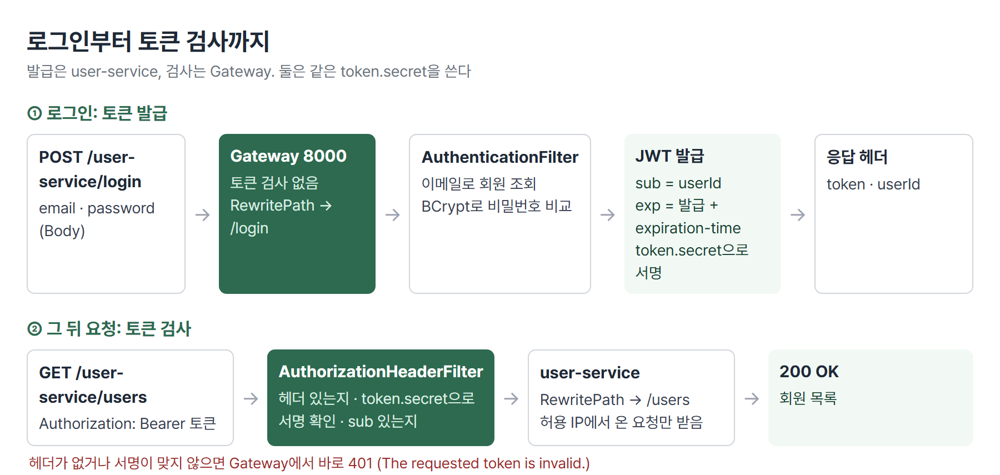

> 💡 토큰을 만드는 쪽(user-service)과 확인하는 쪽(Gateway)이 다르다. 그래서 두 곳이 같은 서명 키를 써야 한다.

### 상황별로 무엇을 쓰나

| 이런 상황이면 | 이것을 쓴다 | 절 |
|---|---|---|
| 이메일 · 비밀번호로 로그인시킨다 | `UsernamePasswordAuthenticationFilter`를 상속한 필터 + `UserDetailsService` | 1 |
| 로그인 상태를 서버 여러 대가 함께 알아야 한다 | 세션 대신 JWT | 2 |
| 토큰이 위조되지 않았는지 확인한다 | 서명 키(`token.secret`)로 서명 검증 | 3 |
| 인증이 필요한 요청만 골라 막는다 | Gateway 라우트 분리 + `AuthorizationHeaderFilter` | 4 |
| 서비스 경로 앞의 `/user-service`를 떼고 넘긴다 | `RewritePath` 필터 | 4 |
| 여러 서비스의 설정 값을 한곳에서 바꾼다 | Spring Cloud Config Server + git 저장소 | 5 |
| 개발 · 운영 환경마다 값을 다르게 둔다 | 프로필 파일(`ecommerce-dev.yml`, `ecommerce-prod.yml`) | 5 |
| 바뀐 설정을 재시작 없이 반영한다 | Actuator `POST /actuator/refresh` | 6 |

## 🧭 오늘의 학습 키워드

| 키워드 | 한 줄 정리 | 오늘 어디에 쓰였나 |
|---|---|---|
| 인증 / 인가 | 누구인지 확인 / 무엇을 해도 되는지 판단 | 1 · 4번 절 |
| `UserDetailsService` | 사용자 이름으로 회원 정보를 찾는 Spring Security 인터페이스 | 1번 절 |
| `AuthenticationFilter` | 로그인 Body를 읽어 인증하고, 성공하면 토큰을 발급 | 1번 절 |
| 세션 | 로그인 상태를 서버 메모리에 두고 세션 ID를 쿠키로 주는 방식 | 2번 절 |
| JWT | 로그인 정보를 담고 서명한 문자열 토큰 | 2 · 3번 절 |
| 페이로드 / 서명 | 토큰 안의 정보(디코딩 가능) / 위조 방지용 값 | 3번 절 |
| Bearer | `Authorization` 헤더에 토큰을 실어 보내는 형식 | 4번 절 |
| `AuthorizationHeaderFilter` | Gateway에서 토큰을 검사하는 직접 만든 필터 | 4번 절 |
| `RewritePath` | 요청 경로를 바꿔서 서비스에 넘기는 Gateway 필터 | 4번 절 |
| Spring Cloud Config | 설정 값을 외부 저장소에서 받아 쓰게 하는 구조 | 5번 절 |
| `@EnableConfigServer` | 이 앱을 Config Server로 만드는 어노테이션 | 5번 절 |
| 프로필 | 환경별 설정 묶음. `-dev` · `-prod` 파일로 구분 | 5번 절 |
| Actuator | 앱 상태 확인 · 관리용 엔드포인트 모음 | 6번 절 |
| `/actuator/refresh` | 바뀐 설정을 다시 읽어 오는 엔드포인트 | 6번 절 |

## ✍️ 공부한 내용

### 1. 로그인 인증 흐름

로그인 요청은 Controller가 아니라 Spring Security 필터가 받는다. `AuthenticationFilter`가 Body를 읽고, 이메일로 회원을 찾고, 비밀번호를 비교한 뒤 성공하면 토큰을 만든다.

| 단계 | 담당 | 하는 일 |
|---|---|---|
| 1 | `attemptAuthentication` | Body(`email` · `password`)를 `RequestLogin`으로 읽어 인증 요청 |
| 2 | `UserServiceImpl.loadUserByUsername` | `findByEmail`로 회원 조회. 없으면 `UsernameNotFoundException` |
| 3 | Spring Security | 입력 비밀번호와 저장된 BCrypt 값 비교 |
| 4 | `successfulAuthentication` | JWT를 만들어 응답 헤더에 담음 |

회원 조회를 Spring Security에 맡기려면 `UserService`가 `UserDetailsService`를 상속하고 `loadUserByUsername`을 구현해야 한다. Security는 이 메서드가 돌려준 `User`(이메일, 저장된 해시)를 받아 비교만 한다.

토큰을 만드는 부분이다. 서명 키는 설정 파일의 `token.secret`에서 읽는다.

```java
String token = Jwts.builder()
        .subject(userDetails.getUserId())
        .expiration(Date.from(now.plusMillis(
                Long.parseLong(environment.getProperty("token.expiration-time")))))
        .issuedAt(Date.from(now))
        .signWith(secretKey)          // Keys.hmacShaKeyFor(token.secret)
        .compact();

res.addHeader("token", token);
res.addHeader("userId", userDetails.getUserId());
```

- 토큰의 주인(`subject`)은 DB 번호가 아니라 `userId`(UUID)다.
- 토큰은 응답 Body가 아니라 헤더에 담긴다. Postman에서는 Headers 탭에서 보인다.

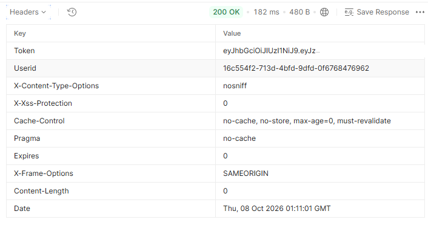

### 2. 세션 대신 토큰

로그인한 상태를 기억하는 방법은 두 가지다. 세션은 서버가 "이 사람은 로그인했다"를 메모리에 적어 두고 사용자에게 번호표(세션 ID 쿠키)만 준다. 토큰은 로그인 정보를 서명해서 사용자에게 통째로 준다. 서버는 아무것도 적어 두지 않고, 요청이 올 때마다 서명만 확인한다.

| | 세션 + 쿠키 | 토큰(JWT) |
|---|---|---|
| 로그인 상태를 두는 곳 | 서버 메모리 | 토큰 안. 서버는 보관하지 않음 |
| 서버가 여러 대일 때 | 세션을 서버끼리 공유하는 장치(공유 세션 저장소)가 필요 | 같은 서명 키만 있으면 어느 서버든 확인 |
| 모바일 앱 | 쿠키가 브라우저 중심이라 직접 관리해야 함 | 헤더에 실어 보내면 됨 |
| 맞는 상황 | 서버 한 대, 브라우저 위주 | 서버가 여럿이거나 서비스가 나뉜 구조 |

서버가 3대로 늘어나면 각 서버의 세션을 공유하는 장치가 필요하다. 서비스까지 나뉜 MSA에서는 세션 방식보다 토큰 방식이 편하다.

### 3. JWT 구조와 서명

JWT는 점(`.`)으로 나뉜 세 부분이다.

| 부분 | 담긴 것 | 누가 읽을 수 있나 |
|---|---|---|
| 헤더 | 서명 알고리즘(HS256 등) | 누구나(Base64URL 디코딩) |
| 페이로드 | `sub`(userId) · `iat`(발급 시각) · `exp`(만료 시각) | 누구나(Base64URL 디코딩) |
| 서명 | 헤더 + 페이로드를 서명 키로 계산한 값 | 서명 키가 있어야 검증 가능 |

로그인 응답의 토큰을 jwt.io에 넣으면 헤더와 페이로드가 바로 읽힌다. 페이로드는 암호화가 아니라 인코딩이라 디코딩만 하면 보인다. 서명 검증은 처음에 실패로 나오고, `token.secret` 값을 넣으면 통과한다.

> 💡 페이로드는 누구나 읽는다. 서명은 "우리 서버가 만들었고 중간에 안 바뀌었다"는 것만 보증한다.

로그인 응답의 토큰을 나눠 디코딩하고, 설정 서버의 `token.secret`과 다른 키로 각각 서명을 검증한 결과다.

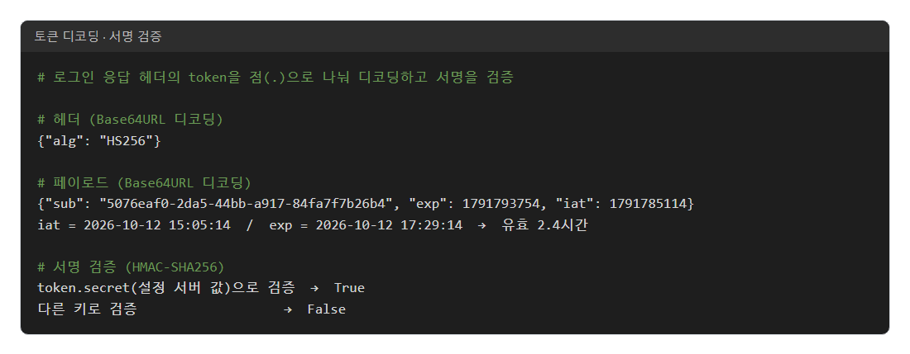

- `exp - iat`가 2.4시간이다. 토큰 유효시간은 user-service의 `token.expiration-time`(86400000, 1일)이 아니라 설정 서버의 `token.expiration_time`(8640000)을 따랐다. 설정 서버 값이 우선이라는 뜻이고, 이 값은 1일이 아니라 2.4시간이다.

그래서 secret을 모르는 사람은 페이로드의 userId를 바꿔도 서명을 다시 맞출 수 없고, Gateway를 통과하지 못한다(401). 같은 이유로 페이로드에는 비밀번호 같은 값을 넣지 않는다.

### 4. Gateway에서 토큰 검사

토큰 검사는 업무 서비스가 아니라 Gateway의 필터 한 곳에서 한다. user-service 라우트를 셋으로 나눠, 토큰이 필요한 요청에만 필터를 건다.

| 라우트 | 조건 | 토큰 검사 |
|---|---|---|
| `user-service-register` | `POST /user-service/users` | 안 함 |
| `user-service-login` | `POST /user-service/login` | 안 함 |
| `user-service` | `GET /user-service/**` | `AuthorizationHeaderFilter` |

회원가입과 로그인은 사용자의 입력을 받아 처리해야 하는 요청이다. 입력을 받기도 전에 토큰 필터를 걸면 순서가 꼬인다. 토큰은 로그인의 결과물이라, 로그인 전에는 낼 토큰이 아예 없다.

```yaml
- id: user-service
  uri: lb://USER-SERVICE
  predicates:
    - Path=/user-service/**
    - Method=GET
  filters:
    - RemoveRequestHeader=Cookie
    - RewritePath=/user-service/(?<segment>.*), /$\{segment}
    - AuthorizationHeaderFilter
```

- `RewritePath`가 `/user-service/users`를 `/users`로 바꿔 넘긴다. 그래서 `UserController`의 `@RequestMapping`이 `/user-service`에서 `/`로 바뀌었다.
- `AuthorizationHeaderFilter`는 ① `Authorization` 헤더가 있는지 ② `Bearer ` 뒤 토큰의 서명이 `token.secret`으로 맞는지 ③ 안에 `sub`가 있는지를 본다. 하나라도 틀리면 서비스까지 가지 않고 401을 돌려준다.

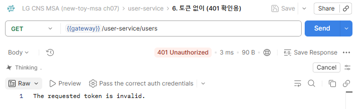

로그인 응답의 토큰을 Authorization(Bearer)에 넣으면 같은 요청이 200이 된다.

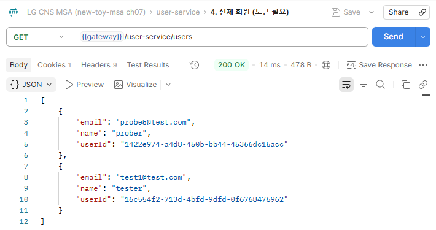

user-service 쪽은 지정한 IP에서 온 요청만 받도록 `WebSecurity`에 `hasIpAddress`를 건다. Gateway가 Eureka에 등록된 IP로 user-service를 부르므로, 그 IP가 허용 목록에 있어야 Gateway 경유 요청이 통과한다.

### 5. Config Server로 설정 모으기

토큰 서명 키, 만료 시간, Gateway IP 같은 값이 서비스마다 `application.yml`에 들어 있으면, 값 하나를 바꿀 때 서비스를 모두 고치고 다시 빌드해야 한다. Config Server는 이 값들을 git 저장소 한곳에 모아 두고, 서비스가 시작할 때 받아 가게 한다.

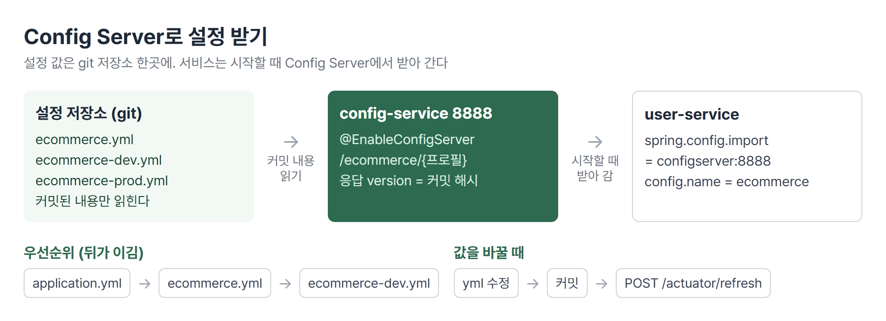

| 구성 | 하는 일 | 핵심 설정 |
|---|---|---|
| 설정 저장소 | `ecommerce.yml` 등 설정 파일을 git으로 관리 | `git init` 후 파일 커밋 |
| config-service(8888) | 저장소의 커밋된 파일을 읽어 HTTP로 내줌 | `@EnableConfigServer`, `git.uri`, `default-label` |
| user-service | 시작할 때 Config Server에서 값을 받음 | `spring.config.import`, `spring.cloud.config.name` |

config-service는 업무 로직 없이 설정만 내주는 서버다.

```yaml
server:
  port: 8888
spring:
  cloud:
    config:
      server:
        git:
          uri: C:\inspire_6th\msa\work\git-local-repo
          default-label: main
```

user-service에는 `spring-cloud-starter-config` 의존성과 아래 설정이 들어간다. `config.name`이 `ecommerce`라서 자기 이름(user-service)이 아니라 `ecommerce.yml`을 받는다. 여러 서비스가 같은 파일을 나눠 쓰는 구조다.

```yaml
spring:
  config:
    import: optional:configserver:http://localhost:8888
  cloud:
    config:
      name: ecommerce
```

`spring-cloud-starter-bootstrap`을 함께 쓰면 `bootstrap.yml`에도 같은 정보를 둔다. 시작할 때는 위 설정으로 받지만, 6번 절의 refresh는 bootstrap 단계에서 설정을 다시 읽는다. 그 단계는 `application.yml`을 보지 않아서 `name: ecommerce`를 모른다(🔧 참조).

```yaml
# bootstrap.yml
spring:
  cloud:
    config:
      uri: http://127.0.0.1:8888
      name: ecommerce
```

user-service의 health-check는 설정 값을 찍는다. secret과 만료 시간이 user-service 자기 yml 값이 아니라 설정 서버 값으로 나온다.

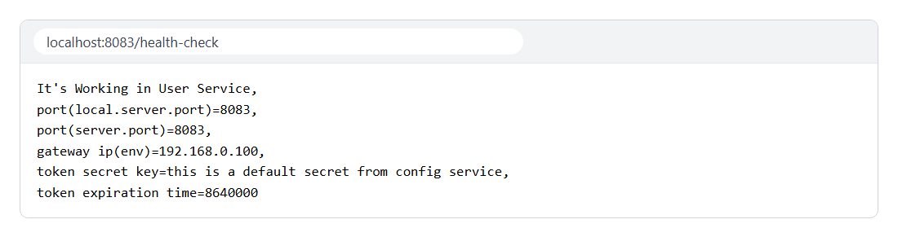

브라우저로 `http://localhost:8888/ecommerce/default`를 열면 Config Server가 내주는 값이 JSON으로 보인다.

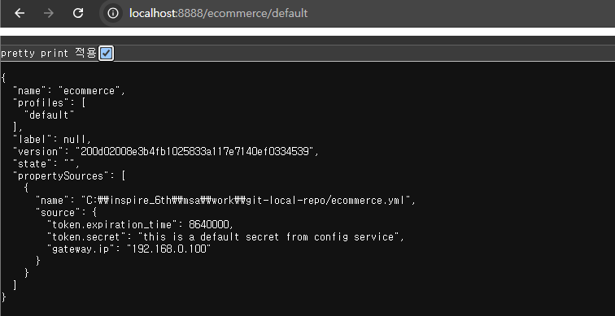

- `version`은 설정 저장소의 커밋 해시다. 파일을 고쳐도 커밋하지 않으면 바뀌지 않는다.
- 주소 끝을 프로필로 바꾸면(`/ecommerce/dev`) 프로필 파일과 기본 파일이 함께 나온다.

| 주소 | 나오는 파일(위가 우선) |
|---|---|
| `/ecommerce/default` | `ecommerce.yml` |
| `/ecommerce/dev` | `ecommerce-dev.yml` → `ecommerce.yml` |
| `/ecommerce/prod` | `ecommerce-prod.yml` → `ecommerce.yml` |

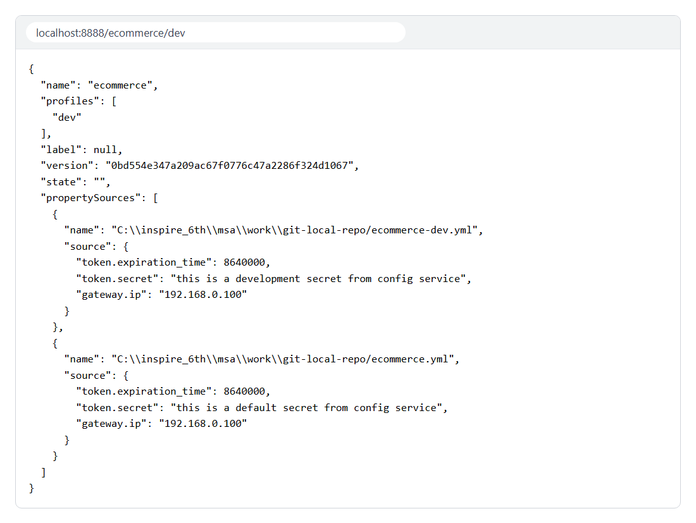

같은 키가 여러 곳에 있으면 `application.yml`(서비스 안) → `ecommerce.yml` → `ecommerce-<프로필>.yml` 순으로 뒤에 오는 값이 이긴다.

### 6. Actuator와 refresh

Actuator는 앱의 상태와 내부 정보를 HTTP로 보여 주는 엔드포인트 모음이다. 기본으로는 일부만 열려 있어서 쓸 것을 지정한다.

```yaml
management:
  endpoints:
    web:
      exposure:
        include:
          - refresh
          - health
          - beans
          - info
```

- `/actuator/health`는 상태(UP), `/actuator/beans`는 등록된 빈 목록을 보여 준다.

`/actuator/beans`에는 빈마다 어떤 빈을 주입받는지(`dependencies`)가 나온다. user-service에는 빈이 492개 있고, 그중 직접 만든 4개를 뽑으면 Controller → Service → Repository 주입 관계가 그대로 보인다.

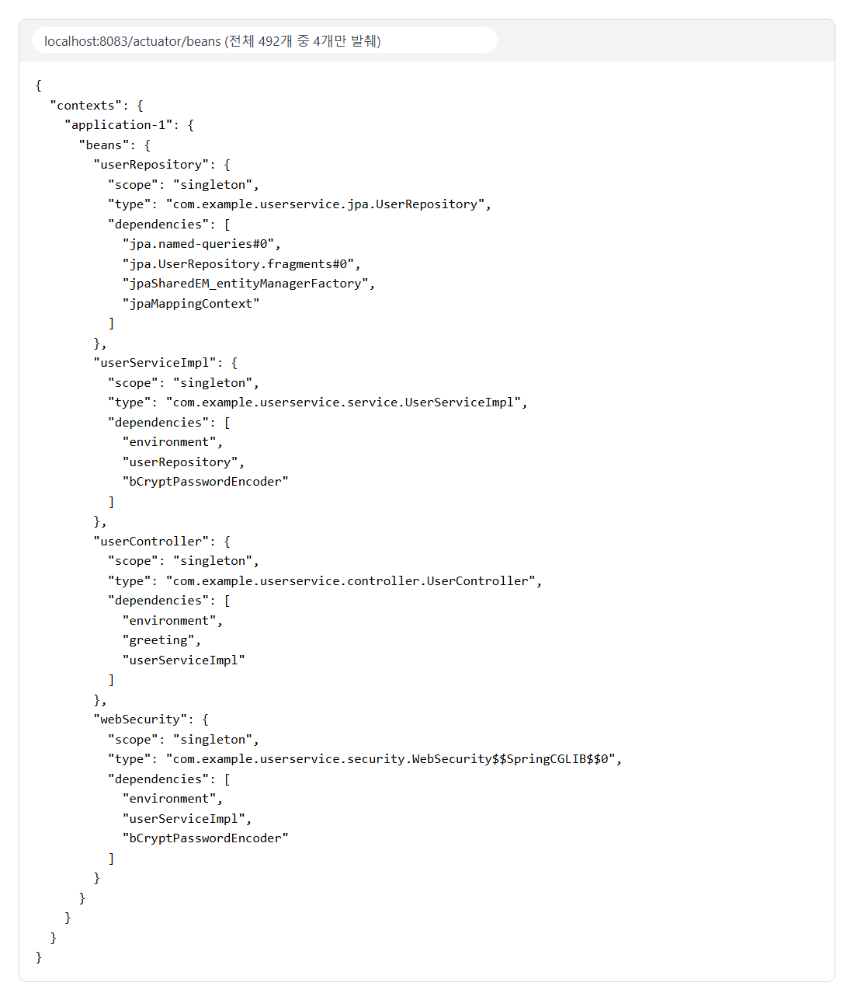

설정 저장소의 값을 고치고 커밋한 뒤 `POST /actuator/refresh`를 부르면 서비스를 재시작하지 않고 새 값을 읽는다. 응답은 바뀐 키 목록이다. `gateway.ip`로 확인한 결과다.

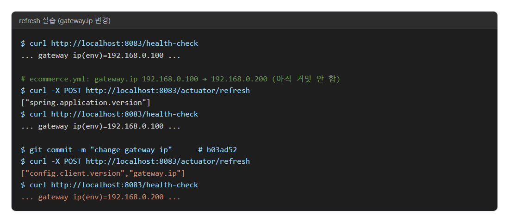

- 커밋 전에 부른 refresh는 `gateway.ip`가 목록에 없고 값도 그대로다.
- 커밋 후 refresh는 목록에 `gateway.ip`가 들어 있고 health-check 값이 바로 바뀐다.

서비스가 수십 · 수백 개면 서비스마다 refresh를 따로 불러야 한다. 이것을 한 번에 처리하는 방법이 Spring Cloud Bus다.

## 🧩 이어지는 내용

- 4일차의 회원가입(비밀번호 BCrypt 저장)이 로그인 비교로, 3일차의 Gateway 필터 구조가 토큰 검사 필터로 이어졌다.
- 서비스 경로를 Gateway와 맞추던 `@RequestMapping("/user-service")`는 `RewritePath`가 들어오면서 `/`로 바뀌었다.
- 교안의 다음 순서는 Section 9 Spring Cloud Bus다.
- 2차 사후평가는 10/29, 미니 프로젝트 2는 10/30에 시작한다.

## ❓ 몰랐던 것

### 로그인 때 비밀번호는 어떻게 비교하나

복호화하지 않는다는 점은 맞다. 다만 비교 수단이 토큰은 아니다. 토큰은 비교가 끝난 뒤에 발급된다.

BCrypt 값에는 해시할 때 섞은 Salt가 들어 있다(`$2a$10$` 뒤 22글자). 로그인 때 Spring Security는 저장값에서 이 Salt를 꺼내 입력한 비밀번호를 같은 방식으로 해시하고, 그 결과가 저장값과 같은지 본다(`BCryptPasswordEncoder.matches`). 원래 비밀번호로 되돌리는 단계는 어디에도 없다.

### 세션과 토큰은 정확히 무엇인가

**세션**은 서버가 만든 로그인 기록이다. 로그인하면 서버가 메모리에 `세션 ID → 사용자 정보`를 적고, 브라우저에는 세션 ID만 쿠키로 준다. 다음 요청 때 쿠키의 세션 ID로 기록을 찾는다. 기록이 서버 안에 있으니 그 서버만 사용자를 안다.

**토큰(JWT)**은 사용자 정보를 담고 서명한 문자열이다. 서버는 기록을 남기지 않고 토큰을 통째로 준다. 다음 요청 때 토큰의 서명만 확인하면 되므로, 서명 키를 가진 서버라면 어디서든 확인할 수 있다. 대신 서버가 기록을 갖고 있지 않아서, 발급한 토큰을 만료 전에 강제로 무효화하기 어렵다.

### Config Server와 user-service는 무엇이 다른가

user-service는 회원가입 · 조회 같은 업무를 처리하는 서비스다. config-service는 업무 없이 설정 파일만 읽어서 내주는 서비스다. user-service는 시작할 때 config-service(8888)에 "ecommerce 설정을 달라"고 요청하고, 받은 값을 자기 설정 위에 얹어 쓴다. 둘 다 Spring Boot 앱이지만 역할이 다르고, config-service가 꺼져 있으면 `optional:` 덕분에 user-service는 자기 `application.yml` 값만으로 뜬다.

### token.secret은 누가 만들고 어디에 두나

발급해 주는 곳이 따로 있지 않다. 개발자 · 운영자가 정한 임의의 긴 문자열이다. HS256 같은 HMAC 서명은 키가 충분히 길어야 해서 짧은 문자열은 쓸 수 없다.

두는 곳은 토큰을 만드는 쪽(user-service)과 확인하는 쪽(Gateway)이 같은 값을 읽을 수 있는 곳이어야 한다. 서비스마다 yml에 따로 적으면 바꿀 때 두 곳을 다 고쳐야 하고 하나만 고치면 토큰 검사가 전부 실패한다. Config Server에 두면 한곳만 고치면 된다. 이것이 secret을 Config Server 쪽에 두는 이유다. 실무에서는 이런 비밀 값을 암호화하거나 별도 비밀 저장소(Vault 등)에 둔다.

### refresh를 불렀는데 값이 안 바뀔 때

refresh를 부르는 것은 맞다. 그런데 refresh는 Config Server가 지금 내주는 값을 다시 받아 오는 것뿐이다. Config Server는 설정 저장소의 커밋된 내용을 읽으므로, 파일을 고치고 커밋하지 않았으면 Config Server가 내주는 값 자체가 그대로다. 그래서 먼저 확인할 것은 커밋이다. `localhost:8888/ecommerce/default`의 `version`이 새 커밋 해시로 바뀌었는지 보면 된다. 커밋을 했는데도 안 바뀌면 refresh가 엉뚱한 설정 이름으로 요청하고 있는지 본다(🔧).

## 🔧 트러블슈팅

### refresh를 불러도 값이 안 바뀜

- **문제**: `ecommerce.yml`의 `gateway.ip`를 고쳐 커밋하고 `POST /actuator/refresh`를 불렀다. 응답은 `["config.client.version"]`뿐이고 health-check 값이 그대로였다. 설정 서버(`/ecommerce/default`)는 새 값을 내주고 있었다
- **가설 1**: `spring.config.import`와 bootstrap 두 방식으로 설정을 이중으로 받아서, refresh가 한쪽만 고친다. `spring.config.import`를 끈 인스턴스도 값이 안 바뀌어 이 가설은 틀렸다
- **원인**: user-service 로그에서 갈렸다. 시작할 때는 `Located environment: name=ecommerce`, refresh 때는 `name=application`이었다. refresh는 bootstrap 단계에서 설정을 다시 받는데, `spring.cloud.config.name: ecommerce`가 `application.yml`에만 있어서 그 단계에서는 보이지 않았다. 그래서 `ecommerce.yml`이 아니라 없는 `application` 설정을 요청했다
- **해결**: `bootstrap.yml`에 `spring.cloud.config.uri` · `name: ecommerce`를 둔다. 이후 refresh 응답에 `gateway.ip`가 들어가고 값이 바뀌었다(6번 절 캡처)
- **재발 방지**: refresh 결과가 이상하면 응답의 바뀐 키 목록과 로그의 `Located environment: name=`부터 본다

## 📌 다음에 해볼 것

- [ ] `ecommerce.yml`의 `token.secret`을 바꿔 커밋하고 `POST /actuator/refresh` 뒤 health-check에서 새 값이 나오는지 확인하기
- [ ] 로그인 토큰을 jwt.io에 넣어 페이로드를 읽고, `token.secret`을 넣었을 때와 안 넣었을 때 서명 결과 비교하기
- [ ] `ecommerce.yml`의 `token.expiration_time`(8640000, 2.4시간)과 주석(`1day`) 중 무엇이 맞는지 정해 하나로 맞추기
- [ ] user-service에 `spring.profiles.active: dev`를 넣고 health-check의 secret이 dev 값으로 바뀌는지 보기

## 🔍 더 짚어둘 것

### 1. 미니 프로젝트: 토큰을 만드는 곳과 확인하는 곳이 갈릴 때

1차 미니 프로젝트(ReCu)는 Google 로그인 뒤 서버가 JWT를 응답 헤더로 주는 방식이었고, 토큰 발급과 검사를 서버 하나가 다 했다. 서명 키도 그 서버 설정 한곳에만 있으면 됐다.

MSA로 나누면 발급(회원 서비스)과 검사(Gateway)가 다른 앱이 된다. 2차 준비 기준에 이미 있는 것과 새로 정할 것이 갈린다.

- **검사 위치(기준에 있음)**: 토큰 검사는 Gateway에서 한 번만 한다. 업무 서비스는 Gateway가 넘겨준 사용자 식별 헤더를 믿고 쓴다.
- **서명 키(새로 정할 것)**: 발급 쪽과 검사 쪽이 같은 키를 써야 하므로 Config Server 한곳에 두는 안이 맞다. 서비스별 yml에 따로 두면 하나만 바뀌어도 모든 요청이 401이 된다.
- **인증 없이 여는 경로(기준에 있음)**: 회원가입 · 로그인처럼 토큰이 생기기 전 요청은 목록으로 정해 두고, 목록에 없는 경로는 전부 토큰을 요구한다.

### 2. AI: 바이브코딩할 때 사람이 확인할 것

- **키 위치**: 생성된 코드에 서명 키 문자열이 그대로 박혀 있지 않은지 본다. 코드에 있으면 저장소에 올라가는 순간 노출된다.
- **발급 · 검사 키 일치**: 발급 쪽과 검사 쪽이 같은 설정 키 이름에서 같은 값을 읽는지 본다. 값이 달라도 컴파일은 되고, 실행해서 401이 나야 드러난다.
- **페이로드 내용**: 토큰에 이메일 · 권한 외에 비밀번호나 개인정보를 넣지 않았는지 본다. 페이로드는 누구나 디코딩한다.
- **설정 반영 순서**: 설정을 바꿨다는 답을 받으면 커밋 → Config Server 응답의 `version` → refresh 순서로 실제 반영을 확인한다.

### 3. SAP ERP: 환경별 설정을 나누는 방식

SAP 시스템도 개발(DEV) · 품질(QAS) · 운영(PRD)을 나누고, 개발에서 만든 변경을 Transport로 다음 시스템에 옮긴다. Config Server는 같은 저장소 안에서 환경별 파일(`-dev` · `-prod`)로 값을 나눈다. 환경마다 다른 설정을 섞이지 않게 관리한다는 목적은 같고, SAP는 시스템을 나눠 변경을 옮기는 방식, Config Server는 파일을 나눠 값을 고르는 방식이다.

태그: LG CNS 6기, 개발자, LGCNSINSPIRECAMP
