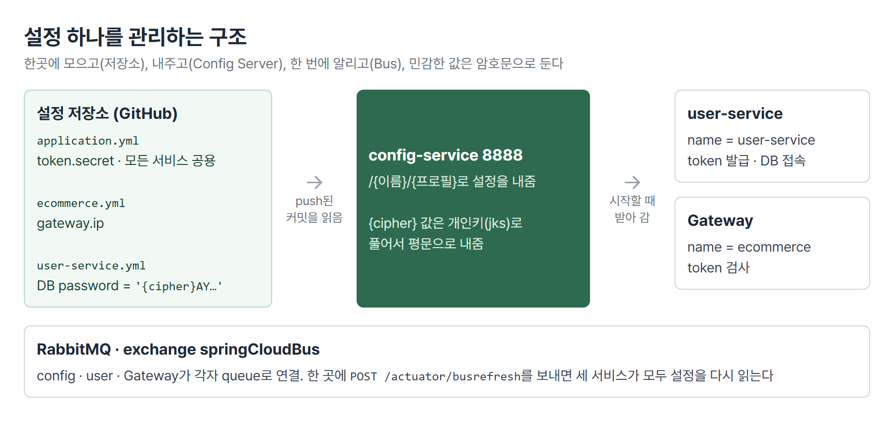
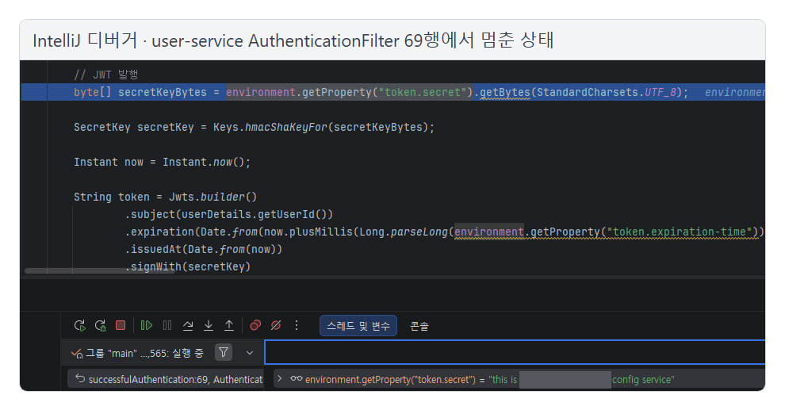
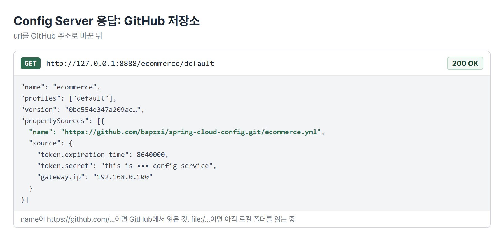
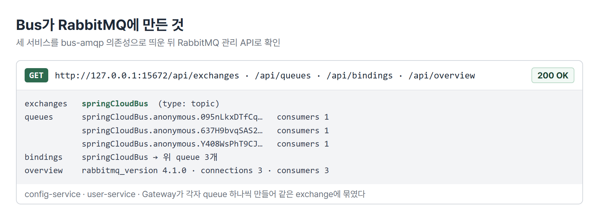
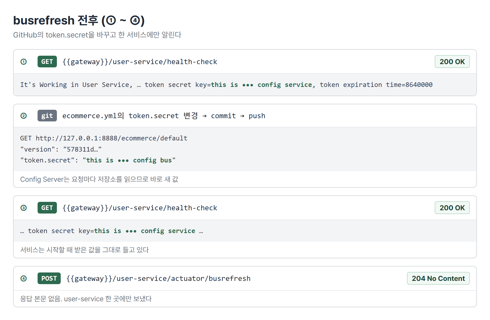
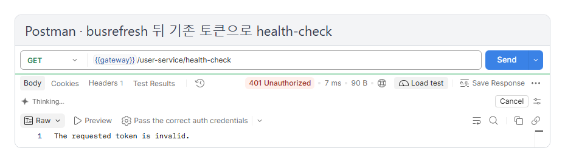
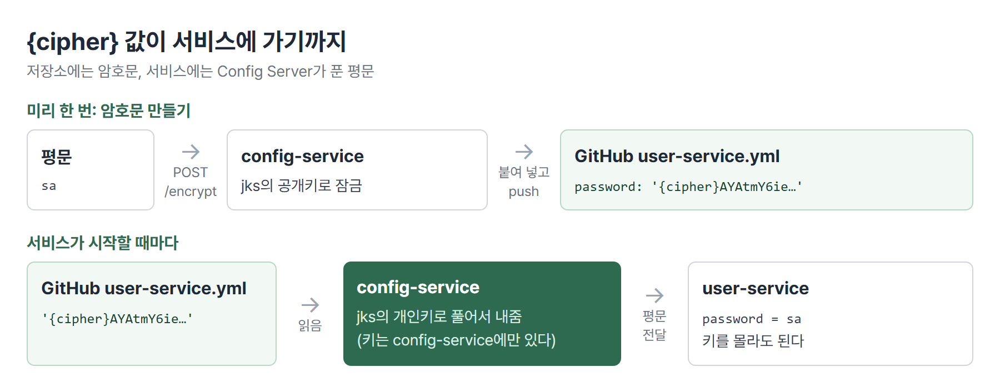
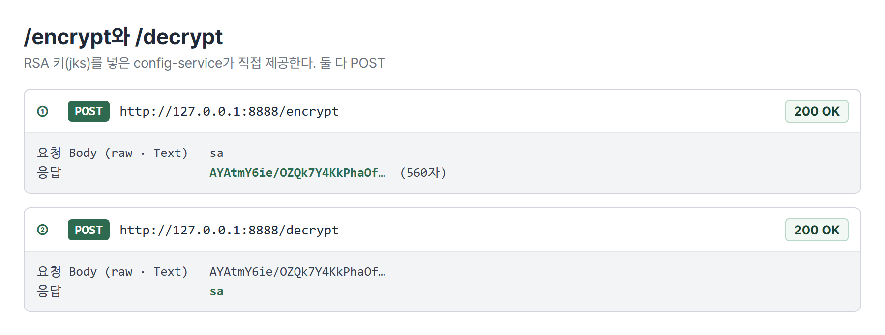
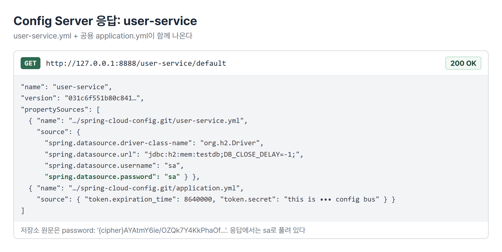

# <LG CNS 6기] MSA 6일차 TIL · Spring Cloud Bus와 설정 암호화

> TL;DR: Config Server의 설정 저장소를 GitHub로 옮기고 바뀐 설정은 RabbitMQ를 거치는 Spring Cloud Bus로 모든 서비스에 한 번에 알린다. DB 비밀번호 같은 값은 저장소에 `{cipher}` 암호문으로 두고 Config Server가 RSA 개인키로 풀어서 서비스에 내준다.

## 🗺️ 한눈에 보기

### 오늘은 무엇을 위한 작업이었나

설정 값 하나를 관리하는 구조를 끝까지 세웠다. 5일차(10/8)에 서비스마다 흩어진 설정을 Config Server 한곳으로 모았다면, 오늘은 그 저장소를 GitHub로 옮겼다. 바뀐 값은 한 번에 퍼뜨리고 민감한 값은 암호문으로 바꿔 두었다.



> 💡 서비스는 설정 값과 복호화 키를 직접 갖지 않는다. 둘 다 config-service가 쥔다. 값이 바뀌었다는 알림은 RabbitMQ를 거쳐 모든 서비스에 간다.

### 상황별로 무엇을 쓰나

| 이런 상황이면 | 이것을 쓴다 | 절 |
|---|---|---|
| 발급 · 검사 두 서비스가 같은 설정 값을 받았는지 확인한다 | 브레이크포인트 + Evaluate로 `env.getProperty(...)` 읽기 | 1 |
| 설정 저장소를 여러 서버 · 여러 사람이 함께 본다 | `git.uri`를 GitHub 주소로(Remote Git Repository) | 2 |
| 서비스 여러 개의 설정을 재시작 없이 한 번에 갱신한다 | Spring Cloud Bus + RabbitMQ, `POST /actuator/busrefresh` | 3 · 4 |
| 저장소에 비밀번호를 평문으로 두지 않는다 | `{cipher}` 암호문 + Config Server의 `/encrypt` | 5 |
| 키 하나를 여럿이 나눠 갖지 않게 한다 | RSA 키 쌍(jks) + `encrypt.key-store` | 6 |

## 🧭 오늘의 학습 키워드

| 키워드 | 한 줄 정리 | 오늘 어디에 쓰였나 |
|---|---|---|
| Evaluate | 디버거에서 멈춘 시점의 식을 바로 계산해 보는 창 | 1번 절 |
| Remote Git Repository | Config Server가 GitHub 저장소에서 설정을 읽는 방식 | 2번 절 |
| `version` | Config Server 응답에 찍히는 저장소 커밋 해시 | 2 · 4번 절 |
| 메시지 브로커 | 서비스 사이에서 메시지를 받아 전달하는 중간 서버 | 3번 절 |
| AMQP | 메시지 브로커용 표준 프로토콜. RabbitMQ가 쓴다 | 3번 절 |
| RabbitMQ | AMQP 메시지 브로커. 5672(서비스 연결) · 15672(관리 화면) | 3번 절 |
| Spring Cloud Bus | 서비스들을 브로커로 묶어 설정 변경 같은 이벤트를 전파 | 3 · 4번 절 |
| exchange / queue | 메시지를 받는 곳 / 서비스마다 메시지를 쌓아 두는 곳 | 3번 절 |
| `/actuator/busrefresh` | 한 서비스에 보내면 Bus로 연결된 전 서비스가 설정을 다시 읽음 | 4번 절 |
| `{cipher}` | 이 값은 암호문이니 풀어서 내보내라는 표시 | 5번 절 |
| `/encrypt` · `/decrypt` | Config Server가 제공하는 암호화 · 복호화 엔드포인트(POST) | 5번 절 |
| 대칭키 / 비대칭키 | 키 하나로 잠그고 풂 / 공개키로 잠그고 개인키로 풂 | 5 · 6번 절 |
| keytool | JDK에 들어 있는 키 · 인증서 생성 도구 | 6번 절 |
| jks(키 저장소) | 키 쌍과 인증서를 담은 파일. 비밀번호와 alias로 꺼낸다 | 6번 절 |

## ✍️ 공부한 내용

### 1. 발급과 검사가 같은 키를 받는지 확인

토큰은 user-service가 만들고 Gateway가 확인한다. 두 서비스가 각자 Config Server에서 `token.secret`을 받으므로, 둘이 정말 같은 값을 들고 있는지 실행 중에 멈춰 세워 확인했다.

| 서비스 | 멈춘 곳 | 하는 일 |
|---|---|---|
| user-service | `AuthenticationFilter.successfulAuthentication` 69행 | 로그인 성공 뒤 토큰 서명 |
| Gateway | `AuthorizationHeaderFilter` 73행 | 요청 토큰의 서명 검증 |

회원가입 → 로그인(user-service에서 멈춤) → 토큰을 붙여 GET(Gateway에서 멈춤) 순서로 부르고 멈춘 화면에서 식을 드래그해 Evaluate 창에 넣으면 값이 바로 나온다. 두 곳 모두 Config Server가 내준 같은 문자열이었다.



- 멈춰 있는 동안 Postman은 응답을 기다리며 계속 로딩 중으로 보인다. F9(Resume)를 눌러야 응답이 온다.

secret이 서로 다르면 토큰이 허용되지 않는다. user-service가 A 키로 서명한 토큰을 Gateway가 B 키로 검증하면 서명이 맞지 않아, 정상 로그인으로 받은 토큰도 401 `The requested token is invalid.`가 된다.

### 2. 설정 저장소를 GitHub로

5일차에는 Config Server가 내 PC의 git 폴더를 읽었다. 그 상태로는 서버를 다른 곳에서 띄우거나 다른 사람이 설정을 고칠 수 없어서, 저장소를 GitHub에 올리고 `uri`만 바꿨다.

| 방식 | `git.uri` | 맞는 상황 |
|---|---|---|
| Local Git | `file:///C:/.../git-local-repo` | 혼자 시험할 때 |
| Remote Git | `https://github.com/<계정>/spring-cloud-config.git` | 여러 서버 · 여러 사람이 같은 설정을 볼 때 |

```yaml
spring:
  cloud:
    config:
      server:
        git:
          uri: https://github.com/bapzzi/spring-cloud-config.git
#          username: [username]   # 비공개 저장소면 계정 · 토큰
#          password: [password]
          default-label: main
```



- 응답 `propertySources`의 `name`이 `https://github.com/...`이면 GitHub에서 읽은 것이다. `file:`로 뜨면 GitHub가 아니라 로컬에 저장소가 있는 상태라, Remote Git으로 바꾼 설정이 아직 적용되지 않은 것이다.
- `version`은 GitHub의 커밋 해시다. 파일을 고치고 커밋만 하고 push하지 않으면 값이 바뀌지 않는다.

### 3. Spring Cloud Bus와 RabbitMQ

5일차의 refresh는 서비스마다 `/actuator/refresh`를 따로 불러야 했다. 서비스가 수십 개면 수십 번이다. Bus는 서비스들을 메시지 브로커 하나에 연결해 두고 한 곳에서 "설정이 바뀌었다"는 메시지를 올리면 브로커가 연결된 모든 서비스에 전달하게 한다.

| 방식 | 부르는 곳 | 맞는 상황 |
|---|---|---|
| refresh | 서비스마다 `POST /actuator/refresh` | 서비스가 한두 개 |
| busrefresh | 아무 서비스 한 곳 `POST /actuator/busrefresh` | 서비스가 여럿이고 같은 설정을 나눠 씀 |

- **왜 나왔나**: 설정은 한곳에 모았는데 갱신 신호는 여전히 서비스마다 보내야 했다.
- **안 그러면 뭐가 되나**: 한 서비스만 refresh를 빠뜨리면 그 서비스만 옛 값으로 돈다. 에러 없이 일부 요청만 틀리게 처리된다.
- **대가는 뭔가**: 브로커라는 실행 요소가 하나 늘어난다. 실습에서도 RabbitMQ 컨테이너를 먼저 띄워야 했다.

메시지 브로커로는 RabbitMQ를 Docker로 띄웠다. AMQP라는 표준 프로토콜을 쓰는 브로커다. 대용량 분산 스트리밍용인 Kafka는 뒤 섹션에서 쓴다.

```
docker run -it -d --rm --name rabbitmq -p 5672:5672 -p 15672:15672 rabbitmq:4.1.0-management
```

- 5672는 서비스들이 붙는 포트, 15672는 관리 화면이다. 기본 계정은 `guest`다.
- 버전은 `4.1.0`으로 고정했다. 최신 태그로 받으면 실습이 제대로 동작하지 않는다.
- `--rm`이라 컨테이너를 멈추면 지워진다. 다시 쓸 때 같은 명령을 한 번 더 실행한다.

세 서비스에 Bus 의존성과 브로커 접속 정보를 넣는다.

| 서비스 | pom | yml |
|---|---|---|
| config-service | `spring-cloud-starter-bus-amqp`, `spring-boot-starter-actuator` | `spring.rabbitmq`, 노출 `health` · `busrefresh` |
| user-service | `spring-cloud-starter-bus-amqp` | `spring.rabbitmq`, 노출에 `busrefresh` 추가 |
| Gateway | `spring-cloud-starter-bus-amqp` | `spring.rabbitmq`, 노출에 `busrefresh` 추가, 라우트 `/user-service/actuator/**` |

```yaml
spring:
  rabbitmq:
    host: 127.0.0.1
    port: 5672
    username: guest
    password: <브로커 비밀번호>
```

- Spring Cloud 2020.0.0부터 엔드포인트 이름이 `bus-refresh`에서 `busrefresh`로 바뀌었다. 옛 자료의 하이픈 이름은 동작하지 않는다.
- Gateway에는 user-service의 actuator로 가는 라우트를 토큰 검사 없이 따로 둔다. 기존 `GET /user-service/**` 라우트에는 토큰 필터가 걸려 있고 POST도 받지 않기 때문이다.

세 서비스를 띄운 뒤 RabbitMQ 관리 API를 보면 Bus가 만든 exchange 하나에 서비스마다 queue가 하나씩 묶여 있다.



### 4. busrefresh로 한 번에 갱신

GitHub의 `token.secret`을 바꾸고 user-service 한 곳에만 busrefresh를 보내서 Gateway까지 바뀌는지 확인했다. 시작 순서는 RabbitMQ → config-service → Eureka → Gateway → user-service다.



- ②에서 Config Server는 바로 새 값을 내준다. 요청이 올 때마다 저장소를 읽기 때문이다.
- ③에서 user-service는 아직 옛 값이다. 서비스는 시작할 때(또는 refresh 때) 받은 값을 들고 있다.

busrefresh 뒤 아까 받은 토큰으로 다시 부르면 401이 난다.



다시 로그인해 새 토큰을 받으면 통과하고 health-check에 새 secret이 찍힌다.

```
POST {{gateway}}/user-service/login           → 200, 헤더 token 새로 발급
GET  {{gateway}}/user-service/health-check    → 200, … token secret key=this is ••• config bus …
```

> 💡 busrefresh는 user-service에만 보냈다. 그런데 토큰을 검사하는 Gateway가 기존 토큰을 거절했다. Gateway의 secret도 바뀌었다는 뜻이고 Bus가 RabbitMQ를 거쳐 Gateway에도 갱신 신호를 전달했다는 증거다.

### 5. 설정 암호화: `{cipher}`

저장소를 GitHub로 옮기면 저장소를 볼 수 있는 사람은 DB 비밀번호 같은 값도 그대로 본다. 커밋 이력에도 남는다. 그래서 저장소에는 암호문을 두고 Config Server가 서비스에 내줄 때 풀어서 준다.



- **왜 나왔나**: 설정 저장소가 여러 사람이 보는 곳이 되었다.
- **안 그러면 뭐가 되나**: 비밀번호가 평문으로 커밋 이력에 남고 나중에 파일을 고쳐도 이력에서는 지워지지 않는다.
- **대가는 뭔가**: config-service가 키를 쥐고 있어야 한다. 그리고 Config Server 응답(`/user-service/default`)에는 평문이 그대로 나온다. 8888 포트를 부를 수 있는 사람은 풀린 값을 본다(아래 응답 캡처).

config-service에 키를 넣으려면 `spring-cloud-starter-bootstrap` 의존성과 `bootstrap.yml`이 필요하다. 의존성이 없으면 `bootstrap.yml`을 읽지 않아서 `/encrypt`가 500을 낸다. 처음에는 대칭키(`encrypt.key`)로 시작했다.

```yaml
# config-service bootstrap.yml (대칭키 단계)
encrypt:
  key: <임의의 긴 문자열>
```

키가 들어가면 config-service가 `/encrypt`와 `/decrypt`를 직접 제공한다. 둘 다 POST이고 Body는 raw · Text다. 아래 값은 6번 절의 RSA 키를 넣은 뒤 만든 것이다.



받은 암호문을 설정 저장소에 붙인다. user-service의 `application.yml`에 있던 datasource를 주석 처리하고 저장소에 `user-service.yml`을 새로 만든다.

```yaml
# 설정 저장소 user-service.yml
spring:
  datasource:
    driver-class-name: org.h2.Driver
    url: jdbc:h2:mem:testdb;DB_CLOSE_DELAY=-1;
    username: sa
    password: '{cipher}AYAtmY6ie…'
```

- 작은따옴표 안에 `{cipher}`와 암호문을 붙여 쓴다.
- user-service `bootstrap.yml`의 `spring.cloud.config.name`을 `ecommerce`에서 `user-service`로 바꾼다. 그러면 user-service는 `ecommerce.yml`을 더 이상 읽지 않는다. 그래서 token 설정을 모든 서비스가 함께 읽는 `application.yml`로 옮기고 `ecommerce.yml`의 token은 주석 처리했다. Gateway는 여전히 `ecommerce.yml` + `application.yml`을 읽으므로 같은 secret을 받는다.



- 저장소 원문은 암호문인데 응답의 `spring.datasource.password`는 `sa`다. Config Server가 풀어서 내준 것이다.
- `sa`는 H2 메모리 DB의 실습 기본 계정이라 그대로 두었다. 실제 운영 비밀번호였다면 이 응답 화면도 외부에 보이면 안 된다.

### 6. 비대칭키(RSA)와 keytool

대칭키는 잠그는 키와 푸는 키가 같다. 키 문자열 하나만 알면 누구나 암호문을 만들고 풀 수 있다. 비대칭키는 공개키로 잠그고 개인키로 푼다.

| | 대칭키 | 비대칭키(RSA) |
|---|---|---|
| 키 | 하나를 공유 | 공개키 · 개인키 한 쌍 |
| config-service 설정 | `encrypt.key: <문자열>` | `encrypt.key-store`(jks 경로 · 비밀번호 · alias) |
| 암호문 모양 | 짧은 16진수 | `AY…`로 시작하는 긴 Base64 |
| 맞는 상황 | 실습 · 단순 구성 | 키를 아는 사람과 곳을 줄여야 할 때 |

키 쌍은 JDK의 keytool로 만든다.

```
keytool -genkeypair -alias apiEncryptionKey -keyalg RSA \
  -dname "CN=..., OU=API Development, O=..., L=Seoul, C=KR" \
  -keypass "<키 비밀번호>" -keystore apiEncryptionKey.jks -storepass "<저장소 비밀번호>"
keytool -list -keystore apiEncryptionKey.jks -v
```

- 3,072비트 RSA 키 쌍과 자체 서명 인증서(유효 90일)가 만들어졌다. 항목 유형은 `PrivateKeyEntry`다.

config-service `bootstrap.yml`의 `encrypt.key`를 주석 처리하고 key-store를 넣는다.

```yaml
encrypt:
#  key: <임의의 긴 문자열>
  key-store:
    location: file:///C:/inspire_6th/msa/keystore/apiEncryptionKey.jks
    password: <저장소 비밀번호>
    alias: apiEncryptionKey
```

- `location`은 `file:///` 형식으로 쓴다. Windows 경로(`C:\...`)를 그대로 쓰면 파일을 찾지 못한다.
- 키를 바꾸면 이전 키로 만든 암호문은 풀리지 않는다. `/encrypt`로 다시 만들어 저장소의 값을 바꾼다.

## 🧩 이어지는 내용

- 5일차(10/8) Config Server와 `/actuator/refresh`가 오늘 Bus의 출발점이다. 그때 refresh를 서비스마다 불러야 했던 한계를 Bus가 풀었다.
- 교안 Section 10의 마지막 장은 token.secret까지 `{cipher}`로 바꾸고 Gateway에서 풀린 값을 확인하는 내용이다.
- 교안 목차상 다음은 Section 11 마이크로서비스 간 통신, Section 12 · 13은 Kafka를 이용한 데이터 동기화다.
- 2차 사후평가는 10/29, 미니 프로젝트 2는 10/30에 시작한다.

## ❓ 몰랐던 것

### busrefresh를 불렀는데 값이 그대로일 때 먼저 볼 것

저장이 제대로 됐는지 보는 방향은 맞다. 다만 여기서 "저장"은 파일 저장이 아니라 GitHub에 push까지 된 커밋이다. Config Server는 GitHub에 올라간 커밋만 읽기 때문에, 로컬에서 커밋만 하고 push하지 않았으면 Config Server가 내주는 값 자체가 그대로다. 확인 방법은 `/ecommerce/default` 응답의 `version`이 새 커밋 해시인지 보는 것이다.

재기동 확인은 방향이 반대다. Bus를 쓰는 이유가 재기동 없이 바꾸려는 것이다. 재기동이 필요한 경우는 서비스가 Config Server보다 먼저 떠서 처음부터 값을 못 받은 때처럼, 시작 순서가 꼬였을 때다.

### busrefresh를 user-service에만 보냈는데 Gateway가 바뀐 이유

busrefresh를 받은 user-service는 자기 설정을 다시 읽은 뒤 RabbitMQ의 `springCloudBus` exchange에 "설정이 바뀌었다"는 이벤트를 올린다. exchange는 묶여 있는 queue 전부에 이 이벤트를 넣는다. 각 queue를 듣고 있던 Gateway와 config-service도 이 이벤트를 받아 설정을 다시 읽는다. 그래서 Gateway가 새 secret으로 바뀌었다. 옛 secret으로 서명된 기존 토큰은 서명이 맞지 않아 401이 됐다.

### `{cipher}` 값은 누가 풀고 서비스는 무엇을 받나

푸는 쪽은 config-service다. 서비스가 설정을 달라고 하면 config-service가 저장소에서 `{cipher}`가 붙은 값을 찾아 자기 키로 풀고 평문으로 바꿔 응답에 담는다. user-service가 받는 값은 `sa` 같은 평문이고 user-service는 키를 갖고 있지 않아도 된다. 키는 config-service 한곳에만 있다.

### 다른 사람의 암호문을 복사하면 안 풀리는 이유

비대칭이라서가 아니라 키가 사람마다 다르기 때문이다. 각자 keytool로 키 쌍을 새로 만들었으므로, 강사님 공개키로 잠근 암호문은 강사님 개인키로만 풀린다. 내 config-service는 내 개인키를 갖고 있어서 그 값을 풀지 못한다. 대칭키도 같다. 키 문자열이 다르면 풀리지 않는다. 그래서 암호문은 각자 자기 config-service의 `/encrypt`로 만들어야 한다.

## 📌 다음에 해볼 것

- [ ] 저장소의 암호문 끝을 일부러 망가뜨려 push하고 `/user-service/default`에 `invalid.spring.datasource.password: <n/a>`가 뜨는지 확인하기
- [ ] busrefresh를 user-service가 아니라 Gateway 자신(`{{gateway}}/actuator/busrefresh`)에 보내도 user-service까지 바뀌는지 확인하기
- [ ] RabbitMQ 컨테이너를 멈춘 상태에서 busrefresh를 부르면 어떻게 되는지 보기
- [ ] token.secret도 `{cipher}`로 바꾸고 Gateway 디버거에서 풀린 값이 들어오는지 확인하기(교안 Section 10 마지막 장)

## 🔍 더 짚어둘 것

### 1. 미니 프로젝트: 설정 저장소와 갱신 방식을 정할 때

2차 미니 프로젝트의 구현 기준 문서는 Eureka · Gateway까지 정해 두었고 설정 관리는 아직 비어 있다. 오늘 실습 기준으로 정할 항목이 갈린다.

- **저장소 위치**: 팀 GitHub의 비공개 저장소에 두면 `username` · `password`(토큰)가 config-service에 들어가야 한다. 이 접속 정보를 어디에 둘지도 같이 정한다.
- **시작 순서**: config-service가 먼저 떠야 다른 서비스가 값을 받는다. 순서를 지키지 않으면 서비스가 에러 없이 기본값으로 떠서, 토큰 검사 같은 곳에서 늦게 드러난다.
- **암호화할 값 목록**: DB 비밀번호 · 토큰 서명 키 · 외부 API 키처럼 `{cipher}`로 둘 값을 목록으로 정하고 키(jks)는 누가 갖고 어디에 둘지 정한다. 키 파일과 그 비밀번호는 설정 저장소에 넣지 않는다.
- **갱신 방식**: 서비스가 여럿이면 refresh를 서비스마다 부르는 대신 Bus를 쓸지, 그러려면 RabbitMQ를 누가 띄울지 정한다.

### 2. AI: 바이브코딩할 때 사람이 확인할 것

- **의존성 위치**: 생성된 pom에서 새 `<dependency>`가 `<dependencies>` 블록 안에 들어갔는지 본다. 블록 밖에 있으면 빌드는 되는데 기능이 붙지 않는다.
- **엔드포인트 이름**: `bus-refresh`처럼 옛 이름이 섞여 있지 않은지 본다. 지금 버전은 `busrefresh`다.
- **설정 이름**: `spring.cloud.config.name`을 바꾸면 그 서비스가 읽는 파일이 바뀐다. 이전 파일에 있던 값(token 등)이 새 파일이나 `application.yml`로 옮겨졌는지 본다.
- **평문 노출 지점**: 암호화했다는 답을 받아도 Config Server 응답에는 평문이 나온다. 8888 포트를 외부에서 부를 수 없는지까지 확인한다.

### 3. SAP ERP: 접속 비밀번호를 두는 곳

SAP에서 다른 시스템으로 가는 RFC 연결(SM59)을 만들 때 넣는 비밀번호는 화면에 가려지고 시스템 안의 보안 저장소(Secure Storage)에 암호화되어 저장된다. 설정 화면을 보는 사람에게 평문을 보여 주지 않고 시스템만 꺼내 쓰게 한다는 점에서 `{cipher}`와 같은 목적이다. Config Server는 저장소의 값 하나하나를 암호문으로 바꿔 두고 푸는 키를 config-service가 쥐는 방식이다.

태그: LG CNS 6기, 개발자, LGCNSINSPIRECAMP
