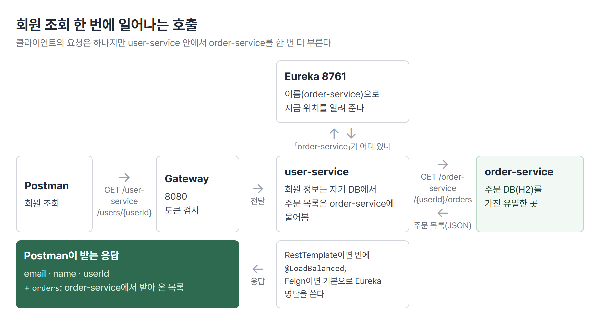
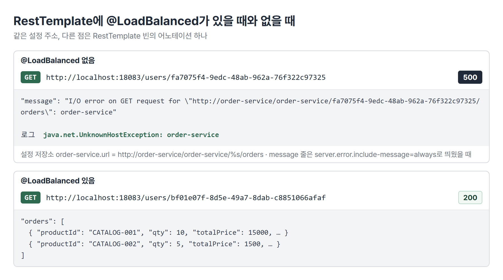
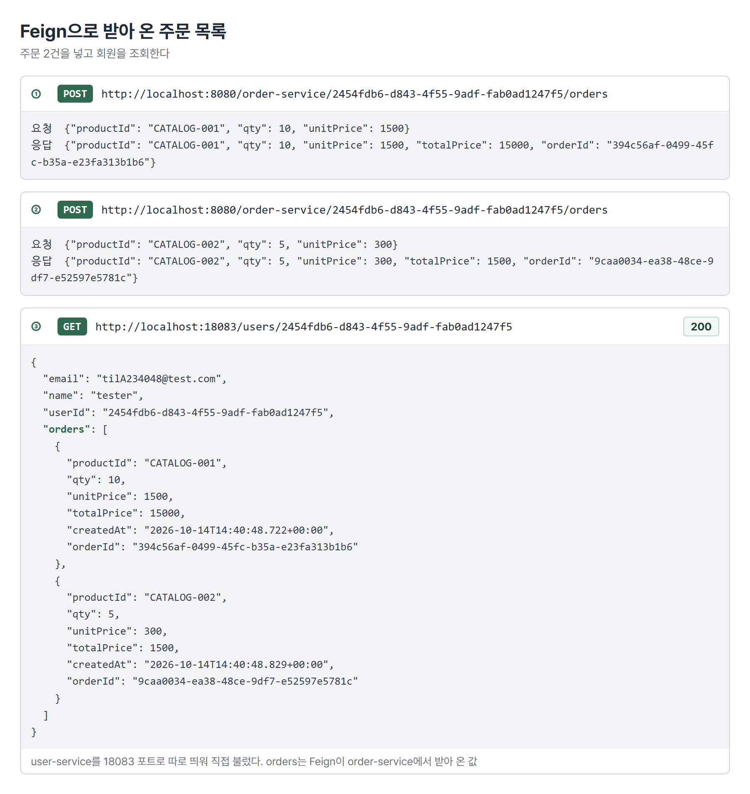
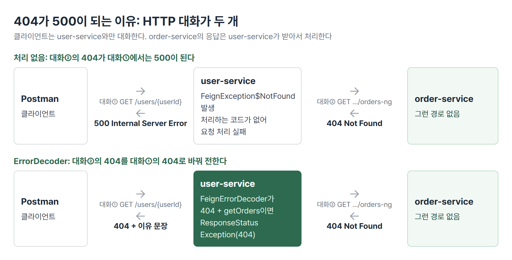
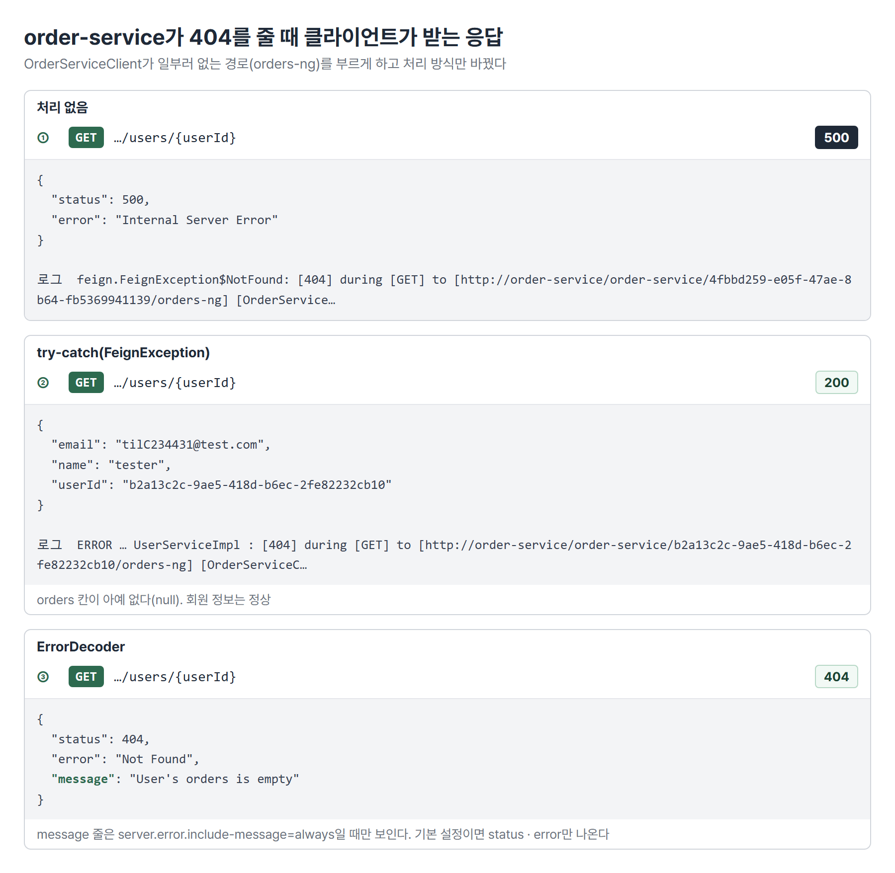
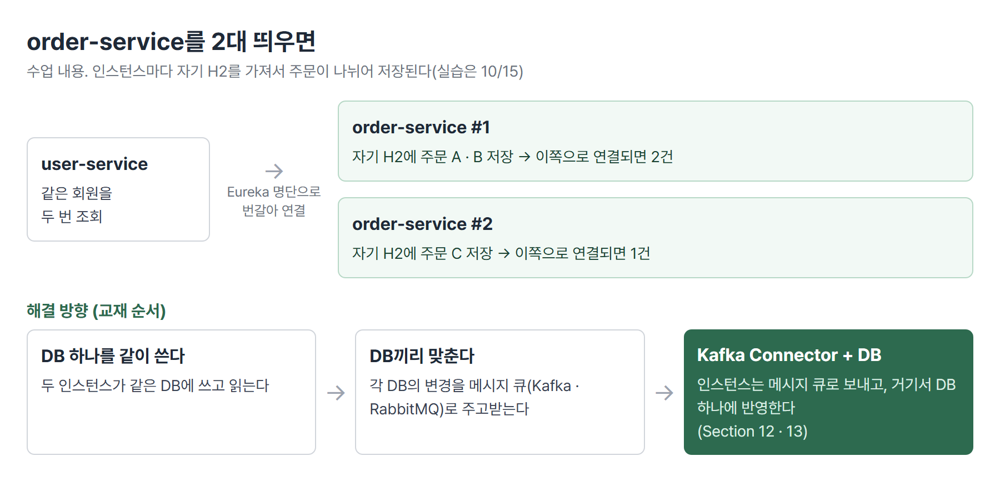

# <LG CNS 6기] MSA 7일차 TIL · 서비스 간 통신과 Feign

> TL;DR: 회원 조회 응답에 주문 목록을 넣으려고 user-service가 order-service를 부르게 했다. 부르는 주소는 IP에서 Eureka 서비스 이름으로, 호출 코드는 RestTemplate에서 Feign 인터페이스로 바꿨다. order-service가 404를 줄 때 클라이언트에게 500 대신 뜻이 맞는 응답이 가도록 ErrorDecoder를 붙였다.

## 🗺️ 한눈에 보기

### 오늘은 무엇을 위한 작업이었나

회원 상세 조회(`GET /user-service/users/{userId}`) 응답의 `orders` 칸을 채우는 작업이었다. 이 칸은 지금까지 빈 목록이었다. 주문은 order-service의 DB에만 있으므로, user-service가 응답을 만드는 도중에 order-service에 HTTP로 물어봐야 한다.



> 💡 클라이언트의 요청은 하나지만 user-service 안에서 order-service를 한 번 더 부른다. 오늘 배운 RestTemplate · `@LoadBalanced` · Feign · ErrorDecoder는 모두 이 두 번째 호출을 다루는 방법이다.

### 상황별로 무엇을 쓰나

| 이런 상황이면 | 이것을 쓴다 | 절 |
|---|---|---|
| 다른 서비스의 데이터가 응답에 필요하다 | 그 서비스의 API를 HTTP로 호출(동기 통신) | 1 |
| 자바 코드에서 HTTP 요청을 보낸다 | RestTemplate `exchange()` | 2 |
| 상대 서비스의 IP · 포트를 코드와 설정에서 빼고 싶다 | Eureka 서비스 이름 + `@LoadBalanced` | 3 |
| 호출 코드를 메서드 한 줄로 줄이고 싶다 | OpenFeign `@FeignClient` 인터페이스 | 4 |
| 상대가 4xx · 5xx를 줄 때 클라이언트 응답을 정한다 | try-catch 또는 ErrorDecoder | 5 |
| 같은 서비스를 여러 대로 늘린다 | 데이터 동기화 방법을 함께 정한다(다음 실습) | 6 |

## 🧭 오늘의 학습 키워드

| 키워드 | 한 줄 정리 | 오늘 어디에 쓰였나 |
|---|---|---|
| 동기 / 비동기 통신 | 답을 받을 때까지 기다림 / 메시지만 넘기고 진행 | 1번 절 |
| RestTemplate | 자바 코드에서 HTTP 요청을 보내는 스프링 도구 | 2 · 3번 절 |
| `exchange()` | 주소 · 메서드 · 응답 타입을 지정해 요청을 보내는 메서드 | 2번 절 |
| `ParameterizedTypeReference` | `List<ResponseOrder>` 같은 제네릭 응답 타입을 알려 줌 | 2번 절 |
| `@LoadBalanced` | RestTemplate이 주소의 호스트 자리를 Eureka 서비스 이름으로 해석 | 3번 절 |
| OpenFeign | 인터페이스 선언만으로 HTTP 호출 코드를 만들어 주는 라이브러리 | 4번 절 |
| `@FeignClient` | 호출할 서비스 이름과 경로를 적는 인터페이스 표시 | 4번 절 |
| `@EnableFeignClients` | Feign 인터페이스를 찾아 구현체를 만들라는 스위치 | 4번 절 |
| `Logger.Level.FULL` | Feign 요청 · 응답의 헤더와 본문까지 로그로 남김 | 4번 절 |
| `FeignException` | Feign 호출이 4xx · 5xx를 받으면 나는 예외 | 5번 절 |
| ErrorDecoder | 상대 응답의 상태 코드를 내 쪽 예외로 바꾸는 Feign 확장점 | 5번 절 |
| `ResponseStatusException` | 상태 코드와 이유를 담아 던지면 그 코드로 응답 | 5번 절 |
| `server.error.include-message` | 오류 응답 본문에 `message`를 넣을지 정하는 설정 | 5번 절 |
| 데이터 동기화 | 같은 데이터를 여러 DB가 나눠 가질 때 내용을 맞추는 일 | 6번 절 |

## ✍️ 공부한 내용

### 1. 서비스끼리 물어보는 이유

서비스마다 DB를 따로 두었기 때문에 주문 데이터는 order-service에만 있다. 나눠서 보관하므로 user-service에는 주문 정보가 없다. user-service가 주문 테이블을 직접 읽게 만들지 않은 데에도 이유가 있다. 직접 읽으면 order-service가 테이블 구조를 바꿀 때 user-service도 같이 고장 난다. API라는 창구로만 묻게 하면 order-service는 창구 모양만 지키고 안쪽은 바꿀 수 있다.

| 방식 | 하는 일 | 맞는 상황 |
|---|---|---|
| 동기 HTTP 통신 | 요청하고 응답이 올 때까지 기다린다 | 결과가 지금 응답에 들어가야 할 때(오늘의 회원 조회) |
| 비동기 통신(AMQP) | 메시지 브로커에 메시지를 넘기고 바로 다음 일을 한다 | 결과를 기다리지 않아도 될 때(뒤 섹션의 Kafka) |

> 💡 응답에 바로 들어가야 하는 데이터는 동기 HTTP로 상대 서비스의 API를 부른다. 상대 DB를 직접 읽지 않는다.

### 2. RestTemplate: 설정에 둔 주소로 호출

RestTemplate은 자바 코드 안에서 HTTP 요청을 보내는 스프링 도구다. 빈으로 등록해 두고 서비스 클래스가 생성자로 받아 쓴다.

```java
// UserServiceApplication
@Bean
public RestTemplate getRestTemplate() {
    return new RestTemplate();
}

// UserServiceImpl.getUserByUserId()
String orderUrl = String.format(env.getProperty("order-service.url"), userId);
ResponseEntity<List<ResponseOrder>> orderListResponse =
        restTemplate.exchange(orderUrl, HttpMethod.GET, null,
            new ParameterizedTypeReference<List<ResponseOrder>>() {});
List<ResponseOrder> orderList = orderListResponse.getBody();
```

- `exchange(주소, 메서드, 요청 본문, 응답 타입)` 순서다. GET이라 요청 본문은 `null`이다.
- 응답이 JSON 배열이라 `ParameterizedTypeReference`로 `List<ResponseOrder>`를 알려 준다. `List.class`만 넘기면 목록 안의 원소가 `ResponseOrder`라는 정보가 빠진다.

주소는 코드가 아니라 설정 저장소의 `user-service.yml`에 두었다. 주소가 바뀌어도 코드를 다시 빌드하지 않으려는 것이다.

```yaml
order-service:
  url: http://127.0.0.1:8080/order-service/%s/orders
```

- `%s` 자리에 `String.format`이 userId를 넣는다.
- 코드의 `env.getProperty("order-service.url")`와 yml 키는 글자까지 같아야 한다. 교재는 `order_service.url`(밑줄)인데 수업 코드는 하이픈이다. 키가 어긋나면 값이 null이 되고 `String.format(null, …)`에서 예외가 나서 회원 조회가 500이 된다.
- 처음 주소는 Gateway(8080)를 거쳐 order-service로 간다. IP와 포트가 그대로 들어 있어서 서버 위치가 바뀌면 설정을 고쳐야 한다.

### 3. `@LoadBalanced`: IP 대신 서비스 이름

주소의 `127.0.0.1:8080` 자리에 Eureka에 등록된 이름을 넣는다. 앞의 `order-service`는 서비스 이름이고 뒤의 `/order-service/%s/orders`는 order-service 컨트롤러의 경로다.

```yaml
order-service:
  url: http://order-service/order-service/%s/orders
```

```java
@Bean
@LoadBalanced
public RestTemplate getRestTemplate() {
    return new RestTemplate();
}
```

| 주소 | 서버 위치가 바뀌면 | 같은 서비스가 2대면 |
|---|---|---|
| IP:포트(Gateway 경유) | 설정을 고친다 | Gateway가 나눠 보낸다 |
| 서비스 이름 + `@LoadBalanced` | 그대로 동작한다 | RestTemplate이 Eureka 명단을 보고 나눠 보낸다 |

같은 설정 주소에서 `@LoadBalanced`만 빼고 띄운 결과다.



- **왜 나왔나**: IP · 포트를 적으면 서버 위치가 바뀔 때마다 설정을 고쳐야 하고 같은 서비스를 여러 대 띄워도 한 주소로만 간다.
- **안 그러면 뭐가 되나**: 주소를 이름으로 바꾸고 `@LoadBalanced`를 빠뜨리면 RestTemplate이 `order-service`를 실제 컴퓨터 이름(호스트명)으로 찾다가 `UnknownHostException`을 낸다. 클라이언트는 500을 받는다.
- **대가는 뭔가**: 호출이 Eureka 명단에 기대게 된다. Gateway의 `lb://` 라우트도 같은 방식인데, 서비스를 재시작한 직후 명단이 갱신되기 전에는 503 `Unable to find instance`가 났다.

> 💡 서비스 이름으로 부르려면 RestTemplate 빈에 `@LoadBalanced`가 있어야 한다. 주소만 바꾸면 이름을 호스트명으로 읽어 실패한다.

### 4. Feign Client: 인터페이스 선언과 로그

RestTemplate은 주소 조립, `exchange()` 호출, 응답 타입 지정을 매번 코드로 쓴다. OpenFeign은 「이 서비스의 이 경로를 부른다」는 인터페이스만 선언하면 호출 코드를 스프링이 만들어 준다.

```xml
<dependency>
    <groupId>org.springframework.cloud</groupId>
    <artifactId>spring-cloud-starter-openfeign</artifactId>
</dependency>
```

```java
@FeignClient(name = "order-service")      // Eureka에 등록된 이름
public interface OrderServiceClient {
    @GetMapping("/order-service/{userId}/orders")
    List<ResponseOrder> getOrders(@PathVariable("userId") String userId);
}

// UserServiceImpl: RestTemplate 블록을 주석 처리하고 한 줄로
List<ResponseOrder> orderList = orderServiceClient.getOrders(userId);
```

- 메인 클래스에 `@EnableFeignClients`를 붙여야 이 인터페이스의 구현체가 만들어진다.
- Feign은 Eureka 이름으로 부르는 것이 기본이라 `@LoadBalanced` 같은 표시가 따로 필요 없다. 기동 로그에 `For 'order-service' URL not provided. Will try picking an instance via load-balancing.`이 찍힌다.
- 설정의 `order-service.url`은 Feign 방식에서는 쓰지 않는다. 주소가 인터페이스의 어노테이션에 들어가 있다.

| | RestTemplate | Feign |
|---|---|---|
| 호출 코드 | `exchange(url, GET, null, 타입)` 여러 줄 | `getOrders(userId)` 한 줄 |
| 주소를 두는 곳 | 설정 파일 | 인터페이스 어노테이션 |
| 이름 기반 호출 | 빈에 `@LoadBalanced` | 기본 |
| 맞는 상황 | 호출 주소를 설정 값으로 바꿔 가며 쓸 때 | 같은 서비스의 API 여러 개를 메서드로 정리해 쓸 때 |

주문 2건을 넣고 회원을 조회하면 `orders`가 채워져 나온다. 아래 응답은 user-service를 18083 포트로 따로 띄워 직접 부른 것이다.



Feign이 실제로 무엇을 주고받았는지는 로그로 본다. 로그 레벨을 `FULL`로 두는 빈과 패키지 로그 레벨을 함께 넣는다.

```java
@Bean
public Logger.Level feignLoggerLevel() {   // feign.Logger
    return Logger.Level.FULL;
}
```

```yaml
logging:
  level:
    com.example.userservice.client: DEBUG
```

```
[OrderServiceClient#getOrders] ---> GET http://order-service/order-service/2454fdb6-…/orders HTTP/1.1
[OrderServiceClient#getOrders] ---> END HTTP (0-byte body)
[OrderServiceClient#getOrders] <--- HTTP/1.1 200 (175ms)
[OrderServiceClient#getOrders] content-type: application/json
[OrderServiceClient#getOrders] [{"productId":"CATALOG-001","qty":10,"unitPrice":1500,"totalPrice":15000, …
[OrderServiceClient#getOrders] <--- END HTTP (330-byte body)
```

- 요청 줄, 응답 코드와 걸린 시간, 헤더, 본문이 다 찍힌다. 요청 URL의 호스트 자리에 서비스 이름(`order-service`)이 그대로 보인다.

> 💡 Feign은 인터페이스 선언만으로 이름 기반 호출과 부하 분산까지 처리한다. 무엇이 오갔는지는 `FULL` 로그로 확인한다.

### 5. order-service가 404를 줄 때: try-catch와 ErrorDecoder

강사님은 `OrderServiceClient`의 경로를 일부러 없는 경로(`/order-service/{userId}/orders-ng`)로 바꿔 order-service가 404를 내게 했다. 실패 상황을 만들어 처리 방식을 비교하려는 시험용 경로다.

처리 코드가 없으면 Postman은 404가 아니라 500을 받는다. HTTP 대화가 두 개이기 때문이다.



- 404는 order-service가 user-service에게 한 응답이다(대화②).
- user-service 안에서는 이 404가 `FeignException$NotFound` 예외가 된다. 처리하는 코드가 없으면 요청 처리가 실패한다. 그래서 클라이언트가 받는 응답(대화①)은 500이다.

처리 방식만 바꿔 같은 요청을 보낸 결과다.



| 단계 | 클라이언트 응답 | 맞는 상황 |
|---|---|---|
| 처리 없음 | 500 | 없음(실패 원인이 클라이언트에게 서버 고장으로 보인다) |
| try-catch(`FeignException`) | 200, `orders` 칸 없음 | 주문을 못 가져와도 회원 정보는 보여 줘야 할 때 |
| ErrorDecoder | 404 + 이유 문장 | 상대의 실패를 상태 코드로 알려야 할 때 |

ErrorDecoder는 Feign이 받은 응답의 상태 코드를 보고 어떤 예외를 던질지 정한다. 404이고 `getOrders` 호출이면 `ResponseStatusException(404)`을 던지므로 클라이언트도 404를 받는다.

```java
@Component
public class FeignErrorDecoder implements ErrorDecoder {
    @Override
    public Exception decode(String methodKey, Response response) {
        switch (response.status()) {
            case 404:
                if (methodKey.contains("getOrders")) {
                    return new ResponseStatusException(HttpStatus.valueOf(response.status()),
                            env.getProperty("order-service.exception.order-is-empty"));
                }
                break;
            default:
                return new Exception(response.reason());
        }
        return null;
    }
}

@FeignClient(name = "order-service", configuration = FeignErrorDecoder.class)
```

```yaml
# 설정 저장소 user-service.yml
order-service:
  exception:
    order-is-empty: User's orders is empty
```

- `methodKey`에는 `OrderServiceClient#getOrders(String)` 같은 값이 들어온다. 어떤 Feign 메서드가 실패했는지로 처리를 나눈다.
- 이유 문장도 설정 저장소에 두어서 문구를 바꿀 때 코드를 고치지 않는다.
- 스프링 부트 기본 설정에서는 오류 응답 본문에 `message`가 들어가지 않는다. 같은 요청을 기본 설정으로 보내면 `status: 404`, `error: Not Found`까지만 나온다. 문장까지 보려면 `server.error.include-message=always`로 띄워야 한다.
- try-catch는 호출하는 곳마다 써야 하지만 ErrorDecoder는 Feign 클라이언트 단위로 한 번 지정한다.

- **왜 나왔나**: order-service의 404가 클라이언트에게 500으로 보여 원인을 알 수 없었다.
- **안 그러면 뭐가 되나**: 처리 없으면 500, try-catch로 삼키면 200에 `orders`만 빠진다. 클라이언트는 주문이 없어서인지 조회에 실패해서인지 구분하지 못한다.
- **대가는 뭔가**: getOrders의 404를 전부 「주문 내역이 없다」로 바꾼다. 오늘 시험처럼 경로 오타로 난 404도 클라이언트에게는 같은 문장으로 간다.

> 💡 order-service의 404는 user-service가 받은 응답이고 클라이언트는 user-service의 응답만 본다. ErrorDecoder가 그 사이에서 상대의 응답을 클라이언트에게 줄 응답으로 바꾼다.

### 6. order-service를 2대 띄우면 (수업 내용, 실습은 10/15)

order-service를 하나 더 띄우면 Eureka에 `ORDER-SERVICE`가 2개 올라가고 Feign이나 `@LoadBalanced` RestTemplate이 두 인스턴스에 번갈아 요청을 보낸다. 그런데 인스턴스마다 자기 H2를 갖고 있어서 주문이 나뉘어 저장된다. 장부가 2개이고 서로 공유하지 않는 구조라 같은 회원을 조회해도 어느 인스턴스로 연결되느냐에 따라 주문 목록이 달라진다.



| 해결 방향(교재 순서) | 하는 일 |
|---|---|
| DB 하나를 같이 쓴다 | 두 인스턴스가 같은 DB에 쓰고 읽는다 |
| DB끼리 맞춘다 | 각 DB의 변경을 메시지 큐(Kafka · RabbitMQ)로 주고받는다 |
| Kafka Connector + DB | 인스턴스는 메시지 큐로 보내고 거기서 DB 하나에 반영한다 |

> 💡 서비스를 여러 대로 늘리면 요청은 나눠지지만 데이터도 나뉜다. 늘리기 전에 데이터를 어디에 모을지부터 정해야 한다.

## 🧩 이어지는 내용

- 6일차(10/13)에 설정 저장소를 GitHub로 옮겼다. 오늘 호출 주소(`order-service.url`)와 오류 문장도 그 저장소의 `user-service.yml`에 두었다.
- Eureka 서비스 이름으로 부르는 방식은 2일차(10/2) Service Discovery와 3일차(10/6) Gateway의 `lb://` 라우트와 같은 원리다.
- order-service 2대 실습은 10/15에 한다. 교안 목차상 다음은 Section 12 · 13 「데이터 동기화를 위한 Kafka 활용」이다.
- 2차 사후평가는 10/29, 미니 프로젝트 2는 10/30에 시작한다.

## ❓ 몰랐던 것

### order-service는 404를 줬는데 Postman은 왜 500을 받나

500이 서버 쪽 에러라는 것까지는 알았는데 어느 서버의 에러인지가 잡히지 않았다. 클라이언트가 직접 부른 서버는 user-service다. order-service의 404는 user-service가 받은 응답이다. user-service가 이를 처리하지 못해 자기 요청 처리에 실패했으므로 클라이언트는 user-service의 500을 받는다. 클라이언트는 뒤에 order-service가 있다는 것도 모른다. 그래서 상대의 실패를 클라이언트에게 어떻게 전할지는 user-service가 정한다. 그 자리가 try-catch나 ErrorDecoder다.

### 서비스 이름으로 부르는데 `@LoadBalanced`가 없으면

주소의 `order-service`를 Eureka 이름이 아니라 실제 컴퓨터 이름(호스트명)으로 찾는다. 그런 이름의 컴퓨터가 없으니 `java.net.UnknownHostException: order-service`가 나고 회원 조회가 500이 된다(3번 절 캡처). 설정 주소를 Eureka 방식으로 바꿨으면 RestTemplate 빈에 `@LoadBalanced`가 붙어 있는지 함께 본다.

### RestTemplate에서 Feign으로 바꾸면 직접 쓰지 않아도 되는 것

주소 문자열 조립(`String.format`), `exchange()` 호출, 응답 타입 지정(`ParameterizedTypeReference`), 그리고 이 호출을 실제로 수행하는 구현 클래스다. 개발자는 인터페이스에 서비스 이름 · 경로 · 반환 타입만 적는다. 대신 경로 오타는 컴파일 단계에서 잡히지 않고 호출할 때 404로 드러난다. 5번 절의 `orders-ng`도 문제없이 빌드됐다.

### 설정 저장소에 값을 넣은 뒤 서비스가 읽게 하려면

설정 저장소에 커밋하고 GitHub에 push까지 해야 Config Server가 새 값을 내준다. Config Server 응답의 `version`이 새 커밋 해시인지로 확인한다. 그다음 user-service가 값을 다시 읽어야 한다. user-service는 시작할 때 받은 값을 들고 있으므로 재시작하거나 refresh를 보낸다.

### 서비스를 나눠서 얻는 것과 치르는 대가

오늘 수업은 담당을 나눠서 생기는 구조를 얼마나 유기적이고 편하게 연결해 주느냐에 대한 내용이다. 나눠서 얻는 것은 1 · 6번 절에서 보였고 오늘 배운 도구는 나눠서 생긴 비용을 줄이는 쪽이다.

| 나눠서 얻는 것 | 오늘 어디서 보였나 |
|---|---|
| 요청이 몰리는 서비스만 늘린다 | order-service만 2대로 늘림(6번 절) |
| 상대의 내부 구조를 몰라도 된다 | user-service는 주문 API 경로만 알고 주문 DB는 모른다(1번 절) |

| 나눠서 치르는 대가 | 오늘 어디서 보였나 | 오늘 배운 도구 |
|---|---|---|
| 서로 찾아가야 한다 | 주소가 바뀌면 호출이 실패한다 | Eureka 이름 + `@LoadBalanced`, Feign |
| 상대의 실패가 내 실패가 된다 | order-service의 404가 클라이언트에게 500으로 보였다 | try-catch, ErrorDecoder |
| 데이터가 흩어진다 | 인스턴스마다 장부가 따로 있다 | 다음 섹션(Kafka) |

띄워야 하는 서비스가 6개로 늘면서 켜는 순서도 지켜야 한다. user-service를 config-service보다 먼저 켜면 설정 값을 받지 못한 채 떠서, 회원가입은 되는데 로그인(토큰 서명)에서 500이 났다.

## 📌 다음에 해볼 것

- [ ] order-service를 2대 띄우고 같은 회원 조회를 반복해 `orders`가 바뀌는지 확인하기(10/15 실습)
- [ ] `OrderServiceClient`의 경로를 `orders`로 되돌리고 회원 조회에 주문이 다시 나오는지 확인하기
- [ ] 설정 저장소의 `order-is-empty` 문장을 바꿔 push하고 user-service가 새 문장을 쓰게 하는 방법 확인하기(교재 메모 `@RefreshScope`)

## 🔍 더 짚어둘 것

### 1. 미니 프로젝트: 서비스 간 호출 방식을 정할 때

2차 미니 프로젝트의 MSA 구현 기준 문서는 다른 서비스를 서비스 이름으로 부른다는 것까지만 정했다. 호출 방식(RestClient · OpenFeign)은 서비스 간 통신 수업 뒤로 미뤄 두었다. 오늘 실습 기준으로 정할 항목이 생겼다.

- **호출 방식 통일**: 팀 안에서 RestTemplate과 Feign을 섞어 쓰면 이름 기반 호출 조건(`@LoadBalanced` 유무)과 실패 처리 위치가 서비스마다 달라진다. 하나로 정한다.
- **실패했을 때의 응답**: 상대 서비스가 4xx · 5xx를 줄 때 클라이언트에게 500을 줄지, 빈 목록과 200을 줄지, 상대의 상태 코드를 그대로 전할지 API마다 명세에 적는다.
- **설정 키 이름 규칙**: 호출 주소와 오류 문장을 설정 저장소에 둔다면 키 이름을 하이픈으로 통일한다. 오늘처럼 교재(밑줄)와 코드(하이픈)가 다르면 값이 null로 들어온다.
- **호출 로그 레벨**: `FULL`은 응답 본문까지 남긴다. 회원 정보가 오가는 호출이면 개발 중에만 켠다.

### 2. AI: 바이브코딩할 때 사람이 확인할 것

- **이름 기반 주소와 `@LoadBalanced`**: 주소를 `http://서비스이름/…`으로 바꿨다면 RestTemplate 빈에 `@LoadBalanced`가 있는지 본다. 빠지면 빌드는 되고 호출할 때 실패한다.
- **설정 키와 코드 문자열**: `env.getProperty("…")`의 문자열과 yml 키가 같은지 본다. 밑줄과 하이픈 차이도 다른 키다.
- **Feign 경로**: 인터페이스의 `@GetMapping` 경로가 상대 컨트롤러의 클래스 경로 + 메서드 경로와 같은지 본다. 오타는 컴파일에서 잡히지 않는다.
- **예외를 삼키는 코드**: try-catch로 로그만 남기는 코드를 받으면 클라이언트가 실패를 알 수 있는지 본다. 200에 칸만 비어 나오면 조용히 틀린 응답이 된다.

### 3. SAP ERP: 다른 시스템을 이름으로 부르기

ABAP에서 다른 시스템의 함수를 부를 때는 `CALL FUNCTION '…' DESTINATION '연결 이름'`처럼 SM59에 등록한 RFC 연결 이름을 쓴다. 실제 호스트와 시스템 번호(또는 메시지 서버와 로그온 그룹)는 SM59에만 있고 코드는 이름만 안다. 주소를 한곳에서 관리하고 코드는 이름으로 부른다는 점이 Eureka 서비스 이름 + `@LoadBalanced`와 같다.

태그: LG CNS 6기, 개발자, LGCNSINSPIRECAMP
