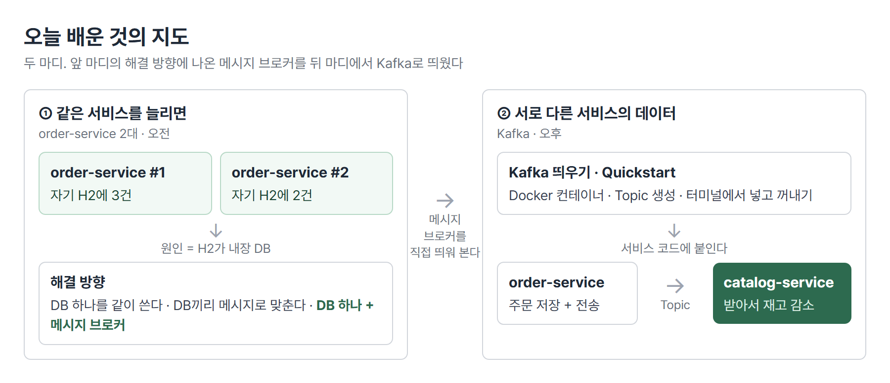
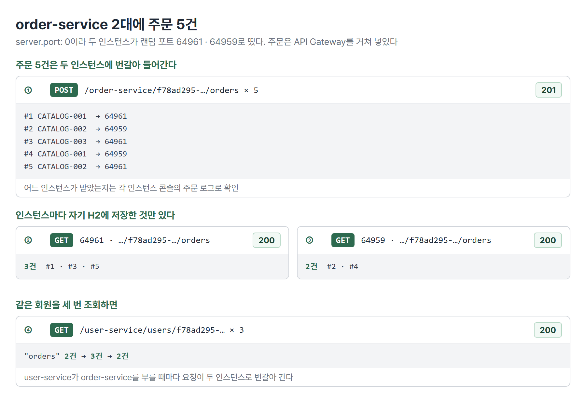
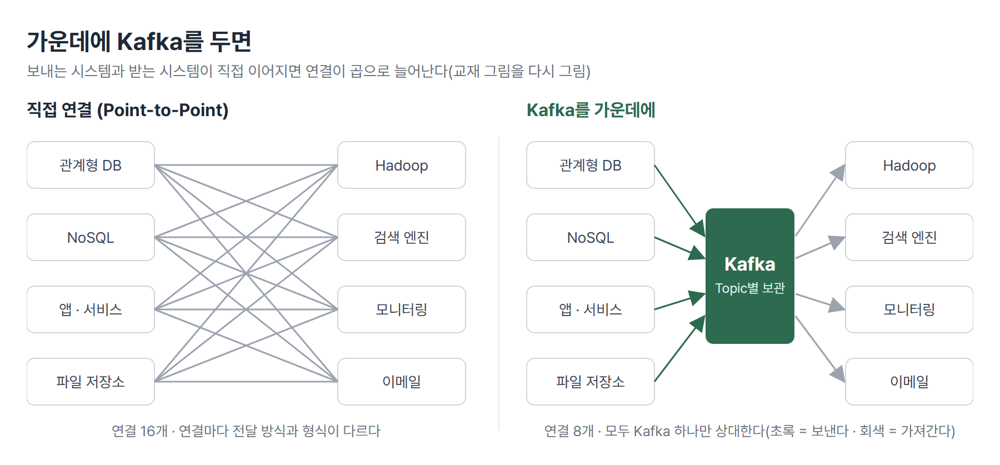
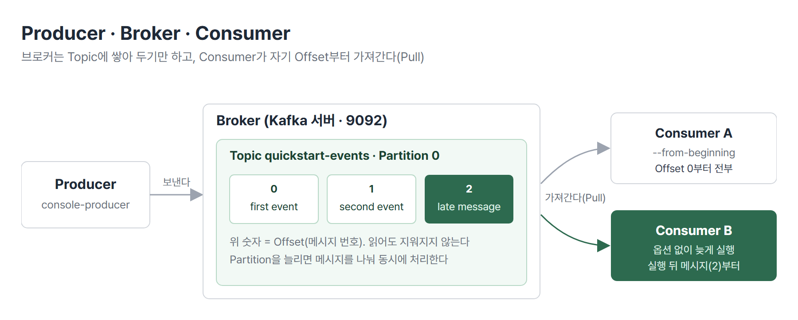
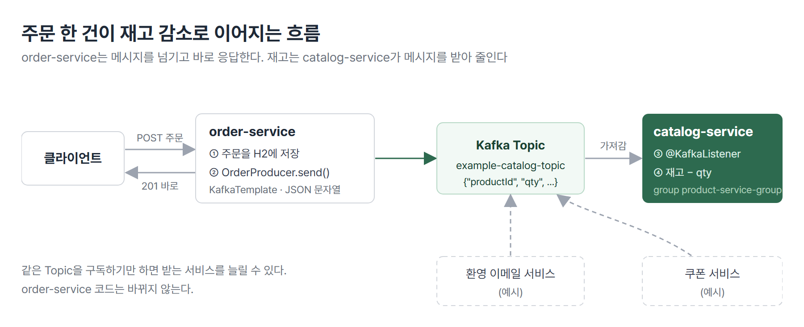
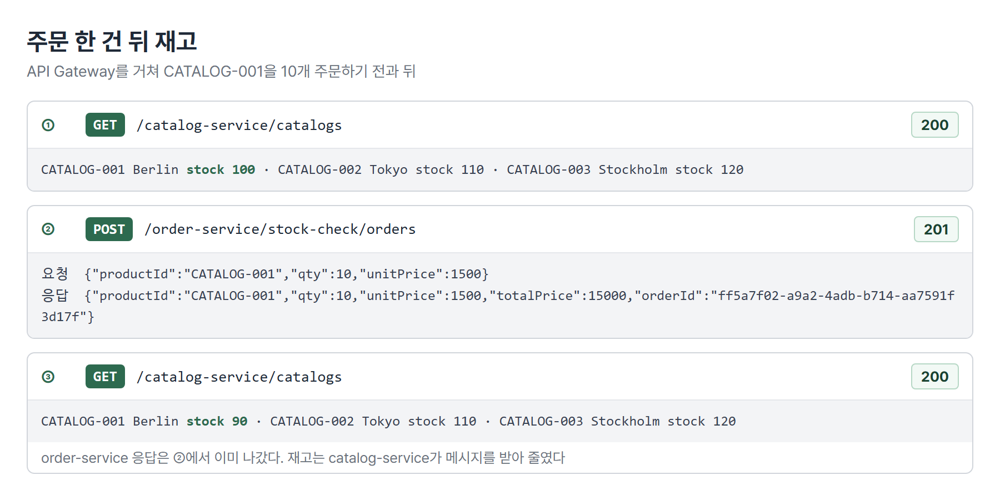

# <LG CNS 6기] MSA 8일차 TIL · Kafka로 재고 맞추기

> TL;DR: order-service를 2대로 늘리면 주문이 두 H2에 나뉘어 저장되는 문제를 확인하고 DB를 하나로 모으거나 메시지 브로커를 두는 해결 방향을 비교했다. Kafka를 Docker로 띄워 Topic에 메시지를 넣고 꺼내 본 뒤, 주문이 들어오면 order-service가 Kafka로 주문 내용을 보내고 catalog-service가 받아 재고를 줄이게 했다.

## 🗺️ 한눈에 보기

### 오늘은 무엇을 배운 날이었나

오늘 수업은 두 마디다. 앞 마디는 같은 서비스를 여러 대로 늘렸을 때 데이터가 나뉘는 문제와 그 해결 방향이고 뒤 마디는 그 해결 방향에 나온 메시지 브로커 Kafka를 직접 띄워 서비스 사이의 데이터를 맞추는 실습이다. 뒤 마디의 실습 코드는 앞 마디 문제(주문 서비스 2대)를 푸는 코드와 별개다. 주문과 재고처럼 서로 다른 서비스의 데이터를 맞추는 코드다.



> 💡 같은 서비스를 늘리면 데이터가 나뉜다. 서로 다른 서비스는 데이터가 처음부터 따로 있다. 두 경우 모두 데이터를 어디에 모으고 어떻게 맞출지를 정해야 하고 그 수단 중 하나가 메시지 브로커다.

### 상황별로 무엇을 쓰나

| 이런 상황이면 | 이것을 쓴다 | 절 |
|---|---|---|
| 같은 서비스를 여러 대로 늘린다 | 내장 DB 대신 DB 하나를 같이 쓴다 | 1 · 2 |
| 요청은 빨리 받고 저장은 뒤에서 해도 된다 | 서비스와 DB 사이에 메시지 브로커를 둔다 | 2 |
| 여러 시스템이 같은 데이터를 받아 간다 | Kafka Topic 하나에 보내고 받는 쪽이 각자 가져간다 | 3 |
| 메시지가 오가는지 코드 없이 확인한다 | Kafka 명령(`kafka-console-producer` · `consumer`) | 4 |
| 한 서비스의 변경을 다른 서비스 DB에 반영한다 | Producer(`KafkaTemplate`) + Consumer(`@KafkaListener`) | 5 |

## 🧭 오늘의 학습 키워드

| 키워드 | 한 줄 정리 | 오늘 어디에 쓰였나 |
|---|---|---|
| 내장 DB(H2 메모리 모드) | 서버와 함께 생기고 함께 사라지는 DB | 1번 절 |
| 스케일 아웃 | 같은 서비스를 여러 대로 늘려 요청을 나눠 받기 | 1번 절 |
| 메시지 브로커 | 보내는 쪽과 받는 쪽 사이에서 메시지를 받아 보관하는 서버 | 2 · 3번 절 |
| 최종적 일관성(Eventual Consistency) | 반영이 늦어도 결국에는 맞춰지는 성질 | 2번 절 |
| Producer / Consumer | 메시지를 보내는 쪽 / 받아 처리하는 쪽 | 3 · 4 · 5번 절 |
| Broker · Cluster | Kafka 서버 한 대 / 그 서버들의 묶음 | 3번 절 |
| Topic | 메시지를 종류별로 모아 두는 저장 공간 | 3 · 4 · 5번 절 |
| Partition | Topic을 나눈 단위. 나눈 만큼 동시에 처리 | 3번 절 |
| Pull 방식 | 브로커가 보내 주지 않고 Consumer가 가져간다 | 3번 절 |
| Offset | Consumer가 어디까지 읽었는지 표시하는 번호 | 4번 절 |
| `--from-beginning` | Topic의 메시지를 처음부터 읽게 하는 옵션 | 4번 절 |
| spring-kafka | Kafka 자바 클라이언트를 스프링에서 쓰기 쉽게 감싼 라이브러리 | 5번 절 |
| `KafkaTemplate` | Topic에 메시지를 보내는 스프링 도구 | 5번 절 |
| `@KafkaListener` | 지정한 Topic에 메시지가 오면 메서드를 불러 주는 표시 | 5번 절 |
| Consumer Group | 같은 그룹의 Consumer끼리 메시지를 나눠 처리하는 묶음 | 5번 절 |

## ✍️ 공부한 내용

### 1. order-service를 2대 띄우면 주문이 나뉜다

같은 서비스를 한 대 더 띄워 요청을 나눠 받게 하는 것을 스케일 아웃이라고 한다. 주문이 몰리는 상황을 가정하고 order-service를 jar로 빌드해 하나 더 실행했다.

```bash
cd order-service
mvn clean compile package -DskipTests
java -jar target/order-service-1.0.jar
```

- `server.port: 0`(랜덤 포트)이라 두 번째 인스턴스도 포트 충돌 없이 뜬다. Eureka에 `ORDER-SERVICE`가 2개 올라간다.
- 주문 5건을 넣고 두 인스턴스의 H2 콘솔을 나란히 열면 3건과 2건으로 나뉘어 있다. 같은 회원을 조회하면 주문이 3건과 2건으로 번갈아 바뀐다. 요청이 두 인스턴스로 번갈아 가기 때문이다.



원인은 H2가 **내장 DB**라는 데 있다. H2를 메모리 모드로 쓰면 스프링 부트 서버를 띄울 때 DB가 같이 만들어지고 서버를 내리면 같이 사라진다. 인스턴스를 하나 더 띄우면 그 인스턴스만의 DB가 하나 더 생긴다.

> 💡 MSA의 「서비스마다 DB를 따로 둔다」는 서비스 종류마다 DB를 하나 둔다는 뜻이다. 같은 서비스를 여러 대 띄우면 그 인스턴스들은 DB 하나를 같이 쓴다.

### 2. 해결 방향 세 가지

| 방법 | 하는 일 | 맞는 상황 | 대가 |
|---|---|---|---|
| ① DB 하나를 같이 쓴다 | 인스턴스들이 같은 외부 DB(MariaDB 등)에 쓰고 읽는다 | 대부분의 경우. 가장 일반적인 구조 | 쓰기가 몰리면 DB가 병목이 된다 |
| ② DB끼리 메시지로 맞춘다 | 한쪽 DB의 변경을 메시지 브로커로 다른 DB에 전달한다 | 인스턴스마다 DB가 꼭 따로 있어야 할 때만 | 구조가 복잡하다. 꼭 필요할 때가 아니면 쓰지 않는다 |
| ③ DB 하나 + 메시지 브로커 | 서비스는 메시지만 보내고, DB 쪽이 메시지를 읽어 저장한다 | 요청을 빨리 받아야 하고 저장이 조금 늦어도 될 때 | 저장이 늦어 저장 직후 조회에서 안 보일 수 있다 |

③에서 메시지 브로커가 하는 일이 둘 더 있다.

- 브로커를 여러 대 띄워 메시지를 복제해 두면 한 대가 죽어도 다른 브로커가 이어서 처리한다. 실무에서는 3대 정도로 늘린다.
- DB가 장애로 메시지를 못 받으면 메시지가 사라지지 않고 브로커에 남는다. 복구된 뒤 다시 시도하게 할 수 있고 재시도를 개발자가 코드로 짜지 않고 설정으로 정한다.

③의 대가인 지연을 감수하는 성질을 **최종적 일관성**(Eventual Consistency)이라고 한다. 저장 직후에는 DB에 아직 없을 수 있지만 메시지가 처리되면 나중에는 맞춰진다.

> 💡 같은 서비스를 늘리는 문제는 DB 하나를 같이 쓰면 대부분 풀린다. 메시지 브로커는 요청을 빨리 받고 저장을 뒤로 미루고 싶을 때 들어간다.

### 3. Kafka: 가운데 두는 메시지 브로커

Kafka는 LinkedIn이 만들어 공개한 메시지 브로커 서버다. 보내는 시스템과 받는 시스템 사이에서 메시지를 받아 Topic별로 보관한다.



- **왜 나왔나**: 보내는 시스템(관계형 DB · NoSQL · 앱 · 파일 저장소)과 받는 시스템(Hadoop · 검색 엔진 · 모니터링 · 이메일)이 서로 직접 연결되면 연결마다 전달 방식과 데이터 형식이 다르다. 시스템이 하나 늘 때마다 연결을 새로 만들고 형식을 맞춰야 해서 확장이 어려웠다.
- **안 그러면 뭐가 되나**: Kafka를 가운데 두면 보내는 쪽은 Kafka 하나만 상대한다. 받을 시스템이 늘어도 보내는 쪽 코드는 그대로이고 받는 쪽이 같은 Topic을 구독하면 된다.
- **대가는 뭔가**: Kafka 서버가 하나 더 생긴다. 이 서버가 멈추면 전달도 멈추므로 실무에서는 여러 대로 묶는다(클러스터). 그만큼 띄우고 관리할 대상이 늘어난다.

| 용어 | 내 정리 |
|---|---|
| Producer / Consumer | 메시지를 Topic에 보내는 쪽 / Topic에서 가져가 처리하는 쪽. 서로를 모른다 |
| Broker · Cluster | 실행 중인 Kafka 서버 한 대 / 여러 대의 묶음. 3대 이상을 권장하고, 한 대가 멈추면 다른 브로커가 리더를 이어받는다 |
| Topic | 메시지를 종류별로 모아 두는 저장 공간(예: 「이메일 발송」 Topic) |
| Partition | Topic을 나눈 단위. 메시지 100개를 3개로 나누면 33 · 33 · 34개를 동시에 처리할 수 있다. 실습은 1개 |
| Pull 방식 | 브로커는 저장만 하고 먼저 보내지 않는다. 구독하는 Consumer가 직접 가져간다 |
| 컨트롤러 | 브로커 중 한 대가 파티션 배정 · 리더 선출 같은 클러스터 관리를 맡는다 |

Kafka 3버전까지는 브로커들을 관리하는 ZooKeeper 서버를 따로 띄워야 했다. 4버전부터는 이 기능이 Kafka 안에 들어갔다. 브로커 기동 로그에도 ZooKeeper 없이 `KafkaRaftServer` 시작 줄이 찍힌다. 교재에 있는 ZooKeeper 기동 명령은 쓰지 않는다.

설치는 Docker 이미지로 했다. Kafka는 Linux 환경을 전제로 만들어져 Windows에서 직접 실행하면 버그가 있다. 강사님이 예로 든 것은 Topic을 지우면 브로커가 같이 종료되는 버그다. 컨테이너 안은 Linux 환경이라 이 문제가 없다. 압축 파일(.tgz)을 풀어 설치하는 방식은 소개만 하고 실습은 Docker로 했다.

> 💡 Kafka는 보내는 쪽과 받는 쪽 사이에 Topic이라는 보관함을 둔다. 받는 쪽은 필요한 Topic에서 직접 가져간다. 그래서 받을 시스템이 늘어도 보내는 쪽은 바뀌지 않는다.

### 4. Quickstart: 터미널에서 Topic에 넣고 꺼내기

서비스 코드에 붙이기 전에 Kafka 공식 Quickstart 순서대로 터미널에서 Producer와 Consumer 역할을 직접 해 봤다. 먼저 브로커를 컨테이너로 띄우고 컨테이너 안으로 들어간다.

```bash
docker run -p 9092:9092 --name broker apache/kafka:latest
docker exec -it broker bash
cd /opt/kafka
```

- 9092는 Kafka 기본 포트다. 컨테이너가 서버 기동까지 해 주므로 교재의 `kafka-server-start` 단계는 건너뛴다.
- Kafka 명령(`kafka-topics.sh` 등)은 컨테이너 안 `/opt/kafka/bin`에 있다. 모든 명령에 「어느 브로커에 접속할지」인 `--bootstrap-server localhost:9092`를 붙인다.

```
$ bin/kafka-topics.sh --create --topic quickstart-events --bootstrap-server localhost:9092
Created topic quickstart-events.
$ bin/kafka-topics.sh --list --bootstrap-server localhost:9092
quickstart-events
$ bin/kafka-topics.sh --describe --topic quickstart-events --bootstrap-server localhost:9092
Topic: quickstart-events	TopicId: V1Xf1lJLSkq_OhEfWHL0Lw	PartitionCount: 1	ReplicationFactor: 1	Configs: min.insync.replicas=1,segment.bytes=1073741824
	Topic: quickstart-events	Partition: 0	Leader: 1	Replicas: 1	Isr: 1	Elr: 	LastKnownElr: 
```

- `--describe`의 `PartitionCount: 1`, `ReplicationFactor: 1`은 Partition 1개, 복제본 1개(브로커 1대)라는 뜻이다. `Leader: 1`은 이 Partition을 맡은 브로커 번호다.

Producer를 실행하면 `>` 프롬프트가 나온다. 한 줄을 치고 엔터를 칠 때마다 메시지 하나가 Topic에 저장된다. 다른 창의 Consumer가 `--from-beginning`으로 처음부터 읽는다.

```
$ bin/kafka-console-producer.sh --topic quickstart-events --bootstrap-server localhost:9092
>this is my first event
>this is my second event

$ bin/kafka-console-consumer.sh --topic quickstart-events --from-beginning --bootstrap-server localhost:9092
this is my first event
this is my second event
```

`--from-beginning`을 빼면 Consumer는 자기가 실행된 뒤에 들어온 메시지부터 받는다. 세 번째 창에 `--from-beginning`으로 띄운 Consumer는 앞서 넣은 두 줄부터 모두 출력했다. 네 번째 창에 이 옵션 없이 띄운 Consumer는 그 뒤에 넣은 `test msg`, `hahaha`만 받았다.



Consumer는 메시지를 읽을 때마다 어디까지 읽었는지 **Offset**(0, 1, 2로 붙는 메시지 번호)을 기록한다. 그래야 다음에 같은 메시지를 두 번 처리하지 않고 그다음부터 읽는다.

> 💡 Consumer가 어디서부터 읽을지는 Offset으로 정해진다. 처음 붙는 Consumer는 기본으로 지금부터 읽는다. `--from-beginning`을 주면 Topic의 처음부터 읽는다.

### 5. Orders → Catalogs: 주문이 들어오면 재고를 줄인다

주문은 order-service DB에, 상품 재고는 catalog-service DB에 있다. 주문이 들어올 때 재고가 줄어야 하는데 order-service는 catalog DB를 직접 고치지 않는다(서비스마다 DB를 따로 두는 원칙). 그래서 order-service가 주문 내용을 Kafka Topic에 보내고 catalog-service가 그 Topic을 구독하다가 받아서 자기 DB의 재고를 줄인다.



두 서비스 pom에 같은 의존성을 넣는다. 버전은 스프링 부트 부모 pom이 정해 준다.

```xml
<dependency>
    <groupId>org.springframework.kafka</groupId>
    <artifactId>spring-kafka</artifactId>
</dependency>
```

spring-kafka는 Kafka 자바 클라이언트(kafka-clients)를 스프링에서 쓰기 쉽게 감싼 라이브러리다. 강사님은 Spring Data JPA의 `save()`가 안에서 JPA 메서드를 부르는 관계와 같다고 설명했다.

order-service 쪽은 주문을 저장한 다음 같은 주문을 JSON 문자열로 바꿔 Topic `example-catalog-topic`에 보낸다.

```java
// OrderProducer
public void send(String topic, OrderDto orderDto) {
    String jsonInString = objectMapper.writeValueAsString(orderDto);   // 객체 → JSON 문자열(try-catch 생략)
    kafkaTemplate.send(topic, jsonInString);
}

// OrderController.createOrder()
OrderDto createdOrder = orderService.createOrder(orderDto);    // H2에 저장
orderProducer.send("example-catalog-topic", orderDto);         // 같은 주문을 Kafka로
```

- `KafkaTemplate`이 Topic에 메시지를 보낸다. RestTemplate이 HTTP 요청을 보내는 것과 비슷한 자리다.
- 보내는 `orderDto`에는 `createOrder()`가 안에서 채운 orderId와 totalPrice도 들어 있다.
- order-service는 catalog-service의 응답을 기다리지 않는다. 메시지를 넘기면 바로 주문 응답(201)을 돌려준다.

catalog-service 쪽은 같은 Topic을 구독하다가 메시지가 오면 상품을 찾아 재고에서 주문 수량을 뺀다.

```java
@KafkaListener(topics = "example-catalog-topic")
public void updateQty(String kafkaMessage) {
    Map<Object, Object> map = mapper.readValue(kafkaMessage, new TypeReference<Map<Object, Object>>() {});   // try-catch 생략
    CatalogEntity entity = repository.findByProductId((String) map.get("productId"));
    if (entity != null) {
        entity.setStock(entity.getStock() - (Integer) map.get("qty"));
        repository.save(entity);
    }
}
```

- `@KafkaListener`가 붙은 메서드는 Topic에 메시지가 들어올 때마다 불린다. 메시지 본문이 문자열로 들어오므로 Map으로 풀어서 `productId`와 `qty`를 꺼낸다.
- JSON의 숫자는 Map에 `Integer` 객체로 들어 있다. 강사님은 `(int)`가 아니라 `(Integer)`로 꺼내는 자리를 따로 짚었다.
- `entity != null` 검사는 교재에 없고 수업 코드에서 넣었다. 없는 상품 ID가 오면 교재 코드는 NullPointerException이 나고 수업 코드는 아무것도 하지 않고 넘어간다.

접속 정보는 처음에 Java 설정 클래스(`KafkaConsumerConfig`)로 만들었다가 `application.yml`로 옮겼다. 설정 클래스의 `@Bean`을 주석 처리하면 스프링 부트가 `spring.kafka.*` 값을 읽어 같은 빈을 만들어 준다.

```yaml
# catalog-service
spring:
  kafka:
    bootstrap-servers: localhost:9092
    consumer:
      group-id: product-service-group
      key-deserializer: org.apache.kafka.common.serialization.StringDeserializer
      value-deserializer: org.apache.kafka.common.serialization.StringDeserializer
      auto-offset-reset: earliest

# order-service
spring:
  kafka:
    bootstrap-servers: localhost:9092
    producer:
      key-serializer: org.apache.kafka.common.serialization.StringSerializer
      value-serializer: org.apache.kafka.common.serialization.StringSerializer
```

| 설정 | 하는 일 |
|---|---|
| `group-id` | Consumer Group 이름. 같은 그룹 안에서는 메시지 하나를 한 Consumer만 처리한다 |
| `auto-offset-reset: earliest` | 이 그룹이 읽은 기록이 없을 때 Topic의 처음부터 읽는다. 기본값 `latest`는 지금부터 |
| Serializer / Deserializer | 문자열을 바이트로 바꿔 보내고, 받은 바이트를 다시 문자열로 바꾼다 |

CATALOG-001을 10개 주문하기 전과 뒤의 재고다.



주문이 들어오자 catalog-service 로그에 받은 메시지와 재고 update SQL이 찍혔다.

```
c.e.c.kafka.CatalogConsumer : Kafka Message: ->{"productId":"CATALOG-001","qty":10,"unitPrice":1500,"totalPrice":15000,"orderId":"ff5a7f02-a9a2-4adb-b714-aa7591f3d17f","userId":"stock-check"}
Hibernate: select ce1_0.id,ce1_0.created_at,ce1_0.product_id,ce1_0.product_name,ce1_0.stock,ce1_0.unit_price from catalog ce1_0 where ce1_0.product_id=?
Hibernate: select ce1_0.id,ce1_0.created_at,ce1_0.product_id,ce1_0.product_name,ce1_0.stock,ce1_0.unit_price from catalog ce1_0 where ce1_0.id=?
Hibernate: update catalog set product_id=?,product_name=?,stock=?,unit_price=? where id=?
```

- `example-catalog-topic`은 따로 만들지 않았다. 브로커 기본 설정(`auto.create.topics.enable=true`)에 따라 처음 쓰일 때 Topic이 자동으로 만들어진다.

강사님은 마지막에 같은 메시지를 받을 수 있는 서비스로 「환영 이메일」과 「쿠폰 서비스」를 적어 보였다. order-service 코드는 그대로 두고 그 서비스들이 같은 Topic을 구독하기만 하면 된다.

- **왜 나왔나**: 주문과 재고가 서로 다른 서비스의 DB에 있어, 주문이 들어와도 재고는 그대로였다.
- **안 그러면 뭐가 되나**: order-service가 catalog DB를 직접 고치면 catalog의 테이블 구조가 바뀔 때 order-service도 같이 고장 난다. 메시지로 넘기면 catalog-service가 꺼져 있어도 주문은 받는다. 메시지는 Topic에 남아 있다가 catalog-service가 다시 켜지면 처리된다.
- **대가는 뭔가**: 재고 반영이 주문 응답보다 늦다(최종적 일관성). 그리고 메시지를 받는 쪽이 실패해도 주문 쪽은 알지 못한다. 없는 상품 ID가 오면 `entity != null`에서 조용히 넘어가므로 주문은 저장됐는데 재고는 그대로인 상태가 될 수 있다.


> 💡 order-service는 주문 내용을 Topic에 보내고 끝난다. 재고를 줄이는 일은 그 Topic을 구독한 catalog-service가 맡는다. 같은 Topic을 다른 서비스가 더 구독할 수도 있다.

## 🧩 이어지는 내용

- 7일차(10/14)에는 user-service가 order-service를 HTTP로 불러 응답을 기다렸다(동기 통신). 오늘은 order-service가 메시지만 보내고 기다리지 않았다(비동기 통신).
- 6일차(10/13) Spring Cloud Bus에서 RabbitMQ를 메시지 브로커로 썼다. 오늘 Kafka도 같은 자리의 서버이고 대량 메시지 처리 때문에 대용량 시스템에서 더 많이 쓴다는 설명이 있었다.
- 교재 Section 12의 뒤쪽(order-service 2대의 주문을 Kafka Sink Connector로 DB 하나에 모으기)은 Kafka Connect 설정이 필요한 부분이라 실습하지 않았다. 강사님은 Kafka Connect를 설정이 복잡하고 버전마다 방법이 바뀌어 소개만 한다고 했다.
- 다음 수업은 Section 13 장애 처리와 분산 추적이다. 2차 사후평가는 10/29, 미니 프로젝트 2는 10/30에 시작한다.

## ❓ 몰랐던 것

### DB 하나 + 메시지 브로커 구조에서 주문 직후 조회하면 안 보일 수 있는 이유

주문 요청을 받은 서비스는 메시지를 브로커에 넘기는 것으로 일을 끝내고 DB 저장은 그 메시지를 읽어 가는 쪽이 나중에 한다. 메시지가 처리되기 전에 조회가 먼저 DB에 닿으면 아직 저장 전이라 주문이 없다. 시간이 지나 메시지가 처리되면 DB에 들어가 나중에는 맞춰진다. 이 지연을 받아들이는 성질이 최종적 일관성이다. 그래서 이 구조를 쓰면 「저장 직후 바로 보여 줘야 하는 화면」이 있는지 먼저 따져야 한다.

### Kafka가 Pull 방식이라서 좋은 점

Consumer가 자기 속도로 가져간다. 브로커가 밀어 넣는 방식이면 메시지가 몰릴 때 처리 속도가 느린 Consumer가 넘친다. Pull이면 Consumer가 처리할 수 있는 만큼만 가져간다. 잠시 멈췄던 Consumer는 다시 켜졌을 때 남은 메시지를 이어서 가져간다. Kafka 공식 설계 문서도 Pull을 고른 이유로 Consumer가 처리 속도를 스스로 정하고 뒤처졌을 때 따라잡을 수 있다는 점을 든다. 브로커는 Consumer마다 어디까지 보냈는지 챙기지 않는다. 각 Consumer가 자기 Offset을 기억한다.

### 늦게 띄운 Consumer가 앞선 메시지를 못 받은 이유

처음 붙는 Consumer는 읽은 기록(Offset)이 없다. 이럴 때 어디서부터 읽을지는 기본값이 「지금부터」(`latest`)라서 실행 뒤에 들어온 메시지만 받는다. 메시지가 지워진 것은 아니다. `--from-beginning`을 주면 같은 Topic의 처음부터 다시 읽는다. catalog-service의 `auto-offset-reset: earliest`도 같은 목적이다. 그룹의 읽은 기록이 없을 때 처음부터 읽게 해서 catalog-service가 처음 뜨기 전에 쌓인 주문도 놓치지 않는다.

### catalog-service가 꺼져 있는 동안 들어온 주문은 어떻게 되나

주문은 그대로 받는다. order-service는 catalog-service의 응답을 기다리지 않으므로 catalog-service가 꺼져 있어도 메시지를 Topic에 넣고 201을 돌려준다. 메시지는 Topic에 남아 있고 catalog-service의 Consumer Group(`product-service-group`)이 어디까지 읽었는지(Offset)는 브로커에 저장돼 있다. 그래서 catalog-service를 다시 켜면 저장된 Offset 다음부터 읽어, 꺼져 있던 동안 들어온 주문의 재고를 줄인다.

다만 catalog-service의 DB도 H2 메모리 모드라, 다시 켜면 테이블이 새로 만들어지고 초기 데이터(`data.sql`)로 다시 채워진다. 꺼지기 전에 줄여 둔 재고는 초기값으로 돌아간다. 메시지를 놓치지 않는 것은 Kafka가 맡지만 처리한 결과를 남기는 것은 받는 쪽 DB가 맡는다. 오전에 본 내장 DB 문제가 여기서도 그대로 나온다.

## 📌 다음에 해볼 것

- [ ] Partition을 3개로 만든 Topic에 메시지를 넣고 `--describe`로 파티션별 리더를 확인하기
- [ ] 같은 `group-id`로 Consumer를 2개 띄우면 메시지가 어떻게 나뉘는지, 다른 `group-id`면 어떻게 되는지 비교하기
- [ ] 없는 상품 ID로 주문해 보고 catalog-service 로그와 재고가 어떻게 되는지 확인하기

## 🔍 더 짚어둘 것

### 1. 미니 프로젝트: 서비스를 늘리기 전에 DB부터

2차 미니 프로젝트의 MSA 구현 기준은 서비스마다 DB(스키마)를 따로 둔다. 같은 서비스를 여러 대 띄워 부하 분산을 시연할 때만 `server.port: 0`으로 바꾼다.

- **여러 대 시연 전 DB 확인**: 시연할 서비스가 H2 메모리 모드면 2대로 늘리는 순간 데이터가 나뉜다. 기준 문서대로 MariaDB를 쓰면 같은 서비스의 인스턴스들은 그 DB 하나를 같이 쓴다.
- **동기 호출과 메시지 중 무엇으로 맞출지**: 다른 서비스의 데이터가 지금 응답에 꼭 필요하면 Feign 같은 동기 호출, 결과를 기다리지 않아도 되는 후속 처리(알림 · 통계 · 재고 반영)면 메시지다. 메시지를 쓰면 Kafka 서버가 팀 환경에 하나 더 생기므로 팀원 모두 Docker로 같은 버전을 띄우는 방법까지 정해야 한다.

### 2. AI: 바이브코딩할 때 사람이 확인할 것

- **Topic 이름이 양쪽에서 같은가**: 보내는 쪽 `send("…")`와 받는 쪽 `@KafkaListener(topics = "…")`가 한 글자라도 다르면 오류 없이 메시지가 안 간다. 교재도 보내는 쪽(`example-category-topic`)과 받는 쪽(`example-order-topic`)이 다른 곳이 있었다.
- **설정이 두 군데 있지 않은가**: Java 설정 클래스에 `@Bean`이 살아 있으면 스프링 부트는 yml의 `spring.kafka.*`로 같은 빈을 만들지 않는다. yml을 고쳤는데 반영이 안 되면 설정 클래스부터 본다.
- **받는 쪽이 실패를 삼키지 않는가**: `entity != null`처럼 넘어가는 분기나 `printStackTrace()`만 하는 catch는 재고가 안 줄어도 아무도 모른다. 로그라도 남기는지 본다.
- **Windows에서 Kafka를 직접 설치하라고 하는가**: 수업 기준은 Docker 이미지다. AI가 압축 파일 설치와 ZooKeeper 기동 명령을 주면 Kafka 버전(4버전부터 ZooKeeper 없음)부터 확인한다.

### 3. SAP ERP: 보내 두고 기다리지 않는 연계

SAP에서 구매오더를 거래처 시스템에 보낼 때 쓰는 IDoc도 메시지를 보내 두고 상대의 처리를 기다리지 않는 방식이다. 보낸 쪽은 IDoc 상태 번호로 「포트까지 넘겼다」를, 받는 쪽은 「문서를 만들었다」를 따로 기록한다. 실패한 IDoc은 원인을 고친 뒤 다시 처리한다. Kafka에서 Consumer가 처리하지 못한 메시지를 다시 처리하는 일을 SAP에서는 IDoc 상태 확인과 재처리 화면이 맡는다.

태그: LG CNS 6기, 개발자, LGCNSINSPIRECAMP
