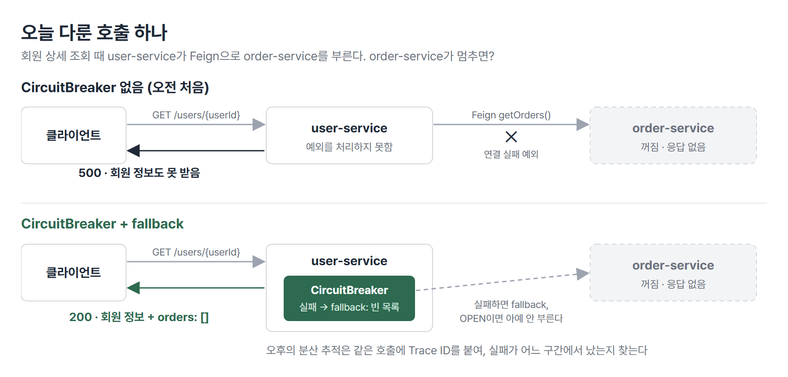
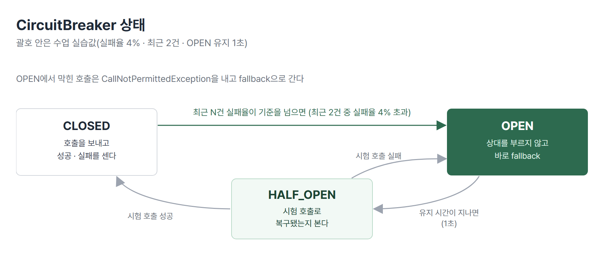
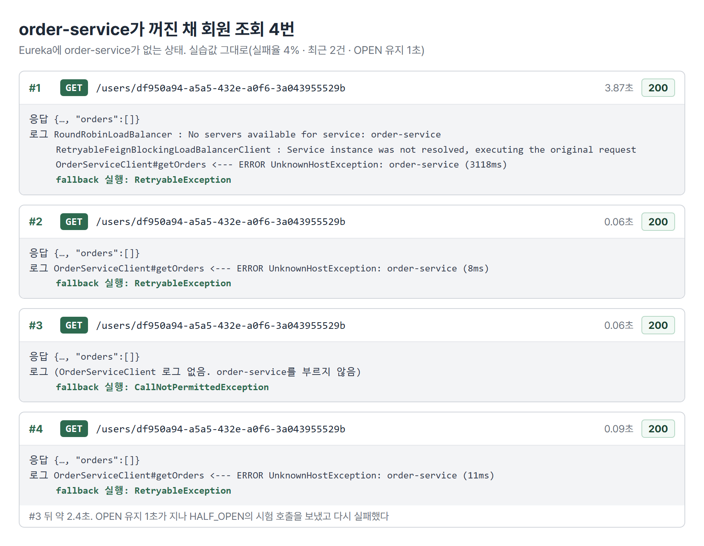
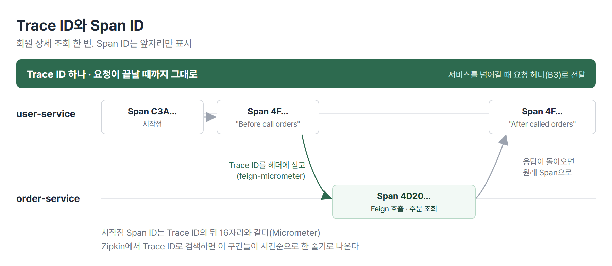
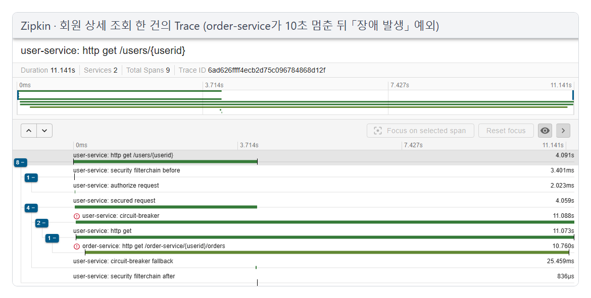

# <LG CNS 6기] MSA 9일차 TIL · CircuitBreaker와 분산 추적

> TL;DR: order-service가 멈추면 멀쩡한 user-service까지 500을 내는 장애 전파를 Resilience4j CircuitBreaker와 fallback으로 막아, 회원 정보는 200으로 나오고 주문 목록만 비게 했다. 오후에는 Micrometer Tracing과 Zipkin을 붙여 요청 하나가 user-service에서 order-service로 넘어갈 때 Trace ID는 그대로, Span ID는 구간마다 새로 붙는 것을 로그와 Zipkin 화면으로 확인했다.

## 🗺️ 한눈에 보기

### 오늘은 무엇을 배운 날이었나

교재 Section 13 「장애 처리와 Microservice 분산 추적」을 한 번에 나갔다. 오전은 장애 처리, 오후는 분산 추적이다. 두 마디 모두 같은 호출(회원 상세 조회 때 user-service가 Feign으로 order-service의 주문 목록을 부르는 호출)을 다룬다. 오전은 그 호출이 실패할 때 피해를 user-service 안에서 끊는 방법이다. 오후는 그 호출이 어디를 거쳐 어디서 실패했는지 찾는 방법이다.



> 💡 서비스가 나뉘면 한쪽 장애가 다른 쪽으로 번지고 어디서 났는지도 찾기 어려워진다. 번지는 것은 CircuitBreaker로 막았고 찾는 일은 Trace ID와 Zipkin으로 했다.

### 상황별로 무엇을 쓰나

| 이런 상황이면 | 이것을 쓴다 | 절 |
|---|---|---|
| 상대 서비스가 에러 응답(404 등)을 보냈다 | ErrorDecoder(7일차) | 1 |
| 상대 서비스가 아예 응답하지 않는다 | CircuitBreaker + fallback | 1 · 2 |
| 실패가 이어지면 상대를 그만 부르고 싶다 | CircuitBreaker 실패율 · 집계창 설정 | 3 |
| 상대가 느려서 응답을 오래 기다린다 | TimeLimiter | 3 |
| 요청 하나가 여러 서비스를 거친 흐름을 본다 | Micrometer Tracing(Trace ID · Span ID) + Zipkin | 4 · 5 |

## 🧭 오늘의 학습 키워드

| 키워드 | 한 줄 정리 | 오늘 어디에 쓰였나 |
|---|---|---|
| 장애 전파 | 한 서비스의 장애가 그 서비스를 부르는 서비스의 실패로 번지는 것 | 1번 절 |
| CircuitBreaker | 실패가 이어지면 상대 호출을 끊고 대신 응답하는 패턴 | 2 · 3번 절 |
| Resilience4j | CircuitBreaker · TimeLimiter · Retry 등을 제공하는 라이브러리 | 2 · 3번 절 |
| fallback | 호출이 실패하거나 차단됐을 때 대신 돌려줄 값 | 2번 절 |
| `CircuitBreakerFactory` | 이름을 주면 CircuitBreaker 객체를 만들어 주는 스프링 클라우드 빈 | 2번 절 |
| CLOSED / OPEN / HALF_OPEN | 정상 통신 / 호출 차단 / 복구 시험 | 3번 절 |
| `failureRateThreshold` | OPEN으로 바꿀 실패율 기준(%) | 3번 절 |
| `slidingWindowSize` | 실패율을 셀 때 보는 최근 호출 수 | 3번 절 |
| `CallNotPermittedException` | OPEN 상태에서 호출을 막았을 때 나는 예외 | 3번 절 |
| TimeLimiter | 정한 시간 안에 응답이 없으면 실패로 처리 | 3번 절 |
| 분산 추적 | 서비스 여러 개를 거친 요청 하나를 같은 번호로 묶어 따라가는 것 | 4번 절 |
| Trace ID / Span ID | 요청 하나 전체의 번호 / 그 안 구간 하나의 번호 | 4 · 5번 절 |
| Micrometer Tracing | 서비스마다 넣어 Trace · Span을 만들고 보내는 라이브러리 | 4번 절 |
| Zipkin | 추적 정보를 모아 저장하고 화면으로 보여 주는 서버 | 4 · 5번 절 |
| propagation(B3) | 서비스 사이에 추적 번호를 헤더로 넘기는 형식 | 4번 절 |

## ✍️ 공부한 내용

### 1. order-service가 멈추면 user-service도 500

회원 상세 조회(`GET /user-service/users/{userId}`)는 user-service가 Feign으로 order-service를 불러 주문 목록을 받아 온다. order-service를 꺼 두고 조회하면 user-service 자체에는 문제가 없는데도 500이 난다. order-service에 연결하다 난 예외(`java.net.UnknownHostException`)를 처리하는 코드가 없어 회원 조회 전체가 실패하기 때문이다.

강사님은 7일차에 배운 두 처리 방식과 비교했다.

| 방식 | 하는 일 | 오늘 상황(order-service가 응답 없음)에서 |
|---|---|---|
| try-catch | 호출하는 곳에서 예외를 잡는다 | 막을 수는 있지만 호출하는 메서드마다 넣어야 한다. 죽은 서비스를 매번 다시 부르고 응답을 기다린다 |
| ErrorDecoder | 상대가 보낸 에러 응답의 상태 코드를 내 쪽 예외로 바꾼다 | 상대가 응답을 보내지 않았으니 동작하지 않는다 |
| CircuitBreaker | 실패를 세다가 기준을 넘으면 호출 자체를 하지 않고 fallback을 돌려준다 | 회원 정보는 200으로 주고 주문 목록만 비운다 |

강사님은 ErrorDecoder와 CircuitBreaker를 「대체재가 아니라 보완재」라고 했다. 상대가 응답은 했는데 실패 응답인 경우는 ErrorDecoder가, 응답 자체가 없거나 늦는 경우는 CircuitBreaker가 맡는다.

> 💡 마이크로서비스는 한쪽 장애가 다른 쪽으로 번지면 안 된다. order-service가 죽어도 회원 정보는 나와야 한다.

### 2. CircuitBreaker 붙이기: `run(호출, fallback)`

Resilience4j는 CircuitBreaker · RateLimiter · Bulkhead · Retry · TimeLimiter 같은 장애 대응 패턴을 제공하는 라이브러리다. 예전에는 Netflix Hystrix를 썼지만 지금은 지원이 끝나 Resilience4j를 쓴다. 스프링 클라우드 의존성 하나를 넣으면 CircuitBreaker와 TimeLimiter 두 가지가 들어온다.

```xml
<dependency>
    <groupId>org.springframework.cloud</groupId>
    <artifactId>spring-cloud-starter-circuitbreaker-resilience4j</artifactId>
</dependency>
```

user-service의 `UserServiceImpl`이 `CircuitBreakerFactory`를 생성자로 받아, Feign 호출을 CircuitBreaker 안에서 실행한다.

```java
CircuitBreaker circuitBreaker = circuitBreakerFactory.create("circuitbreaker");

List<ResponseOrder> orderList = circuitBreaker.run(
        () -> orderServiceClient.getOrders(userId),          // 실행할 호출
        throwable -> {                                       // 실패하면 대신 돌려줄 값
            log.warn("fallback 실행: {}", throwable.getClass().getSimpleName());
            return new ArrayList<>();
        });
userDto.setOrders(orderList);
```

- `run()`의 첫 인자가 원래 하려던 호출, 두 번째 인자가 fallback이다. 둘 다 람다식으로 넘긴다.
- 호출이 성공하면 주문 목록이, 실패하면 빈 목록이 `orderList`에 들어간다. 어느 쪽이든 회원 조회는 이어서 진행된다.
- `create("circuitbreaker")`의 문자열은 CircuitBreaker 이름이다. 이름별로 실패 기록을 따로 센다.

order-service를 꺼 둔 채 회원을 조회하면 200과 빈 `orders`가 온다. 아래 로그는 그 한 번의 user-service 로그다(시각 · 패키지 이름은 생략).

```
UserServiceImpl : Before call orders microservice
RoundRobinLoadBalancer : No servers available for service: order-service
RetryableFeignBlockingLoadBalancerClient : Service instance was not resolved, executing the original request
RoundRobinLoadBalancer : No servers available for service: order-service
RetryableFeignBlockingLoadBalancerClient : Service instance was not resolved, executing the original request
OrderServiceClient : [OrderServiceClient#getOrders] <--- ERROR UnknownHostException: order-service (3118ms)
UserServiceImpl : fallback 실행: RetryableException
UserServiceImpl : After called orders microservice
```

- Eureka에 order-service가 없으니 로드밸런서가 넘겨줄 인스턴스를 찾지 못했다. 그러자 Feign은 서비스 이름 그대로 `http://order-service`로 요청을 보냈다. `order-service`라는 호스트 이름은 DNS에 없으므로 `UnknownHostException`이 났다.
- Feign은 이 예외를 `RetryableException`으로 감싸 던지고 CircuitBreaker가 그 예외를 받아 fallback을 실행했다.
- fallback 다음 줄 `After called orders microservice`까지 진행됐다. 회원 조회가 끊기지 않고 끝까지 갔다는 뜻이다.

| | CircuitBreaker 없음 | CircuitBreaker + fallback |
|---|---|---|
| order-service 꺼짐 | 500, 회원 정보도 못 받음 | 200, 회원 정보 + 빈 `orders` |
| 맞는 상황 | 없음 | 주문 목록이 없어도 회원 화면은 보여 줘야 할 때 |

> 💡 CircuitBreaker는 실패할 수 있는 호출을 감싸고 실패하면 정해 둔 대체값으로 응답을 이어 가게 한다.

### 3. 언제 끊고 언제 다시 붙나: 상태와 설정

CircuitBreaker는 실패 한 번에 바로 끊지 않는다. 최근 호출의 실패율을 세다가 기준을 넘으면 끊는다.



| 상태 | 하는 일 |
|---|---|
| CLOSED | 정상. 호출을 그대로 보내고 결과(성공 · 실패)를 센다 |
| OPEN | 차단. 상대를 부르지 않고 바로 fallback을 돌려준다 |
| HALF_OPEN | OPEN 유지 시간이 지나면 시험 호출을 보내 본다. 성공하면 CLOSED, 실패하면 다시 OPEN |

기준은 설정 클래스에서 바꾼다. `Customizer`로 기본 설정을 덮어쓰는 빈을 등록하면, `UserServiceImpl`이 주입받는 팩토리가 이 설정으로 CircuitBreaker를 만든다.

```java
@Bean
public Customizer<Resilience4JCircuitBreakerFactory> globalCustomConfiguration() {
    CircuitBreakerConfig circuitBreakerConfig = CircuitBreakerConfig.custom()
            .failureRateThreshold(4)
            .waitDurationInOpenState(Duration.ofMillis(1000))
            .slidingWindowType(CircuitBreakerConfig.SlidingWindowType.COUNT_BASED)
            .slidingWindowSize(2)
            .build();

    TimeLimiterConfig timeLimiterConfig = TimeLimiterConfig.custom()
            .timeoutDuration(Duration.ofSeconds(4))
            .build();

    return factory -> factory.configureDefault(id ->
            new Resilience4JConfigBuilder(id)
                    .timeLimiterConfig(timeLimiterConfig)
                    .circuitBreakerConfig(circuitBreakerConfig)
                    .build());
}
```

| 설정 | 뜻 | 기본값(수업 설명) | 실습값 |
|---|---|---|---|
| `failureRateThreshold` | OPEN으로 바꿀 실패율(%) | 50 | 4 |
| `waitDurationInOpenState` | OPEN을 유지하는 시간. 지나면 HALF_OPEN | 1분 | 1초 |
| `slidingWindowType` | 최근 N건으로 셀지(COUNT_BASED), 최근 N초로 셀지(TIME_BASED) | COUNT_BASED | COUNT_BASED |
| `slidingWindowSize` | 실패율을 셀 최근 호출 수 | 100 | 2 |
| `timeoutDuration`(TimeLimiter) | 이 시간 안에 응답이 없으면 실패 | 1초 | 4초 |

- 실습값은 회로가 열리는 것을 바로 보이려고 일부러 낮게 잡은 값이다. 실무 값이 아니다.
- `Customizer`는 같은 이름의 클래스가 여러 패키지에 있어서 `org.springframework.cloud.client.circuitbreaker`의 것을 골라야 한다.

order-service를 꺼 둔 채 회원을 세 번 연속 조회하면 세 번째 호출에서 `CallNotPermittedException`이 난다. 첫 호출과 두 번째 호출이 모두 실패해 최근 2건의 실패율이 100%가 됐고 4%를 넘었으니 OPEN이 되어 세 번째 호출은 order-service로 가지 않았다.



- #1 · #2는 order-service를 부르려다 실패했다(`UnknownHostException` 로그가 있다). #3에는 `OrderServiceClient` 로그가 없다. order-service를 부르지 않고 바로 `CallNotPermittedException`으로 fallback했다.
- OPEN 유지 시간이 1초라 조금만 지나도 HALF_OPEN으로 넘어가 시험 호출을 보낸다. #3 뒤 약 2.4초에 보낸 #4가 그 시험 호출이고 다시 실패했다. 차단된 상태를 오래 보려면 `waitDurationInOpenState`를 주석 처리해 기본값(1분)으로 늘린다.
- 반대로 늘려 둔 채 TimeLimiter 테스트로 넘어가면 회로가 열린 채로 남아 상대를 부르지 않으므로 테스트가 동작하지 않는다. 이때는 옵션을 1초로 되돌리고 user-service를 재기동한 뒤 진행한다.

TimeLimiter는 order-service에 일부러 지연을 넣어 확인했다. 주문 조회 API에 난수로 절반쯤은 10초를 멈추게 하는 코드를 넣고 회원을 조회하면, 멈춘 호출은 10초를 다 기다리지 않고 4초 뒤 fallback(빈 목록)이 나간다.

- **왜 나왔나**: 상대 서비스가 죽거나 느리면 그 서비스를 부르는 서비스도 실패하거나 같이 느려졌다. try-catch로는 매번 상대를 부르고 기다리는 것까지 막지 못했다.
- **안 그러면 뭐가 되나**: 끊지 않으면 죽은 서비스를 계속 부르고 실패를 기다린다. 끊으면 OPEN 동안은 호출을 보내지 않고 바로 fallback을 돌려준다.
- **대가는 뭔가**: fallback이 돌려준 빈 목록은 「주문이 없음」과 겉으로 같다. 또 OPEN 동안에는 상대가 이미 살아났어도 호출하지 않는다. 유지 시간과 집계 기준을 어떻게 잡느냐에 따라 정상 응답을 놓치는 시간이 생긴다.

> 💡 CircuitBreaker는 실패율이 기준을 넘으면 상대 호출을 끊는다. 정해 둔 시간이 지나면 시험 호출로 다시 붙을지 정한다. TimeLimiter는 느린 응답을 정해 둔 시간에서 실패로 끊는다.

### 4. 분산 추적: 요청 하나에 번호 하나

서비스가 여러 개로 나뉘면 요청 하나가 user → order → catalog처럼 여러 서비스를 거친다. 중간에서 실패하면 서비스마다 로그를 따로 열어 봐야 한다. 그래서 요청 하나에 번호를 붙여 모든 서비스의 로그를 그 번호로 묶는다. 이것을 분산 추적이라고 한다.

| 번호 | 무엇의 번호인가 | 서비스를 넘어갈 때 |
|---|---|---|
| Trace ID | 요청 하나의 시작부터 끝까지 전체 | 요청 헤더에 실려 그대로 넘어간다 |
| Span ID | 그 안에서 서비스 · 작업 단위 하나의 구간 | 받는 쪽에서 새로 발급한다 |



회원 상세 조회 한 번의 로그를 보면 user-service가 order-service를 부르기 직전 로그의 Span ID는 `4F…`, Feign으로 order-service를 부르는 동안은 `4D20…`, 호출이 끝나고 돌아온 뒤 로그는 다시 `4F…`였다. Trace ID는 처음부터 끝까지 같았다. 요청이 시작된 첫 구간은 Span ID가 Trace ID의 뒤 16자리와 같아서 「여기가 시작점」이라는 것을 알 수 있다.

아래는 order-service의 장애 코드를 주석 처리한 상태에서 주문 3건을 넣고 회원을 조회한 로그다. 스프링 부트 3.5 기본 형식이라 줄마다 `[traceId-spanId]`가 붙는다(시각 · 스레드 · 패키지 이름은 생략).

```
user-service : [6ad626568e1618f56b8d27de45604b42-f7563a21af8f49a6] UserServiceImpl : Before call orders microservice
user-service : [6ad626568e1618f56b8d27de45604b42-307ff1bc24f82bc0] OrderServiceClient : ---> GET http://order-service/order-service/df950a94-…/orders HTTP/1.1
order-service: [6ad626568e1618f56b8d27de45604b42-d800f6a897d28428] OrderController : Before retrieve orders data
order-service: [6ad626568e1618f56b8d27de45604b42-d800f6a897d28428] OrderController : Add retrieved orders data
user-service : [6ad626568e1618f56b8d27de45604b42-307ff1bc24f82bc0] OrderServiceClient : <--- HTTP/1.1 200 (460ms)
user-service : [6ad626568e1618f56b8d27de45604b42-f7563a21af8f49a6] UserServiceImpl : After called orders microservice
```

- 앞 32자리 Trace ID는 두 서비스의 모든 줄에서 같다.
- 뒤 16자리 Span ID는 구간마다 다르다. 호출 전후 로그(`f756…`), Feign 호출(`307f…`), order-service 처리(`d800…`)가 각각의 구간이다. 앞의 `4F` → `4D20` → `4F`와 같은 모양이다.

이 번호를 만드는 라이브러리가 Micrometer Tracing이고 모아서 보여 주는 서버가 Zipkin이다. 예전에 쓰던 Spring Cloud Sleuth는 스프링 부트 3부터 지원이 끝나 Micrometer Tracing으로 바뀌었다. Zipkin은 Docker로 띄웠다.

```bash
docker run -d --name zipkin -p 9411:9411 openzipkin/zipkin
```

추적할 서비스(user · order) pom에 의존성을 넣는다.

| 의존성 | 하는 일 |
|---|---|
| `micrometer-observation` | 관측(Observation) 기본 API. Tracing이 이 위에서 동작한다 |
| `micrometer-tracing-bridge-brave` | 추적 공통 인터페이스. 실제로 Trace ID를 만들고 넘기는 엔진으로 Brave를 쓴다 |
| `zipkin-reporter-brave` | Brave가 만든 추적 정보를 Zipkin에 보낸다 |
| `brave-instrumentation-spring-web` | 스프링 웹 요청에 추적을 붙인다 |
| `feign-micrometer` | Feign으로 다른 서비스를 부를 때 Trace ID를 요청 헤더에 실어 보낸다 |
| `spring-boot-starter-actuator` | 추적 설정이 동작하는 기반. order-service에는 없어서 함께 넣었다 |

```yaml
management:
  tracing:
    sampling:
      probability: 1.0        # 추적 정보를 100% 보낸다
    propagation:              # 모든 서비스가 같은 형식이어야 추적이 이어진다
      consume: B3
      produce: B3
  zipkin:
    tracing:
      endpoint: http://localhost:9411/api/v2/spans
```

- `probability: 1.0`은 요청 전부의 추적 정보를 보낸다는 뜻이다. 운영 환경에서는 양이 많아 일부만 보낸다(샘플링).
- propagation은 추적 번호를 헤더에 어떤 형식으로 싣는지 정한다. 강사님이 「중요한 것」으로 짚은 것은 형식의 내용이 아니라 모든 서비스가 같은 형식을 써야 한다는 점이다.
- 의존성만 넣는다고 추적 정보가 생기지 않는다. 코드에서 로그를 남겨야 그 구간이 기록된다. 강사님은 CircuitBreaker 호출 앞뒤에 `log.info`를 넣었다.
- 실습 환경은 스프링 부트 3.5.3이다. 강사님은 부트 4에서는 의존성 구성과 yml 경로가 바뀌었다고 했다.

> 💡 Trace ID는 요청 하나 전체에 하나만 붙고 서비스를 넘어가도 그대로다. Span ID는 구간마다 새로 붙는다. 그래서 Trace ID 하나로 검색하면 그 요청이 거친 구간이 순서대로 나온다.

### 5. 일부러 낸 장애를 Zipkin에서 찾기

order-service의 주문 조회 API에 10초를 멈춘 뒤 예외(`장애 발생`)를 던지는 코드를 넣고 회원을 조회했다. 회원 조회는 CircuitBreaker 덕분에 200과 빈 주문 목록으로 끝난다. order-service 콘솔에는 `장애 발생` 예외가 찍힌다. 그 한 번의 두 서비스 로그를 시각순으로 모으면 다음과 같다(스레드 · 패키지 이름은 생략).

```
23:19:43.708 user-service : [6ad626ffff4ecb2d75c096784868d12f-9b67ad9c6fa959b8] UserServiceImpl : Before call orders microservice
23:19:44.067 order-service: [6ad626ffff4ecb2d75c096784868d12f-b25209502e27eb00] OrderController : Before retrieve orders data
23:19:47.717 user-service : [6ad626ffff4ecb2d75c096784868d12f-9aaa8c2f96b10ff6] UserServiceImpl : fallback 실행: TimeoutException
23:19:47.742 user-service : [6ad626ffff4ecb2d75c096784868d12f-9b67ad9c6fa959b8] UserServiceImpl : After called orders microservice
23:19:54.676 order-service: [                                                 ] ERROR … Request processing failed: java.lang.Exception: 장애 발생
23:19:54.790 user-service : [6ad626ffff4ecb2d75c096784868d12f-fcc389b9f3d69623] OrderServiceClient : <--- HTTP/1.1 500 (11073ms)
```

- 호출 4초 뒤 TimeLimiter가 기다림을 끊고 fallback을 돌려줬다. 회원 조회 응답은 그때 200으로 나갔다.
- order-service는 그 뒤에도 10초를 다 채우고 예외를 던졌다. Feign은 11초 뒤에 500을 받았지만 회원 조회 응답은 이미 나간 뒤다. TimeLimiter는 기다리는 쪽만 끊고 상대가 하던 작업은 멈추지 않는다.
- order-service의 예외 줄에는 Trace ID 칸이 비어 있다. 로그 파일에서는 이 예외를 Trace ID로 찾을 수 없다.

Zipkin에서 그 요청의 Trace ID로 검색하면 user-service 구간과 order-service 구간이 한 줄기로 나온다. 실패한 구간에는 에러 표시(새 화면에서는 느낌표)와 에러 메시지 `장애 발생`, 상태 500이 붙는다.



- 맨 위 user-service 구간(회원 조회 요청)은 4.091초에 끝났다. 전체 Trace는 order-service 구간이 끝날 때까지 이어져 11.141초다.
- 느낌표가 붙은 구간은 `circuit-breaker`와 order-service의 `/order-service/{userid}/orders`다. order-service 구간을 열면 에러 `장애 발생`, 예외 타입 `Exception`, 상태 500이 나온다. 로그에서 Trace ID가 빠진 예외도 Zipkin에서는 이 요청 안에 붙어 있다.

Dependencies 화면에서는 정한 시간대에 서비스 사이를 오간 요청이 움직이는 점으로 보이고 에러가 난 호출은 빨간 점으로 센다. 위 정상 조회 한 번과 장애 조회 한 번 뒤에는 user-service → order-service 호출 2건 중 에러 1건으로 집계됐다.

| Zipkin 화면 | 보는 것 |
|---|---|
| Trace ID 검색(우측 상단) | 요청 하나가 거친 구간과 각 구간의 소요 시간 · 에러 |
| Find a Trace | 서비스 이름 등으로 걸러 추적 목록 찾기 |
| Dependencies | 시간대를 정해 서비스 사이 호출 관계와 에러 횟수 |

- Zipkin은 기본으로 메모리에 저장한다. 껐다 켜면 추적 정보가 사라지고 남기려면 MySQL · MariaDB 같은 DB를 연결한다.
- 마지막 실습 과제는 catalog-service에 상품 하나를 조회하는 API를 만들고 order-service가 Feign으로 부르게 해서 user → order → catalog 세 구간이 Trace ID 하나로 이어지는지 Zipkin에서 확인하는 것이다.

> 💡 열 개쯤 이어진 요청에서 중간 장애를 찾을 때 Trace ID 검색 한 번이 서비스마다 로그를 여는 일을 대신한다. 서비스가 둘일 때는 그 차이가 작다.

## 🧩 이어지는 내용

- 7일차(10/14)에 Feign으로 order-service를 부르고 ErrorDecoder로 404를 처리했다. 오늘은 같은 호출에서 상대가 아예 응답하지 않을 때를 다뤘다.
- 8일차(10/15)에 Kafka를 Docker로 띄웠다. 오늘 Zipkin도 같은 방식(Docker 컨테이너)으로 띄웠다.
- 교재 목차상 다음은 Section 14 Microservice Architecture 패턴, Section 15 · 16 컨테이너 가상화와 Docker 배포다.
- 2차 사후평가는 10/29, 미니 프로젝트 2는 10/30에 시작한다.

## ❓ 몰랐던 것

### order-service가 꺼져 있으면 ErrorDecoder로 왜 못 막나

ErrorDecoder는 상대가 보낸 응답의 상태 코드를 보고 예외를 정하는 장치다. 응답이 있어야 동작한다. order-service가 꺼져 있으면 연결 단계에서 실패해 응답 자체가 없으므로 ErrorDecoder까지 가지 못한다. 7일차의 「order-service의 404가 클라이언트에게 500으로 보인 이유」와 같은 구조다. 클라이언트는 user-service의 응답만 보고, user-service가 order-service 쪽 실패를 처리하지 못하면 자기 요청이 실패해 500이 된다. 다른 점은 실패의 모양이다. 7일차는 상대가 404라는 응답을 줬다. 오늘은 응답이 없었다. 응답이 없는 실패를 받아 주는 자리가 CircuitBreaker의 fallback이다.

### fallback이 빈 목록과 200을 돌려줘도 되는 경우와 위험한 경우

되는 경우는 빠진 데이터가 부가 정보일 때다. 회원 상세 화면에서 주문 목록이 비어도 회원 정보는 보여 줄 수 있다. 위험한 경우는 빈 값이 정상 값과 구분되지 않을 때다. 클라이언트는 빈 `orders`만 보고 「주문이 없다」와 「주문을 못 가져왔다」를 가리지 못한다. 결제 금액이나 재고처럼 틀리면 안 되는 값을 fallback으로 0이나 빈 값으로 채우면 실패가 정상처럼 보인다. 그래서 fallback을 쓸 때는 로그를 남긴다(오늘 코드의 `log.warn`). 화면에 「일부 정보를 불러오지 못했다」를 알릴지도 API 명세에 정한다.

### 실습값에서 세 번째 호출이 order-service로 가지 않은 이유

실패율을 「최근 2건」으로 세게 했기 때문이다. 첫 호출과 두 번째 호출이 모두 실패해 최근 2건의 실패율이 100%가 됐고 기준 4%를 넘었으므로 CircuitBreaker가 OPEN이 됐다. OPEN에서는 호출을 보내지 않고 `CallNotPermittedException`을 내며 바로 fallback을 돌려준다. 그래서 세 번째 호출은 order-service에 연결을 시도하지도 않았다.

### Trace ID가 order-service로 넘어가는 통로

HTTP 요청 헤더다. user-service가 Feign으로 order-service를 부를 때 `feign-micrometer`가 요청 헤더에 Trace ID(와 지금 구간의 Span ID)를 싣는다. order-service는 헤더에서 Trace ID를 읽어 같은 Trace ID를 이어 쓴다. 자기 구간에는 새 Span ID를 붙인다. 응답이 돌아오면 그 요청의 추적도 끝난다.

### 서비스마다 propagation 형식이 다르면

헤더에 싣는 형식과 읽는 형식이 다르면 order-service는 user-service가 보낸 추적 번호를 읽지 못한다. 그러면 order-service는 받은 요청을 새 요청으로 보고 새 Trace ID를 만든다. Zipkin에서는 user-service의 추적과 order-service의 추적이 서로 다른 Trace ID로 따로 나온다. 한 줄기로 이어지지 않는다. 강사님도 이 대목에서 「모든 서비스가 같은 스펙을 써야 추적이 끊기지 않는다」고 짚었다.

## 📌 다음에 해볼 것

- [ ] `waitDurationInOpenState`를 60초로 늘리고 OPEN 동안 order-service를 다시 켜서, 바로 붙지 않고 60초 뒤 HALF_OPEN에서 붙는지 확인하기
- [ ] 실습 과제: catalog-service에 상품 하나 조회 API를 만들고 order-service가 Feign으로 부르게 해서 Zipkin에 세 구간이 이어지는지 확인하기
- [ ] order-service의 propagation만 다른 형식으로 바꾸고 Zipkin에서 추적이 둘로 갈라지는지 확인하기

## 🔍 더 짚어둘 것

### 1. 미니 프로젝트: 외부 API에 기대는 서비스

2차 미니 프로젝트의 MSA 구현 기준은 「외부 API(AI · 공공데이터 등)에 의존하는 기능은 별도 서비스로 뗀다. 외부가 느리거나 실패해도 나머지 화면은 동작한다」고 정해 두었다. 서비스를 떼는 것만으로는 이 목표가 다 이뤄지지 않는다. 그 서비스를 부르는 쪽이 오늘 실습처럼 실패를 끊어야 한다.

- **어느 호출에 CircuitBreaker를 둘지**: 외부 API를 부르는 서비스, 그리고 그 서비스를 부르는 서비스 사이의 호출이 1순위다.
- **fallback 값**: 서비스마다 「실패하면 무엇을 보여 줄지」를 명세에 적는다. 빈 목록, 기본 문구, 「잠시 후 다시 시도」 안내 중 무엇인지 화면 담당과 맞춘다.
- **TimeLimiter 시간**: AI 응답처럼 원래 몇 초씩 걸리는 호출은 기본값 1초면 정상 응답도 실패로 끊긴다. 호출별로 평소 응답 시간을 재고 정한다.
- **추적은 처음부터**: Trace ID를 로그에 남기는 설정은 서비스를 만들 때 같이 넣는 편이 낫다. 시연 중 장애가 나면 Trace ID 하나로 어느 서비스에서 났는지 바로 찾을 수 있다.

### 2. AI: 바이브코딩할 때 사람이 확인할 것

- **스프링 부트 버전에 맞는 의존성인가**: 오늘 설정은 부트 3.5 기준이고 부트 4에서는 의존성과 yml 경로가 바뀌었다. 미니 프로젝트 2는 부트 4.1.1이라 AI가 준 설정이 어느 버전 기준인지부터 본다. Sleuth나 Hystrix가 나오면 지원이 끝난 옛 방식이다.
- **fallback이 실패를 감추지 않는가**: 빈 값만 돌려주고 로그가 없으면 장애가 나도 아무도 모른다.
- **실습값을 그대로 쓰지 않는가**: 실패율 4% · 최근 2건 · 1초는 수업용 값이다. 그대로 두면 일시적인 실패 한 번에도 회로가 열린다.
- **`Customizer` import**: 같은 이름의 클래스가 여러 패키지에 있다. 자동완성이 다른 패키지 것을 넣으면 설정이 적용되지 않는다.

태그: LG CNS 6기, 개발자, LGCNSINSPIRECAMP
