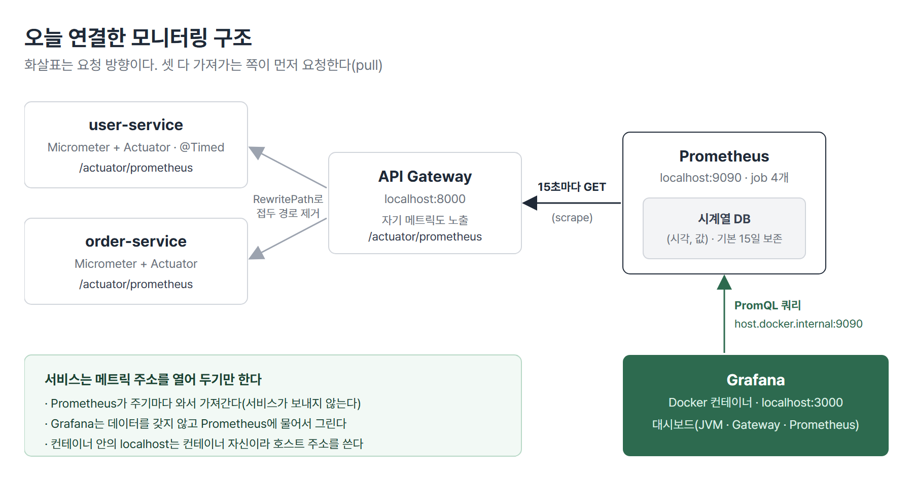
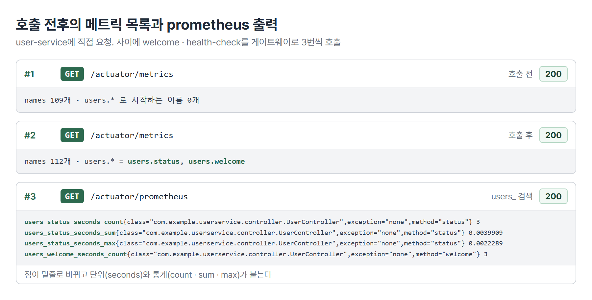
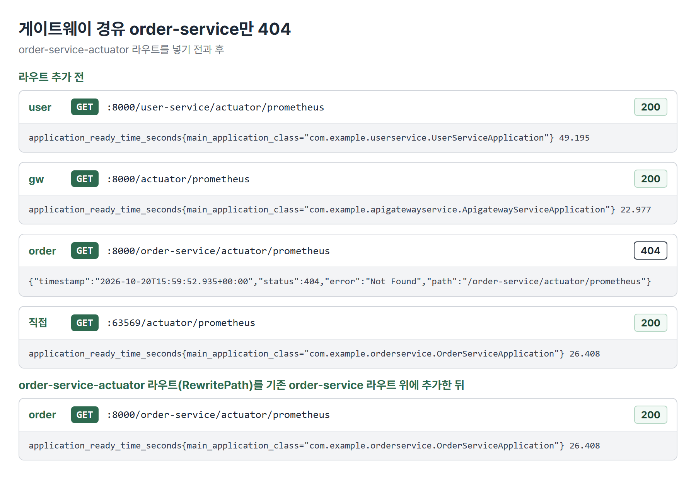
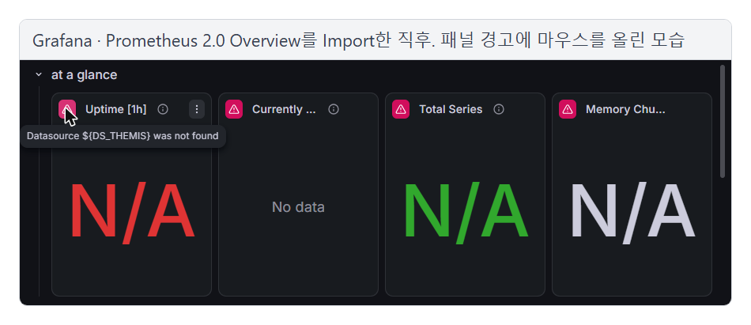
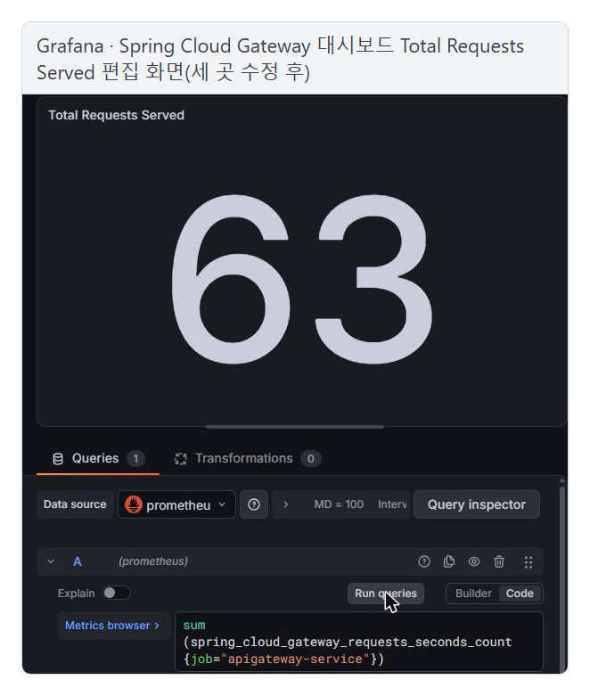
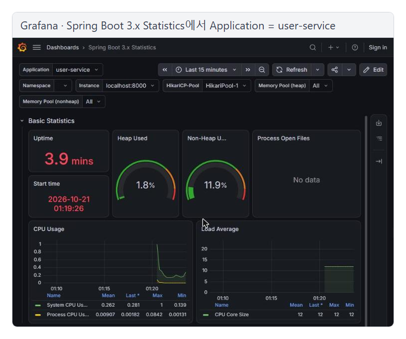
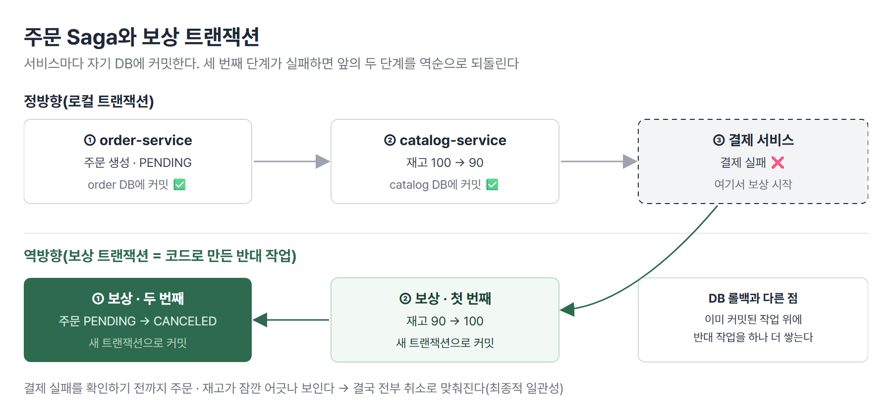

# <LG CNS 6기] MSA 10일차 TIL · Prometheus와 Grafana 모니터링

> TL;DR: user · order · gateway 세 서비스에 Micrometer와 Actuator로 지표를 열었다. Prometheus가 15초마다 게이트웨이를 거쳐 긁어 가 시계열로 쌓고 Grafana가 그 데이터를 대시보드로 보여 주게 연결했다. 2020년에 만든 대시보드를 가져와 데이터 소스 · 메트릭 이름 · job 조건을 지금 버전에 맞게 고쳤다. 마지막에는 서비스마다 DB가 따로인 구조에서 트랜잭션을 맞추는 Saga 패턴을 다뤘다.

## 🗺️ 한눈에 보기

### 오늘은 무엇을 배운 날이었나

9일차의 분산 추적은 요청 하나가 어느 서비스를 거쳤는지 보는 도구였다. 오늘 배운 모니터링(교재 Section 14)은 서비스마다 요청 수 · 응답 시간 · 메모리 · CPU 같은 숫자를 시간에 따라 모아 서비스가 얼마나 바쁘고 건강한지 보는 도구다. 오늘은 코드보다 의존성 추가 · 환경 설정 · 제품 설치가 대부분이었다.



> 💡 Micrometer는 서비스 안에서 지표를 잰다. Prometheus는 그 지표를 주기적으로 가져가 시간순으로 저장하고 Grafana는 Prometheus에 물어 그래프로 그린다. 데이터는 셋 다 「당겨 가는」 방향으로 움직인다.

### 상황별로 무엇을 쓰나

| 이런 상황이면 | 이것을 쓴다 | 절 |
|---|---|---|
| 서비스의 요청 수 · 응답 시간을 지표로 만들고 싶다 | Micrometer + Actuator + `micrometer-registry-prometheus` | 2 |
| 특정 API에 따로 이름을 붙여 재고 싶다 | `@Timed` + `management.observations.annotations.enabled` | 2 |
| 지금 어떤 지표가 있는지 사람이 확인한다 | `/actuator/metrics` | 3 |
| 수집기가 지표 값을 가져갈 주소가 필요하다 | `/actuator/prometheus` | 3 · 4 |
| 여러 서비스의 지표를 주기적으로 모아 시간순으로 저장한다 | Prometheus(`prometheus.yml`의 job) | 4 · 5 |
| 저장된 지표를 그래프 · 대시보드로 본다 | Grafana + 데이터 소스 연결 | 6 · 7 |
| 서비스마다 DB가 따로인데 여러 서비스 작업을 함께 성공 · 취소시켜야 한다 | Saga 패턴(보상 트랜잭션) | 8 |

## 🧭 오늘의 학습 키워드

| 키워드 | 한 줄 정리 | 오늘 어디에 쓰였나 |
|---|---|---|
| 모니터링 | 서비스 상태를 숫자로 모아 시간에 따라 보는 것 | 1번 절 |
| 메트릭(지표) | 요청 수 · 응답 시간 · 메모리처럼 잴 수 있는 값 | 전체 |
| Micrometer | JVM 애플리케이션 안에서 메트릭을 만드는 라이브러리 | 2 · 3번 절 |
| `@Timed` | 메서드 하나에 이름을 붙여 실행 횟수 · 시간을 재는 어노테이션 | 2 · 3번 절 |
| `/actuator/prometheus` | 모든 메트릭을 Prometheus가 읽는 텍스트 형식으로 내주는 엔드포인트 | 3 · 4번 절 |
| Prometheus | 메트릭을 주기적으로 긁어 와 시계열 DB에 저장하는 서버 | 4 · 5번 절 |
| pull 방식 | 수집하는 쪽이 대상에게 가서 가져오는 방식 | 1 · 4번 절 |
| scrape | Prometheus가 대상의 메트릭 주소를 호출해 값을 가져가는 일 | 4 · 5번 절 |
| 시계열 데이터 | 같은 항목을 일정 간격으로 재서 (시각, 값)으로 쌓은 데이터 | 1 · 5번 절 |
| job · target | 수집 대상의 이름 · 수집할 주소 | 4 · 5번 절 |
| PromQL | Prometheus에 저장된 시계열을 조회하는 쿼리 언어 | 5 · 6번 절 |
| Grafana | 데이터 소스에 쿼리를 보내 대시보드로 시각화하는 도구 | 6 · 7번 절 |
| `host.docker.internal` | 컨테이너 안에서 호스트 PC를 가리키는 주소 | 6번 절 |
| Saga 패턴 | 여러 서비스 작업을 단계별로 처리하고 실패하면 반대 작업으로 되돌리는 방법 | 8번 절 |
| 보상 트랜잭션 | 이미 커밋된 작업을 되돌리려고 코드로 만든 반대 작업 | 8번 절 |

## ✍️ 공부한 내용

### 1. 모니터링이 왜 필요하고 무엇을 보나

마이크로서비스는 서비스 수십 개가 따로 돈다. 어느 서비스가 요청을 많이 받는지, 어디서 응답이 느려지는지, 메모리가 차오르는 서비스가 있는지 알려면 서비스마다 숫자를 모아 한곳에서 봐야 한다. 9일차 분산 추적과 비교하면 다음과 같다.

| | 분산 추적(Zipkin) | 모니터링(Prometheus · Grafana) |
|---|---|---|
| 답하는 질문 | 이 요청 하나가 어느 서비스를 거쳤고 어디서 실패했나 | 이 서비스가 지금 얼마나 바쁘고 건강한가 |
| 단위 | 요청 하나(Trace ID) | 시간 구간별 숫자(요청 수 · 응답 시간 · 메모리) |
| 맞는 상황 | 특정 장애 요청의 원인 구간 찾기 | 추세 보기, 병목 · 과부하 서비스 찾기 |

교재 목차의 Hystrix Dashboard · Turbine Server는 예전 Spring Cloud의 모니터링 도구이고 지금은 deprecated(더 개발하지 않고 대체재가 있는 상태)다. 개념과 설정 방식이 비슷해 교재 그대로 읽되, Turbine 자리는 Micrometer + Prometheus로, Hystrix Dashboard 자리는 Grafana로 바꿔 읽으면 된다.

교재의 화살표는 서비스가 수집 서버로 보내는 것처럼 그려져 있지만 실제 방향은 반대다. Prometheus가 정해 둔 주기(실습은 15초)마다 각 서비스의 메트릭 주소를 호출해 가져간다(pull 방식). Grafana도 Prometheus에 쿼리를 보내 데이터를 당겨 온다. 8일차 Kafka에서 Consumer가 Broker에서 메시지를 당겨 가던 것과 같은 방향이다.

> 💡 서비스는 메트릭 주소를 열어 두기만 하고 가져가는 것은 Prometheus다. 주소를 열지 않으면 Prometheus는 아무것도 가져갈 수 없다.

### 2. Micrometer와 Actuator 설정

Micrometer는 JVM 기반 애플리케이션에 메트릭을 제공하는 라이브러리다. Spring Boot 2부터 스프링의 메트릭 처리에 쓰였고 Prometheus 외에도 여러 모니터링 시스템을 지원한다. Prometheus와 연결하려면 Prometheus 형식으로 내주는 registry 의존성을 넣는다. 세 서비스(user · order · gateway) pom에 같은 의존성을 추가했다.

```xml
<!-- micrometer + prometheus -->
<dependency>
    <groupId>io.micrometer</groupId>
    <artifactId>micrometer-registry-prometheus</artifactId>
</dependency>
```

의존성만으로는 수집이 시작되지 않는다. Actuator가 있어야 하고 엔드포인트도 열어야 한다. 세 서비스 모두 Actuator는 이미 있었다(order-service는 9일차 Zipkin 실습 때 추가). 노출 목록에 `metrics`와 `prometheus`를 더한다.

```yaml
management:
  endpoints:
    web:
      exposure:
        include:
          - health
          - info
          - metrics      # 추가
          - prometheus   # 추가
```

- Actuator와 이 의존성이 함께 있으면 컨트롤러 메서드(API) 처리 결과가 `http.server.requests`라는 메트릭 하나에 자동으로 쌓인다. API마다 따로 이름을 만들지 않고 `uri` 값으로 구분한다.
- order-service에는 엔드포인트 노출 설정 자체가 없어서 블록을 새로 만들었다.

API 하나를 따로 이름 붙여 재고 싶으면 `@Timed`를 쓴다. user-service의 헬스 체크와 welcome 메서드에 붙였다.

```java
@GetMapping("/health-check")
@Timed(value = "users.status")
public String status() { ... }

@GetMapping("/welcome")
@Timed(value = "users.welcome")
public String welcome(HttpServletRequest request) { ... }
```

```yaml
management:
  observations:
    annotations:
      enabled: true   # @Timed를 처리하는 TimedAspect가 자동 등록된다
```

- Spring Boot 3부터는 `@Timed`만 붙여서는 측정되지 않는다. 메서드 실행에 끼어들어 시간을 재는 TimedAspect 빈이 있어야 한다. 자바 코드로 빈을 등록하는 방법과 yml 한 줄로 켜는 방법 중 yml을 썼다.
- 교재의 `longTask = true`는 넣지 않았다. longTask 타이머는 끝난 요청이 아니라 아직 실행 중인 오래 걸리는 작업을 잰다. 헬스 체크처럼 밀리초 안에 끝나는 메서드에는 잴 것이 없다.
- 게이트웨이는 라우팅만 하고 비즈니스 로직이 없어 `@Timed`를 붙이지 않았다.

> 💡 지표가 생기려면 세 가지가 함께 있어야 한다. Actuator, Prometheus registry 의존성, 엔드포인트 노출이다. `@Timed`는 Boot 3에서 TimedAspect를 켜는 설정까지 있어야 동작한다.

### 3. `/actuator/metrics`와 `/actuator/prometheus`

두 엔드포인트는 같은 메트릭을 다른 사람에게 보여 준다.

| | `/actuator/metrics` | `/actuator/prometheus` |
|---|---|---|
| 보는 쪽 | 사람 | Prometheus |
| 형식 | JSON, 메트릭 이름 목록 | 텍스트, 모든 메트릭의 이름과 값 |
| 이름 | `users.status` | `users_status_seconds_count` 등 |
| 맞는 상황 | 어떤 메트릭이 있는지 확인할 때 | 수집 주소로 등록할 때 |

`@Timed`를 붙이고 서버를 켠 직후에는 `/actuator/metrics` 목록에 `users.status`가 없다. API 메트릭은 그 API가 한 번이라도 호출돼야 생긴다. welcome과 health-check를 세 번씩 부른 뒤에는 목록에 나타난다.



- Prometheus는 이름에 점을 쓰지 않으므로 Micrometer가 점을 밑줄로 바꾼다. 그 뒤에 단위(`seconds`)와 통계 종류가 붙는다.
- `@Timed` 하나에서 `_count`(호출 횟수) · `_sum`(걸린 시간 합계)를 가진 summary와 `_max`(최근 가장 오래 걸린 시간)를 가진 gauge가 함께 나온다.
- Grafana에서 쿼리를 쓸 때는 점 이름이 아니라 이 밑줄 이름을 그대로 써야 값이 나온다.

> 💡 `/actuator/metrics`는 「무엇을 재고 있나」, `/actuator/prometheus`는 「잰 값이 얼마인가」다. Prometheus에 등록하는 주소는 뒤쪽이다.

### 4. Prometheus 수집 설정과 게이트웨이 경유 404

Prometheus는 압축 파일을 풀면 바로 실행된다. 최신(latest)이 아니라 안정화된 LTS 버전을 받았다. Docker 이미지도 있지만 컨테이너로 띄우면 설정 파일을 고칠 때 컨테이너 안에서 vi를 쓰거나 볼륨(컨테이너 데이터를 호스트 폴더와 묶는 기능)을 걸어야 해서 실습은 압축 해제 방식으로 했다. 실무와 프로젝트에서는 환경을 타지 않는 Docker를 권한다고 했다.

수집 대상은 `prometheus.yml`의 `scrape_configs`에 job으로 적는다. 기본으로 Prometheus 자기 자신을 수집하는 job이 들어 있고 그 아래 세 서비스를 추가했다. 세 job 모두 게이트웨이(`localhost:8000`)를 거쳐 수집한다.

```yaml
scrape_configs:
  - job_name: "prometheus"
    static_configs:
      - targets: ["localhost:9090"]

  - job_name: "user-service"
    scrape_interval: 15s
    metrics_path: "/user-service/actuator/prometheus"
    static_configs:
      - targets: ["localhost:8000"]

  - job_name: "order-service"
    scrape_interval: 15s
    metrics_path: "/order-service/actuator/prometheus"
    static_configs:
      - targets: ["localhost:8000"]

  - job_name: "apigateway-service"
    scrape_interval: 15s
    metrics_path: "/actuator/prometheus"   # 게이트웨이 자신이라 접두 경로 없음
    static_configs:
      - targets: ["localhost:8000"]
```

- 실제 요청 주소는 `targets` 뒤에 `metrics_path`가 붙은 것이다.
- `scrape_interval`을 빼면 `global` 값을 쓰고 `global`도 없으면 기본 1분이다.
- Prometheus를 Docker로 띄우면 컨테이너 안의 `localhost:8000`은 호스트 PC의 게이트웨이가 아니라 컨테이너 자신이다. 그때는 `host.docker.internal:8000`으로 적는다.

세 주소를 Prometheus에 넣기 전에 브라우저로 확인하면 order-service만 404가 난다. order-service에 직접 요청하면 200이므로 order-service 설정이 아니라 게이트웨이 라우트 문제다.



- 기존 order-service 라우트는 `/order-service/...` 경로를 그대로 넘긴다. 주문 API는 컨트롤러 매핑 자체가 `/order-service`로 시작해서 문제가 없었다. Actuator는 `/actuator/prometheus`에 있어서 앞의 `/order-service`를 잘라 내야 한다. 404 응답의 `path`가 `/order-service/actuator/prometheus`인 것이 접두 경로가 그대로 넘어갔다는 증거다.
- 해결은 user-service의 actuator 라우트를 복사해 order-service용을 만드는 것이다. 새 라우트는 `RewritePath`로 앞의 `/order-service`를 잘라 내고 뒤 경로만 넘긴다.

```yaml
- id: order-service-actuator
  uri: lb://ORDER-SERVICE
  predicates:
    - Path=/order-service/actuator/**
    - Method=GET,POST
  filters:
    - RewritePath=/order-service/(?<segment>.*), /$\{segment}
- id: order-service          # 기존 라우트는 이 아래
  uri: lb://ORDER-SERVICE
  predicates:
    - Path=/order-service/**
```

- 새 라우트는 기존 `order-service` 라우트 **위**에 둔다. 게이트웨이는 라우트를 위에서부터 검사해 처음 맞는 하나만 적용한다. `/order-service/**`가 위에 있으면 actuator 요청도 거기에 먼저 걸려 새 라우트는 절대 적용되지 않는다. 더 구체적인 경로를 위에 둔다.
- 「metrics는 되는데 prometheus만 안 된다」는 경우는 pom을 고친 뒤 Maven sync를 하지 않아 registry 의존성이 실제로 들어오지 않은 것이었다.

> 💡 게이트웨이를 거쳐 수집하면 라우트가 Actuator 경로까지 맞게 넘겨야 한다. 라우트는 처음 맞는 하나만 적용되므로 구체적인 경로를 위에 둔다.

### 5. Prometheus 조회 결과 읽기

압축을 푼 폴더에서 설정 파일을 지정해 실행한다. 수집한 데이터는 실행한 폴더의 `data`에 저장되므로 매번 같은 폴더에서 실행해야 이어서 쌓인다.

```bash
prometheus --config.file=prometheus.yml
```

`localhost:9090`의 쿼리 창에 `http_server_requests_seconds_count`를 넣고 실행하면 서비스 · 메서드 · 상태 코드 · 경로별 누적 요청 수가 나온다. 아래는 그 결과에서 라벨 일부(job · method · status · uri)만 남긴 것이다.

```
job=order-service       GET  404  uri="/**"                   8
job=order-service       GET  200  uri="/actuator/prometheus"  35
job=user-service        GET  200  uri="/actuator/prometheus"  39
job=user-service        GET  200  uri="/health-check"         3
job=user-service        GET  200  uri="/welcome"              3
job=user-service        POST 201  uri="/users"                1
job=user-service        POST 200  uri="UNKNOWN"               1
job=apigateway-service  GET  200  uri="/actuator/prometheus"  31
job=apigateway-service  GET  200  uri="UNKNOWN"               71
```

- 이름은 메트릭 이름 + 단위 + 통계 종류로 읽는다. `_count`는 횟수, `_sum`은 처리 시간 합계, `_max`는 최근 가장 오래 걸린 요청이다.
- 모든 결과의 `instance`가 `localhost:8000`이다. 게이트웨이를 거쳐 수집했기 때문이다. 서비스는 `job`으로 구분한다.
- 요청을 보내지 않아도 `/actuator/prometheus` 행이 계속 는다. Prometheus가 15초마다 그 주소를 호출하는 것 자체가 요청이기 때문이다.
- `uri`에는 실제 주소가 아니라 컨트롤러 매핑 패턴이 남는다. 컨트롤러를 거치지 않은 요청은 `UNKNOWN`이다. 게이트웨이가 다른 서비스로 넘기기만 한 요청이 그렇고 컨트롤러가 아니라 필터가 처리한 로그인 요청(user-service POST 200)도 그렇다. 매핑이 없어 404가 난 요청은 `/**`로 남는다.
- 값은 서버가 켜진 뒤부터의 누적값이다. Graph 탭에서는 같은 쿼리를 시간축 그래프로 볼 수 있다. 기본 보존 기간은 15일이고 그 이상 남기려면 외부 저장소를 연결한다.

> 💡 Prometheus 결과는 「메트릭 이름 + 라벨 조합 하나 = 시계열 하나」다. 어느 라벨로 거르고 묶느냐가 곧 무엇을 보느냐다.

### 6. Grafana 연결과 2020년 대시보드 고치기

Grafana는 Docker로 띄웠다. 압축 파일 버전도 있지만 Windows에서 권한 문제가 이어져 컨테이너로 바꿨다.

```bash
docker run -d -p 3000:3000 --name grafana grafana/grafana
docker logs grafana
```

`localhost:3000`에서 초기 관리자 계정으로 로그인한다(비밀번호 변경 화면은 건너뛸 수 있다). Grafana는 데이터를 직접 갖지 않고 Prometheus 같은 데이터 소스에 쿼리를 보낸다. Connections > Add new connection > Prometheus에서 데이터 소스를 만들고 주소를 넣는다.

| 데이터 소스 주소 | 결과 | 이유 |
|---|---|---|
| `http://localhost:9090` | 「connection refused」로 연결 실패 | Grafana가 컨테이너 안에 있어 `localhost`는 컨테이너 자신을 가리킨다 |
| `http://host.docker.internal:9090` | 「Successfully queried the Prometheus API.」 | 컨테이너 밖 호스트 PC의 Prometheus를 가리킨다 |

대시보드는 직접 만들려면 PromQL을 알아야 해서 grafana.com에 공개된 대시보드를 ID로 가져왔다(Import → ID 입력 → Load → 데이터 소스 선택 → Import). 일부러 2020년에 만든 대시보드 세 개를 골라 지금 버전에 맞게 고치는 연습을 했다.

| 대시보드 | 증상 | 고친 곳 |
|---|---|---|
| JVM(Micrometer, 11892) | 대부분 값이 나옴. Uptime · Start time 글씨가 깨짐 | 패널 크기 · 표시 형식 조정 |
| Prometheus 2.0 Overview(3662) | 모든 패널에 경고, N/A | 대시보드 JSON의 `${DS_THEMIS}`를 내 데이터 소스 값으로 일괄 치환 |
| Spring Cloud Gateway(11506) | 거의 전부 N/A · No data | 메트릭 이름 · job 조건 · Value options 세 곳 |



- 3662는 데이터 소스를 변수(`${DS_THEMIS}`)로 적어 두었는데 가져올 때 그 변수가 내 데이터 소스로 바뀌지 않았다. 패널 경고에 마우스를 올리면 「Datasource ${DS_THEMIS} was not found」가 나온다.
- 고치는 길: 대시보드 설정 → JSON Model → 전체 복사 → 에디터에서 `${DS_THEMIS}`를 내 데이터 소스 값으로 전체 바꾸기 → 다시 붙여넣고 저장. 고친 뒤 Uptime · Total Series 같은 값이 나온다.

Spring Cloud Gateway 대시보드의 Total Requests Served 패널은 세 곳을 차례로 고쳐야 숫자가 나온다. 앞의 두 곳만 고쳐서는 여전히 N/A다.

| 단계 | 옛 대시보드 | 바꾼 값 | 이유 |
|---|---|---|---|
| ① 메트릭 이름 | `gateway_requests_seconds_count` | `spring_cloud_gateway_requests_seconds_count` | 지금 버전은 앞에 `spring_cloud_`가 붙는다. 옛 이름으로 조회하면 결과 0건 |
| ② job 조건 | 대시보드 변수 `$gatewayService` | `prometheus.yml`에 지은 job 이름(`apigateway-service`) | 변수가 옛 메트릭 이름으로 값을 찾고 있어 비어 있다 |
| ③ Value options의 Fields | `/^Value$/` | Numeric Fields | 옛 패널 형식의 조건이라 지금 데이터 필드 이름과 맞지 않는다 |



- 패널마다 하나씩 고치는 대신 대시보드 설정의 Variables에서 원작자가 만든 변수 두 개를 고치면 한 번에 적용된다.
- 「No data」만 보고 문제라고 단정할 수 없다. 아직 쌓인 데이터가 없을 수도 있고 쿼리 설정이 틀렸을 수도 있다.
- CPU 패널처럼 여러 서비스를 한 그래프에 그리면 범례가 전부 `localhost:8000`으로 나와 구분이 안 된다. Legend를 instance 대신 job으로 바꾼다.
- JVM Memory 그래프가 톱니 모양인 것은 GC(가비지 컬렉터)가 주기적으로 메모리를 비우기 때문이다.

> 💡 옛 대시보드가 안 나오는 이유는 대개 세 가지다. 데이터 소스 변수가 안 바뀌었거나, 메트릭 이름이 바뀌었거나, 패널 형식이 바뀌었다. 가장 좋은 방법은 지금 버전용 대시보드를 쓰는 것이다.

### 7. 지금 버전용 대시보드와 `application` 라벨

남은 시간 과제는 지금 버전용 대시보드를 넣어 보는 것이었다(Micrometer는 Spring Boot 3용, Prometheus 최신용, Spring Cloud Gateway 공식). 세 개를 넣어 보면 Gateway와 Prometheus는 고치지 않아도 값이 나오지만 Spring Boot 3용은 그대로는 서비스를 고를 수 없다.

| 대시보드 | 결과 |
|---|---|
| Spring Cloud Gateway 공식(Spring Cloud Gateway 저장소의 JSON) | 처음부터 `spring_cloud_gateway_…` 이름을 써서 그대로 값이 나온다. 라우트별 실패 · QPS(초당 요청 수) 패널이 더 있다. 6번 절에서 고친 11506과 대시보드 UID가 같다 |
| Prometheus 2.0 Stats(15489) | 그대로 값이 나온다. job별 수집 시간(Scrape Duration) 등 |
| Spring Boot 3.x Statistics(19004) | Application 목록이 비어 있고 Instance는 `localhost:8000` 하나뿐이라 세 서비스가 섞인다 |

Spring Boot 3용 대시보드는 서비스를 `application` 라벨로 고른다. 게이트웨이를 거쳐 수집하면 세 서비스의 `instance`가 모두 같으므로 이 라벨이 없으면 서비스를 구분할 방법이 없다. 실습 코드의 마지막 커밋에서 세 서비스에 공통으로 들어간 설정이 이 라벨을 붙인다.

```yaml
management:
  metrics:
    tags:
      application: ${spring.application.name}   # 모든 메트릭에 서비스 이름 라벨을 붙인다
```



- 라벨을 붙이고 나면 Application에서 서비스를 고를 때마다 Uptime · 메모리 · CPU · DB 커넥션 풀(HikariCP)이 그 서비스 값으로 바뀐다.
- 서비스 이름을 직접 쓰지 않고 `${spring.application.name}`을 넣었으므로 세 서비스가 같은 줄을 그대로 써도 각자 자기 이름이 붙는다.

> 💡 지표를 모으는 쪽에서 「누가 보낸 값인지」를 라벨로 남겨 둬야 보는 쪽에서 나눠 볼 수 있다. 게이트웨이 경유처럼 주소가 같아지는 구조에서는 더 그렇다.

### 8. 마무리: Saga 패턴

수업 마지막에 Saga 패턴을 다뤘다. 모놀리식은 DB가 하나라 `@Transactional` 하나로 「전부 성공 아니면 전부 취소」가 된다. 마이크로서비스는 서비스마다 DB가 따로라 여러 서비스의 작업을 한 번에 묶어 롤백할 방법이 없다. 그래서 애플리케이션 코드에서 「성공하면 다음 단계, 실패하면 앞 단계를 취소」를 직접 챙긴다. 이것이 Saga 패턴이다. 항공권 · 호텔 · 렌터카를 각각 다른 회사에 예약하다 렌터카가 안 되면 앞의 예약을 거꾸로 취소하는 것과 같다.



- 각 서비스는 자기 DB의 작업만 처리하고 커밋한다(로컬 트랜잭션).
- 중간에 실패하면 앞에서 커밋된 작업을 반대 작업으로 하나씩, 역순으로 되돌린다(보상 트랜잭션). 재고 −10의 보상은 재고 +10, 주문 생성(PENDING)의 보상은 주문 취소(CANCELED)다.

| | DB 트랜잭션 롤백 | 보상 트랜잭션 |
|---|---|---|
| 되돌리는 대상 | 아직 커밋되지 않은 변경 | 이미 커밋된 작업 |
| 누가 되돌리나 | DB가 자동으로 | 개발자가 만든 반대 작업(새 트랜잭션)으로 |
| 범위 | DB 하나 안에서만 | 서비스 여러 개에 걸쳐 |

- **왜 나왔나**: 서비스마다 DB를 나누자 서비스 사이의 작업을 `@Transactional` 하나로 묶을 수 없게 됐다.
- **안 그러면 뭐가 되나**: 결제가 실패해도 재고는 이미 줄어든 채로, 주문은 대기 상태로 남는다. 각 서비스 DB는 각자 정상이라 에러도 나지 않는다.
- **대가는 뭔가**: 결제 실패를 확인하기 전까지는 주문과 재고가 어긋난 상태가 잠깐 보인다. 그래서 주문은 바로 확정하지 않고 PENDING으로 둔다. 결국 「전부 성공」 또는 「전부 취소」로 맞춰지는데 이것을 최종적 일관성이라고 한다. 또 취소는 완전한 원상복구가 아니라 반대 작업이다. 이미 보낸 예약 확인 문자는 지울 수 없으니 취소 문자를 다시 보내는 식이다.

> 💡 Saga는 여러 서비스의 작업을 순서대로 처리하고 실패하면 앞의 작업을 반대 작업으로 하나씩 되돌려 전부 성공 또는 전부 취소로 맞추는 방법이다.

## 🧩 이어지는 내용

- 9일차(10/16)에 Micrometer Tracing과 Zipkin으로 요청 하나의 경로를 추적했다. 오늘은 같은 Micrometer로 요청 수 · 응답 시간 같은 숫자를 모았다.
- 8일차(10/15)의 Kafka Consumer가 Broker에서 메시지를 당겨 갔듯 Prometheus도 서비스에서 메트릭을 당겨 간다. 8일차에 주문 → 재고를 Kafka로 맞춘 구조가 오늘 Saga 예시의 앞 두 단계와 같은 자리다.
- 교재 목차상 다음은 Section 15 · 16 컨테이너 가상화와 Docker 배포다. 10/21부터 7일간 「AM 기반의 MSA 기술 II」로 Docker · 쿠버네티스 · ArgoCD를 배운다.
- 2차 사후평가는 10/29, 미니 프로젝트 2는 10/30에 시작한다.

## ❓ 몰랐던 것

### 분산 추적과 모니터링은 어떻게 다른가

둘 다 서비스를 들여다보지만 답하는 질문이 다르다. 분산 추적은 「이 요청 하나가 어느 서비스를 거쳤고 어디서 실패했나」에 답한다. 단위가 요청 하나(Trace ID)라서 특정 장애 요청의 원인 구간을 찾는 데 쓴다. 모니터링은 「이 서비스가 지금 얼마나 바쁘고 건강한가」에 답한다. 단위가 시간 구간별 숫자라서 요청이 몰리는 서비스, 응답이 점점 느려지는 서비스, 메모리가 차오르는 서비스를 찾는 데 쓴다. 보통은 모니터링 그래프에서 이상을 먼저 보고 그 시간대의 요청을 분산 추적으로 파고든다.

### `@Timed`를 붙였는데 목록에 없던 이유

API 메트릭은 그 API가 한 번이라도 호출돼야 만들어진다. 서버를 켠 직후에는 호출 기록이 없으니 `users.status`라는 이름도 아직 없다. 설정이 틀린 것으로 착각하기 쉬운 지점이라 확인할 때는 해당 API를 먼저 몇 번 부른 뒤 목록을 본다. 대시보드의 route id 조건도 같다. 그 라우트로 요청이 한 번이라도 처리돼야 시계열이 생기므로, 조건에는 실제로 쓰인 route id를 넣는다.

### order-service 경로만 404였던 이유와 라우트 위치

기존 order-service 라우트는 `/order-service/...` 경로를 자르지 않고 그대로 넘긴다. 주문 API는 컨트롤러 매핑이 `/order-service`로 시작해서 그대로 넘겨도 맞았지만 Actuator는 `/actuator/prometheus`에 있어서 `/order-service/actuator/prometheus`라는 주소는 order-service 안에 없다. 그래서 order-service가 404를 냈다. user-service는 이미 actuator 전용 라우트에서 `RewritePath`로 앞부분을 잘라 내고 있었다. 새 라우트를 기존 라우트 위에 두는 이유는 게이트웨이가 위에서부터 검사해 처음 맞는 하나만 쓰기 때문이다. `/order-service/**`가 먼저 있으면 actuator 요청도 거기서 끝난다.

### 요청을 안 보냈는데 count가 계속 늘어난 이유

Prometheus의 수집 자체가 HTTP 요청이기 때문이다. Prometheus가 15초마다 각 서비스의 `/actuator/prometheus`를 GET으로 호출하므로 그 경로의 `http_server_requests_seconds_count`는 1분에 4씩 는다. 대시보드의 전체 요청 수 대부분이 이 수집 요청이고 「초당 요청 수」 그래프가 일정한 수평선으로 나오는 것도 같은 이유다. 실제 사용자 요청만 보려면 `uri`로 수집 경로를 빼고 조회한다.

### Grafana 데이터 소스에 `localhost:9090`을 쓰면 안 되는 이유

Grafana를 Docker 컨테이너로 띄웠기 때문이다. 컨테이너 안에서 `localhost`는 그 컨테이너 자신을 가리킨다. Grafana 컨테이너 안에는 9090에서 도는 프로그램이 없으므로 연결에 실패한다. 호스트 PC에서 도는 Prometheus를 가리키려면 Docker가 제공하는 `host.docker.internal`을 쓴다. 반대로 Prometheus를 컨테이너로 띄우면 `prometheus.yml`의 `localhost:8000`도 같은 이유로 `host.docker.internal:8000`이어야 한다. 실제 배포에서는 실제 서버 주소를 넣는다.

### 서비스를 구분하려면 무엇이 필요했나

라벨이다. Prometheus는 「메트릭 이름 + 라벨 조합」으로 시계열을 나눈다. 게이트웨이를 거쳐 수집하면 세 서비스의 `instance`가 모두 `localhost:8000`이라 `instance`로는 구분되지 않는다. `job`은 Prometheus가 붙이므로 직접 쿼리할 때는 쓸 수 있지만 Spring Boot 3용 대시보드는 `application` 라벨로 서비스를 고르게 만들어져 있다. `management.metrics.tags.application`으로 각 서비스가 자기 이름을 라벨로 붙여 내보내면 대시보드에서 서비스별로 나눠 볼 수 있다.

### 보상 트랜잭션은 무엇을 어떤 순서로 하나

주문 생성(PENDING) → 재고 100에서 90 → 결제 실패라면 보상은 성공했던 단계를 역순으로 되돌린다. 먼저 재고를 90에서 100으로 되돌린 다음 주문을 PENDING에서 CANCELED로 바꾼다. 각 보상은 그 자체가 새로 커밋되는 작업이다. DB 롤백은 커밋 전의 변경을 DB가 자동으로 없던 일로 만들지만, 보상 트랜잭션은 이미 커밋된 결과 위에 반대 작업을 하나 더 쌓는다. 그래서 「되돌리는 코드」를 개발자가 단계마다 따로 만들어야 하고, 되돌릴 수 없는 일(이미 나간 알림)은 취소 안내 같은 다른 반대 작업으로 대신한다.

## 📌 다음에 해볼 것

- [ ] Prometheus도 Docker로 띄워 `prometheus.yml`의 대상을 `host.docker.internal:8000`으로 바꿔 수집하기
- [ ] `uri!="/actuator/prometheus"` 조건으로 수집 요청을 뺀 실제 요청 수만 Grafana 패널로 만들어 보기
- [ ] 8일차 주문 → 재고(Kafka) 흐름에서 재고 차감이 실패하면 주문을 어떻게 취소할지, 보상 단계를 어디에 둘지 코드에서 찾아보기

## 🔍 더 짚어둘 것

### 1. 미니 프로젝트: 시연 전에 넣어 둘 관측 설정

2차 미니 프로젝트는 서비스를 여러 개로 나눈다. 시연 중 「어느 서비스가 느린가」를 바로 보이려면 처음부터 넣어 두는 편이 낫다.

- **`application` 라벨은 서비스 생성 때 같이**: 공통 설정 한 줄이라 나중에 넣어도 되지만 빠지면 최신 대시보드에서 서비스가 섞인다.
- **수집 경로 정하기**: 오늘처럼 게이트웨이를 거쳐 수집하면 Prometheus 설정이 간단하지만 게이트웨이 라우트에 actuator 경로가 다 있어야 하고 게이트웨이가 멈추면 수집도 같이 멈춘다. 서비스마다 직접 수집하면 그 반대다. 어느 쪽을 택할지 팀에서 정한다.
- **Docker로 띄우는 구성이면 주소부터**: 컨테이너끼리는 `localhost`로 서로 닿지 않는다. 호스트 · 컨테이너 중 무엇이 어디서 도는지 표로 정리해 두면 데이터 소스 · 수집 주소 오류를 줄인다.
- **주문 · 결제처럼 여러 서비스가 함께 성공해야 하는 기능**: 기능 명세 단계에서 실패 시 보상 순서(무엇을 먼저 되돌리나)와 중간 상태(PENDING)를 같이 적는다.

### 2. AI: 바이브코딩할 때 사람이 확인할 것

- **대시보드 · 설정이 어느 버전 기준인가**: 2020년 대시보드는 메트릭 이름(`gateway_` → `spring_cloud_gateway_`)과 패널 형식이 지금과 다르다. AI가 준 쿼리가 결과 0건이면 Prometheus 화면에서 자동완성으로 실제 이름부터 확인한다.
- **`@Timed`만 넣고 끝내지 않았나**: Boot 3에서는 `management.observations.annotations.enabled`가 함께 있어야 측정된다.
- **컨테이너 안의 `localhost`**: AI가 준 설정의 `localhost`가 컨테이너 안에서 실행되는 것인지 본다.
- **No data를 0으로 읽지 않는가**: 데이터가 없는 것과 쿼리가 틀린 것은 화면이 같다.

### 3. SAP ERP: 트랜잭션별 응답 시간 보기

SAP에서도 운영 중인 시스템의 상태를 숫자로 본다. 워크로드 모니터(ST03N)에서 트랜잭션 코드별 실행 횟수와 평균 응답 시간을 기간별로 확인하는 것이 오늘 `http_server_requests_seconds`를 `uri`별로 본 것과 같은 자리다. 「어느 화면이 느린가」를 사용자 신고가 아니라 집계된 숫자로 먼저 찾는다는 점이 같다.

태그: LG CNS 6기, 개발자, LGCNSINSPIRECAMP
