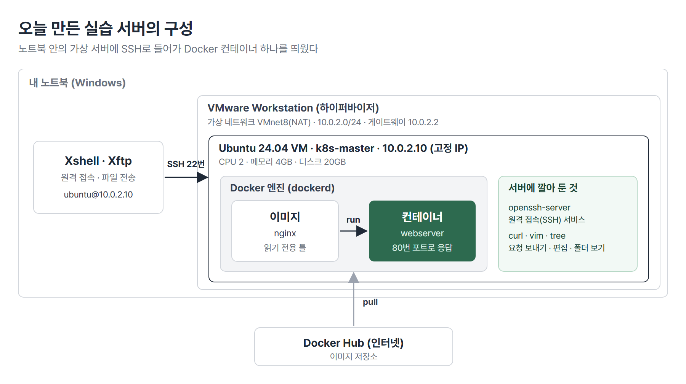
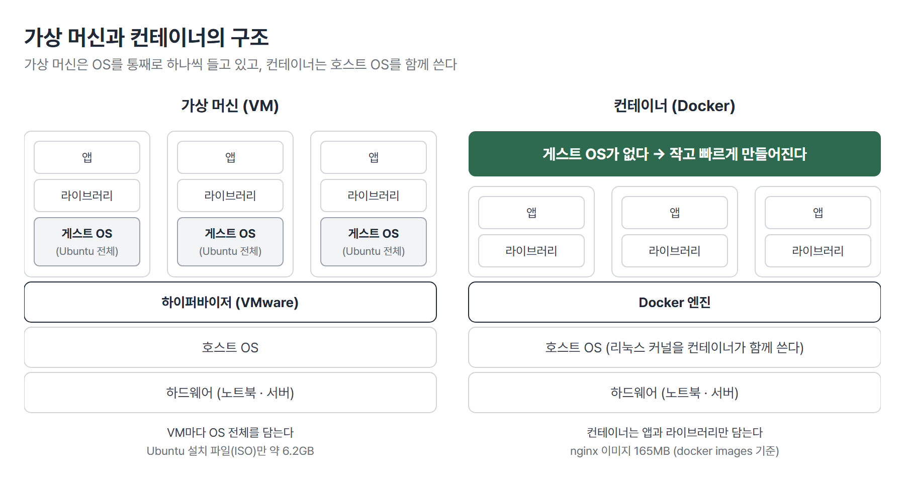
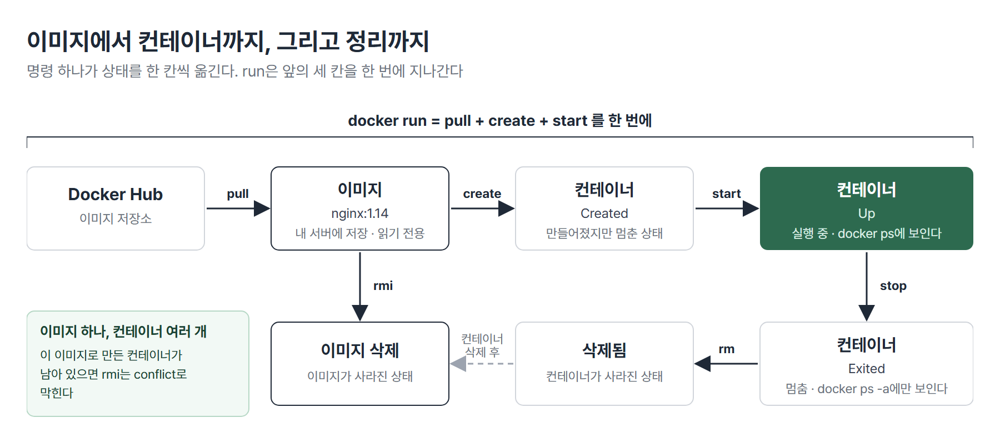

# <LG CNS 6기] MSA II 1일차 TIL · Docker 환경 구성과 기본 명령

> TL;DR: MSA II의 첫날. VMware 위에 Ubuntu 24.04 서버를 만들어 SSH로 접속하고 Docker 엔진을 설치했다. nginx 컨테이너를 띄워 `ps` · `rm` · `rmi`로 정리하는 기본 흐름까지 나갔다. 컨테이너는 앱과 라이브러리를 이미지로 묶어 서버마다 같은 환경을 만드는 방법이고 `docker run`은 이미지 받기 · 컨테이너 만들기 · 실행을 한 번에 한다.

## 🗺️ 한눈에 보기

### 오늘은 무엇을 위한 작업이었나

MSA I에서는 서비스를 내 PC에서 실행하며 만들었다. MSA II는 그 서비스를 서버에 올려 운영하는 쪽이고 첫 3일(10/21 ~ 10/23)은 Docker다. 오늘은 연습용 서버를 노트북 안에 만들고 그 서버에서 컨테이너 하나를 띄워 접속하고 지우는 데까지 나갔다.



> 💡 노트북(Windows) 위에 VMware가 있고 그 안의 Ubuntu 서버에 Docker 엔진을 깔았다. 이후 명령은 모두 Xshell로 이 서버에 접속해서 친다.

### 상황별로 무엇을 쓰나

| 이런 상황이면 | 이것을 쓴다 | 절 |
|---|---|---|
| 서버마다 환경이 달라 배포가 어긋난다 | 환경을 이미지로 묶은 컨테이너 | 1 |
| 노트북 안에 연습용 서버가 필요하다 | VMware + Ubuntu VM | 2 |
| 서버에 원격으로 접속하고 파일을 옮긴다 | SSH(Xshell) · Xftp | 2 |
| 서버에 Docker를 설치한다 | `install-docker.sh` + `chmod u+x` | 3 |
| 이미지를 받아 컨테이너를 띄운다 | `docker run` | 4 |
| 서버 밖에서 컨테이너의 서비스에 접속한다 | `-p 호스트포트:컨테이너포트` | 4 |
| 컨테이너와 이미지를 지운다 | `docker rm` → `docker rmi` | 5 |

## 🧭 오늘의 학습 키워드

| 키워드 | 한 줄 정리 | 오늘 어디에 쓰였나 |
|---|---|---|
| 가상 머신(VM) | 하이퍼바이저 위에 OS를 통째로 하나 더 올린 가상 컴퓨터 | 1 · 2번 절 |
| 하이퍼바이저 | 한 컴퓨터에서 여러 OS를 나눠 돌리게 하는 프로그램(VMware) | 1 · 2번 절 |
| VMnet8(NAT) | VM이 노트북을 거쳐 인터넷에 나가는 가상 네트워크 | 2번 절 |
| 고정 IP | 재부팅해도 바뀌지 않게 직접 지정한 주소 | 2번 절 |
| SSH | 원격 서버에 암호화해서 접속하는 방법 | 2번 절 |
| `chmod u+x` | 파일 소유자에게 실행 권한을 더하는 명령 | 3번 절 |
| Docker 엔진(`dockerd`) | 컨테이너와 이미지를 만들고 관리하는 백그라운드 프로그램 | 3번 절 |
| 이미지 | 컨테이너를 만드는 읽기 전용 틀 | 4번 절 |
| 컨테이너 | 이미지를 실행한 독립된 프로세스(실행 중인 프로그램) | 4번 절 |
| Docker Hub | 이미지를 저장하고 내려받는 저장소 | 4번 절 |
| 태그 | 이미지의 버전 이름. 생략하면 `latest` | 4번 절 |
| `docker run` | 이미지 받기 + 컨테이너 만들기 + 실행을 한 번에 | 4번 절 |
| `-p 호스트:컨테이너` | 서버의 포트와 컨테이너의 포트를 이어 주는 옵션 | 4번 절 |
| `docker ps -a -q` | 멈춘 것까지 모든 컨테이너의 ID만 | 5번 절 |
| `docker rmi` | 이미지 삭제. 그 이미지를 쓰는 컨테이너가 있으면 막힌다 | 5번 절 |

## ✍️ 공부한 내용

### 1. Docker를 먼저 배우는 이유

서버에 서비스를 올리려면 OS · 런타임 · 라이브러리 · 설정이 서버마다 같아야 한다. 하나라도 다르면 같은 프로그램이 한 서버에서만 실행되지 않는다. 서버가 수십 대면 새 버전을 모두에 같은 시점에 반영하는 일이 배포의 가장 큰 부담이 된다.

가상 머신(VM)은 서버마다 OS 전체를 하나씩 담아 환경을 맞췄다. 컨테이너는 앱과 라이브러리만 묶고 OS 커널(OS의 핵심 부분)은 호스트의 것을 함께 쓴다.



| | 가상 머신(VM) | 컨테이너 |
|---|---|---|
| 나누는 방식 | 하이퍼바이저가 OS째로 나눈다 | 호스트 리눅스의 기능으로 프로세스 단위로 나눈다 |
| 안에 든 것 | 게스트 OS 전체 + 라이브러리 + 앱 | 라이브러리 + 앱. 커널은 호스트의 것을 함께 쓴다 |
| 크기 | 수 GB. Ubuntu 설치 파일(ISO)만 약 6.2GB | 수십 ~ 수백 MB. nginx 이미지 165MB |
| 속도 | 하이퍼바이저를 거치고 크기가 커서 만들고 옮기는 데 오래 걸린다 | 성능 손실이 거의 없고 빠르게 만든다 |
| 맞는 상황 | OS째로 분리해야 하거나 OS가 서로 다른 환경 | 같은 서비스를 여러 서버에 똑같이 배포 |

- **왜 나왔나**: VM으로 환경을 맞추면 OS 전체를 싣기 때문에 이미지가 커서 네트워크로 옮기고 띄우는 데 시간이 오래 걸렸다.
- **안 그러면 뭐가 되나**: 서버마다 환경을 손으로 맞춰야 하고 어긋나면 같은 프로그램이 한 서버에서만 실행되지 않는다.
- **대가는 뭔가**: 컨테이너는 호스트 커널을 같이 쓰므로 OS째로 나누는 VM보다 격리가 약하다. Docker는 리눅스 기반이라 리눅스에서 기능을 전부 쓸 수 있고 오늘 실습도 Windows가 아니라 리눅스(Ubuntu) VM에서 했다.

배포 방식은 물리 서버 → 가상화 → 컨테이너 → 쿠버네티스 순서로 발전해 왔다. 컨테이너를 자동으로 관리하는 쿠버네티스는 다음 주에 배운다.

> 💡 VM은 OS를 통째로 들고 다니고 컨테이너는 앱과 라이브러리만 들고 다닌다. 그래서 컨테이너가 작고 빠르다.

### 2. 실습 서버 만들기: VMware · Ubuntu · 고정 IP · SSH

연습용 서버를 노트북 안에 만든다. 이 서버를 다음 주 쿠버네티스 실습에도 그대로 쓴다. 이름과 IP를 정해진 값에 똑같이 맞춰야 문제가 생겼을 때 같은 환경에서 원인을 찾을 수 있다.

VMware는 가상 네트워크를 세 종류 만들어 둔다. 오늘은 인터넷이 되는 VMnet8만 설정한다.

| 이름 | 방식 | 맞는 상황 |
|---|---|---|
| VMnet0 | 외부 네트워크와 같은 대역에 연결(브리지) | VM을 실제 네트워크의 장비 하나처럼 쓸 때 |
| VMnet1 | 호스트 전용. 내 PC 안에서만 통신 | 인터넷 없이 PC와 VM끼리만 시험할 때 |
| VMnet8 | NAT. PC를 거쳐 인터넷에 연결 | VM이 인터넷에 나가야 할 때 |

- VMnet8 값: Subnet IP `10.0.2.0` · 마스크 `255.255.255.0` · NAT 게이트웨이 `10.0.2.2` · DHCP 범위 `10.0.2.128 ~ 10.0.2.254`. 바꾼 뒤 Apply를 눌러야 적용된다.
- VM은 Ubuntu 24.04 LTS(장기 지원 버전) Desktop ISO로 만든다. 최신인 26이 아니라 24.04를 쓴다. 서버는 새 버전보다 검증된 버전을 쓰는 것이 관행이다.
- VM 이름은 `k8s-master`, 자원은 CPU 2 · 메모리 4GB · 디스크 20GB다. 설치할 때 컴퓨터 이름도 `k8s-master`로 맞추고 터미널에서 `hostname`으로 확인한다.
- VM 우클릭 → Snapshot → Take Snapshot으로 지금 상태를 저장해 두면 실습 중 망가져도 이 시점으로 되돌릴 수 있다.

NAT 대역에서는 DHCP가 `10.0.2.128`부터 주소를 자동으로 나눠 준다. 그대로 두면 재부팅 때 주소가 바뀔 수 있어서 서버는 주소를 직접 지정한다.

| 항목 | 값 |
|---|---|
| IPv4 방식 | 수동(Manual) |
| 주소 | `10.0.2.10` |
| 넷마스크 | `255.255.255.0` |
| 게이트웨이 · DNS | `10.0.2.2` |

설정 뒤 `ip addr`로 `10.0.2.10`이 보이는지 확인한 다음 필요한 패키지를 설치한다.

```bash
sudo -i
apt-get update
apt-get install -y openssh-server curl vim tree
```

| 패키지 | 쓰임 |
|---|---|
| `openssh-server` | 다른 컴퓨터가 SSH로 이 서버에 들어올 수 있게 한다 |
| `curl` | 터미널에서 주소로 요청을 보낸다. 웹 서버 확인에 쓴다 |
| `vim` | vi 편집기 |
| `tree` | 폴더 구조를 나무 모양으로 보여 준다 |

서버는 보통 멀리 있어서 화면과 키보드를 직접 붙일 수 없다. 그래서 SSH로 들어가 명령을 친다. 노트북에서 Xshell로 호스트 `10.0.2.10`, 포트 22, 사용자 `ubuntu`로 접속한다. 처음 접속할 때 뜨는 「수락 및 저장」을 누르면 다음부터는 묻지 않는다. 파일을 옮길 때는 같은 회사의 Xftp를 쓴다.

서버에서 쓴 기본 명령이다.

| 명령 | 하는 일 |
|---|---|
| `pwd` | 현재 위치(`/home/ubuntu`) |
| `ls -al` | 숨김 파일을 포함해 권한 · 소유자 · 시각까지 목록으로 본다 |
| `cd /` · `cd ..` · `cd ~` | 루트 · 상위 · 홈 폴더로 이동 |
| `mkdir test` · `touch aaa.txt` | 폴더 · 빈 파일 만들기 |
| `cp aaa.txt bbb.txt` | 복사 |
| `sudo -i` | 관리자(root)로 전환. 프롬프트 끝이 `$`면 일반 사용자, `#`이면 관리자 |

vi는 모드가 셋이다. 열면 명령 모드에서 시작하고 `i`로 입력 모드에 들어가며 `Esc`로 돌아온다. `:`를 누르면 실행 모드가 된다.

| 키 | 하는 일 |
|---|---|
| `i` | 입력 모드 |
| `:wq` | 저장하고 종료 |
| `:q!` | 저장하지 않고 강제 종료. 쿠버네티스 YAML을 잘못 고쳤을 때 쓴다 |
| `dd` · `yy` · `p` | 한 줄 삭제 · 복사 · 붙여넣기 |
| `u` | 되돌리기 |
| `:set nu` · `/단어` | 줄 번호 보기 · 검색 |

> 💡 서버 작업은 「SSH로 접속해서 명령을 친다」가 기본 흐름이다. 프롬프트의 `$`와 `#`로 지금 권한이 일반 사용자인지 관리자인지 먼저 본다.

### 3. Docker 엔진 설치와 실행 권한

Docker를 서버에 깔는 방법은 두 가지다.

| | 단계별 설치 | 스크립트 설치 |
|---|---|---|
| 방법 | 공식 문서의 명령을 한 줄씩 실행 | `install-docker.sh` 하나를 실행 |
| 맞는 상황 | 각 단계가 무엇을 하는지 익힐 때 | 같은 서버를 여러 번 만들거나 빨리 끝낼 때 |

오늘은 스크립트로 설치했다. 스크립트가 하는 일은 네 가지다.

- 준비 패키지(`ca-certificates` · `curl` · `gnupg` 등)를 설치한다.
- Docker 공식 GPG 키(내려받는 패키지가 진짜인지 확인하는 서명 키)와 apt 저장소를 등록한다.
- `docker-ce` · `docker-ce-cli` · `containerd.io`를 설치한다.
- `ubuntu` 사용자를 `docker` 그룹에 넣는다.

Xftp로 `/home/ubuntu`에 올린 파일을 root 홈으로 옮겨 실행한다. Ubuntu는 보안 때문에 외부 접속으로 root 폴더에 바로 올릴 수 없어서 일반 사용자 폴더에 올린 뒤 옮긴다.

```bash
sudo mv ./install-docker.sh /root
sudo -i
chmod u+x install-docker.sh
./install-docker.sh
```

`chmod`를 건너뛰면 실행되지 않는다.

```text
$ ls -al install-docker.sh
-rw-rw-r-- 1 ubuntu ubuntu 876 Oct 23 00:48 install-docker.sh
$ ./install-docker.sh
-bash: ./install-docker.sh: Permission denied
$ chmod u+x install-docker.sh
$ ls -al install-docker.sh
-rwxrw-r-- 1 ubuntu ubuntu 876 Oct 23 00:48 install-docker.sh
```

- `ls -al` 맨 앞의 열 `-rw-rw-r--`은 앞 3칸이 소유자, 다음 3칸이 그룹, 마지막 3칸이 나머지 사용자의 읽기(r) · 쓰기(w) · 실행(x) 권한이다.
- 소유자 칸에 `x`가 없으면 `./`로 실행할 때 `Permission denied`가 난다. `chmod u+x`는 소유자(user)에게 실행(x)을 더하고 그러면 `-rwx`로 바뀐다.
- `./`는 「현재 폴더의 파일」이라는 표시다. 빼면 시스템 경로에서 찾기 때문에 실행되지 않는다.

설치가 끝나면 Docker 데몬이 떠 있는지 본다.

```text
$ systemctl status docker
● docker.service - Docker Application Container Engine
     Loaded: loaded (/usr/lib/systemd/system/docker.service; enabled; preset: enabled)
     Active: active (running) since Wed 2026-10-21 14:37:11 KST; …
```

- `Active: active (running)`이 초록색이면 Docker 엔진(`dockerd`)이 떠 있는 것이다. 이 명령은 Docker뿐 아니라 리눅스 서비스 상태를 볼 때 공통으로 쓴다. 목록 화면이 멈춰 있으면 `Ctrl+C`(또는 `q`)로 빠져나온다.
- 연습에서는 `sudo -i`로 root가 되어 docker 명령을 썼다. 운영 서버에서는 root로 상시 작업하지 않는다. 스크립트가 `ubuntu`를 `docker` 그룹에 넣었으므로 다시 로그인하면 `sudo` 없이도 docker 명령이 된다.

> 💡 `Permission denied`는 「실행 권한이 없다」는 뜻이고 `chmod u+x`로 푼다. 설치가 됐는지는 `systemctl status docker`가 `active (running)`인지로 본다.

### 4. 이미지와 컨테이너, 그리고 `docker run`

이미지는 컨테이너를 만드는 읽기 전용 틀이고 컨테이너는 그 이미지를 실행한 것이다. 이미지 하나로 컨테이너를 여러 개 만들 수 있다. 컨테이너 안에서 파일을 바꿔도 이미지는 그대로이고 바뀐 부분만 그 컨테이너의 쓰기 계층에 저장된다.

이미지 이름은 이렇게 쓴다.

```text
[저장소 이름]/[이미지 이름]:[태그]     예) nginx:1.15
```

- 태그는 이미지의 버전이다. 생략하면 `latest`로 본다.
- `nginx` 같은 공식 이미지는 저장소 이름이 없다. 이미지는 Docker Hub(`hub.docker.com`)에 저장돼 있고 `docker login -u <계정>`으로 로그인한다. 비밀번호는 입력해도 화면에 보이지 않고 `Login Succeeded`가 나오면 성공이다. 이때 자격 증명이 암호화되지 않은 채 `config.json`에 저장된다는 경고가 함께 뜬다.

`docker search`로 이미지를 찾을 수 있다. `OFFICIAL` 칸에 `[OK]`가 붙은 것이 공식 이미지다.

```text
$ docker search nginx --limit 3
NAME                              DESCRIPTION                                     STARS     OFFICIAL
nginx                             Official build of Nginx.                        21409     [OK]
nginx/nginx-ingress               NGINX and  NGINX Plus Ingress Controllers fo…   124       
nginx/nginx-prometheus-exporter   NGINX Prometheus Exporter for NGINX and NGIN…   53        
```

- 이름에 `/`가 붙은 것은 올린 사람이 따로 있는 이미지다. 공식 이미지를 쓰는 것이 안전하다.

`docker run`은 세 단계를 한 번에 한다.

| 명령 | 하는 일 | `docker ps -a`의 상태 | 맞는 상황 |
|---|---|---|---|
| `docker pull nginx:1.15` | 이미지만 받는다 | 컨테이너 없음 | 미리 받아 둘 때 |
| `docker create --name web2 nginx:1.15` | 컨테이너만 만든다 | `Created` | 만들어 두고 나중에 실행할 때 |
| `docker start web2` | 만든 컨테이너를 실행한다 | `Up` | `create` 다음 단계 |
| `docker run -d --name web -p 80:80 nginx:1.15` | 위 셋을 한 번에. 이미지가 없으면 받는다 | `Up` | 대부분의 경우 |

```text
$ docker create --name web2 nginx:1.15
$ docker ps -a
CONTAINER ID   IMAGE        COMMAND                  CREATED                  STATUS    PORTS     NAMES
833ee3297c8f   nginx:1.15   "nginx -g 'daemon of…"   Less than a second ago   Created             web2
$ docker start web2
$ docker ps
CONTAINER ID   IMAGE        COMMAND                  CREATED        STATUS        PORTS     NAMES
833ee3297c8f   nginx:1.15   "nginx -g 'daemon of…"   1 second ago   Up 1 second   80/tcp    web2
```



| 옵션 | 뜻 |
|---|---|
| `-d` | 백그라운드(데몬)로 실행 |
| `--name web` | 컨테이너 이름. 없으면 임의 이름이 붙는다 |
| `-p 8080:80` | 호스트 포트 : 컨테이너 포트를 연결 |
| `-it` | 터미널 입력을 컨테이너에 계속 연결 |
| `--rm` | 멈추면 자동으로 지워지는 임시 컨테이너 |

`-p`의 앞은 컨테이너를 돌리는 서버(호스트)의 포트이고 뒤는 컨테이너 안 프로그램의 포트다. nginx는 컨테이너 안에서 계속 80번을 쓰고 호스트 쪽만 다른 번호로 열 수 있다.

```text
$ docker run -d --name web -p 8080:80 nginx:1.14
$ docker ps
CONTAINER ID   IMAGE        COMMAND                  CREATED         STATUS         PORTS                                     NAMES
cd1b5abfd7c9   nginx:1.14   "nginx -g 'daemon of…"   3 seconds ago   Up 2 seconds   0.0.0.0:8080->80/tcp, [::]:8080->80/tcp   web
$ curl -s localhost:8080 | head -4
<!DOCTYPE html>
<html>
<head>
<title>Welcome to nginx!</title>
```

- 호스트의 8080번으로 요청하면 컨테이너의 80번이 응답한다. 80번은 연결하지 않았으므로 호스트의 80번으로는 접속되지 않는다.
- 컨테이너는 Docker가 서버 안에 만든 내부 네트워크 주소를 받는다. `docker inspect`로 확인한다. 서버 밖으로 서비스를 내보내는 통로가 `-p`다.

```text
$ docker inspect --format '{{range .NetworkSettings.Networks}}{{.IPAddress}}{{end}}' webserver
172.17.0.2
$ curl -s -o /dev/null -w "%{http_code}\n" http://172.17.0.2
200
```

컨테이너는 이미지의 기본 명령 하나를 실행하는 프로세스라서 그 명령이 끝나면 컨테이너도 끝난다.

```text
$ docker run -d --name app ubuntu:focal
$ docker run -d -it --name app5 ubuntu:focal
$ docker ps -a
CONTAINER ID   IMAGE          COMMAND       CREATED         STATUS                     PORTS     NAMES
4e3058acbc73   ubuntu:focal   "/bin/bash"   2 seconds ago   Up 1 second                          app5
15affe52a587   ubuntu:focal   "/bin/bash"   3 seconds ago   Exited (0) 2 seconds ago             app
```

- `ubuntu:focal`의 기본 명령은 `/bin/bash`다. `-d`만 주면 bash가 입력받을 터미널이 없어 바로 끝나 `Exited (0)`가 된다. `-it`를 더하면 터미널이 붙어 계속 실행된다.
- nginx는 `-d`만으로도 유지된다. 컨테이너 안에서 nginx 프로세스가 계속 돌고 있기 때문이다.
- `-it`로 들어간 컨테이너에서 `Ctrl+P`, `Q`를 누르면 컨테이너를 끄지 않고 빠져나온다.

> 💡 이미지는 틀이고 컨테이너는 그 틀로 만든 실행물이다. `docker run`은 이미지 받기 · 컨테이너 만들기 · 실행을 한 번에 한다.

### 5. 컨테이너와 이미지 정리하기

| 명령 | 하는 일 |
|---|---|
| `docker ps` | 실행 중인 컨테이너만 |
| `docker ps -a` | 멈춘 컨테이너까지(all) |
| `docker ps -a -q` | 모든 컨테이너의 ID만(quiet) |
| `docker rm <이름>` | 컨테이너 삭제. 실행 중이면 막힌다 |
| `docker rm -f <이름>` | 실행 중이어도 강제 삭제 |
| `docker rmi <이미지>` | 이미지 삭제 |

실행 중인 컨테이너는 먼저 멈추거나 `-f`로 지운다.

```text
$ docker rm webserver
Error response from daemon: cannot remove container "webserver": container is running: stop the container before removing or force remove
$ docker stop webserver
webserver
$ docker rm webserver
webserver
```

컨테이너를 한꺼번에 지울 때는 `$( )`로 ID 목록을 넘긴다. `$( )` 안의 명령(`docker ps -a -q`)이 먼저 실행되고 그 결과가 바깥 명령의 인자로 들어간다.

```text
$ docker rm -f $(docker ps -a -q)
cd1b5abfd7c9
$ docker ps -a
CONTAINER ID   IMAGE     COMMAND   CREATED   STATUS    PORTS     NAMES
```

이 명령은 대상을 확인하지 않고 전부 지운다. 쓰기 전에 `docker ps -a`로 무엇이 지워지는지 본다.

그 컨테이너가 쓰는 이미지는 지워지지 않는다.

```text
$ docker rmi nginx:1.14
Error response from daemon: conflict: unable to delete nginx:1.14 (must be forced) - container cd1b5abfd7c9 is using its referenced image f7988fb6c02e
```

- **왜 나왔나**: 컨테이너는 이미지를 읽기 전용으로 쓰고 바뀐 부분만 자기 계층에 저장한다. 이미지를 지우면 실행 중인 컨테이너가 읽던 바탕이 사라진다.
- **안 그러면 뭐가 되나**: Docker가 막지 않으면 돌고 있는 컨테이너의 바탕이 없어진다. 실제로는 `conflict` 메시지로 바로 드러나서 조용히 틀리는 일은 없다.
- **대가는 뭔가**: 정리할 때 순서를 지켜야 한다. 이미지에 `-f`를 붙이면 컨테이너가 남아 있어도 이름(태그)만 떼어 내고 넘어간다. 지워진 것처럼 보여도 컨테이너는 계속 돌고 있다.

현장 순서는 컨테이너를 먼저, 이미지를 나중에 지우는 것이다.

```bash
docker rm -f $(docker ps -a -q)     # 1. 컨테이너 전부
docker rmi -f $(docker images -q)   # 2. 이미지 전부
```

> 💡 컨테이너가 쓰고 있는 이미지는 지울 수 없다. 정리는 컨테이너 → 이미지 순서다.

## 🧩 이어지는 내용

- 10일차(10/20)에 Grafana를 Docker 컨테이너로 띄웠고 컨테이너 안의 `localhost` 문제를 만났다. 오늘 배운 컨테이너의 격리와 `-p` 포트 연결이 그때 쓴 명령의 바탕이다.
- 교재는 5장 중간까지 나갔다. 목차상 이어서 5장 나머지와 6장 Docker 명령어, 7장 Docker Layer, 8장 Dockerfile, 9장 웹 서버 이미지와 컨테이너 만들기가 나온다.
- Docker는 이미지는 만들지만 컨테이너를 자동으로 관리하지는 못한다. 쿠버네티스는 반대로 컨테이너의 배포와 관리를 자동화하지만 이미지는 만들지 못한다. 그래서 Docker 3일(10/21 ~ 10/23) 뒤에 쿠버네티스 4일(10/26 ~ 10/29)을 배운다.
- 2차 사후평가는 10/29, 미니 프로젝트 2는 10/30에 시작한다.

## ❓ 몰랐던 것

### 서버마다 환경이 달라 한 대만 안 돌아가는 이유와 컨테이너가 줄이는 방식

서버마다 OS 버전 · 설치된 라이브러리 · 런타임(Java 등) 버전 · 환경 설정이 다르기 때문이다. 프로그램은 실행할 때 이런 것들을 가져다 쓰므로 하나라도 없거나 다르면 그 서버에서만 실패한다. 컨테이너는 프로그램과 라이브러리 · 설정을 이미지 하나에 묶어 어느 서버에서 실행해도 같은 환경이 되게 한다. 커널은 호스트의 것을 쓰므로 그 부분은 이미지에 담기지 않는다.

### `10.0.2.10`이 사설 IP라는 것의 의미

`10.0.2.x`는 VMware가 만든 가상 네트워크 안에서만 쓰는 주소(사설 IP)라서 인터넷에서는 이 주소로 접속할 수 없다. 사설 IP는 같은 가상 네트워크 안의 장비끼리만 통신하는 주소다. 서비스를 외부 사람에게 보이려면 인터넷에서 닿는 공인 IP가 필요하다. AWS 같은 클라우드 서버가 공인 IP를 가진다.

### 스크립트 실행 때 나는 권한 오류

`ls -al`에서 맨 앞 열을 본다. 소유자 칸(2 ~ 4번째 글자)에 `x`가 없으면(`-rw-`) 실행 권한이 없는 것이다. `chmod u+x install-docker.sh`로 소유자에게 실행 권한을 더하면 `-rwx`로 바뀌고 `./install-docker.sh`가 실행된다.

### `-p 8080:80`의 8080과 80

앞의 8080은 컨테이너를 돌리는 서버(호스트)의 포트이고 뒤의 80은 컨테이너 안 nginx의 포트다. 브라우저나 `curl`은 서버의 8080번으로 접속한다. 그러면 Docker가 그 요청을 컨테이너의 80번으로 넘긴다. 호스트의 80번은 연결하지 않았으므로 접속되지 않는다.

### 실행 중인 컨테이너가 있을 때 `docker rmi`가 실패하는 이유

컨테이너가 그 이미지를 읽기 전용 바탕으로 쓰고 있기 때문이다. `conflict: … container … is using its referenced image …` 메시지가 그 뜻이다. 컨테이너를 `docker rm -f`로 먼저 지운 뒤 `docker rmi`를 하면 지워진다.

### 컨테이너 안에서 `localhost:9090`을 쓰면 안 되는 이유

컨테이너는 자기만의 네트워크 공간을 가지므로 그 안에서 `localhost`(127.0.0.1)는 컨테이너 자신을 가리킨다. Grafana 컨테이너 안에는 9090번에서 도는 프로그램이 없으므로 `localhost:9090`은 연결에 실패한다. 호스트에서 도는 Prometheus에 닿으려면 호스트 주소(`host.docker.internal`)를 쓴다. 오늘 `-p`가 필요한 이유와 같은 구조다. `-p 8080:80`으로 띄운 nginx 컨테이너 안에서 `127.0.0.1:80`은 접속되지만 `127.0.0.1:8080`은 `Connection refused`다. 8080은 호스트에만 열린 번호이기 때문이다.

### 직접 서버 환경을 맞추지 않아도 배포가 되던 이유

Vercel 같은 배포 서비스는 코드를 받아 빌드하고 실행 환경(런타임 · 서버)을 대신 준비한다. 사람이 맞출 부분이 줄어드는 대신 서버를 직접 고르지는 못한다. VM이나 EC2 같은 서버에 직접 올릴 때는 OS부터 런타임 · 설정까지 사람이 맞춰야 한다. 컨테이너는 그 환경을 이미지로 묶어 사람이 맞추는 부분을 줄인다.

## 📌 다음에 해볼 것

- [ ] `docker create` → `docker ps -a` → `docker start` 순서로 `run`이 한 번에 하는 세 단계를 나눠 확인하기
- [ ] `docker run -d --name app ubuntu:focal`과 `-d -it`를 비교해 `Exited (0)`와 `Up`이 갈리는 것을 확인하기
- [ ] 컨테이너가 떠 있는 상태에서 `docker rmi`를 일부러 쳐서 `conflict`를 확인하고 컨테이너를 지운 뒤 다시 지워 보기

## 🔍 더 짚어둘 것

### 1. 미니 프로젝트: 2차 배포 대상을 정할 기준

2차 미니 프로젝트(10/30 ~ 11/5)는 개발 5일 안에 서비스 간 연동과 배포까지 끝내야 한다. 배포 대상은 MSA II를 마친 뒤 정한다. 후보는 셋이다.

| 후보 | 얻는 것 | 감수할 것 |
|---|---|---|
| 로컬 Docker Compose | 비용 없이 가장 빠르다 | 시연이 한 노트북에 묶인다 |
| 클라우드 서버 1대 + Docker Compose | 팀 전원이 같은 주소로 확인한다 | 계정 · 비용을 누가 부담할지 정해야 한다 |
| 쿠버네티스 | MSA II에서 배우는 것을 그대로 쓴다 | 5일 안에 얹기에는 설정 부담이 크다 |

- **Docker Compose는 수업 목차에 없다**: 교안에는 다음 단계로 이름만 나온다. 선택하면 따로 익혀야 한다.
- **첫날 배포**: 빈 화면이라도 먼저 배포해 배포 경로를 확인한다는 것이 미니 프로젝트 1의 교훈이다. 이미지를 만드는 과정(Dockerfile)이 그 경로의 일부가 된다.
- **주소 하드코딩**: 서비스 주소를 `localhost`나 IP로 적어 두면 컨테이너로 옮길 때 깨진다. 컨테이너 안의 `localhost`는 컨테이너 자신이기 때문이다. 서비스 이름이나 환경 변수로 빼 둔다.
- **데이터가 필요한 서비스**: 컨테이너를 지우면 그 안에서 바뀐 파일도 같이 사라진다. DB를 컨테이너로 띄울 때는 목차의 15장 Volume(데이터를 컨테이너 밖에 두는 방법)을 먼저 본다.

### 2. AI: 바이브코딩할 때 사람이 확인할 것

- **일괄 삭제 명령은 대상을 먼저 본다**: `docker rm -f $(docker ps -a -q)`는 확인 없이 컨테이너를 전부 지운다. 실행 전에 `docker ps -a`로 대상을 본다.
- **옛 글의 명령은 버전을 의심한다**: 컨테이너 IP를 읽는 `--format '{{.NetworkSettings.IPAddress}}'`는 글마다 흔히 나오지만 최신 Docker에서는 `map has no entry for key "IPAddress"`로 실패한다. `Networks` 아래를 도는 형식(`{{range .NetworkSettings.Networks}}…`)이 통한다. AI가 준 명령이 오류를 내면 버전 차이부터 본다.
- **이미지는 공식 이미지인지 본다**: 이름에 `/`가 붙은 이미지는 올린 사람이 따로 있다. `docker search`의 OFFICIAL 칸을 확인한다.
- **비밀번호를 명령줄에 쓰지 않는다**: `docker login -u 계정`은 비밀번호를 따로 묻는다. 한 줄에 `-p 비밀번호`로 붙이라는 명령은 셸 기록에 비밀번호가 남는다.

### 3. SAP ERP: 환경을 나누고 옮기는 방식

SAP는 개발(DEV) · 품질(QAS) · 운영(PRD) 시스템을 나누고 변경을 이관 요청(Transport Request)으로 순서대로 옮긴다. 이관되는 것은 프로그램과 설정 같은 오브젝트이고 서버 환경(OS · DB 버전)은 시스템마다 따로 관리한다. 컨테이너가 프로그램과 실행 환경을 한 묶음으로 옮기는 것과 대비되는 지점이다.

태그: LG CNS 6기, 개발자, LGCNSINSPIRECAMP
