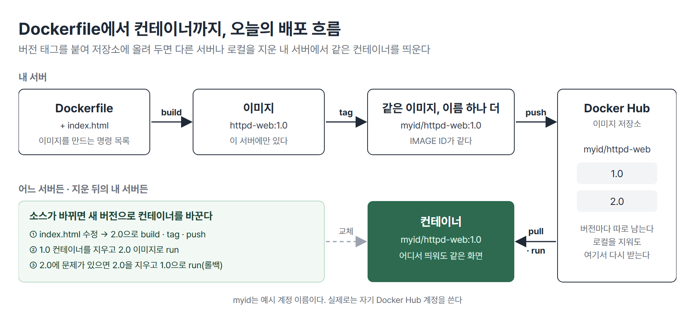
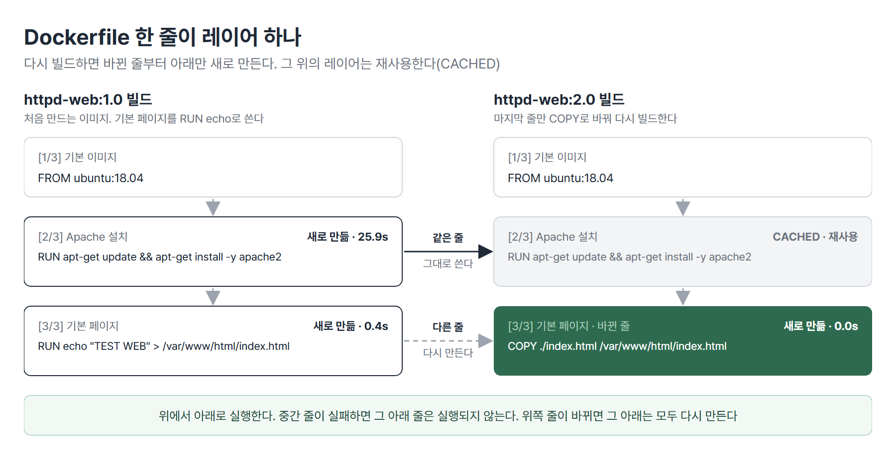

# <LG CNS 6기] MSA II 2일차 TIL · Dockerfile과 이미지 배포

> TL;DR: Dockerfile로 Tomcat(WAS)과 Apache 웹서버 이미지를 직접 빌드해 띄우고 버전 태그를 붙여 Docker Hub에 올리는 순서(build → tag → push)를 배웠다. 저장소에 버전별로 올려 둔 이미지는 로컬을 지워도 받아서 다시 띄우며 새 버전에 문제가 생기면 이전 버전으로 되돌린다.

## 🗺️ 한눈에 보기

### 오늘은 무엇을 위한 작업이었나

MSA II 1일차에는 Docker Hub에 이미 있는 nginx 이미지를 받아 띄웠다. 오늘은 그 이미지를 직접 만든다. 서비스 소스를 Dockerfile로 이미지에 담고 버전 태그를 붙여 저장소에 올리면 어느 서버에서든 같은 이미지를 받아 컨테이너로 띄울 수 있다. 소스가 바뀌면 새 버전 이미지를 만들어 컨테이너를 바꾼다.



> 💡 배포 단위는 「이미지 + 버전 태그」다. build → tag → push로 저장소에 올리고 pull · run으로 어디서든 띄운다.

수업은 크게 두 마디였다. 앞 마디는 MySQL 컨테이너 안을 들여다보고 자주 쓰는 명령을 alias로 묶은 것(1 · 2절), 뒤 마디는 Dockerfile로 이미지를 만들어 저장소에 올리는 배포 흐름(3 ~ 6절)이다.

### 상황별로 무엇을 쓰나

| 이런 상황이면 | 이것을 쓴다 | 절 |
|---|---|---|
| 도는 컨테이너 안의 파일 · 설정을 확인한다 | `docker exec -it <컨테이너> bash` | 1 |
| 긴 docker 명령을 자주 친다 | alias(`~/.bashrc`에 등록) | 2 |
| 서비스 소스로 이미지를 만든다 | Dockerfile + `docker build -t 이름:버전 .` | 3 · 4 |
| 소스만 바뀌었다 | `COPY` 줄을 둔 Dockerfile로 다음 버전 빌드 | 5 |
| 같은 호스트 포트 · 이름을 쓰는 컨테이너가 이미 있다 | 이전 컨테이너를 지우고 다시 `run` | 5 |
| 이미지를 다른 서버 · 팀원과 나눈다 | `docker tag` → `docker push` | 6 |
| 로컬을 지운 뒤 다시 띄운다 | 저장소 이미지 이름으로 `docker run` | 6 |
| 새 버전에 문제가 생겼다 | 이전 버전 태그로 다시 `run`(롤백) | ❓ |

## 🧭 오늘의 학습 키워드

| 키워드 | 한 줄 정리 | 오늘 어디에 쓰였나 |
|---|---|---|
| `docker exec -it` | 실행 중인 컨테이너 안에서 셸 · 명령을 실행 | 1 · 4번 절 |
| `-e` | 컨테이너에 환경 변수를 넘기는 옵션 | 1번 절 |
| alias | 긴 명령에 짧은 이름을 붙이는 셸 기능 | 2번 절 |
| Dockerfile | 이미지를 만드는 명령을 위에서부터 한 줄씩 적은 파일 | 3 ~ 5번 절 |
| 기본 이미지(`FROM`) | Dockerfile 맨 위에 반드시 오는 출발 이미지 | 3번 절 |
| 레이어 | Dockerfile 명령 한 줄이 만드는 이미지의 한 층 | 3 · 5번 절 |
| `docker build -t 이름:태그 .` | 현재 폴더의 Dockerfile로 이미지를 만든다 | 3 ~ 5번 절 |
| 태그 | 이미지의 버전 이름. 생략하면 `latest` | 3 · 6번 절 |
| WAS(Tomcat) | 비즈니스 로직을 실행하는 서버. 기본 포트 8080 | 4번 절 |
| 웹서버(Apache) | 화면 파일을 내주는 서버. 기본 포트 80 | 5번 절 |
| `EXPOSE` | 이미지가 쓰는 포트를 적어 두는 표시. 포트를 열지는 않는다 | 4번 절 |
| `COPY` | 빌드 폴더의 파일을 이미지 안으로 복사 | 5번 절 |
| 빌드 캐시(`CACHED`) | 바뀌지 않은 줄의 레이어를 다시 만들지 않고 재사용 | 5번 절 |
| `docker tag` | 같은 이미지에 저장소 계정이 들어간 이름을 하나 더 붙인다 | 6번 절 |
| `docker push` | 이미지를 저장소로 올린다 | 6번 절 |
| Docker Hub | 이미지를 올리고 받는 저장소 | 6번 절 |

## ✍️ 공부한 내용

### 1. 컨테이너 안 들여다보기: MySQL

DB도 컨테이너로 띄울 수 있다. MySQL 이미지는 root 비밀번호를 환경 변수로 받기 때문에 `-e`로 넘긴다. 띄운 뒤에는 `docker exec`로 컨테이너 안에 들어가 파일을 확인한다.

```bash
docker run -d --name ms -e MYSQL_ROOT_PASSWORD=**** mysql
docker exec -it ms bash     # 컨테이너 안 셸로 들어간다. /bin/bash로 써도 같다
```

```text
$ docker ps
CONTAINER ID   IMAGE     COMMAND                  CREATED          STATUS          PORTS                 NAMES
28fe5666419b   mysql     "docker-entrypoint.s…"   21 seconds ago   Up 20 seconds   3306/tcp, 33060/tcp   ms
```

- `PORTS` 칸에 `3306/tcp`만 있고 `0.0.0.0:…->` 표시가 없다. `-p`로 연결하지 않았으므로 서버 밖에서는 이 DB에 닿지 않는다.
- 이미지 이름에 태그를 붙이지 않아 `mysql:latest`가 받아졌다.

`exec`는 두 가지로 쓴다.

| 명령 | 하는 일 | 맞는 상황 |
|---|---|---|
| `docker exec -it ms /bin/bash` | 컨테이너 안에 셸을 열고 들어간다 | 여러 파일을 돌아보며 확인할 때 |
| `docker exec ms cat /etc/hosts` | 명령 하나만 실행하고 결과를 받는다 | 파일 하나 · 값 하나만 볼 때 |

```text
$ docker exec ms cat /etc/hosts
127.0.0.1	localhost
::1	localhost ip6-localhost ip6-loopback
fe00::	ip6-localnet
ff00::	ip6-mcastprefix
ff02::1	ip6-allnodes
ff02::2	ip6-allrouters
172.17.0.2	28fe5666419b
```

- 마지막 줄이 컨테이너의 IP와 호스트명이다. 호스트명 `28fe5666419b`는 `docker ps`의 `CONTAINER ID`와 같다.

DB 데이터 파일은 컨테이너 안 `/var/lib/mysql`에 쌓인다.

```text
$ docker exec ms ls /var/lib/mysql
#ib_16384_0.dblwr
#ib_16384_1.dblwr
#innodb_redo
#innodb_temp
auto.cnf
binlog.000001
binlog.000002
binlog.index
…
ibdata1
ibtmp1
mysql
mysql.ibd
…
```

- `ibdata1`(데이터) · `binlog.*`(변경 기록) 같은 파일이 컨테이너 안에 있다.

> 💡 `docker exec`로 도는 컨테이너 안을 볼 수 있다. DB 컨테이너의 데이터는 컨테이너 안 `/var/lib/mysql`에 쌓인다.

### 2. 단축 명령 alias

컨테이너 IP 확인 · 전체 삭제처럼 길고 자주 치는 명령에 짧은 이름을 붙인다. 셸에서 `alias 이름='명령'`으로 정하면 그 접속에서만 유효하다. 서버를 다시 켜도 남기려면 `~/.bashrc` 끝에 적고 `source ~/.bashrc`로 다시 읽는다.

```text
$ alias | grep -E "crm|cip"
alias cip='docker inspect --format "{{range .NetworkSettings.Networks}}{{.IPAddress}}{{end}}"'
alias crm='docker rm -f $(docker ps -a -q)'
alias crmi='docker rmi -f $(docker images -q)'
$ cip ms
172.17.0.2
$ crm
28fe5666419b
```

| 이름 | 하는 일 |
|---|---|
| `cip <컨테이너>` | 컨테이너의 IP만 뽑는다. `/etc/hosts`의 마지막 줄과 같은 값 |
| `crm` | 컨테이너를 전부 강제 삭제 |
| `crmi` | 이미지를 전부 강제 삭제 |

- `crm` · `crmi`는 확인 없이 전부 지운다. 치기 전에 `docker ps -a` · `docker images`로 대상을 본다. 정리 순서는 컨테이너(`crm`) → 이미지(`crmi`)다.

### 3. Dockerfile과 레이어

상품 · 주문 · 회원처럼 서비스마다 앱이 따로 돈다. 이 앱들을 컨테이너로 띄우려면 이미지가 있어야 하고, 그 이미지를 만드는 명령 목록이 Dockerfile이다. 앱이 자바든 자바스크립트든 방식은 같다.

이전에는 서버(VM)를 만들고 그 안에 직접 설치했다.

| | VM에 직접 설치 | Dockerfile로 이미지 |
|---|---|---|
| 준비 | OS 설치 → 자바 · Tomcat 설치 → 소스 올림 | Dockerfile 작성 → `docker build` → `docker run` |
| 크기 | OS를 포함해 기본 8GB 이상 | OS 전체(커널)를 담지 않아 VM보다 작다 |
| 서버를 늘릴 때 | 서버마다 같은 설치를 반복 | 같은 이미지를 받아 실행 |
| 소스를 바꿀 때 | 서버의 폴더에 소스를 다시 올린다 | 소스를 넣어 새 버전 이미지를 빌드한다 |

Dockerfile은 키워드(대문자)와 인자(소문자)로 한 줄씩 쓴다. 파일 이름은 `Dockerfile` 철자 그대로여야 한다.

| 키워드 | 하는 일 | 오늘 쓴 예 |
|---|---|---|
| `FROM` | 기본 이미지. 반드시 맨 위에 있다 | `ubuntu:18.04` |
| `LABEL` | 작성자 같은 정보 | `maintainer` |
| `ENV` | 환경 변수 | `CATALINA_HOME /usr/local/tomcat` |
| `RUN` | 이미지를 만들 때 명령 실행 | `apt-get install -y apache2` |
| `COPY` | 빌드 폴더의 파일을 이미지 안으로 복사 | `./index.html` |
| `EXPOSE` | 쓰는 포트를 적어 두는 표시 | `80` |
| `CMD` | 컨테이너가 시작될 때 실행할 명령 | `catalina.sh run` |

**Dockerfile은 위에서 아래로 실행되고 한 줄이 레이어 하나를 만든다.** 기본 이미지 위에 `RUN` · `COPY` 줄마다 레이어가 한 층씩 쌓인다. 중간 줄에서 실패하면(설치할 패키지가 없거나 복사할 파일이 없거나) 그 아래 줄은 실행되지 않는다.

이미지는 `docker build`로 만든다.

```bash
docker build -t tomcat:1.0 .
```

- `-t`로 `이름:태그`를 붙인다. 태그를 빼면 `latest`가 붙는다. 반드시 버전을 붙인다(이유는 ❓).
- 마지막 `.`은 현재 폴더를 기준으로 빌드한다는 뜻이다. Dockerfile과 `COPY`할 파일이 이 폴더에 있어야 한다.

- **왜 나왔나**: VM에 OS · 자바 · Tomcat을 깔고 소스를 올리는 방식은 서버 하나가 크고(기본 8GB 이상) 서버 수십 대에 같은 설치를 반복해야 해서 배포가 느렸다.
- **안 그러면 뭐가 되나**: 설치 순서를 사람이 기억해 서버마다 손으로 반복한다. 한 단계가 빠진 서버만 다르게 동작한다.
- **대가는 뭔가**: `RUN` 한 줄마다 레이어가 쌓여 이미지가 커진다. 크기가 크면 배포 때 옮기는 시간이 늘어난다. 크기를 줄이는 경량화는 따로 배운다.

> 💡 Dockerfile은 기본 이미지 위에 한 줄씩 레이어를 쌓는 명령 목록이다. `docker build -t 이름:버전 .`으로 이미지를 만든다.

### 4. Tomcat(WAS) 이미지 빌드와 실행

Tomcat은 비즈니스 로직을 실행하는 WAS(Web Application Server)이고 기본 포트는 8080이다. Ubuntu 18.04에 JDK 17을 설치하고 Tomcat 9.0.100을 받아 풀어 실행하는 Dockerfile이다.

```dockerfile
FROM ubuntu:18.04
LABEL maintainer="…"

ENV TOMCAT_VERSION 9.0.100
ENV CATALINA_HOME /usr/local/tomcat
ENV JAVA_HOME /usr/lib/jvm/java-17-openjdk-amd64
ENV PATH $CATALINA_HOME/bin:$PATH

RUN apt-get -y update && apt-get -y upgrade
RUN apt-get -y install openjdk-17-jdk wget

RUN mkdir $CATALINA_HOME
RUN wget https://archive.apache.org/dist/tomcat/tomcat-9/v${TOMCAT_VERSION}/bin/apache-tomcat-${TOMCAT_VERSION}.tar.gz -O /tmp/tomcat.tar.gz
RUN cd /tmp && tar xvfz tomcat.tar.gz
RUN cp -Rv /tmp/apache-tomcat-${TOMCAT_VERSION}/* $CATALINA_HOME
RUN rm -rf /tmp/apache-tomcat-${TOMCAT_VERSION}
RUN rm -rf /tmp/tomcat.tar.gz

EXPOSE 80

CMD ["/usr/local/tomcat/bin/catalina.sh", "run"]
```

- `ENV`로 Tomcat 버전 · 설치 경로 · 자바 경로를 변수로 두고 아래 `RUN`에서 `${TOMCAT_VERSION}` · `$CATALINA_HOME`으로 쓴다. 버전을 바꿀 때 한 줄만 고친다.
- `CMD`는 컨테이너가 시작될 때 `catalina.sh run`으로 Tomcat을 포그라운드(터미널을 붙잡고 계속 도는 방식)로 실행한다. 이 프로세스가 계속 돌기 때문에 컨테이너가 꺼지지 않는다.

빌드하면 로그에 단계가 `[1/9]` ~ `[9/9]`로 찍힌다.

```text
$ docker build -t tomcat:1.0 .
#4 [1/9] FROM docker.io/library/ubuntu:18.04@sha256:152dc042452c496007f07ca9127571cb9c29697f42acbfad72324b2bb2e43c98
…
#5 [2/9] RUN apt-get -y update && apt-get -y upgrade
#5 DONE 13.7s
#6 [3/9] RUN apt-get -y install openjdk-17-jdk wget
…
#6 DONE 117.6s
…
#12 [9/9] RUN rm -rf /tmp/tomcat.tar.gz
#12 DONE 0.7s
…
#13 naming to docker.io/library/tomcat:1.0 done
```

- 9단계는 `FROM` 1줄과 `RUN` 8줄이다. `ENV` · `LABEL` · `EXPOSE` · `CMD`는 이미지에 설정값만 남기고 단계 수에 들어가지 않는다.
- JDK를 설치하는 `[3/9]`가 가장 오래 걸렸다.

```text
$ docker images
IMAGE          ID             DISK USAGE   CONTENT SIZE   EXTRA
mysql:latest   f51c9c01c16b       1.08GB          304MB        
tomcat:1.0     6747f815e268       1.02GB          320MB        
```

- OS 위에 JDK까지 설치해 Tomcat 이미지가 1GB를 넘는다. 경량화 전의 연습용 이미지이고 운영에서는 이렇게 크게 만들지 않는다.

컨테이너로 띄우고 응답을 확인한다.

```text
$ docker run -d --name tc -p 8080:8080 tomcat:1.0
19cfbbe411922294559e51884a3a1ae32d235ffc6e04574cd4be9f3dcb88ff1d
$ docker ps
CONTAINER ID   IMAGE        COMMAND                  CREATED          STATUS          PORTS                                                 NAMES
19cfbbe41192   tomcat:1.0   "/usr/local/tomcat/b…"   13 seconds ago   Up 12 seconds   80/tcp, 0.0.0.0:8080->8080/tcp, [::]:8080->8080/tcp   tc
$ curl -s localhost:8080 | grep -o '<title>[^<]*</title>'
<title>Apache Tomcat/9.0.100</title>
```

- 브라우저로 서버 주소의 8080번에 접속하면 Tomcat 기본 화면(고양이 그림)이 뜬다.
- `PORTS`의 `80/tcp`는 Dockerfile의 `EXPOSE 80`에서 온 표시다. Tomcat은 8080에서 응답하고 실제로 연결된 것은 `-p 8080:8080`이다. **`EXPOSE`는 포트를 적어 둘 뿐 열지 않는다.** 접속은 `-p` 뒤 번호가 앱이 실제로 듣는 포트와 맞을 때 된다.

기본 화면 파일은 컨테이너 안 `/usr/local/tomcat/webapps/ROOT`에 있다.

```text
$ docker exec tc ls /usr/local/tomcat/webapps/ROOT
RELEASE-NOTES.txt
WEB-INF
asf-logo-wide.svg
bg-button.png
bg-middle.png
bg-nav.png
bg-upper.png
favicon.ico
index.jsp
tomcat.css
tomcat.svg
```

- `index.jsp` · `tomcat.css`가 고양이 화면이다. 개발한 소스를 이 자리에 넣으면 우리 서비스 화면이 뜬다.

> 💡 WAS 이미지도 Dockerfile 한 장으로 만든다. 포트는 `-p`로 연결해야 열리고 `EXPOSE`는 표시만 한다.

### 5. Apache 웹서버 이미지 1.0과 2.0

웹서버는 화면 파일을 내주는 서버이고 기본 포트는 80이다. Apache를 설치하고 기본 페이지(`/var/www/html/index.html`)를 바꾸는 이미지를 두 가지 방식으로 만들었다. 1.0은 Dockerfile 안에서 페이지를 직접 쓴다.

```dockerfile
FROM ubuntu:18.04
LABEL maintainer="…"
# install apache
RUN apt-get update \
&& apt-get install -y apache2
RUN echo "TEST WEB" > /var/www/html/index.html
EXPOSE 80
CMD ["/usr/sbin/apache2ctl","-D","FOREGROUND"]
```

```text
$ docker run -d --name httpd-web -p 80:80 httpd-web:1.0
544e19d1ec98c1b0f61b2d5ba8166e8b15bccf6c851749a03f23f4be281f50a3
$ docker ps --size
CONTAINER ID   IMAGE           COMMAND                  CREATED          STATUS          PORTS                                                 NAMES       SIZE
544e19d1ec98   httpd-web:1.0   "/usr/sbin/apache2ct…"   2 seconds ago    Up 2 seconds    0.0.0.0:80->80/tcp, [::]:80->80/tcp                   httpd-web   57.3kB (virtual 223MB)
19cfbbe41192   tomcat:1.0      "/usr/local/tomcat/b…"   54 seconds ago   Up 53 seconds   80/tcp, 0.0.0.0:8080->8080/tcp, [::]:8080->8080/tcp   tc          205kB (virtual 705MB)
$ curl -s localhost
TEST WEB
```

- `SIZE`의 앞 숫자(57.3kB)는 컨테이너가 실행 중에 바꾼 부분, `virtual`은 이미지까지 더한 크기다. 같은 이미지로 컨테이너를 여러 개 띄워도 이미지 부분은 함께 쓴다.
- 80번은 웹의 기본 포트라 브라우저에서 포트 번호 없이 서버 주소만 쳐도 열린다.

2.0은 페이지를 빌드 폴더의 `index.html` 파일로 두고 `COPY`로 넣는다. 바뀐 것은 한 줄이다.

```diff
-RUN echo "TEST WEB" > /var/www/html/index.html
+COPY ./index.html /var/www/html/index.html
```

| | 1.0 (`RUN echo`) | 2.0 (`COPY`) |
|---|---|---|
| 빌드 폴더 | `Dockerfile` | `Dockerfile` + `index.html` |
| 화면을 바꾸려면 | Dockerfile을 고친다 | `index.html`만 고쳐 다시 빌드 |
| 맞는 상황 | 화면이 뜨는지만 확인할 때 | 개발한 소스를 이미지에 넣을 때(현장 방식) |

같은 이름에 버전만 올려 빌드하면 1.0보다 훨씬 빨리 끝난다.



```text
$ docker build -t httpd-web:2.0 .
…
#5 [2/3] RUN apt-get update && apt-get install -y apache2
#5 CACHED
…
#7 [3/3] COPY ./index.html /var/www/html/index.html
#7 DONE 0.0s
…
#8 naming to docker.io/library/httpd-web:2.0 done
$ docker images
IMAGE           ID             DISK USAGE   CONTENT SIZE   EXTRA
httpd-web:1.0   5ac5dbb5969a        312MB         89.1MB   U    
httpd-web:2.0   4aa476c9484a        312MB         89.1MB        
mysql:latest    f51c9c01c16b       1.08GB          304MB        
tomcat:1.0      6747f815e268       1.02GB          320MB   U    
```

- 1.0 빌드 때 25.9초 걸린 Apache 설치 줄(`[2/3]`)이 2.0에서는 `CACHED`로 재사용됐다. 새로 만든 것은 바뀐 `COPY` 줄 하나다.
- 1.0 이미지는 그대로 남고 2.0이 따로 생겼다. `EXTRA`의 `U`는 그 이미지로 만든 컨테이너가 있다는 표시다.

2.0 컨테이너를 띄울 때 1.0 컨테이너가 80번을 쓰고 있으면 포트 오류가 난다.

```text
$ docker run -d --name httpd-web2 -p 80:80 httpd-web:2.0
6c5ca45941957bebc8cd3e6fb6082cddec80e5a261811430cfd8aa934f138f29
docker: Error response from daemon: failed to set up container networking: driver failed programming external connectivity on endpoint httpd-web2 (3cfc72963ba603ac45e5d161868e9cd7ac96bf5e3bd77ccec5e6481def78c0b0): Bind for 0.0.0.0:80 failed: port is already allocated
$ docker rm -f httpd-web
httpd-web
$ docker run -d --name httpd-web2 -p 80:80 httpd-web:2.0
docker: Error response from daemon: Conflict. The container name "/httpd-web2" is already in use by container "6c5ca45941957bebc8cd3e6fb6082cddec80e5a261811430cfd8aa934f138f29". You have to remove (or rename) that container to be able to reuse that name.
$ docker rm -f httpd-web2
httpd-web2
$ docker run -d --name httpd-web2 -p 80:80 httpd-web:2.0
08ee6c630616a819d71cd36c922aeba1112f4896a3b85cf8e690988a1883ad91
```

- **포트 오류**: 호스트의 80번은 컨테이너 하나만 쓸 수 있다. 80번을 쓰던 1.0 컨테이너(`httpd-web`)를 지워 자리를 비운다.
- **이름 오류**: 포트 오류가 났어도 컨테이너는 이미 만들어져 `httpd-web2`라는 이름을 차지하고 있었다. 첫 실행에 찍힌 ID(`6c5ca…`)와 이름 오류 속 ID가 같다. 실행이 실패한 컨테이너까지 지운 뒤 다시 `run` 해야 한다.

```text
$ docker ps
CONTAINER ID   IMAGE           COMMAND                  CREATED              STATUS          PORTS                                                 NAMES
08ee6c630616   httpd-web:2.0   "/usr/sbin/apache2ct…"   3 seconds ago        Up 2 seconds    0.0.0.0:80->80/tcp, [::]:80->80/tcp                   httpd-web2
19cfbbe41192   tomcat:1.0      "/usr/local/tomcat/b…"   About a minute ago   Up 58 seconds   80/tcp, 0.0.0.0:8080->8080/tcp, [::]:8080->8080/tcp   tc
$ curl -s localhost | head -6
<html>
<head>
<title>Docker Container Connected Success !!!</title>
<style>
body {margin-top: 40px; background-color: blue;}
</style>
```

- 같은 주소(80번)에서 1.0의 `TEST WEB` 대신 2.0의 `index.html`(파란 배경 화면)이 응답한다. 컨테이너를 새 버전 이미지로 바꾸면 서비스 화면이 바뀐다.

> 💡 소스를 `COPY`로 넣으면 소스만 바꿔 다음 버전을 빌드한다. 바뀐 줄부터 아래만 새로 만들어 빌드가 빠르다.

### 6. Docker Hub 업로드와 지운 뒤 되살리기

만든 이미지는 그 서버 안에만 있다. 다른 서버나 팀원이 쓰려면 저장소에 올려야 한다. 배포 순서는 **빌드 → 태그 → 푸시**다. 태그는 어느 저장소(Docker Hub · AWS ECR)로 갈지를 정한다. 푸시는 그 저장소로 이미지를 올린다.

```bash
docker login -u <계정>                              # 비밀번호는 따로 묻는다. Login Succeeded면 성공
docker tag httpd-web:1.0 <계정>/httpd-web:1.0       # 저장소 계정이 들어간 이름을 붙인다
docker push <계정>/httpd-web:1.0                    # Docker Hub로 올린다
```

`tag`는 이미지를 새로 만들지 않는다. 아래에서 `myid`는 예시 계정 이름이다.

```text
$ docker tag httpd-web:1.0 myid/httpd-web:1.0
$ docker images | grep httpd-web
httpd-web:1.0        5ac5dbb5969a        312MB         89.1MB        
httpd-web:2.0        4aa476c9484a        312MB         89.1MB   U    
myid/httpd-web:1.0   5ac5dbb5969a        312MB         89.1MB        
```

- `httpd-web:1.0`과 `myid/httpd-web:1.0`의 `ID`가 `5ac5dbb5969a`로 같다. 같은 이미지에 Docker Hub용 이름이 하나 더 붙은 것이다.
- push가 끝나면 Docker Hub 웹의 내 저장소에서 `1.0` 태그를 확인한다. 소스가 바뀔 때마다 다시 빌드해 1.0 → 2.0 → 3.0으로 올린다.

저장소에 올려 두면 로컬을 전부 지워도 된다.

```text
$ docker ps -a
CONTAINER ID   IMAGE     COMMAND   CREATED   STATUS    PORTS     NAMES
$ docker images
IMAGE   ID             DISK USAGE   CONTENT SIZE   EXTRA
```

- `crm` · `crmi`로 지운 뒤에는 컨테이너도 이미지도 없고 브라우저는 「사이트에 연결할 수 없음」이 된다.
- 저장소의 이름으로 `run` 하면 이미지가 없으니 받아서 띄운다. 고양이 화면(Tomcat)과 웹서버 화면을 이렇게 되살린다.

```bash
docker run -d --name tc -p 8080:8080 <계정>/<Tomcat 이미지 이름>:1.0
docker run -d --name httpd-web -p 80:80 <계정>/httpd-web:1.0
```

- **왜 나왔나**: 이미지는 만든 서버 안에만 있어서 다른 서버나 팀원이 쓸 수 없다.
- **안 그러면 뭐가 되나**: 로컬 이미지를 지우면 Dockerfile과 소스로 다시 빌드해야 하고 서버마다 빌드를 반복한다.
- **대가는 뭔가**: 저장소 계정과 로그인이 필요하고 이미지 이름 앞에 계정을 붙여야 한다. Docker Hub 공개 저장소에 올린 이미지는 누구나 받을 수 있다.

> 💡 빌드 → 태그 → 푸시로 저장소에 올린다. 저장소에 버전별로 남아 있으면 로컬을 지워도 `run` 한 줄로 되살린다.

## 🧩 이어지는 내용

- MSA II 1일차(10/21)에 Docker를 설치하고 Docker Hub의 nginx 이미지를 `docker run`으로 받아 띄운 뒤 `rm` · `rmi`로 정리했다. 오늘은 그 이미지를 Dockerfile로 직접 만들어 저장소에 올리는 단계다.
- 10/23(MSA II 3일차)에는 컨테이너 네트워크(docker0 · 포트 연결)와 httpd · nginx 이미지 크기 비교가 이어진다.
- 10/26 오전에 이미지 경량화와 AWS ECR 업로드를 하고 이어서 쿠버네티스 클러스터(노드 3대)를 구성한다. 쿠버네티스는 10/26 ~ 10/29 4일이다.
- 2차 사후평가는 10/29, 미니 프로젝트 2는 10/30 ~ 11/05다.

## ❓ 몰랐던 것

### 소스만 바꾼 2.0 빌드가 1.0보다 빨리 끝난 이유

Dockerfile은 위에서부터 한 줄이 레이어 하나다. 다시 빌드하면 위에서부터 줄을 비교해 이전과 같은 줄은 만들어 둔 레이어를 그대로 쓰고(`CACHED`) 처음으로 달라진 줄부터 아래만 새로 만든다. 2.0에서 바뀐 것은 맨 아래 줄(`RUN echo` → `COPY ./index.html`)뿐이었다. 그래서 1.0에서 25.9초 걸린 Apache 설치 레이어를 재사용하고 `COPY` 레이어 하나만 만들었다.

하루에 여러 번 배포하는 팀에서 배포마다 바뀌는 것은 대개 소스다. 무거운 설치 줄을 위에, 자주 바뀌는 소스 `COPY` 줄을 아래에 두면 빌드마다 설치를 되풀이하지 않는다. 반대로 소스 줄이 위에 있으면 소스만 고쳐도 그 아래 설치 줄까지 매번 다시 돈다.

### latest로만 올렸을 때 되돌리기 어려운 이유와 롤백 순서

태그를 안 붙이면 `latest`가 붙는다. 소스가 바뀔 때마다 같은 이름 `httpd-web:latest`로 빌드해 push하면 저장소의 latest가 새 이미지로 덮어써진다. 이전 이미지를 가리키던 이름이 없어져 「어제 돌던 그 이미지」를 이름으로 불러 다시 띄울 수 없다. 지금 도는 컨테이너가 어느 시점의 소스인지도 이름만으로는 알 수 없다.

버전 태그를 지켰다면 2.0 컨테이너를 지우고 1.0으로 다시 띄운다.

```bash
docker rm -f httpd-web2                                         # 1. 문제가 난 2.0 컨테이너 삭제
docker run -d --name httpd-web -p 80:80 <계정>/httpd-web:1.0    # 2. 1.0 이미지로 다시 실행
```

1.0은 저장소에 그대로 남아 있으므로 로컬에 없어도 `run`이 받아 온다.

### 컨테이너를 지우고 다시 띄웠을 때의 데이터

「데이터가 날아가지 않으려나」가 맞다. 컨테이너가 실행 중에 바꾸거나 새로 만든 파일은 그 컨테이너에만 저장되고 이미지는 바뀌지 않는다. 같은 이미지로 새 컨테이너를 띄우면 이미지의 처음 상태에서 시작하므로 이전 컨테이너가 쌓은 회원 데이터는 보이지 않는다.

공식 MySQL 이미지는 `/var/lib/mysql`을 Docker가 따로 만드는 이름 없는 볼륨에 둔다. 이 볼륨은 `docker rm -f`로 컨테이너를 지워도 남지만 새 컨테이너는 새 볼륨을 받으므로 예전 데이터를 보지 못한다. 그래서 DB를 컨테이너로 띄우기 전에 데이터를 컨테이너 밖 어디에 둘지(Volume 등)를 먼저 정한다. Volume은 아직 배우지 않았다.

## 📌 다음에 해볼 것

- [ ] 내 Docker Hub 계정에 `httpd-web:1.0`을 tag · push하고 로컬을 전부 지운 뒤 `docker run` 한 줄로 화면 되살리기
- [ ] `index.html`의 배경색을 바꿔 3.0으로 빌드하고 `CACHED` 줄을 확인한 뒤, 3.0 컨테이너를 2.0으로 되돌려 보기
- [ ] Dockerfile의 `RUN apt-get` 줄에 패키지 하나를 더해 다시 빌드하고 그 아래 줄까지 새로 만들어지는지 확인하기

## 🔍 더 짚어둘 것

### 1. 미니 프로젝트: 이미지 이름 · 버전 규칙과 첫날 배포 한 바퀴

2차 미니 프로젝트(10/30 ~ 11/05)는 서비스가 여러 개라 Dockerfile과 이미지도 서비스 수만큼 생긴다. 오늘 배운 흐름을 팀 규칙으로 옮기면 킥오프에서 정할 것은 셋이다.

| 정할 것 | 예 | 정하지 않으면 |
|---|---|---|
| 이미지 이름 | `<저장소 계정>/<서비스>:<버전>` | 팀원마다 이름이 달라 어떤 이미지가 어느 서비스인지 찾기 어렵다 |
| 버전 규칙 | `latest` 금지, 다시 빌드할 때마다 숫자를 올린다 | 롤백할 이전 이미지를 이름으로 부를 수 없다 |
| 저장소 위치 | 팀이 함께 쓰는 저장소 한 곳 | 각자 개인 계정에 올리면 다른 팀원이 받을 이름을 모른다 |

- **첫날 배포 한 바퀴의 완료 기준**: 빈 화면 `index.html` 하나를 1.0 이미지로 build · tag · push한다. 다른 팀원 PC에서 `docker run <계정>/<이름>:1.0` 한 줄로 같은 화면이 뜨면 경로가 열린 것이다. 그 뒤로는 소스를 바꿔 버전만 올린다.
- **시연 전 롤백 연습**: 새 버전을 올린 상태에서 이전 버전으로 되돌리는 순서(컨테이너 삭제 → 이전 버전 `run`)를 한 번 해 본다. 시연 직전에는 마지막으로 정상이던 버전 번호를 적어 둔다.
- **공개 저장소와 비밀번호**: Docker Hub 공개 저장소의 이미지는 누구나 받는다. DB 비밀번호는 Dockerfile이나 이미지 안 파일에 넣지 않고 MySQL 컨테이너처럼 실행할 때 `-e`로 넘긴다.

### 2. AI: 바이브코딩할 때 사람이 확인할 것

- **태그가 빠졌는지 본다**: `docker build -t myapp .`처럼 태그가 없으면 `latest`가 붙는다. `FROM ubuntu`나 `mysql`처럼 기본 이미지의 태그를 빼면 받는 시점의 latest가 온다.
- **`EXPOSE`와 실제 포트를 맞춰 본다**: `EXPOSE`는 표시일 뿐 포트를 열지 않는다. 앱이 실제로 듣는 포트(Tomcat 8080)와 `-p` 뒤 번호가 맞아야 접속된다.
- **줄 순서를 본다**: 자주 바뀌는 소스 `COPY` 줄이 설치 `RUN` 줄보다 위에 있으면 소스만 고쳐도 설치부터 다시 돈다.

태그: LG CNS 6기, 개발자, LGCNSINSPIRECAMP
