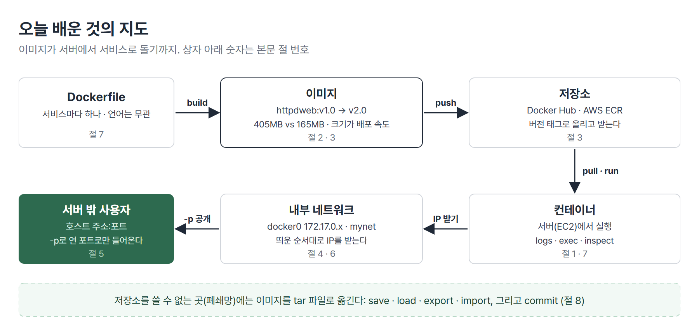
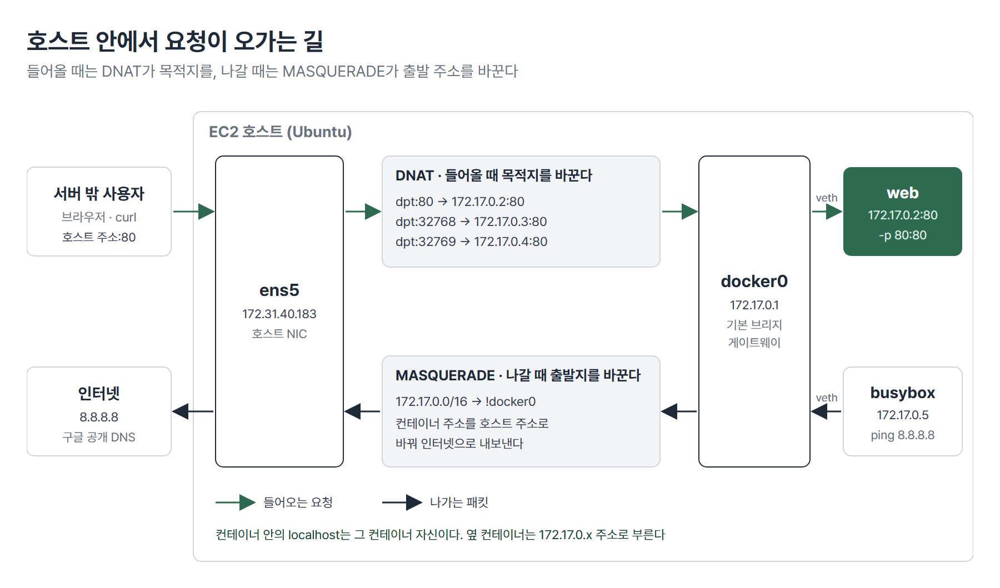
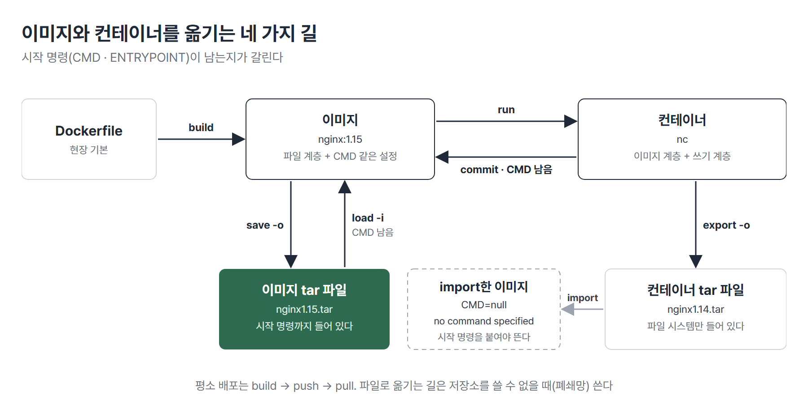

# <LG CNS 6기] MSA II 3일차 TIL · 컨테이너 네트워크와 이미지 옮기기

> TL;DR: 같은 홈페이지를 httpd 이미지(405MB)와 nginx 이미지(165MB)로 만들어 크기를 비교했고 소스를 바꿔 `v2.0`을 빌드한 뒤 `v1.0`으로 되돌렸다. 컨테이너가 docker0에서 IP를 받아 밖으로 나가는 길과 `-p`로 들어오는 길을 iptables 규칙으로 확인했다. 저장소 없이 이미지를 파일로 옮길 때는 `save`/`load`만 시작 명령까지 보존한다.

## 🗺️ 한눈에 보기

### 오늘은 무엇을 배운 날이었나

1일차(10/21)에는 이미지로 컨테이너를 띄우고 지웠고 2일차(10/22)에는 Dockerfile로 이미지를 직접 빌드해 Docker Hub에 올렸다. 오늘은 그 이미지가 서버에서 서비스로 돌기까지 남은 조각을 하나씩 배웠다. 수업은 크게 세 마디다. 이미지를 작게 만들고 버전으로 바꿔 올리는 법, 컨테이너로 들어오고 나가는 길, 저장소 없이 이미지를 옮기는 법이다. 실습 서버는 AWS EC2의 Ubuntu였다.



> 💡 이미지는 작게 만들어 버전 태그로 올리고 서버에서는 네트워크와 포트로 길을 잇는다. 저장소를 못 쓰는 곳에는 tar 파일로 옮긴다.

### 상황별로 무엇을 쓰나

| 이런 상황이면 | 이것을 쓴다 | 절 |
|---|---|---|
| 돌고 있는 컨테이너의 로그 · 파일을 본다 | `docker logs` · `docker exec -it` | 1 |
| 같은 기능의 이미지 중 하나를 고른다 | `docker images`로 크기를 비교 | 2 |
| 소스가 바뀌었다 | 같은 Dockerfile로 다음 버전 태그를 빌드 | 3 |
| 새 버전에 문제가 생겼다 | 이전 버전 태그로 다시 `run` | 3 |
| 컨테이너의 IP · 게이트웨이를 확인한다 | `docker inspect` · `docker network inspect` | 4 |
| 서버 밖에서 컨테이너에 접속하게 한다 | `-p 호스트포트:컨테이너포트` | 5 |
| 포트 연결 규칙을 확인한다 | `docker ps`의 PORTS 칸 · `iptables -t nat -L -n -v` | 5 |
| 서버 안에서만 열고 밖에는 닫는다 | `-p 127.0.0.1:80:80` | 5 |
| 컨테이너 IP를 직접 정한다 | `docker network create` + `--net` · `--ip` | 6 |
| 이미지는 지워졌고 컨테이너만 남았다 | `docker commit` | 8 |
| 저장소 없이 이미지를 파일로 넘긴다 | `docker save` / `docker load` | 8 |

## 🧭 오늘의 학습 키워드

| 키워드 | 한 줄 정리 | 오늘 어디에 쓰였나 |
|---|---|---|
| `docker logs -f` | 컨테이너 로그를 실시간으로 계속 본다 | 1번 절 |
| `docker exec -it` | 돌고 있는 컨테이너 안에서 셸을 연다 | 1번 절 |
| 이미지 크기 | 서버마다 내려받아야 하는 양. 클수록 배포와 복구가 느리다 | 2번 절 |
| `docker ps --size` | 컨테이너가 쓴 크기와 이미지까지 더한 크기 | 2번 절 |
| 빌드 캐시 | 바뀌지 않은 단계는 다시 만들지 않고 재사용 | 3번 절 |
| 버전 태그 · 롤백 | 번호를 올려 배포하고 문제가 생기면 이전 번호로 다시 띄운다 | 3번 절 |
| AWS ECR | 회사용 비공개 이미지 저장소. EKS · ECS가 함께 쓴다 | 3번 절 |
| `docker0` | Docker 설치 때 생기는 기본 브리지. 주소 172.17.0.1 | 4번 절 |
| veth | 컨테이너마다 하나씩 생겨 docker0에 연결되는 가상 네트워크 인터페이스 | 4번 절 |
| MASQUERADE | 컨테이너가 나갈 때 출발 주소를 호스트 주소로 바꾸는 규칙 | 4 · 5번 절 |
| 포트 포워딩(`-p`) | 호스트 포트로 온 요청을 컨테이너 포트로 넘긴다 | 5번 절 |
| DNAT | 들어온 요청의 목적지를 컨테이너 IP:포트로 바꾸는 규칙 | 5번 절 |
| `-P` · `EXPOSE` | 이미지에 적힌 포트를 Docker가 고른 호스트 포트에 연결 | 5번 절 |
| 사용자 정의 네트워크 | 대역과 컨테이너 IP를 직접 정하는 브리지 | 6번 절 |
| `docker commit` | 컨테이너에서 이미지를 만든다 | 8번 절 |
| `save`/`load` · `export`/`import` | 이미지째로 · 컨테이너 파일 시스템만 tar 파일로 옮긴다 | 8번 절 |

## ✍️ 공부한 내용

### 1. 복습: 돌고 있는 컨테이너를 들여다보는 명령

`create`는 컨테이너를 만들기만 해서 `start`를 따로 해야 하고 `run`은 `pull` · `create` · `start`를 한 번에 한다. 1일차의 이 구분에 더해 이미 떠 있는 컨테이너를 확인하는 명령을 정리했다.

| 명령 | 하는 일 | 맞는 상황 |
|---|---|---|
| `docker logs <이름>` | 컨테이너가 지금까지 낸 로그 | 컨테이너가 바로 멈추거나 응답이 이상할 때 |
| `docker logs -f <이름>` | 로그를 계속 이어서 보여 준다(follow) | 요청을 보내면서 로그를 지켜볼 때 |
| `docker exec -it <이름> bash` | 돌고 있는 컨테이너 안에서 셸을 연다 | 컨테이너 안의 파일 · 설정을 볼 때 |
| `docker inspect <이름>` | 컨테이너 · 이미지의 상세 정보(JSON) | IP · 포트 · 시작 명령을 확인할 때 |
| `docker top <이름>` | 컨테이너 안에서 도는 프로세스 | 프로그램이 떠 있는지 볼 때 |
| `docker history <이미지>` | 이미지가 쌓인 이력 | 어떤 단계가 크기를 차지하는지 볼 때 |

ID는 기본으로 앞 12자리만 보인다. `--no-trunc`를 붙이면 잘리지 않은 전체 ID가 나온다.

```text
$ docker ps -a -q
bc6eb1456f32
$ docker images --no-trunc
REPOSITORY   TAG       IMAGE ID                                                                  CREATED       SIZE
nginx        1.14      sha256:f7988fb6c02e0ce69257d9bd9cf37ae20a60f1df7563c3a2a6abe24160306b8d   7 years ago   165MB
```

> 💡 로그는 `logs`, 컨테이너 안의 파일은 `exec -it`, 설정값은 `inspect`로 본다.

### 2. 이미지 크기와 배포 속도

같은 홈페이지를 두 웹서버 이미지로 만들어 크기를 비교했다. httpd(Apache)는 Ubuntu 이미지에 Apache를 설치하는 방식이고 nginx는 웹서버가 이미 든 이미지에 페이지만 바꿔 넣는 방식이다. 먼저 httpd 쪽(`httpdweb`) Dockerfile이다.

```dockerfile
FROM ubuntu:22.04
LABEL maintainer = "****"

#install apache
RUN apt-get update && apt-get -y install apache2

COPY index.html /var/www/html/index.html

EXPOSE 80

CMD ["/usr/sbin/apache2ctl","-D","FOREGROUND"]
```

nginx 쪽(`nginxweb`) Dockerfile은 바탕 이미지가 다르고 설치 단계가 없다.

```dockerfile
FROM nginx:1.14
LABEL maintainer = "NGINX Front-end container <****>"

COPY index.html /usr/share/nginx/html/index.html

EXPOSE 80

CMD ["nginx","-g","daemon off;"]
```

- 웹 페이지 위치는 웹서버마다 정해져 있다. Apache는 `/var/www/html/index.html`, nginx는 `/usr/share/nginx/html/index.html`이다. 쿠버네티스 · AWS에서도 그대로 쓰는 경로다.
- `CMD`는 컨테이너가 시작할 때 실행할 명령이다. 웹서버를 포그라운드(`FOREGROUND`, `daemon off;`)로 띄워야 컨테이너가 멈추지 않는다. 컨테이너는 기본 명령이 끝나면 함께 끝나기 때문이다.

두 이미지를 빌드해 크기를 비교한다.

```text
$ docker build -t httpdweb:v1.0 .
$ docker build -t nginxweb:v1.0 .
$ docker images
IMAGE           ID             DISK USAGE   CONTENT SIZE   EXTRA
httpdweb:v1.0   979590410bdf        405MB          118MB        
nginx:1.14      f7988fb6c02e        165MB         44.7MB        
nginxweb:v1.0   06e599bf8960        165MB         44.7MB        
```

- 같은 페이지인데 httpd 쪽이 두 배 넘게 크다. httpd는 OS 이미지 위에서 `apt-get`으로 Apache와 패키지 43개를 설치한다. nginx 쪽은 `nginx:1.14`에 `index.html` 하나만 더해서 바탕 이미지와 크기가 같다.
- 요즘 현장 웹서버는 대부분 nginx다. 이미지가 작아 컨테이너도 작고 배포가 편하기 때문이다.

컨테이너의 크기는 `docker ps --size`로 본다.

```text
$ docker run -d --name my_httpd -p 80:80 httpdweb:v1.0
$ docker ps --size
CONTAINER ID   IMAGE           COMMAND                  CREATED         STATUS         PORTS                                 NAMES      SIZE
563edaba4dac   httpdweb:v1.0   "/usr/sbin/apache2ct…"   2 seconds ago   Up 2 seconds   0.0.0.0:80->80/tcp, [::]:80->80/tcp   my_httpd   57.3kB (virtual 287MB)
```

- 앞의 57.3kB는 컨테이너가 쓰기 계층에 직접 쓴 양이고 괄호 안 virtual은 바탕 이미지 계층까지 더한 크기다. 컨테이너의 덩치는 이미지가 정한다. 이미지가 작아야 컨테이너가 작다.

이미지를 더 줄이는 경량화 전략 네 가지가 나왔다. 실습은 10/26에 한다.

| 전략 | 줄이는 것 |
|---|---|
| alpine 기본 이미지 | OS 계층을 경량 리눅스(alpine)로 바꾼다 |
| 멀티스테이지 빌드 | 빌드에만 필요한 도구를 최종 이미지에서 뺀다 |
| 캐시 · 불필요한 파일 제거(`--no-cache`) | 설치 과정에서 남는 캐시와 파일 |
| `RUN` 줄이기 | 여러 `RUN`을 `&&`로 묶어 레이어 수를 줄인다 |

> 💡 같은 웹 페이지도 기본 이미지를 무엇으로 고르느냐에 따라 405MB와 165MB로 갈렸다. 이미지 크기는 Dockerfile 첫 줄에서 대부분 정해진다.

### 3. 소스를 바꾸면 새 버전으로: 2.0 빌드와 롤백

홈페이지 배경색을 가격 정보가 바뀐 것으로 가정해 파랑에서 초록으로 바꿨다. Dockerfile은 그대로 두고 태그만 `v2.0`으로 올려 다시 빌드한다.

```text
$ grep background index.html
body {margin-top: 40px; background-color: green;}
$ docker build -t httpdweb:v2.0 .
…
#6 [2/3] RUN apt-get update && apt-get -y install apache2
#6 CACHED

#7 [3/3] COPY index.html /var/www/html/index.html
#7 DONE 0.0s
…
$ docker images | grep httpdweb
httpdweb:v1.0   979590410bdf        405MB          118MB        
httpdweb:v2.0   5e637f649dbd        405MB          118MB        
```

- `v1.0`을 처음 빌드할 때 Apache 설치 단계는 28.6초가 걸렸다(`#6 DONE 28.6s`). `v2.0`에서는 같은 단계가 `CACHED`로 넘어가고 바뀐 `COPY`만 다시 실행됐다.
- Dockerfile은 위에서 아래로 한 줄씩 실행되고 줄마다 레이어가 하나씩 쌓인다. 바뀐 줄과 그 아래만 다시 만들기 때문에 자주 바뀌는 소스 복사 줄이 아래에 있어야 위쪽 설치 단계가 캐시로 남는다.
- `v1.0`과 `v2.0`이 함께 남아 있다. 이전 버전이 남아 있어야 되돌릴 수 있다.

새 버전에 문제가 생기면 이전 번호로 다시 띄운다. 이것이 롤백이다.

```text
$ docker run -d --name my_httpd -p 80:80 httpdweb:v2.0
$ curl -s localhost | grep background
body {margin-top: 40px; background-color: green;}
$ docker rm -f my_httpd
my_httpd
$ docker run -d --name my_httpd -p 80:80 httpdweb:v1.0
$ curl -s localhost | grep background
body {margin-top: 40px; background-color: blue;}
```

- `latest`는 쓰지 않고 반드시 버전 태그를 단다. 태그 없이 올리면 모두 `latest` 하나로 덮여 지금 도는 것이 몇 번째 버전인지 이름으로 구별할 수 없고 되돌아갈 이전 번호도 없다.
- 팀은 「번호가 높은 것이 최신」 같은 규칙을 먼저 정한다. 5.0에 문제가 생기면 4.0으로 다시 배포한다.

다른 서버에서도 쓰려면 저장소에 올린다. 순서는 `docker build` → `docker tag <이미지> <계정>/<이미지>:<태그>` → `docker push`이고 받는 쪽은 `docker run -d --name nc -p 80:80 <계정>/nginxweb:v2.0`처럼 저장소 이름째로 실행한다. 팀원이 3.0 · 4.0을 이어서 올리면 저장소에 버전이 나란히 쌓인다.

| | Docker Hub | AWS ECR(Elastic Container Registry) |
|---|---|---|
| 성격 | 공개 이미지를 올리고 받는 저장소 | 회사 계정 안의 비공개 저장소 |
| 쓰는 쪽 | 누구나 `pull` | AWS의 EKS · ECS가 같은 ECR에서 이미지를 받는다 |
| 맞는 상황 | 공개 이미지 · 연습 | 회사 서비스 이미지 |

- EKS(Elastic Kubernetes Service)는 AWS의 쿠버네티스 서비스이고 ECS(Elastic Container Service)는 AWS 자체 컨테이너 서비스다. 둘은 다른 서비스지만 같은 ECR 저장소를 쓴다. 쿠버네티스 서비스는 Azure의 AKS, Google의 GKE처럼 클라우드마다 있다.
- 이 「이미지 이름:버전 태그」 형식을 ECR에 올릴 때도 그대로 쓴다. ECR 업로드는 10/26에 한다.

> 💡 새 버전은 태그 번호를 올려 빌드하고 문제가 생기면 이전 번호로 다시 띄운다. 그래서 `latest` 대신 버전 태그를 쓴다.

### 4. 컨테이너가 받는 주소와 밖으로 나가는 길

Docker를 설치하면 서버에 네트워크 인터페이스가 하나 더 생긴다. `ip addr`로 보면 셋이다.

```text
$ ip addr
1: lo: <LOOPBACK,UP,LOWER_UP> mtu 65536 qdisc noqueue state UNKNOWN group default qlen 1000
    inet 127.0.0.1/8 scope host lo
2: ens5: <BROADCAST,MULTICAST,UP,LOWER_UP> mtu 9001 qdisc mq state UP group default qlen 1000
    inet 172.31.40.183/20 metric 100 brd 172.31.47.255 scope global dynamic ens5
3: docker0: <BROADCAST,MULTICAST,UP> mtu 1500 qdisc noqueue state UP group default 
    inet 172.17.0.1/16 brd 172.17.255.255 scope global docker0
```

| 인터페이스 | 주소 | 하는 일 |
|---|---|---|
| `lo` | 127.0.0.1 | 루프백. 자기 자신을 가리킨다 |
| `ens5` | 172.31.40.183 | 호스트(EC2)의 네트워크 카드. 서버 밖과 이어진다 |
| `docker0` | 172.17.0.1 | Docker가 만든 기본 브리지. 컨테이너들이 여기에 연결된다 |

docker0는 컨테이너와 호스트를 이어 주는 다리라서 브리지 네트워크라고 부른다. 컨테이너를 하나 띄우면 docker0에 연결되는 가상 인터페이스(veth)가 하나 늘어난다. `ifconfig`가 없으면 안내에 나오는 net-tools를 설치한다.

```text
$ docker run -d --name nc -p 80:80 nginx:1.14
$ ifconfig
…
veth7140248: flags=4163<UP,BROADCAST,RUNNING,MULTICAST>  mtu 1500
```

컨테이너를 두 개 더 띄우고 IP와 게이트웨이를 확인했다.

```text
$ docker run -d --name nc2 -p 8080:80 nginx:1.14
$ docker run -d --name nc3 nginx:1.14
$ docker inspect --format '{{range .NetworkSettings.Networks}}{{.IPAddress}} {{.Gateway}}{{end}}' nc nc2 nc3
172.17.0.2 172.17.0.1
172.17.0.3 172.17.0.1
172.17.0.4 172.17.0.1
```

- IP는 띄운 순서대로 .2 · .3 · .4가 붙는다. .1은 docker0가 쓴다. 기본 브리지에서는 컨테이너가 IP를 고를 수 없다.
- 게이트웨이 172.17.0.1은 컨테이너가 밖으로 나갈 때 거치는 문이다. Windows `ipconfig`의 기본 게이트웨이와 같은 역할이다.
- `docker inspect`는 현장 트러블슈팅에서 자주 여는 명령이다. Networks 아래에 IP · Gateway · EndpointID(네트워크 연결 지점의 ID)가 있다.

네트워크 자체는 `docker network`로 본다.

```text
$ docker network ls
NETWORK ID     NAME      DRIVER    SCOPE
b0d4b539a646   bridge    bridge    local
78f2ca6768ef   host      host      local
c114cce2fa56   none      null      local
$ docker network inspect bridge
…
                {
                    "Subnet": "172.17.0.0/16",
                    "Gateway": "172.17.0.1"
                }
…
            "com.docker.network.bridge.enable_ip_masquerade": "true",
…
            "com.docker.network.bridge.name": "docker0",
…
```

- 기본 네트워크는 셋이다. `bridge`가 기본값이라 옵션 없이 띄운 컨테이너는 모두 docker0에 붙는다. `none`은 외부와 통신하지 않는 폐쇄용이다.
- `bridge`의 실제 이름이 `docker0`이고 대역은 172.17.0.0/16이다. /16이라 2의 16승, 약 6만 5천 개의 주소를 쓸 수 있다.
- 출력 아래쪽 `Containers`에 이 브리지에 붙은 nc · nc2 · nc3와 각자의 IP(`172.17.0.2/16` 등)가 모두 나온다.

브리지에 꽂힌 인터페이스는 `brctl show`로 본다(bridge-utils 설치 필요).

```text
$ brctl show
bridge name	bridge id		STP enabled	interfaces
docker0		8000.f6ff6e20759c	no		veth7140248
							vethd8de084
							vethdfe1e69
```

- docker0 아래 veth가 셋이다. 컨테이너 세 개가 하나씩 꽂혀 있다. 회사 서버에 브리지가 몇 개이고 컨테이너가 몇 대 붙었는지 이렇게 확인한다.

이번에는 컨테이너 안에서 밖으로 나가 본다. busybox는 리눅스 기본 명령만 담은 작은 이미지다.

```text
$ docker run --rm --name c1 busybox sh -c 'ip addr show eth0; ping -c 3 8.8.8.8'
2: eth0@if9: <BROADCAST,MULTICAST,UP,LOWER_UP,M-DOWN> mtu 1500 qdisc noqueue 
    inet 172.17.0.5/16 brd 172.17.255.255 scope global eth0
PING 8.8.8.8 (8.8.8.8): 56 data bytes
64 bytes from 8.8.8.8: seq=0 ttl=111 time=21.458 ms
64 bytes from 8.8.8.8: seq=1 ttl=111 time=21.388 ms
64 bytes from 8.8.8.8: seq=2 ttl=111 time=21.314 ms

--- 8.8.8.8 ping statistics ---
3 packets transmitted, 3 packets received, 0% packet loss
round-trip min/avg/max = 21.314/21.386/21.458 ms
```

- nc · nc2 · nc3가 .2 · .3 · .4를 쓰고 있어서 busybox는 다음 번호 .5를 받았다. 컨테이너 안에서 보이는 인터페이스 이름은 `eth0`이다.
- 8.8.8.8은 구글의 공개 DNS 서버 주소로 인터넷 연결을 확인할 때 많이 쓴다. 3개를 보내 3개가 돌아왔으니 컨테이너에서 인터넷이 된다.
- 나가는 길은 컨테이너 `eth0` → veth → docker0(게이트웨이 172.17.0.1) → 호스트 `ens5` → 인터넷이다. 172.17.x는 호스트 안에서만 쓰는 주소라 그대로는 인터넷에서 답이 돌아올 수 없다. 그래서 docker0 밖으로 나갈 때 출발 주소를 호스트 주소로 바꾼다. 이 규칙이 MASQUERADE이고 위 `bridge` 설정의 `enable_ip_masquerade: true`가 그것을 켠다. 실제 규칙은 5번 절의 iptables 출력에 있다.
- `docker run -it --name c1 busybox`로 들어갔다가 `exit`로 나오면 셸이 끝나 컨테이너도 멈춘다. 멈춘 컨테이너는 네트워크에서 빠져 `docker inspect`의 IP가 비어 있다. 계속 띄워 두려면 `-d -it`로 실행한다.



> 💡 컨테이너는 docker0 대역(172.17.0.0/16)에서 띄운 순서대로 IP를 받는다. 밖으로 나갈 때는 docker0와 호스트 네트워크 카드를 거치며 출발 주소가 호스트 주소로 바뀐다.

### 5. 바깥에서 들어오는 길: 포트 연결 세 형태와 iptables

컨테이너 IP(172.17.0.x)는 호스트 안에서만 닿는다. 서버 밖의 브라우저는 호스트 주소와 포트로만 들어올 수 있고 그 포트를 컨테이너 포트로 이어 주는 것이 `-p`다. `-p 앞:뒤`에서 앞은 호스트 포트, 뒤는 컨테이너 포트다. 쓰는 형태는 세 가지다.

| 형태 | 호스트 포트 | 컨테이너 포트 | 맞는 상황 |
|---|---|---|---|
| `-p 80:80` | 적은 번호(80) | 적은 번호(80) | 바깥 주소를 고정해야 할 때 |
| `-p 80` | Docker가 고른 번호(32768) | 적은 번호(80) | 바깥 번호는 상관없을 때 |
| `-P` | Docker가 고른 번호(32769) | 이미지의 `EXPOSE`(80) | 이미지에 적힌 포트를 그대로 쓸 때 |

```text
$ docker run -d --name web -p 80:80 nginx:1.14
$ docker run -d --name web2 -p 80 nginx:1.14
$ docker run -d --name web3 -P nginx:1.14
$ docker ps
CONTAINER ID   IMAGE        COMMAND                  CREATED         STATUS         PORTS                                       NAMES
b0c6001c7f4c   nginx:1.14   "nginx -g 'daemon of…"   2 seconds ago   Up 2 seconds   0.0.0.0:32769->80/tcp, [::]:32769->80/tcp   web3
bb99a9b64df3   nginx:1.14   "nginx -g 'daemon of…"   3 seconds ago   Up 2 seconds   0.0.0.0:32768->80/tcp, [::]:32768->80/tcp   web2
2714611f40f4   nginx:1.14   "nginx -g 'daemon of…"   3 seconds ago   Up 2 seconds   0.0.0.0:80->80/tcp, [::]:80->80/tcp         web
$ curl -s -o /dev/null -w '%{http_code}\n' localhost:80
200
$ curl -s -o /dev/null -w '%{http_code}\n' localhost:32768
200
$ curl -s -o /dev/null -w '%{http_code}\n' localhost:32769
200
$ docker inspect nginx:1.14 --format '{{json .Config.ExposedPorts}}'
{"80/tcp":{}}
```

- `curl -s -o /dev/null -w '%{http_code}\n'`은 응답 본문을 버리고 상태 코드만 찍는다. 200이면 열린 것이다.
- `-p 80`과 `-P`는 호스트 쪽 번호를 Docker가 골라 32768 · 32769가 붙었다. 호스트 80번은 열리지 않으므로 `docker ps`의 PORTS 칸에서 번호를 확인하고 그 번호로 접속한다.
- `-P`의 컨테이너 쪽 80은 nginx 이미지의 `ExposedPorts`(Dockerfile의 `EXPOSE 80`)에서 왔다.

이 연결은 호스트의 iptables(리눅스 방화벽 · 주소 변환 규칙)에 규칙 한 줄씩으로 들어간다. `iptables -t nat -L -n -v`는 NAT(주소 변환) 규칙을 숫자 그대로 자세히 보여 준다.

```text
$ iptables -t nat -L -n -v
…
Chain POSTROUTING (policy ACCEPT 25858 packets, 1967K bytes)
 pkts bytes target     prot opt in     out     source               destination         
    1    84 MASQUERADE  0    --  *      !docker0  172.17.0.0/16        0.0.0.0/0           

Chain DOCKER (2 references)
 pkts bytes target     prot opt in     out     source               destination         
    0     0 DNAT       6    --  !docker0 *       0.0.0.0/0            0.0.0.0/0            tcp dpt:80 to:172.17.0.2:80
    0     0 DNAT       6    --  !docker0 *       0.0.0.0/0            0.0.0.0/0            tcp dpt:32768 to:172.17.0.3:80
    0     0 DNAT       6    --  !docker0 *       0.0.0.0/0            0.0.0.0/0            tcp dpt:32769 to:172.17.0.4:80
```

- DNAT 세 줄이 `-p` 세 개에 하나씩 대응한다. 호스트의 80 · 32768 · 32769번(`dpt`, 목적지 포트)으로 온 요청의 목적지를 각 컨테이너 IP:80으로 바꾼다.
- MASQUERADE 한 줄은 4번 절의 나가는 길이다. 172.17.0.0/16에서 출발해 docker0가 아닌 쪽(`!docker0`)으로 나가는 패킷의 출발 주소를 호스트 주소로 바꾼다.
- 호스트의 같은 포트를 두 컨테이너가 쓸 수는 없다. `80:80` 두 개는 안 되고 `80:80`과 `8080:80`은 된다. 컨테이너 쪽 80은 컨테이너마다 IP가 달라서 겹쳐도 된다.

`-p` 앞에 주소를 붙이면 호스트의 그 주소로 온 요청만 받는다.

```text
$ docker run -d --name bbb -p 127.0.0.1:80:80 nginx:1.14
$ docker ps
CONTAINER ID   IMAGE        COMMAND                  CREATED         STATUS         PORTS                  NAMES
8f48b1e5174e   nginx:1.14   "nginx -g 'daemon of…"   2 seconds ago   Up 2 seconds   127.0.0.1:80->80/tcp   bbb
$ curl -s -m 3 -o /dev/null -w '%{http_code}\n' localhost:80
200
$ curl -s -m 3 -o /dev/null -w '%{http_code}\n' 172.31.40.183:80 || true
000
```

- PORTS 칸이 `0.0.0.0:80`이 아니라 `127.0.0.1:80`이다. 서버 안에서 `localhost`로는 200이 오지만 서버의 사설 IP(172.31.40.183)로는 연결되지 않아 상태 코드가 000이다. 서버 안의 다른 프로그램만 쓰고 밖에는 열지 않을 서비스에 쓴다.

- **왜 나왔나**: 컨테이너는 docker0 대역의 사설 주소를 받는다. 이 주소는 호스트 안에서만 닿아서 서버 밖에서는 컨테이너에 직접 접속할 수 없다.
- **안 그러면 뭐가 되나**: `-p` 없이 띄운 nc3는 `Up` 상태로 잘 돌고 호스트 안에서 172.17.0.4로는 응답한다. 오류 없이 서버 밖에서만 보이지 않는다.
- **대가는 뭔가**: 호스트 포트 하나에는 컨테이너 하나만 연결된다. 컨테이너가 늘면 어느 호스트 포트를 누가 쓰는지 관리해야 하고 `-p 80` · `-P`처럼 번호를 Docker에 맡기면 접속 번호를 매번 `docker ps`로 확인해야 한다.

> 💡 `-p 호스트:컨테이너`는 iptables에 DNAT 규칙 한 줄을 만든다. 호스트 포트는 한 컨테이너만 쓸 수 있고 열리는 번호는 `docker ps`의 PORTS 칸으로 확인한다.

### 6. 사용자 정의 네트워크 mynet

docker0에서는 IP를 띄운 순서대로만 받는다. IP를 직접 정하고 싶으면 브리지 네트워크를 따로 만든다.

```text
$ docker network create --driver bridge --subnet 192.168.100.0/24 --gateway 192.168.100.254 mynet
2f52486f7be730be640463f53a7a2d8e3efccd2fde1745852752853bb1612537
$ docker network ls
NETWORK ID     NAME      DRIVER    SCOPE
b0d4b539a646   bridge    bridge    local
78f2ca6768ef   host      host      local
2f52486f7be7   mynet     bridge    local
c114cce2fa56   none      null      local
$ docker run -d --name mynginx --net mynet --ip 192.168.100.100 -p 80:80 nginx:1.14
$ curl -s localhost | grep -o '<title>[^<]*</title>'
<title>Welcome to nginx!</title>
$ docker network inspect mynet
…
                    "Subnet": "192.168.100.0/24",
                    "Gateway": "192.168.100.254"
…
                "Name": "mynginx",
…
                "IPv4Address": "192.168.100.100/24",
…
$ brctl show
bridge name	bridge id		STP enabled	interfaces
br-2f52486f7be7		8000.e22ab6c5ec62	no		veth3cc3734
docker0		8000.f6ff6e20759c	no		
```

- `--net mynet`을 붙이면 mynet에, 안 붙이면 docker0에 연결된다. `--ip`로 대역 안의 IP를 직접 줬다.
- 브리지가 둘이 됐다. 새 브리지 이름 `br-2f52486f7be7`의 뒷부분이 `docker network ls`의 mynet ID와 같다.
- `/24`는 2의 8승, 256개 주소 대역이다. 게이트웨이를 .254로 직접 지정했다.

서브넷을 주지 않고 만들면 Docker가 다음 대역을 골라 준다.

```text
$ docker network create tmpnet
f0eeca65839f2d865843a2024b360ed3278b57840adccebe267cce30d6e2282d
$ docker network inspect tmpnet --format '{{range .IPAM.Config}}{{.Subnet}} {{.Gateway}}{{end}}'
172.18.0.0/16 172.18.0.1
```

- docker0가 172.17이라 다음 172.18이 붙었고 게이트웨이는 대역의 .1이다. 하나 더 만들면 172.19로 이어진다.

| | 기본 브리지 `docker0` | 사용자 정의 브리지 `mynet` |
|---|---|---|
| 만드는 법 | Docker 설치 때 자동 | `docker network create --driver bridge …` |
| 대역 | 172.17.0.0/16, 게이트웨이 .1 | 직접 지정(192.168.100.0/24, 게이트웨이 .254) |
| 컨테이너 IP | 띄운 순서대로. 고를 수 없음 | `--ip`로 지정 |
| 쓰는 법 | 옵션 없이 실행 | `--net mynet` |
| 맞는 상황 | 연습 · 컨테이너 하나 | 현장. 업무별로 네트워크를 나눈다 |

- **왜 나왔나**: docker0에서는 IP를 띄운 순서대로 받아 원하는 번호를 줄 수 없다.
- **안 그러면 뭐가 되나**: 컨테이너를 지우고 다시 띄우는 순서가 바뀌면 같은 서비스가 다른 IP를 받는다. 그 IP를 적어 둔 쪽은 오류 없이 다른 컨테이너를 부르거나 연결에 실패한다.
- **대가는 뭔가**: 대역 · 게이트웨이 · IP를 사람이 정하고 관리한다. 실행할 때마다 `--net`을 붙여야 하고 빠뜨리면 조용히 docker0에 붙는다.

> 💡 사용자 정의 네트워크는 대역과 IP를 내가 정하는 브리지다. 현장에서는 업무별로 만들어 컨테이너를 나눠 붙인다.

### 7. 언어가 달라도 같은 흐름: Node.js 컨테이너

웹서버가 아니라 자바스크립트 프로그램도 같은 방식으로 컨테이너가 된다. `info.js`는 요청이 오면 컨테이너의 호스트 이름과 IP를 돌려주고 8080번에서 기다리는 프로그램이다.

```dockerfile
FROM node:14
LABEL maintainer="nodejs app container <****>"
COPY info.js /info.js
ENTRYPOINT ["node", "info.js"]
```

- `ENTRYPOINT`도 `CMD`처럼 컨테이너가 시작할 때 실행할 명령을 정한다. 여기서는 `node info.js`다.

```text
$ docker build -t nodejs:1.0 .
$ docker images | grep -E 'nodejs|node '
nodejs:1.0      1684c59036d3       1.35GB          350MB        
$ docker run -d --name njs -p 8080:8080 nodejs:1.0
$ curl -s localhost:8080
Container Hostname: 0219a479823a
Container IPAddress: 172.17.0.2
$ docker inspect -f 'Hostname={{.Config.Hostname}} IP={{range .NetworkSettings.Networks}}{{.IPAddress}}{{end}} Gateway={{range .NetworkSettings.Networks}}{{.Gateway}}{{end}}' njs
Hostname=0219a479823a IP=172.17.0.2 Gateway=172.17.0.1
$ docker logs njs
Container Application TEST
```

- 컨테이너의 호스트 이름은 컨테이너 ID 앞 12자리다. `--net`을 주지 않았으니 IP는 docker0 대역에서 받았다.
- `docker logs`에 나온 한 줄은 `info.js`가 시작할 때 `console.log`로 찍은 것이다.
- 기본 이미지가 `node:14`라 이미지가 1.35GB다. 언어와 상관없이 크기는 기본 이미지가 정한다.
- 자바 · 자바스크립트 · 파이썬 어느 언어든 Dockerfile을 쓰고 빌드하면 같은 흐름으로 컨테이너가 된다. 파이썬으로 만든 AI 에이전트도 이렇게 컨테이너로 만든다.

> 💡 언어가 달라도 Dockerfile → build → run 흐름은 같다. 달라지는 것은 기본 이미지와 시작 명령이다.

### 8. 이미지를 만드는 다른 길과 파일로 옮기는 법

컨테이너는 읽기 전용 이미지 계층 위에 읽기 · 쓰기가 되는 컨테이너 계층을 얹은 것이다. 컨테이너를 지우면 컨테이너 계층만 사라진다. 이미지를 얻는 길은 `build`(Dockerfile로) · `pull`(저장소에서 받기. `run`도 이미지가 없으면 받는다) · `commit`(컨테이너에서) · `load`(파일에서)가 있다. 현장에서 주로 쓰는 것은 `build`이고 `commit`과 파일은 저장소를 못 쓰는 예외 상황에 쓴다.



먼저 `commit`이다. 이미지를 지웠는데 그 이미지로 만든 컨테이너가 살아 있으면 컨테이너에서 이미지를 다시 만들 수 있다.

```text
$ docker run -d --name web nginx:1.14
$ docker rmi -f nginx:1.14
Untagged: nginx:1.14
$ docker ps
CONTAINER ID   IMAGE          COMMAND                  CREATED        STATUS                  PORTS     NAMES
20a33f905bd0   f7988fb6c02e   "nginx -g 'daemon of…"   1 second ago   Up Less than a second   80/tcp    web
$ docker commit web nginx:1.14
sha256:b16b7f84a3f5df42d009302afee9fb90f451b3661e648defbac46cb5ed843088
$ docker images
IMAGE           ID             DISK USAGE   CONTENT SIZE   EXTRA
…
nginx:1.14      b16b7f84a3f5        166MB         44.7MB        
…
```

- `rmi -f`의 결과가 `Untagged` 한 줄뿐이다. 이름(태그)만 떼어졌고 이미지 자체는 컨테이너가 쓰고 있어 남았다. `docker ps`의 IMAGE 칸이 이름 대신 ID(`f7988fb6c02e`)로 바뀐 것이 그 표시다.
- `commit`으로 `nginx:1.14`라는 이름이 다시 생겼다. ID는 새로 붙는다.

파일로 옮기는 방법은 둘이다. 금융권처럼 인터넷이 막힌 폐쇄망에서는 저장소에서 받을 수 없어 tar 파일로 압축해 USB 등으로 넘긴다. 컨테이너는 `export`/`import`, 이미지는 `save`/`load`로 한다. `commit`으로 되살린 `nginx:1.14`로 컨테이너 `nc`를 띄우고 그 컨테이너를 파일로 묶었다.

```text
$ docker rm -f web
web
$ docker run -d --name nc -p 80:80 nginx:1.14
$ docker export -o nginx1.14.tar nc
$ docker rm -f nc
nc
$ docker rmi -f nginx:1.14
Untagged: nginx:1.14
Deleted: sha256:b16b7f84a3f5df42d009302afee9fb90f451b3661e648defbac46cb5ed843088
Deleted: sha256:f7988fb6c02e0ce69257d9bd9cf37ae20a60f1df7563c3a2a6abe24160306b8d
$ docker import nginx1.14.tar nginx:1.14
sha256:4dac135528762f2c6101edd10075a012bc5cb95afd9e015703a5c524487aa8a8
$ docker run -d --name nc2 nginx:1.14
docker: Error response from daemon: no command specified

Run 'docker run --help' for more information
$ docker inspect nginx:1.14 --format 'CMD={{json .Config.Cmd}} ENTRYPOINT={{json .Config.Entrypoint}}'
CMD=null ENTRYPOINT=null
$ docker run -d --name nc2 -p 80:80 nginx:1.14 nginx -g 'daemon off;'
$ curl -s -o /dev/null -w '%{http_code}\n' localhost
200
```

- 이번에는 컨테이너를 먼저 지워서 `rmi -f`가 `Deleted`까지 갔다. 쓰는 컨테이너가 없으면 이미지가 실제로 지워진다.
- `import`에는 `-i` 옵션이 없고 파일 이름 뒤에 새 이미지 이름을 적는다.
- `import`로 만든 이미지는 `CMD`와 `ENTRYPOINT`가 비어 있어 `run`이 `no command specified`로 실패한다. `export`는 컨테이너의 파일 시스템만 담고 시작 명령 같은 이미지 설정은 담지 않기 때문이다. 이미지 이름 뒤에 시작 명령(`nginx -g 'daemon off;'`)을 붙이면 뜬다.

같은 컨테이너에서 `commit`으로 만든 이미지와 `save`/`load`로 옮긴 이미지는 시작 명령이 남는다.

```text
$ docker commit nc2 nginx:1.15
sha256:f61953f5f5616e837c1f76ff6cfa6ea1a3a6b3555f1e9303a0c37100a85d97f7
$ docker run -d --name nc3 -p 8080:80 nginx:1.15
$ docker inspect nginx:1.15 --format 'CMD={{json .Config.Cmd}}'
CMD=["nginx","-g","daemon off;"]
$ docker save -o nginx1.15.tar nginx:1.15
$ docker rmi -f nginx:1.15
Untagged: nginx:1.15
Deleted: sha256:f61953f5f5616e837c1f76ff6cfa6ea1a3a6b3555f1e9303a0c37100a85d97f7
$ docker load -i nginx1.15.tar
Loaded image: nginx:1.15
$ docker inspect nginx:1.15 --format 'CMD={{json .Config.Cmd}}'
CMD=["nginx","-g","daemon off;"]
```

| 방법 | 무엇을 무엇으로 | 시작 명령(CMD · ENTRYPOINT) | 맞는 상황 |
|---|---|---|---|
| `docker build` | Dockerfile → 이미지 | Dockerfile대로 | 현장 기본 |
| `docker commit` | 컨테이너 → 이미지 | 남는다 | 이미지는 지워졌는데 컨테이너가 살아 있을 때 |
| `docker save -o` / `docker load -i` | 이미지 ↔ tar 파일 | 남는다 | 폐쇄망에 이미지를 파일로 넘길 때 |
| `docker export -o` / `docker import` | 컨테이너 → tar 파일 → 이미지 | 사라진다. 실행할 때 붙여야 한다 | 컨테이너의 파일 시스템만 넘길 때 |

- **왜 나왔나**: 인터넷이 막힌 서버는 저장소에서 `pull`할 수 없어서 이미지를 파일로 넘겨야 한다.
- **안 그러면 뭐가 되나**: `export`/`import`로 넘기면 받는 쪽 `docker run`이 `no command specified`로 바로 실패한다. 오류가 나서 조용히 틀리지는 않지만 원래 시작 명령을 모르면 띄울 수 없다.
- **대가는 뭔가**: `save`/`load`는 이미지 한 벌을 그대로 옮겨 시작 명령까지 남는다. `export`는 컨테이너 안에서 바뀐 파일까지 담지만 `CMD` · `ENTRYPOINT` 같은 이미지 설정은 빠진다.

> 💡 이미지를 파일로 넘길 때는 `save`/`load`다. `export`/`import`는 파일 시스템만 옮기므로 받는 쪽에서 시작 명령을 다시 적어야 한다.

## 🧩 이어지는 내용

- 1일차(10/21)에 `-p 8080:80`의 앞이 호스트 포트, 뒤가 컨테이너 포트라는 것을 배웠다. 오늘은 그 연결이 iptables의 DNAT 규칙으로 들어가는 것과 `-p 80` · `-P` 형태까지 봤다.
- 2일차(10/22)에 Dockerfile로 Tomcat · Apache 이미지를 빌드해 Docker Hub에 올렸다. 오늘은 그 흐름을 버전 태그로 반복하고 되돌리는 법까지 이었다.
- 10/26 오전에는 교재 13장 경량화 전략(멀티스테이지 빌드 실습)과 12장 AWS ECR 업로드(AWS CLI 설치 필요)를 하고 쿠버네티스 클러스터 구성으로 넘어간다. 클러스터 노드는 3대이고 현장에서는 항상 홀수로 만든다.
- 쿠버네티스는 10/26 ~ 10/29, 2차 사후평가는 10/29, 미니 프로젝트 2는 10/30에 시작한다.

## ❓ 몰랐던 것

### 이미지 크기 차이가 배포에서 드러나는 곳

속도다. 새 버전을 배포하면 서버마다 저장소에서 이미지를 내려받는다(`pull`). 405MB와 165MB의 차이가 서버 수만큼 곱해진다. 장애로 컨테이너를 새로 띄울 때도 이미지가 없는 서버는 먼저 받아야 해서 복구 시간이 길어진다. 저장소에 버전마다 이미지가 쌓이므로 저장 · 전송 비용도 커진다. 그래서 같은 기능이면 작은 기본 이미지를 고르고 경량화 전략으로 더 줄인다.

### busybox에서 8.8.8.8까지 가는 길

8.8.8.8은 구글의 공개 DNS 서버라서 인터넷 연결 확인에 쓴다. 패킷은 컨테이너 `eth0` → veth → docker0(게이트웨이 172.17.0.1) → 호스트 `ens5` 순서로 나간다. 컨테이너 주소 172.17.0.5는 호스트 안에서만 쓰는 주소라서 docker0를 벗어날 때 MASQUERADE 규칙이 출발 주소를 호스트 주소로 바꾼다. 응답은 호스트로 돌아오고 호스트가 다시 컨테이너로 넘긴다. iptables 출력의 `MASQUERADE … !docker0  172.17.0.0/16` 한 줄이 그 규칙이다.

### 컨테이너 안의 `localhost`가 옆 컨테이너를 가리키지 않는 이유

컨테이너는 각자 네트워크 공간을 따로 가져서 그 안의 `localhost`(127.0.0.1)는 그 컨테이너 자신이다. busybox 안에는 80번에서 도는 프로그램이 없으니 `localhost:80`은 거절되고 옆 nginx 컨테이너는 그 컨테이너의 IP로 불러야 닿는다.

```text
$ docker run --rm busybox wget -T 3 -qO- http://localhost:80
wget: can't connect to remote host (127.0.0.1): Connection refused
$ docker run --rm busybox sh -c 'wget -T 3 -qO- http://172.17.0.2:80 | head -4'
<!DOCTYPE html>
<html>
<head>
<title>Welcome to nginx!</title>
```

MSA I 10일차(10/20)에 Grafana 컨테이너 안에서 적은 `localhost:9090`이 호스트의 Prometheus에 닿지 않은 것도 같은 구조다. 다만 컨테이너 IP는 띄운 순서로 붙으므로 IP를 설정에 고정해 두면 순서가 바뀔 때 어긋난다.

### `-p 80`과 `-P`로 띄우면 `localhost:80`이 안 열리는 이유

`-p`의 앞은 호스트 포트, 뒤는 컨테이너 포트다. `-p 80`은 뒤(컨테이너 80)만 적은 것이고 `-P`는 컨테이너 쪽을 이미지의 `EXPOSE`(80)로 정한다. 두 형태 모두 호스트 쪽 번호는 Docker가 골라 32768 · 32769가 붙었고 호스트 80번은 열리지 않는다. 그래서 `docker ps`의 PORTS 칸(`0.0.0.0:32768->80/tcp`)에서 앞 번호를 읽어 `localhost:32768` · `localhost:32769`로 접속한다. 둘의 차이는 컨테이너 쪽 번호를 내가 적느냐 이미지에서 가져오느냐뿐이다.

### USB로 이미지를 넘길 때 `save`와 `export` 중 무엇을 고르나

`save`다. `save`/`load`는 이미지를 그대로 tar 파일로 묶어 시작 명령(`CMD`)까지 남는다. `export`는 컨테이너의 파일 시스템만 담아서 받는 쪽이 `import`한 이미지로 `docker run`을 하면 `no command specified`가 나고 `docker inspect`로 보면 `CMD=null ENTRYPOINT=null`이다. `export`로 받았다면 실행할 때 시작 명령을 직접 붙여야 한다.

## 📌 다음에 해볼 것

- [ ] `-p 127.0.0.1:8080:80`처럼 바인딩 주소와 호스트 포트를 바꿔 띄우고 `localhost`와 서버 사설 IP로 각각 접속해 결과 비교하기
- [ ] busybox 컨테이너 안에서 옆 nginx를 IP로 부른 뒤 nginx를 지우고 다시 띄워 IP가 그대로인지 `docker inspect`로 확인하기
- [ ] `export`/`import`로 만든 이미지를 `docker inspect`로 열어 `Cmd`가 비어 있는 것을 보고 시작 명령을 붙여 실행하기

## 🔍 더 짚어둘 것

### 1. 미니 프로젝트: 지금 배운 것으로 배포할 수 있는 범위

미니 프로젝트 2(10/30 ~ 11/5)는 서비스 여러 개를 컨테이너로 올려야 한다. Docker 3일로 할 수 있는 것과 더 필요한 것을 단계별로 나누면 이렇다.

| 단계 | 지금 배운 것으로 되는 것 | 더 필요한 것 |
|---|---|---|
| 이미지 | 서비스마다 Dockerfile → `build` → 버전 태그 | 크기 줄이기(경량화, 10/26) |
| 저장소 | Docker Hub에 올리고 받기 | 팀 비공개 저장소(ECR, 10/26) |
| 실행 | 서버 1대에 컨테이너를 하나씩 `run` | 여러 컨테이너를 한 번에 띄우고 내리기(Docker Compose, 수업 목차에 없음) |
| 연결 | 사용자 정의 네트워크 · `-p` | 서버 여러 대에 나뉜 컨테이너끼리의 연결(쿠버네티스) |
| 데이터 | 없음. 컨테이너를 지우고 새로 띄우면 이전 데이터를 볼 수 없다 | 데이터를 컨테이너 밖에 두는 Volume |
| 배포 | 사람이 명령으로 build · push · run | 자동 배포(쿠버네티스 · ArgoCD) |

- **바깥에 여는 포트는 하나로**: MSA I에서 바깥 요청은 API Gateway 한 곳으로 받았다. 컨테이너로 옮겨도 `-p`는 게이트웨이에만 열고 나머지 서비스는 `-p` 없이 내부 네트워크로만 받게 하면 서버 밖에서 서비스에 직접 닿는 길이 없다. 5번 절의 `127.0.0.1` 바인딩처럼 열 범위도 좁힐 수 있다.
- **서비스 주소에 컨테이너 IP를 적지 않는다**: docker0의 IP는 띄운 순서로 붙는다. 팀원이 서비스를 다른 순서로 띄우면 같은 설정이 다른 컨테이너를 가리킨다. 사용자 정의 네트워크에서는 컨테이너 이름으로 서로를 찾을 수 있으므로 서비스 주소는 컨테이너 이름이나 환경 변수로 둔다.
- **호스트 포트 표를 먼저 정한다**: 한 서버에서 호스트 포트는 컨테이너 하나만 쓴다. 서비스별 호스트 포트 · 컨테이너 포트 · 이미지 이름:태그를 킥오프 때 표로 정해 두면 팀원끼리 같은 호스트 포트를 잡는 충돌을 피한다.
- **태그 규칙을 팀 규칙에 넣는다**: `latest` 금지, 번호가 높은 것이 최신, 문제가 생기면 이전 번호로 재배포. 롤백이 되려면 이전 버전 이미지가 저장소에 남아 있어야 한다.

### 2. AI: 바이브코딩할 때 사람이 확인할 것

- **`-p`의 뒤 번호가 실제 서비스 포트와 맞는지 본다**: 이미지는 80으로 서비스하는데 `-p 8080:8080`처럼 뒤 번호를 틀리면 컨테이너는 `Up`인데 접속만 안 된다. `docker inspect`의 `ExposedPorts`와 대조한다.
- **설정 파일에 172.17.x 같은 컨테이너 IP가 박혀 있지 않은지 본다**: 띄우는 순서가 바뀌면 조용히 어긋난다.
- **Dockerfile 첫 줄의 기본 이미지를 본다**: `ubuntu`에 웹서버를 설치하는 방식과 웹서버 공식 이미지는 같은 페이지에서 405MB와 165MB로 갈렸다.
- **이미지를 파일로 옮기라는 답이 `export`면 시작 명령을 챙긴다**: `import`한 이미지는 `CMD`가 비어 있다.

태그: LG CNS 6기, 개발자, LGCNSINSPIRECAMP
