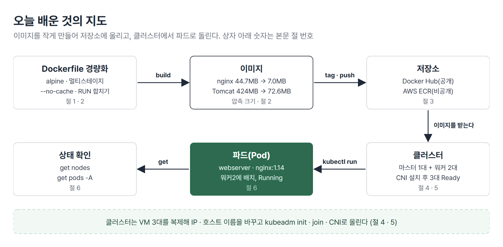
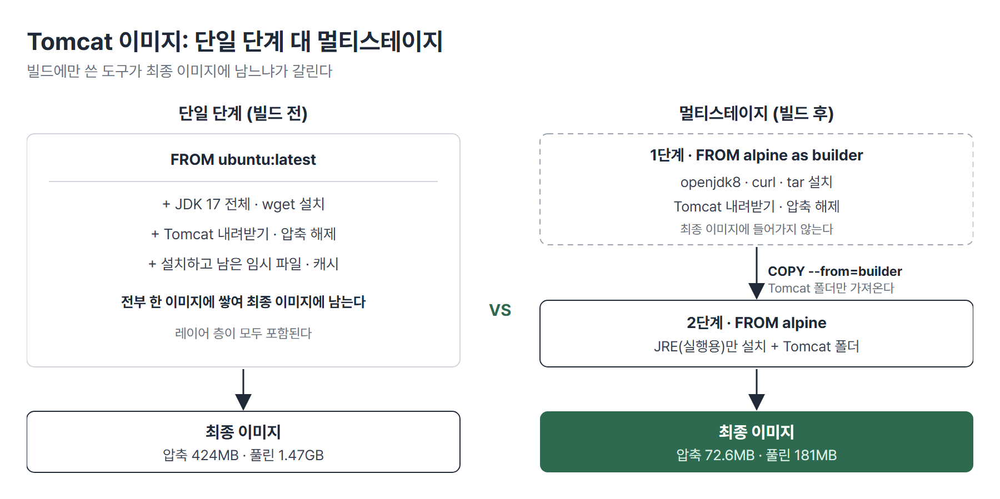
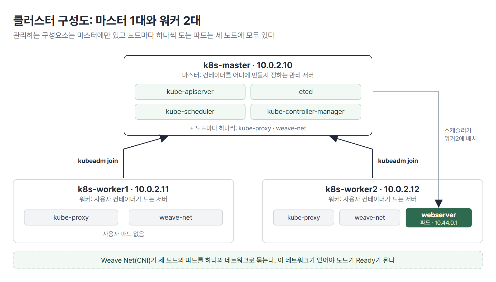

# <LG CNS 6기] MSA II 4일차 TIL · 이미지 저장소와 쿠버네티스 클러스터 구성

> TL;DR: 같은 앱을 alpine과 멀티스테이지로 빌드해 이미지 크기를 비교하고 Docker Hub와 AWS ECR에 올렸다. 이어서 마스터 1대와 워커 2대로 쿠버네티스 클러스터를 만들어 노드 3대가 Ready가 되는 것까지 확인했다.

## 🗺️ 한눈에 보기

### 오늘은 무엇을 배운 날이었나

오늘 수업은 크게 두 마디다. 앞마디는 이미지를 작게 만들어 저장소에 올리는 법이고 뒷마디는 그 이미지를 돌릴 쿠버네티스 클러스터를 만드는 법이다. 실습 서버는 AWS EC2의 Ubuntu였고 클러스터는 노트북 안의 VM 3대였다.



> 💡 이미지는 작게 만들어 저장소에 올리고 그 이미지를 돌릴 서버 묶음(클러스터)은 마스터 1대와 워커 2대로 만든다.

### 상황별로 무엇을 쓰나

| 이런 상황이면 | 이것을 쓴다 | 절 |
|---|---|---|
| 웹서버(nginx) 이미지를 줄인다 | 기본 이미지를 `-alpine`으로 바꾼다 | 1 · 2 |
| Tomcat 같은 WAS 이미지를 줄인다 | 멀티스테이지 빌드 | 1 · 2 |
| 밖에 공개하면 안 되는 이미지를 올린다 | AWS ECR(비공개 저장소) | 3 |
| 테스트로 이미지를 올려 본다 | Docker Hub(공개 저장소) | 3 |
| VM을 복제해 서버를 늘린다 | IP와 호스트 이름을 둘 다 바꾼다 | 4 |
| 서버 3대를 쿠버네티스로 묶는다 | 마스터에서 `kubeadm init`, 워커에서 `kubeadm join` | 5 |
| 클러스터가 정상인지 본다 | `kubectl get nodes` · `kubectl get pods -A` | 6 |

## 🧭 오늘의 학습 키워드

| 키워드 | 한 줄 정리 | 오늘 어디에 쓰였나 |
|---|---|---|
| 경량화 | 이미지 크기를 줄이는 일 | 1 · 2번 절 |
| alpine | 가벼운 리눅스. 기본 이미지로 쓴다 | 2번 절 |
| 멀티스테이지 빌드 | 빌드 단계와 실행 단계를 나눠 실행 단계만 이미지로 남긴다 | 2번 절 |
| 압축 크기 · 풀린 크기 | 저장소로 오가는 크기 · 서버 디스크에서 차지하는 크기 | 2번 절 |
| Docker Hub | 공개 이미지 저장소 | 3번 절 |
| AWS ECR | AWS의 비공개 이미지 저장소 | 3번 절 |
| 태그 | `저장소 주소/이름:버전` 형태의 이미지 이름 | 3번 절 |
| 클러스터 | 서버 여러 대를 하나로 묶은 것 | 4번 절 |
| 마스터 · 워커 | 관리하는 서버 · 컨테이너를 돌리는 서버 | 4번 절 |
| `kubeadm init` · `join` | 클러스터를 만들고 · 워커를 붙이는 명령 | 5번 절 |
| CNI(Weave Net) | 파드끼리 통신하는 네트워크를 만드는 플러그인 | 5번 절 |
| 파드(Pod) | 쿠버네티스가 컨테이너를 실제로 돌리는 단위 | 6번 절 |
| `kube-system` | 클러스터가 스스로 돌리는 시스템 파드의 영역 | 6번 절 |

## ✍️ 공부한 내용

### 1. 이미지를 작게 만드는 방법 4가지

이미지가 크면 서버마다 받는 시간이 길어지고 저장소에 쌓이는 양도 늘어난다. 그래서 이미지를 만들 때 크기를 줄이는 방법이 정리돼 있다.

| 방법 | 줄이는 것 | 맞는 상황 |
|---|---|---|
| alpine 기본 이미지 | 바닥이 되는 리눅스 자체 | 웹서버처럼 빌드할 것이 없을 때 |
| 멀티스테이지 빌드 | 빌드에만 쓴 도구 | 컴파일이 필요한 WAS |
| 불필요한 파일 · 캐시 제거(`--no-cache`) | 설치하고 남은 찌꺼기 | 패키지를 설치하는 모든 Dockerfile |
| `RUN`을 `&&`로 합치기 | 레이어 수 | 설치 명령이 여러 줄일 때 |

> 💡 Dockerfile은 줄마다 레이어(층)가 하나씩 쌓인다. 층이 많을수록 시간이 오래 걸리고 크기도 커진다.

### 2. 같은 앱을 네 가지로 빌드해 크기 비교

같은 Node.js 서버를 기본 이미지만 바꿔 네 번 빌드했다. 앱 코드는 그대로이고 `FROM` 줄과 구성만 다르다.

| 방식 | `FROM` | 압축 크기 | 풀린 크기 |
|---|---|---|---|
| 기본 | `node:16` | 351MB | 1.35GB |
| slim | `node:16-slim` | 67.6MB | 280MB |
| alpine | `node:16-alpine` | 44.8MB | 186MB |
| alpine + 멀티스테이지 | `node:16-alpine` 3단계 | 43.1MB | 176MB |

`docker images`의 `CONTENT SIZE`가 압축 크기이고 `DISK USAGE`가 풀린 크기다. 저장소를 오가는 건 압축 크기라서 배포 속도는 이 값으로 비교한다.

**웹서버 이미지**는 `FROM` 한 줄만 바꿨다.

```dockerfile
FROM nginx:1.14          # 압축 44.7MB · 풀린 165MB
FROM nginx:1.14-alpine   # 압축 7.0MB · 풀린 26.2MB
```

웹서버는 컴파일할 것이 없어서 바닥 이미지만 alpine으로 바꾸면 끝이다. 그런데도 크기는 약 84% 줄었다.

**WAS(Tomcat) 이미지**는 멀티스테이지로 만들었다. 빌드 전은 `ubuntu:latest`에 JDK 전체를 설치하는 방식이고 압축 424MB, 풀린 1.47GB였다. 멀티스테이지 후는 압축 72.6MB, 풀린 181MB다.

```dockerfile
FROM alpine:latest as builder
RUN apk add --no-cache openjdk8 curl tar      # 내려받고 푸는 데 쓰는 도구
# ... Tomcat을 내려받아 $CATALINA_HOME에 푼다 ...

FROM alpine:latest
RUN apk add --no-cache openjdk8-jre-base      # 실행에는 JRE만
COPY --from=builder $CATALINA_HOME $CATALINA_HOME
CMD ["catalina.sh", "run"]
```

- 첫 번째 `FROM`(builder)에서 Tomcat을 받아 풀고 두 번째 `FROM`에서 완성된 폴더만 `COPY --from=builder`로 가져온다.
- 최종 이미지에는 두 번째 단계만 남는다. `curl` · `tar` · JDK 전체는 첫 단계에 두고 버린다.



> 💡 이미지 크기 기준은 웹서버는 alpine으로 한 자리 MB, WAS는 멀티스테이지로 두 자리 MB다.

Tomcat Dockerfile은 JDK 버전이 올라가면서 빌드 오류가 나서 수정한 코드로 다시 빌드했다. 빌드 전에는 `docker system prune`과 `docker builder prune -f`로 디스크와 캐시를 비운다. EC2 디스크가 6.8GB뿐이라 공간이 모자라면 빌드가 실패한다.

### 3. 이미지 저장소 3종과 ECR 푸시

만든 이미지는 저장소에 올려 두어야 다른 서버가 받아 쓴다. 저장소는 세 가지를 배웠다.

| 저장소 | 누가 볼 수 있나 | 현장에서 |
|---|---|---|
| Docker Hub | 누구나(공개) | 교육 · 테스트용 |
| AWS ECR | 우리 계정만(비공개) | 실제로 쓴다 |
| 로컬 `registry:2` | 사내 | 거의 안 쓴다 |

Docker Hub는 외부에 노출되기 때문에 보안 문제가 생긴다. 계정 이름만 알면 올린 이미지를 볼 수 있어서 회사 이미지는 올리지 않는다. 그래서 현장에서는 비공개인 ECR을 쓴다.

ECR에 올리려면 AWS CLI를 설치하고 액세스 키로 권한을 넣는다. 키는 `aws configure`에 입력하고 지역은 서울(`ap-northeast-2`)로 맞춘다. 액세스 키가 유출되면 이미지도 가져갈 수 있어서 코드나 글에 붙이지 않는다.

ECR의 저장소는 폴더 같은 껍데기이고 그 안에 `1.0`, `2.0`처럼 버전 태그가 쌓인다. 올리는 순서는 Docker Hub와 같다. 로그인, 태그, 푸시다.

```bash
aws ecr get-login-password --region ap-northeast-2 | docker login --username AWS --password-stdin <계정ID>.dkr.ecr.ap-northeast-2.amazonaws.com
docker tag nginxweb:1.0 <계정ID>.dkr.ecr.ap-northeast-2.amazonaws.com/ecr-nginx:1.0
docker push <계정ID>.dkr.ecr.ap-northeast-2.amazonaws.com/ecr-nginx:1.0
```

- 로그인에 성공하면 `Login Succeeded`가 나온다. ECR 주소는 리전마다 다르므로 저장소를 만든 리전으로 로그인한다.
- 태그 끝의 이름이 ECR 저장소 이름과 다르면 `repository ... does not exist`가 나온다.
- 소스의 `index.html`을 「버전 2.0」으로 바꿔 다시 빌드한 뒤 같은 방식으로 `2.0`을 올렸다.

올린 뒤에는 서버의 이미지를 지우고 ECR에서 받아 컨테이너를 띄워 확인한다.

```text
$ aws ecr list-images --region ap-northeast-2 --repository-name ecr-nginx --query "imageIds[].imageTag" --output text
2.0	1.0
$ docker run -d --name ecrtest -p 8080:80 <계정ID>.dkr.ecr.ap-northeast-2.amazonaws.com/ecr-nginx:2.0
Status: Downloaded newer image for <계정ID>.dkr.ecr.ap-northeast-2.amazonaws.com/ecr-nginx:2.0
$ curl -s localhost:8080 | grep -o '<title>[^<]*</title>'
<title>AWS ECR Nginx Web Server Version 2.0</title>
```

로컬 `registry:2`는 이미지를 서버 안의 컨테이너에 보관하는 방식이다. 포트는 5000번으로 정해져 있고 이미지는 `/var/lib/docker/volumes` 아래에 저장된다. 스토리지를 살 돈도 없고 ECR 계정도 없는데 Docker Hub는 쓸 수 없을 때만 쓴다.

> 💡 Docker Hub는 공개, ECR은 비공개다. 이미지를 올리고 받는 명령은 같고 주소와 권한만 다르다.

### 4. 클러스터 구성도와 VM 준비

클러스터는 서버 여러 대를 하나로 묶은 것이다. 역할은 두 가지로 나뉜다.

| 역할 | 하는 일 |
|---|---|
| 마스터 | 컨테이너를 어디에 만들지 지시하는 관리 서버. 관리용 구성요소가 올라간다. |
| 워커 | 사용자의 컨테이너가 실제로 도는 서버 |



현장은 마스터 3대와 워커 3대로 만들어 한 대가 죽어도 돌아가게 한다. 이번 구성은 PC 자원과 시간 때문에 마스터 1대와 워커 2대로 줄였다. 서버를 직접 설치해 보는 이유는 명령과 개념을 같이 익히기 위해서다.

VM은 새로 설치하지 않고 Docker가 설치된 상태의 스냅샷으로 되돌린 뒤 폴더째 복제해서 만들었다.

1. 마스터 VM 폴더를 두 번 복제하고 폴더 이름을 `k8s-worker1`, `k8s-worker2`로 바꾼다.
2. VMware에서 복제본의 `.vmx`를 열고 이름을 바꾼 뒤 켤 때 「I Copied It」을 고른다.
3. 복제본마다 IP를 바꾼다(워커1 `10.0.2.11`, 워커2 `10.0.2.12`).
4. `/etc/hostname`을 바꾼다. 적용하려면 재부팅이 필요하다.
5. 3대 모두 `/etc/hosts`에 같은 3줄을 넣는다.
6. `ping`으로 노드끼리, 그리고 `8.8.8.8`까지 되는지 확인한다.

```text
10.0.2.10  k8s-master
10.0.2.11  k8s-worker1
10.0.2.12  k8s-worker2
```

복제본은 마스터와 IP가 같은 채로 켜지므로 복제본의 IP를 바꾸기 전에는 마스터를 켜지 않는다. 마스터는 마지막에 켠다.

> 💡 복제한 VM은 IP와 호스트 이름이 원본과 같다. 둘 다 바꿔야 한다.

### 5. 클러스터 구성

구성은 세 묶음이다. 3대 모두 하는 것, 마스터에서만 하는 것, 워커에서만 하는 것이다. 명령마다 실행할 서버가 정해져 있어서 마스터 전용, 워커 전용, 공통을 구분해서 실행한다. 모든 명령은 `sudo -i`로 루트가 된 상태에서 한다.

**3대 모두(선행 설정)**

| 작업 | 왜 하나 |
|---|---|
| swap 끄기, 방화벽 해제 | 쿠버네티스는 swap을 쓰면 안 되고 노드끼리 통신이 막히면 안 된다 |
| 커널 모듈 · 네트워크 설정을 파일에 적기 | 재부팅해도 설정이 유지되게 한다 |
| 쿠버네티스 저장소 추가 후 `kubelet` · `kubeadm` · `kubectl` 설치 | 노드를 관리하는 에이전트 · 클러스터를 만드는 도구 · 명령을 내리는 도구 |
| 설치한 패키지를 `hold`로 고정 | 업데이트로 버전이 바뀌지 않게 한다 |
| cgroup 설정 | 컨테이너 런타임과 kubelet이 자원 제한을 같은 방식으로 다루게 한다 |

**마스터에서만 · 워커에서만 (순서대로)**

| 순서 | 누가 | 무엇을 |
|---|---|---|
| 1 | 마스터 | `kubeadm init`으로 관리 서버를 만든다 |
| 2 | 마스터 | 접속 설정 3줄을 실행해 `kubectl`이 클러스터를 찾게 한다 |
| 3 | 워커 1 · 2 | 마스터가 출력한 `kubeadm join ...` 명령을 실행해 클러스터에 붙는다 |
| 4 | 마스터 | CNI(Weave Net)를 `kubectl apply -f`로 설치한다 |

`join` 명령에는 토큰이 들어 있다. 마스터가 출력할 때 파일로 저장해 두면 다시 찾을 수 있다.

3번까지 끝낸 뒤 `kubectl get nodes`를 보면 노드 3대가 모두 `NotReady`다. CNI를 설치하면 몇 분 뒤 `Ready`로 바뀐다. 오래 지나도 안 바뀌면 마스터를 먼저 재부팅하고 워커1, 워커2 순서로 재부팅한다.

> 💡 노드가 Ready가 되려면 파드끼리 통신하는 네트워크가 먼저 만들어져 있어야 한다. 그 네트워크를 만드는 것이 CNI다.

### 6. 클러스터 점검과 첫 파드

클러스터가 만들어지면 노드 3대부터 확인한다.

```text
$ kubectl get nodes
NAME          STATUS   ROLES           AGE   VERSION
k8s-master    Ready    control-plane   24h   v1.32.13
k8s-worker1   Ready    <none>          24h   v1.32.13
k8s-worker2   Ready    <none>          24h   v1.32.13
```

`kubectl get pods -A`는 모든 영역의 파드를 보여 준다. 처음에는 `kube-system` 영역에 클러스터가 스스로 돌리는 시스템 파드만 있다.

| 파드 | 개수 | 어디에 | 하는 일 |
|---|---|---|---|
| `kube-apiserver` | 1 | 마스터만 | 모든 명령이 들어오는 입구 |
| `etcd` | 1 | 마스터만 | 클러스터의 상태를 저장 |
| `kube-scheduler` | 1 | 마스터만 | 파드를 어느 노드에 놓을지 정한다 |
| `kube-controller-manager` | 1 | 마스터만 | 원하는 상태와 현재 상태를 맞춘다 |
| `kube-proxy` | 3 | 노드마다 하나 | 노드의 네트워크 규칙 관리 |
| `weave-net` | 3 | 노드마다 하나 | CNI. 파드 네트워크를 만든다 |
| `coredns` | 2 | 클러스터 안 | 이름으로 서비스를 찾는 DNS. 하나가 죽어도 되게 두 개 둔다 |

노드 수가 늘면 `kube-proxy`와 `weave-net`도 노드 수만큼 늘어난다. 마스터 전용 구성요소는 늘지 않는다.

마지막으로 파드 하나를 직접 띄웠다. Docker에서 `docker run`으로 컨테이너를 띄우던 자리에 `kubectl run`을 쓴다.

```text
$ kubectl run webserver --image=nginx:1.14
pod/webserver created
$ kubectl get pods -o wide
NAME        READY   STATUS    RESTARTS   AGE   IP          NODE          NOMINATED NODE   READINESS GATES
webserver   1/1     Running   0          16s   10.44.0.1   k8s-worker2   <none>           <none>
```

- `READY 1/1`은 파드 안 컨테이너 1개가 준비됐다는 뜻이다.
- `IP 10.44.0.1`은 파드가 받은 IP다. 노드 IP(`10.0.2.x`)와 대역이 다르다. Weave Net이 나눠 준 주소다.
- `NODE`가 워커2인 것은 스케줄러가 워커2에 놓았다는 뜻이다.

작업을 마칠 때는 워커를 먼저 끄고 마스터를 마지막에 끈다. 켤 때는 마스터를 먼저 켠다. 클러스터 구성이 끝난 상태로 스냅샷을 찍어 두면 나중에 깨졌을 때 그 지점으로 되돌릴 수 있다.

## 🧩 이어지는 내용

- 1~3일차(10/21~10/23)에 이미지, Dockerfile, 컨테이너 네트워크를 배웠다. 오늘은 그 이미지를 줄이고 저장소에 올리는 데까지 이었다.
- 3일차에 Docker Hub에 올린 것을 오늘은 비공개 저장소(ECR)까지 넓혔다.
- 쿠버네티스는 10/29까지 이어지고 다음 순서는 kubectl 명령, 파드 생성, 컨트롤러, 서비스다.
- 2차 사후평가는 10/29이고 미니 프로젝트 2는 10/30에 시작한다.

## ❓ 몰랐던 것

### 이미지가 작을 때 좋아지는 것

세 가지가 좋아진다. 첫째는 배포 속도다. 서버마다 이미지를 받으므로 크기 차이가 서버 수만큼 곱해진다. 둘째는 복구 속도다. 서버가 죽어 새 서버에서 컨테이너를 다시 띄울 때 이미지를 먼저 받아야 한다. 셋째는 비용이다. 저장소에 쌓이는 양과 전송량이 줄어든다.

### 웹서버 이미지도 줄일 필요가 있는 이유

줄일 필요가 있다. nginx 이미지는 압축 44.7MB에서 7.0MB로 약 84% 줄었다. 가벼워 보이는 웹서버도 바닥이 되는 리눅스를 alpine으로 바꾸면 줄어든다. 웹서버는 컴파일이 없어서 방법이 한 가지(alpine)로 끝날 뿐이다.

### 멀티스테이지가 덜어내는 것

멀티스테이지가 덜어내는 것은 **빌드에만 쓴 도구**다. 소스를 컴파일하거나 파일을 내려받아 풀 때는 JDK, curl, tar가 필요하지만 실행할 때는 JRE와 결과물만 있으면 된다. 그래서 첫 단계에서 만들고 두 번째 단계에는 결과물만 복사해 최종 이미지로 남긴다. 레이어 수를 줄이는 것은 `RUN`을 `&&`로 합치는 별도의 방법이다.

### 복제한 VM에서 바꿔야 하는 것

IP와 호스트 이름 두 가지다. 복제본은 원본과 둘 다 같은 채로 켜진다. IP가 같으면 두 VM이 충돌해 네트워크가 막히고 호스트 이름이 같으면 노드 이름이 중복돼 클러스터를 구성할 때 오류가 난다. 호스트 이름은 재부팅해야 적용된다.

### CNI의 역할과 Ready 조건

CNI(컨테이너 네트워크 인터페이스)는 파드끼리 통신하는 네트워크를 만들어 주는 플러그인이고 이번에 쓴 것이 Weave Net이다. 3일차에서 컨테이너가 `docker0`에서 IP를 받았던 것과 비슷한 역할인데 `docker0`는 서버 1대 안에서만 통하고 CNI는 서버 여러 대에 걸쳐 파드를 하나의 네트워크로 묶는다. 노드는 이 네트워크가 준비돼야 Ready가 된다. `kubeadm init`과 `join` 직후에는 네트워크가 없어서 `NotReady`였고 Weave Net을 설치하자 `Ready`가 됐다.

### 마스터에만 있는 파드와 노드마다 있는 파드

`kube-apiserver` · `etcd` · `kube-scheduler` · `kube-controller-manager` 네 개가 마스터에만 있다. 노드마다 하나씩 있는 것은 `kube-proxy`와 `weave-net`이다. 노드가 늘면 이 둘이 같이 늘고 마스터 전용 파드는 늘지 않는다.

## 📌 다음에 해볼 것

- [ ] `docker history`로 nginx와 Tomcat 이미지를 열어 어느 줄에서 크기가 늘어나는지 확인하기
- [ ] 클러스터 VM을 마스터부터 켜고 `kubectl get nodes`가 Ready가 되기까지 걸리는 시간 재 보기
- [ ] `kubectl get pods -A -o wide`로 `kube-proxy`와 `weave-net`이 노드마다 하나씩 있는지 확인하기

## 🔍 더 짚어둘 것

### 1. 미니 프로젝트: 이미지와 저장소를 고를 때

미니 프로젝트 2(10/30 ~ 11/5)에서 서비스를 컨테이너로 올린다면 오늘 배운 두 가지가 바로 쓰인다.

- **서비스 이미지는 WAS 기준으로 만든다**: Spring Boot 서비스는 빌드 단계에서 Maven으로 jar를 만들고 실행 단계에서는 JRE에 jar만 복사하는 멀티스테이지가 맞는다. 다만 Tomcat 예제로만 만들어 봤고 Spring Boot jar로는 아직 빌드해 보지 않았다.
- **저장소는 공유 범위로 고른다**: 팀원이 같은 이미지를 받으려면 공유 저장소가 필요하다. Docker Hub는 공개라 코드가 보이고 ECR은 팀 AWS 계정과 비용을 낼 사람이 필요하다.
- **클러스터는 한 PC 안에서만 접속된다**: 노트북 VM의 사설 주소(`10.0.2.x`)라 다른 팀원이 닿을 수 없다. 팀 배포 환경으로 쓰기보다 시연용으로 판단한다.

### 2. AI: 바이브코딩할 때 사람이 확인할 것

- **Dockerfile의 `FROM` 줄과 최종 크기를 본다**: AI가 `ubuntu`나 기본 이미지로 만들면 같은 앱이 몇 배 커진다. `docker images`로 크기를 확인한다.
- **멀티스테이지의 `COPY --from=` 경로를 본다**: 경로가 실제 빌드 결과 위치와 다르면 빌드는 통과하고 실행에서 실패한다.
- **액세스 키와 토큰을 AI에게 붙여 넣지 않는다**: 대화와 코드, 로그에 남으면 유출과 같다. `aws configure`나 환경 변수로만 넣는다.
- **쿠버네티스 설치 명령은 버전을 확인한다**: 저장소 주소와 패키지 버전이 버전마다 달라서 오래된 가이드를 그대로 붙이면 설치가 안 된다. 이번 실습은 v1.32다.

태그: LG CNS 6기, 개발자, LGCNSINSPIRECAMP
