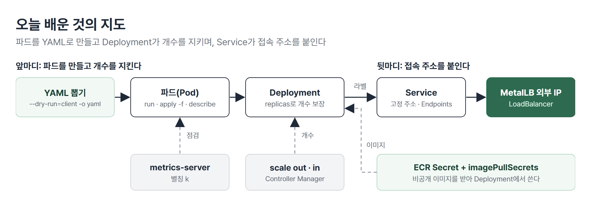
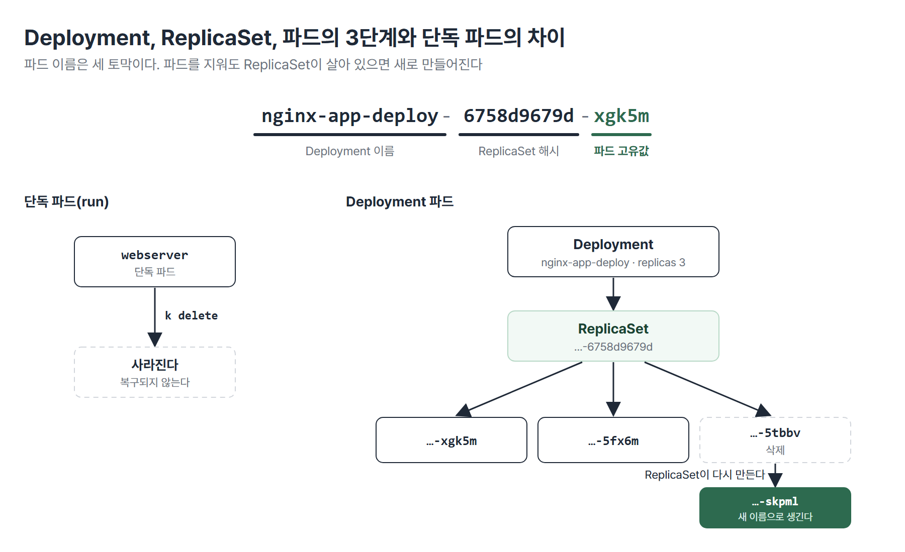
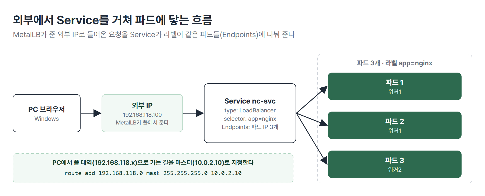

# <LG CNS 6기] MSA II 5일차 TIL · 파드와 Deployment, Service와 MetalLB

> TL;DR: 클러스터에 metrics-server를 설치한 뒤 파드를 YAML로 만들고 Deployment로 개수를 지키게 했다. 오후에는 Service와 MetalLB로 파드에 고정 주소와 외부 접속을 붙이고 비공개 ECR 이미지를 받는 Deployment까지 만들었다.

## 🗺️ 한눈에 보기

### 오늘은 무엇을 배운 날이었나

오늘은 파드를 만들어 개수를 지키게 하는 일과 그 파드들에 고정 접속 주소를 붙이는 일을 했다. 두 일에 공통으로 쓰인 습관은 설계도 파일(YAML)을 직접 짜지 않고 뽑아 쓰는 것과 `describe`로 상태를 읽는 것이다.



> 💡 파드는 YAML로 만들고 개수는 Deployment가 지키며 접속은 Service가 맡는다.

### 상황별로 무엇을 쓰나

| 이런 상황이면 | 이것을 쓴다 | 절 |
|---|---|---|
| 파드·노드의 CPU, 메모리를 보거나 자동 증감을 쓴다 | metrics-server | 1 |
| 파드 하나를 빠르게 띄워 본다 | `kubectl run` | 2 |
| 파드를 운영용으로 만든다 | `--dry-run=client -o yaml`로 YAML을 뽑아 고친 뒤 `apply -f` | 2 · 3 |
| 파드 개수를 지키게 한다 | Deployment | 4 |
| 개수를 늘리고 줄인다 | `scale` 또는 YAML의 `replicas` 수정 | 4 · 5 |
| 파드가 바뀌어도 같은 주소로 접속하게 한다 | Service | 6 |
| 클러스터 밖에서 접속하게 한다 | `LoadBalancer`(온프레미스에서는 MetalLB) | 6 |
| 비공개 ECR 이미지를 쓴다 | Secret + `imagePullSecrets` | 7 |

## 🧭 오늘의 학습 키워드

| 키워드 | 한 줄 정리 | 오늘 어디에 쓰였나 |
|---|---|---|
| metrics-server | 파드·노드의 CPU, 메모리 사용량을 모으는 구성요소 | 1번 절 |
| HPA | 부하에 따라 파드 수를 자동으로 늘리고 줄이는 기능 | 1번 절 |
| `k` 별칭 | `kubectl`을 `k`로 줄이는 설정 | 1번 절 |
| YAML | 쿠버네티스 리소스를 적는 설정 파일. 들여쓰기와 대소문자를 구별한다 | 2번 절 |
| `apply -f` | 파일 내용대로 리소스를 만들거나 덮어쓴다 | 2번 절 |
| `describe` | 리소스의 상세 상태와 이벤트를 보여 주는 점검 명령 | 2번 절 |
| `--dry-run=client -o yaml` | 만들지 않고 YAML만 뽑는 옵션 | 3번 절 |
| Deployment | 파드 개수를 지키고 버전을 관리하는 컨트롤러 | 4번 절 |
| ReplicaSet | Deployment 아래에서 실제로 개수를 지키는 컨트롤러 | 4번 절 |
| scale out · in | 파드 개수를 늘리고 · 줄인다 | 5번 절 |
| Controller Manager | 원하는 개수와 현재 개수를 맞추는 마스터 구성요소 | 5번 절 |
| Service | 파드 묶음 앞에 붙는 고정 접속 주소 | 6번 절 |
| Endpoints | Service에 묶인 파드 IP 목록 | 6번 절 |
| MetalLB | 온프레미스에서 LoadBalancer에 외부 IP를 주는 도구 | 6번 절 |
| `imagePullSecrets` | 비공개 저장소의 이미지를 받을 때 쓰는 인증 정보 연결 | 7번 절 |

## ✍️ 공부한 내용

### 1. 클러스터 점검, metrics-server, 별칭

시작은 `kubectl get nodes`로 노드 3대가 Ready인지, `get pods -A`로 시스템 파드가 떠 있는지 확인하는 것이다. 4일차에 설치한 CNI는 Weave Net이다. Calico도 같은 역할이라 둘 중 하나만 설치하면 되고 한 노드가 계속 `NotReady`이면 Calico를 설치해 보는 방법이 있다. 네트워크 정책이 필요한 CKA 문제에서는 Calico를 설치하라고 나온다.

metrics-server는 파드와 노드의 CPU, 메모리 사용량을 모으는 구성요소다. 설치는 두 줄이다.

```bash
kubectl apply -f https://github.com/kubernetes-sigs/metrics-server/releases/latest/download/components.yaml
kubectl patch deployment metrics-server -n kube-system --type='json' \
  -p='[{"op":"add","path":"/spec/template/spec/containers/0/args/-","value":"--kubelet-insecure-tls"}]'
```

- 첫 줄이 설치이고 둘째 줄은 실행 인자에 `--kubelet-insecure-tls`를 추가하는 패치다. 설치 직후 파드가 `0/1`이었고 패치 뒤 새 파드가 `1/1`이 됐다.
- 확인은 `kubectl top pods -n kube-system`이다. `top`은 metrics-server가 있어야 동작한다.

> 💡 metrics-server는 `top`과 HPA(파드 자동 증감)의 바탕이다. 현장에서는 설치하고 안 하고를 고민하지 않고 무조건 설치한다.

명령을 줄이는 별칭도 설정한다. 현장에서 쓰는 방식이다.

```bash
echo 'alias k=kubectl' >> ~/.bashrc
echo 'source <(kubectl completion bash)' >> ~/.bashrc
echo 'complete -F __start_kubectl k' >> ~/.bashrc
source ~/.bashrc
```

- 이후에는 `k get pods`처럼 치고 `k describe pods <탭>`으로 파드 이름을 자동완성한다.
- `kg`, `kd` 같은 더 짧은 별칭은 초급 단계에서는 권하지 않았다.

### 2. 파드 만들기: `run`과 YAML

파드 하나를 만드는 방법은 두 가지다. `kubectl run webserver --image=nginx:1.14`는 명령 한 줄이고 이름과 이미지를 파일에 적는 방법이 YAML이다.

```yaml
apiVersion: v1
kind: Pod
metadata:
  name: netflixweb-pod
  labels:
    app: nginx-app
spec:
  containers:
  - name: nginx-app
    image: powermvp/netflix:v2.0
    ports:
    - containerPort: 80
```

- 파일로 만들 때는 `k apply -f netflixweb.yaml`을 쓴다. `-f`는 파일이다.
- `labels`는 파드의 꼬리표다. 컨트롤러와 서비스가 이 꼬리표로 파드를 찾는다.
- `resources`에 `requests`와 `limits`를 넣으면 CPU와 메모리의 최소·최대치를 정한다.

YAML은 규칙이 두 가지라서 어렵다.

| 규칙 | 틀리면 |
|---|---|
| 들여쓰기(같은 높이는 형제 항목) | 실행이 안 된다 |
| 대소문자 구분(`nodePort`와 `NodePort`는 다르다) | 실행이 안 된다 |

Dockerfile은 위에서 아래로 실행되지만 YAML은 전체가 맞는지를 한꺼번에 검토한다. 그래서 메모장 대신 VS Code로 열고 확장 indent-rainbow로 들여쓰기를 색으로 본다. 필드에 마우스를 올리면 설명도 뜬다.

만든 뒤에는 `k describe pods netflixweb-pod`로 상태를 읽는다.

| 보는 항목 | 알 수 있는 것 |
|---|---|
| Labels · Node · IP | 꼬리표, 어느 노드에 놓였는지, 파드 IP |
| Image | 어느 이미지로 만들었는지 |
| Events | 배치 → 이미지 가져오기 → 컨테이너 생성 → 시작 순서와 실패 사유 |

> 💡 파드나 서비스가 이상하면 가장 먼저 `describe`를 친다.

### 3. YAML 초안 뽑기

YAML을 처음부터 쓰면 들여쓰기에서 막힌다. 그래서 명령으로 초안을 뽑아 수정하는 방식을 쓴다. 쓰는 옵션은 `--dry-run=client`와 `-o yaml`이다.

```bash
k run web --image=nginx:1.14 --dry-run=client                       # pod/web created (dry run). 만들지 않고 명령만 검증
k run web --image=nginx:1.14 --dry-run=client -o yaml > web-pod.yaml  # YAML을 뽑아 파일로 저장
k apply -f web-pod.yaml                                              # 고친 뒤 실행
```

| 방법 | 어떻게 | 맞는 상황 |
|---|---|---|
| 명령으로 바로 만들기 | `k run ...`, `k create deployment ...` | 연습, 빠른 확인 |
| YAML을 처음부터 쓰기 | 빈 파일에 직접 작성 | 들여쓰기·대소문자가 어려워 권하지 않는다 |
| `--dry-run=client -o yaml`로 뽑기 | 초안을 뽑아 고친 뒤 `apply -f` | 현장과 시험의 기본 방식 |

명령으로는 정할 수 없는 값이 있어서 이 방식이 필요하다. 예를 들어 `k create deployment`는 컨테이너 이름을 따로 받지 않는다. 컨테이너 이름을 `web`으로 만들라는 문제라면 이렇게 푼다.

```bash
k create deployment nginx-web --image=nginx:1.14 --replicas=3 --dry-run=client -o yaml > nginx-web.yaml
# 파일에서 컨테이너 이름 nginx를 web으로 고친다
k apply -f nginx-web.yaml
```

- 다른 방법은 kubernetes.io 문서의 Deployment 샘플을 복사해 이름과 이미지를 고치는 것이다. CKA 시험에서는 이 문서 창만 열 수 있어서 거기서 복사해 쓴다.
- YAML로 만든 것은 `k delete -f 파일`로 지울 수 있다. 명령으로 만든 것은 해당 명령으로 지워야 한다.
- 강사님 회사의 원칙은 명령을 직접 치지 않고 YAML로만 만드는 것이다. 명령은 한 번 잘못 치면 되돌릴 수 없고 YAML은 실행 전에 검토할 수 있다.

> 💡 `--dry-run=client -o yaml > 파일`은 오늘 가장 중요한 명령이다. 현장에서도 시험에서도 이 방식으로 YAML을 만든다.

### 4. Deployment와 scale

Deployment는 「이 파드를 몇 개 유지해 줘」를 맡기는 컨트롤러다. 파드 하나를 만들 때와 달리 `replicas`와 `selector`, `template`이 들어간다.

```yaml
apiVersion: apps/v1
kind: Deployment
metadata:
  name: nginx-app-deploy
spec:
  replicas: 3
  selector:
    matchLabels:
      app: nginx-app
  template:
    metadata:
      labels:
        app: nginx-app
    spec:
      containers:
      - name: nginx-app
        image: <이미지>
```

- `replicas`가 파드 개수이고 `template` 아래가 파드 하나의 설계도다. 여기서 만들어진 파드가 두 개 노드에 나뉘어 올라간다.
- `selector`의 라벨과 `template`의 라벨은 같아야 한다. 라벨 규칙은 다음 시간에 더 다룬다.

개수를 바꾸는 방법은 세 가지다.

| 방법 | 명령 | 특징 |
|---|---|---|
| YAML을 고치고 `apply` | `vi`로 `replicas`를 고친 뒤 `k apply -f` | `configured`로 나온다. 실행 전에 검토할 수 있다 |
| `scale` | `k scale deployment nginx-app-deploy --replicas=5` | 명령 한 줄로 바로 바뀐다 |
| `edit` | `k edit deployments.apps nginx-app-deploy` | 편집기를 저장(`:wq`)하는 순간 바로 반영된다. 조심해서 쓴다 |

실습에서는 3 → 5 → 3 → 5 → 2 → 3으로 `scale`을 바꿔 봤다. 늘리면 새 파드가 바로 생기고 줄이면 일부 파드가 정리된다.

단독 파드와 Deployment 파드는 지웠을 때 다르게 움직인다.

| 파드 | 지우면 | 살리려면 |
|---|---|---|
| 단독 파드(`run`으로 만든 것) | 그냥 사라진다 | etcd 백업을 복원해야 한다 |
| Deployment 파드 | 몇 초 안에 새 이름의 파드가 다시 생긴다 | 아무것도 안 해도 된다 |

Deployment 아래에는 한 단계가 더 있다. 파드 이름 `nginx-app-deploy-6758d9679d-xgk5m`은 세 토막이다.



- 앞 토막(`nginx-app-deploy`)은 Deployment 이름이고 가운데 토막(`6758d9679d`)은 ReplicaSet 이름의 일부이며 마지막 토막만 파드마다 다르다.
- 파드를 지워도 ReplicaSet이 살아 있는 한 파드가 다시 만들어지고 ReplicaSet을 지워도 Deployment가 다시 만든다.

> 💡 현장에서는 파드의 98~99%를 Deployment로 만든다. 단독 파드는 지우면 끝이라 운영에 쓰지 않는다.

### 5. 개수를 지키는 구조

개수를 바꾸는 용어는 두 쌍으로 구분한다.

| 용어 | 뜻 | 쿠버네티스에서 |
|---|---|---|
| scale out · in | 파드(컨테이너) 개수를 늘리고 · 줄인다 | 오늘 한 것 |
| scale up · down | 한 대의 CPU, 메모리를 키우고 · 줄인다 | 하드웨어를 바꿔야 해서 해당 없음 |

개수를 지키는 일은 마스터의 구성요소 네 개가 나눠서 한다. 4일차에 본 마스터 전용 파드들이다.

| 구성요소 | 하는 일 |
|---|---|
| API Server | 명령을 가장 먼저 받아 문법과 실행 권한을 검증한다 |
| etcd | 리소스가 있는지 없는지를 저장하는 DB |
| Scheduler | 워커의 CPU, 메모리, 디스크를 보고 파드를 놓을 노드를 정한다 |
| Controller Manager | 원하는 개수와 현재 개수를 비교해 부족하면 만든다 |

`kubectl run`을 치면 API Server가 명령을 검증하고 etcd에 같은 리소스가 있는지 확인하며 Scheduler가 노드를 정한다. 파드가 죽으면 Controller Manager가 알아채고 새로 만든다.

> 💡 개수를 맞추는 것은 Controller Manager이고 어느 노드에 놓을지 정하는 것은 Scheduler다.

### 6. Service와 MetalLB

파드는 새로 만들어질 때마다 IP가 바뀐다. 그래서 같은 레이블의 파드들을 묶어 앞에 고정 주소를 붙이는 것이 Service다. 묶인 파드의 IP 목록은 Endpoints에 들어간다.

```bash
k expose deployment nc-deploy --name nc-svc --type=LoadBalancer --port 80
k get svc
k describe svc nc-svc
```

`describe svc`에서는 세 가지를 본다.

| 항목 | 의미 |
|---|---|
| Selector | 어떤 라벨의 파드를 묶는지 |
| Endpoints | 실제로 묶인 파드 IP 목록(비어 있으면 라벨이 안 맞는 것) |
| LoadBalancer Ingress | 외부에서 접속하는 가상 IP(VIP) |

파드를 늘리면 Endpoints에 파드 IP가 자동으로 붙고 지우면 빠진다. 분산도 확인했다. 파드마다 `index.html`을 `web1`, `web2`로 바꾸고 Service 주소로 `curl`을 반복하면 두 값이 섞여 나온다.

```bash
k exec -it <파드이름> -- bash                 # 파드 안으로 들어간다
echo "I am Home Page web1" > /usr/share/nginx/html/index.html
```

- `--`를 빼고 `k exec -it <파드> bash`로 치면 `exec [POD] [COMMAND] is not supported anymore`가 나온다.
- 파드가 3개면 접속이 각각 약 33.3%씩 나뉜다. 앞에 로드밸런서가 붙어 있어서다.

`LoadBalancer`는 원래 퍼블릭 클라우드가 외부 로드밸런서를 만들어 주는 타입이다. 온프레미스에는 그 장비가 없어서 `EXTERNAL-IP`가 `<pending>`으로 남는다. 이 자리를 채워 주는 것이 MetalLB다.

| 순서 | 작업 |
|---|---|
| 1 | `kube-proxy` 설정의 `strictARP`를 `true`로 바꾼다 |
| 2 | MetalLB 매니페스트(v0.14.4)를 적용한다 |
| 3 | 외부 IP 풀과 광고 설정(`IPAddressPool`, `L2Advertisement`)을 적용한다 |
| 4 | Windows 관리자 PowerShell에서 풀 대역으로 가는 길을 마스터로 지정한다 |

```yaml
  addresses:
  - 192.168.118.100-192.168.118.120
  autoAssign: true
```

```powershell
route add 192.168.118.0 mask 255.255.255.0 10.0.2.10
```

- 예시 대역은 `192.168.118.x`(강사님 PC 값)이고 각자 VMnet1 대역에 맞춰 바꾼다. 풀은 `ip-pool`이라는 이름으로 만든다.
- 적용 뒤 첫 LoadBalancer 서비스가 풀의 첫 주소(`.100`)를 받았다. 서비스를 지우고 새로 만들면 같은 주소를 다시 받는다.
- `L2Advertisement`의 `interfaces: eth0`가 노드의 NIC 이름과 달라 `announceFailed` 경고가 나왔지만 접속은 됐다.



> 💡 Service는 라벨로 파드를 묶는 고정 주소이고 MetalLB는 그 주소를 클러스터 밖에서 쓸 수 있게 외부 IP를 준다.

### 7. 비공개 ECR 이미지로 Deployment 만들기

ECR은 비공개 저장소라서 클러스터가 이미지를 받으려면 인증 정보가 필요하다. 4일차에 올린 이미지를 클러스터에서 쓰는 자리다. 순서는 네 단계다.

| 순서 | 작업 |
|---|---|
| 1 | 마스터에 AWS CLI v2를 설치한다(`curl`, `unzip`, `sudo ./aws/install`) |
| 2 | `aws configure`로 자격증명과 지역(`ap-northeast-2`)을 넣는다 |
| 3 | `kubectl create secret docker-registry`로 인증 정보를 Secret으로 만든다 |
| 4 | Deployment의 `spec.template.spec`에 `imagePullSecrets`로 연결한다 |

```bash
kubectl create secret docker-registry ecr-secret \
  --docker-server=<계정ID>.dkr.ecr.ap-northeast-2.amazonaws.com \
  --docker-username=AWS \
  --docker-password="$(aws ecr get-login-password --region ap-northeast-2)" \
  --namespace=default
```

- 비밀번호 자리에서 `aws ecr get-login-password`가 토큰을 받아 온다. 그래서 마스터에 AWS CLI가 있어야 한다.
- CLI가 없으면 `aws: not found`, 자격증명이 없으면 `NoCredentials`가 나오고 둘 다 비밀번호가 비어 `error: either --from-file or ...`로 끝난다.

```yaml
    spec:
      imagePullSecrets:
      - name: ecr-secret
      containers:
      - name: nginx
        image: <계정ID>.dkr.ecr.ap-northeast-2.amazonaws.com/ecr-nginx:v2.0
```

- `imagePullSecrets`는 `containers`와 같은 깊이(형제 라인)에 둔다. 공식 문서의 Deployment 샘플을 복사해 이미지만 바꾸고 이 두 줄을 넣으면 된다.
- 이미지의 태그는 자기 저장소에 올린 태그를 쓴다. 적용하면 파란 바탕의 2.0 페이지가 외부 IP로 열린다.

> 💡 비공개 저장소의 이미지는 Secret을 만들고 `imagePullSecrets`로 연결해야 받을 수 있다.

## 🧩 이어지는 내용

- 4일차에 클러스터를 만들고 파드를 한 번 띄웠다. 오늘은 그 파드를 YAML과 Deployment로 다루고 Service로 접속하는 데까지 이었다.
- 4일차에 ECR에 올린 이미지를 오늘 클러스터에서 받아 Deployment로 띄웠다.
- 다음 시간에는 컨트롤러와 Service, Label을 이론으로 정리하고 마지막 날에는 GitHub와 Argo CD를 연동한 자동 배포(CI/CD)를 한다.

## ❓ 몰랐던 것

### metrics-server가 없으면 안 되는 것

`kubectl top`이 동작하지 않고 HPA가 파드의 CPU, 메모리 사용량을 알 수 없어 자동 증감을 못 한다. 부하에 따라 서버를 5대에서 10대로 늘리는 구조는 이 수치를 읽는 구성요소가 있어야 돌아간다.

### 이상할 때 가장 먼저 치는 명령

`describe`다. 파드는 레이블, IP, 배치된 노드, 이미지와 Events(배치, 이미지 가져오기, 생성, 시작)를 본다. 서비스는 Endpoints가 비어 있는지를 본다. 안 될 때 어디서 막혔는지가 Events와 Endpoints에 남는다.

### 현장에서 명령 대신 YAML로 만드는 이유

명령은 한 번 잘못 치면 되돌리기 어렵고 파일은 실행 전에 검토할 수 있어서다. YAML로 만든 것은 `delete -f`로 지울 수도 있고 복사해서 이름만 바꿔 다시 쓸 수도 있다. 그래서 명령으로 초안(`--dry-run=client -o yaml`)만 뽑고 실제 생성은 파일로 한다.

### 단독 파드와 Deployment 파드의 삭제 결과

단독 파드는 사라지고 Deployment 파드는 새 이름으로 다시 생긴다. 이유는 Deployment 아래의 ReplicaSet이 원하는 개수를 기억하고 있어서다. 단독 파드는 이 기억이 없어서 etcd 백업을 복원해야 살린다.

### 죽은 파드를 알아채고 다시 만드는 구성요소

Controller Manager가 원하는 개수(3)와 현재 개수(2)를 비교해 알아채고 새로 만든다. Scheduler는 이미 만들기로 한 파드를 어느 노드에 놓을지만 정한다. 개수를 맞추는 일과 놓는 일이 분리돼 있다.

### Service가 파드에 나눠 보내려면 같아야 하는 것

Service의 `selector` 라벨과 파드의 라벨이다. 같으면 Endpoints에 파드 IP가 들어가고 다르면 Endpoints가 비어 요청을 받을 파드가 없다. 오늘 `describe svc`에서 `Selector: app=nginx`와 파드 IP 목록이 짝으로 보였다.

### 비공개 ECR 이미지를 받는 조건

Secret(`docker-registry` 종류)과 Deployment의 `imagePullSecrets`가 필요하다. ECR은 인증된 요청에만 이미지를 내주는데 이미지를 받는 쪽은 노드이고 `kubectl`을 친 사람이 아니다. 그래서 인증 정보를 Secret에 담아 파드 설계도에 연결해 둔다. 그 토큰은 AWS CLI로 받아 오므로 마스터에 AWS CLI와 자격증명이 있어야 Secret을 만들 수 있다.

## 📌 다음에 해볼 것

- [ ] `k get deploy,rs,pods`로 파드 이름 세 토막이 각각 무엇인지 확인하기
- [ ] `k scale`로 개수를 바꾸면서 `k describe svc`의 Endpoints가 바뀌는지 보기
- [ ] ECR 토큰(`get-login-password`)의 만료 시간과 Secret을 갱신하는 방법 확인하기
- [ ] 자기 PC의 VMnet1 대역을 확인해 MetalLB 풀 대역 정하기

## 🔍 더 짚어둘 것

### 1. 미니 프로젝트: 서비스를 클러스터에 올릴 때

미니 프로젝트 2(10/30 ~ 11/5)에서 서비스를 컨테이너로 올린다면 오늘 배운 것이 이어진다. 서비스마다 Deployment와 Service를 한 벌씩 만들고 서비스 사이는 ClusterIP로, 밖에서 접속할 곳만 LoadBalancer로 연다.

- **YAML은 뽑아서 쓴다**: 서비스마다 파일을 직접 짜면 들여쓰기 오류가 늘어난다. 하나를 `--dry-run=client -o yaml`로 뽑아 서비스 이름과 이미지만 바꾸는 편이 안전하다.
- **라벨 규칙을 팀이 정한다**: Service가 라벨로 파드를 묶으므로 서비스마다 겹치지 않는 `app` 라벨을 정해 두지 않으면 서로 다른 서비스가 묶인다.
- **이 클러스터는 노트북 안에서만 쓴다**: 노드 IP가 사설 주소(`10.0.2.x`)라 다른 팀원이 닿을 수 없다. 팀이 함께 쓰는 환경으로는 맞지 않다.

### 2. AI: 바이브코딩할 때 사람이 확인할 것

- **YAML의 들여쓰기와 라벨 일치**: AI가 만든 YAML은 모양이 맞아 보여도 `selector`와 `labels`가 다르면 Service의 Endpoints가 비는 식으로 조용히 틀린다. `apply` 뒤 `describe svc`로 확인한다.
- **적용 전에 `--dry-run=client`로 검증한다**: 만들지 않고 명령과 파일이 맞는지만 볼 수 있다.
- **토큰을 명령에 직접 붙이지 않는다**: Secret을 만들 때 `$(aws ecr get-login-password ...)`처럼 명령 치환으로 받는다. 값을 대화나 파일에 붙이면 남는다.
- **`latest` 주소의 설치 파일은 시점마다 내용이 달라진다**: metrics-server 설치 주소가 `releases/latest`다. 버전이 바뀌면 인자나 동작이 달라질 수 있어 설치 뒤 `top`이 도는지 확인한다.


태그: LG CNS 6기, 개발자, LGCNSINSPIRECAMP
