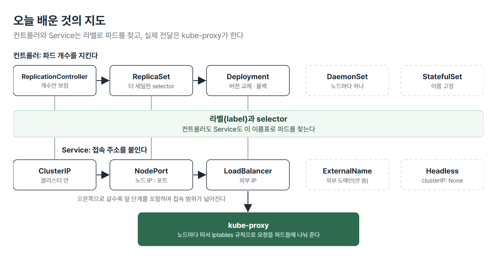
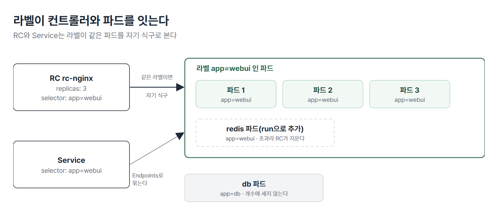
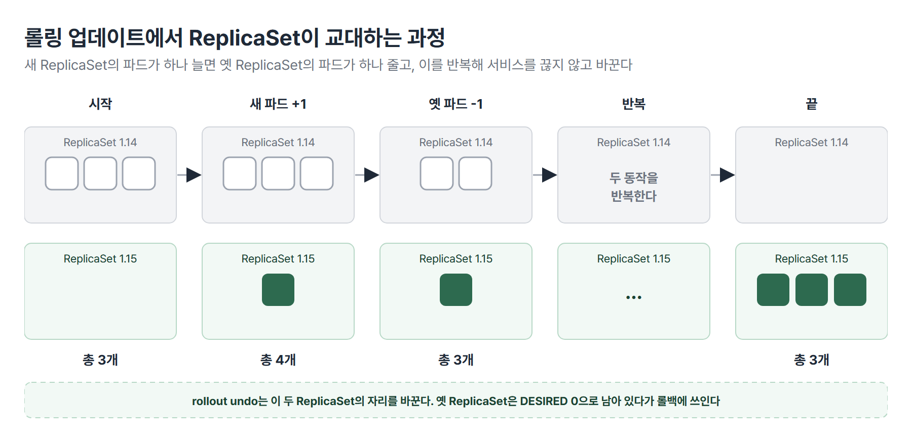
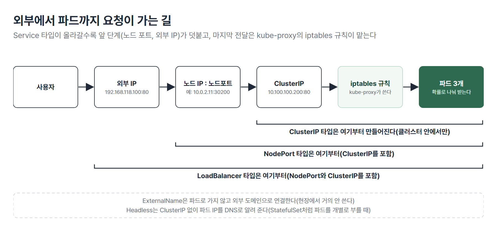

# <LG CNS 6기] MSA II 6일차 TIL · 컨트롤러와 라벨, 롤링 업데이트, Service 타입

> TL;DR: 파드 개수를 지키는 컨트롤러(RC, ReplicaSet, Deployment)가 모두 라벨을 따라간다는 것을 실습하고 Deployment로 롤링 업데이트와 롤백을 했다. 오후에는 DaemonSet과 StatefulSet, Service 타입 4가지와 Headless, 그리고 요청을 파드로 나눠 주는 kube-proxy의 iptables 규칙까지 다뤘다.

## 🗺️ 한눈에 보기

### 오늘은 무엇을 배운 날이었나

오전에는 파드 개수를 지키는 컨트롤러가 파드를 찾는 방식(라벨)을 RC와 ReplicaSet으로 확인했고 오후에는 그 위에 버전 교체(Deployment)와 접속 주소(Service)를 얹었다. 쿠버네티스의 연결은 모두 이름표(라벨)로 이뤄진다는 점이 오전과 오후를 잇는다.



> 💡 컨트롤러도 Service도 라벨로 파드를 찾는다.

### 상황별로 무엇을 쓰나

| 이런 상황이면 | 이것을 쓴다 | 절 |
|---|---|---|
| 파드 개수만 지킨다(옛 방식) | ReplicationController, ReplicaSet | 1 · 2 |
| 버전을 바꾸면서 개수도 지킨다 | Deployment | 3 |
| 서비스 중단 없이 새 버전으로 바꾼다 | 롤링 업데이트(`set image`, YAML 수정) | 3 |
| 새 버전이 문제라 되돌린다 | `rollout undo` | 3 |
| 노드마다 하나씩 파드가 필요하다 | DaemonSet | 5 |
| 이름이 바뀌면 안 되는 DB를 올린다 | StatefulSet | 5 |
| 클러스터 안에서만 접속한다 | ClusterIP | 6 |
| 노드 IP와 포트로 밖에서 접속한다 | NodePort | 6 |
| 외부 IP로 접속한다 | LoadBalancer | 6 |

## 🧭 오늘의 학습 키워드

| 키워드 | 한 줄 정리 | 오늘 어디에 쓰였나 |
|---|---|---|
| 라벨 · selector | 파드에 붙인 이름표 · 그 이름표로 파드를 고르는 조건 | 1번 절 |
| ReplicationController(RC) | 파드 개수만 지키는 옛 컨트롤러 | 1번 절 |
| ReplicaSet(RS) | RC와 같은 일을 더 세밀한 selector로 한다 | 2번 절 |
| 롤링 업데이트 | 파드를 하나씩 새 버전으로 바꿔 서비스가 끊기지 않게 하는 교체 | 3번 절 |
| `rollout undo` | 이전 버전으로 되돌린다 | 3번 절 |
| revision | Deployment가 남기는 버전 이력 번호 | 3번 절 |
| 블루/그린 · 카나리 | 새 버전을 따로 만들어 한 번에 바꾸는 방식 · 일부만 먼저 바꾸는 방식 | 4번 절 |
| DaemonSet | 노드마다 파드를 하나씩 두는 컨트롤러 | 5번 절 |
| StatefulSet | 파드 이름과 순서를 유지하는 컨트롤러 | 5번 절 |
| ClusterIP · NodePort · LoadBalancer | 접속 범위가 다른 Service 타입 3가지 | 6번 절 |
| Headless Service | ClusterIP가 없고 파드 IP를 직접 알려 주는 Service | 6번 절 |
| kube-proxy | Service로 온 요청을 파드로 나눠 주는 노드의 구성요소 | 7번 절 |
| iptables | 리눅스의 패킷 전달 규칙. kube-proxy가 여기에 규칙을 쓴다 | 7번 절 |

## ✍️ 공부한 내용

### 1. ReplicationController와 라벨

컨트롤러는 파드 개수를 보장한다. 가장 오래된 형태인 ReplicationController(RC)로 확인했다.

```yaml
apiVersion: v1
kind: ReplicationController
metadata:
  name: rc-nginx
spec:
  replicas: 3
  selector:
    app: webui
  template:
    metadata:
      labels:
        app: webui
    spec:
      containers:
      - name: nginx-container
        image: nginx:1.14
```

- `selector`가 「어떤 라벨의 파드를 셀지」이고 `template`이 「부족하면 어떤 파드를 만들지」다. 두 곳의 라벨은 같아야 한다.
- 적용하면 파드 3개가 생기고 이름은 `rc-nginx-xxxxx`처럼 부모 이름에 문자열이 붙는다.
- 개수는 `k scale rc rc-nginx --replicas=5`, YAML의 `replicas` 수정, `k edit rc rc-nginx`로 바꾼다. `edit`은 저장하는 순간 바로 반영된다.

개수를 늘릴 때는 `template`을 기준으로 새 파드를 만든다. 그래서 selector의 라벨과 template의 라벨이 같아야 한다.

라벨 하나가 개수 판단의 전부라는 것은 두 실험으로 보였다.

| 실험 | 결과 |
|---|---|
| 같은 라벨(`app=webui`)의 파드를 `run`으로 하나 더 만든다 | RC가 4번째 파드를 지워 곧 사라진다. RC는 웹서버인지 DB인지 구별하지 못하고 라벨만 본다 |
| 같은 라벨의 단독 파드 2개가 있는 상태에서 replicas 3인 RC를 `apply`한다 | 새 파드가 1개만 생긴다. 이미 있는 2개를 자기 식구로 센다 |



> 💡 쿠버네티스의 컨트롤러와 Service는 모두 라벨을 따라간다. 업무가 다른 파드라도 라벨이 같으면 같은 식구로 본다.

### 2. RC와 ReplicaSet의 차이와 업데이트의 한계

ReplicaSet(RS)은 RC와 같은 역할이고 selector 표현이 더 풍부하다.

| 항목 | RC | RS |
|---|---|---|
| `apiVersion` | `v1` | `apps/v1` |
| selector | 라벨을 바로 적는다 | `matchLabels`(그리고 `matchExpressions`: In, NotIn, Exists, DoesNotExist) |
| 개수 보장 | O | O |
| 이미지 교체(롤링 업데이트) | 안 된다 | 안 된다 |

둘 다 개수만 맞추고 버전은 모른다. 이미지를 1.14에서 1.15로 고쳐 `apply`해도 이미 떠 있는 파드는 1.14 그대로이고 새로 생기는 파드만 1.15를 받는다. 파드를 하나씩 직접 지워야 1.15로 바뀐다.

- 이 상태는 같은 서비스가 1.14와 1.15로 섞여 도는 것이라서 배포가 안 된 것으로 본다. 가격이 다른 두 버전이 동시에 노출되는 장애가 된다.
- `k delete rc rc-nginx`는 부모를 지우므로 파드도 모두 사라진다.
- `k delete rs rs-nginx --cascade=false`는 RS만 지우고 파드를 남긴다. 남은 파드는 단독 파드가 되어 지워도 다시 생기지 않는다. 최신 버전에서는 `--cascade=orphan`을 쓰라는 경고가 나온다.

> 💡 RC와 RS는 개수만 지킨다. 버전 교체까지 맡는 것이 Deployment다.

### 3. Deployment: 롤링 업데이트와 롤백

Deployment는 아래에 ReplicaSet을 만들고 그 아래에 파드를 둔다. RS와 정의는 `kind`만 다르다. 이미지를 바꾸면 새 ReplicaSet을 만들어 파드를 하나씩 교체한다. 이것이 롤링 업데이트다.



`k edit`으로 본 기본 설정은 다음과 같다.

```yaml
spec:
  progressDeadlineSeconds: 600
  revisionHistoryLimit: 10
  strategy:
    rollingUpdate:
      maxSurge: 25%
      maxUnavailable: 25%
    type: RollingUpdate
```

- `maxSurge`는 교체 중에 정해진 개수보다 더 만들 수 있는 파드 수이고 `maxUnavailable`은 교체 중에 줄어들어도 되는 파드 수다. 파드 3개이면 하나를 더 만들어 4개로 운영하면서 새 버전을 하나 넣고 옛 버전을 하나 빼는 것을 반복한다.
- 장점은 업무 시간에도 배포할 수 있다는 것이고 단점은 시간이 걸린다는 것이다. 비율을 키우면 빨라진다.
- `revisionHistoryLimit: 10`은 이전 버전을 10개까지 보관한다는 뜻이다. 옛 ReplicaSet은 `DESIRED 0`으로 남아 있고 롤백할 때 쓰인다.

이미지를 바꾸는 방법은 세 가지다.

| 방법 | 명령 | 특징 |
|---|---|---|
| YAML 수정 후 `apply` | `vi`로 이미지를 고치고 `k apply -f` | 파일에 버전이 남는다 |
| `edit` | `k edit deployments.apps deploy-nginx` | 저장하는 순간 바로 교체된다 |
| `set image` | `k set image deployments deploy-nginx nginx-container=nginx:1.15 --record` | 한 줄. `=` 앞은 컨테이너 이름(YAML의 `name`) |

되돌리는 명령은 다음과 같다.

```bash
k rollout history deployment deploy-nginx                      # 버전 이력(revision)
k rollout undo deployment deploy-nginx                         # 직전 버전으로
k rollout undo deployment deploy-nginx --to-revision=7         # 특정 버전으로
```

- `undo`는 직전 두 버전의 자리를 바꾼다. 한 번 더 치면 원래 버전으로 돌아온다. 현재가 1.18일 때 `undo`로 1.17이 되고 다시 `undo`를 치면 1.18이 된다.
- 이력의 `CHANGE-CAUSE`에 명령이 남게 하려면 `--record`를 붙인다. `--record`는 더 이상 권장되지 않는다는 경고가 나온다.
- 다른 방법은 YAML의 `metadata.annotations`에 `kubernetes.io/change-cause: version 1.16`을 적는 것이다. 이미지와 이 줄을 같이 고쳐 `apply`하면 이력에 `2 version 1.16`처럼 남는다.
- `rollout pause`로 배포를 잠시 멈추고 `resume`으로 다시 시작하며 `status`로 진행을 본다.

> 💡 Deployment는 개수를 지키면서 버전을 바꾼다. 현장에서는 파드의 98~99%가 Deployment다.

### 4. 배포 방식 3가지와 시험문제 풀이

롤링 업데이트 외에 두 가지 방식이 더 있다. 기술 면접에서 물을 수 있어서 특징을 알아 두라고 했다.

| 방식 | 어떻게 교체하나 | 특징 |
|---|---|---|
| 롤링 업데이트 | 파드를 하나씩 새 버전으로 교체 | 서비스가 끊기지 않지만 시간이 걸린다 |
| 블루/그린 | 새 버전을 같은 수만큼 따로 만들어 한꺼번에 전환 | 면접 질문 대비로 장단점을 정리해 둘 것 |
| 카나리 | 일부만 새 버전으로 섞어 운영하다 점진적으로 전환 | 면접 질문 대비로 장단점을 정리해 둘 것 |

CKA 기출 두 문제를 풀었다. 첫 문제는 `devops` 네임스페이스에 Deployment `eshop-order`(replicas 3)를 만들고 5개로 늘리는 것이다.

```bash
k create namespace devops
k create deployment eshop-order -n devops --image=nginx --replicas=3
k scale deployment -n devops eshop-order --replicas=5
```

- `-n devops` 없이 조회하면 `default` 네임스페이스만 보여서 아무것도 안 보인다. `-n`을 명령 앞쪽에 먼저 쓰면 이름 탭 자동완성이 된다.

둘째 문제(배점이 높다)는 Deployment `webserver`에 라벨 `app_env_stage=dev`, 컨테이너 이름 `webserver`, `nginx:1.14`로 만들고 1.15로 올렸다가 되돌리는 것이다.

```bash
k create deployment webserver --image=nginx:1.14 --replicas=2 --dry-run=client -o yaml > webserver.yaml
# 파일에서 라벨 3곳(metadata.labels, selector.matchLabels, template.metadata.labels)을 app_env_stage: dev로, 컨테이너 이름을 webserver로 고친다
k apply -f webserver.yaml
k set image deployments webserver webserver=nginx:1.15
k rollout undo deployment webserver
```

- 라벨은 명령으로 지정할 수 없어서 `--dry-run=client -o yaml`로 YAML을 뽑아 고친다.
- 라벨이 세 곳에 모두 같아야 하므로 한 곳이라도 빠지면 Deployment가 파드를 못 묶는다.

### 5. DaemonSet과 StatefulSet

둘 다 Deployment 말고 쓰는 컨트롤러이고 쓰임이 다르다.

| 컨트롤러 | 개수 | 파드 이름 | 쓰임 |
|---|---|---|---|
| Deployment | `replicas`로 지정 | 무작위 | 일반 서비스. 현장의 대부분 |
| DaemonSet | 노드마다 하나(`replicas` 없음) | 무작위 | 로그 수집, 노드 모니터링 |
| StatefulSet | `replicas`로 지정 | 번호가 고정(`sf-nginx-0`, `-1`, `-2`) | 이름이 바뀌면 안 되는 DB 이중화 |

DaemonSet은 노드가 3개면 노드마다 하나씩 올라간다. `kube-system`의 `kube-proxy`와 `weave-net`이 DaemonSet 파드다.

- `replicas`만 없고 ReplicaSet과 같은 정의다. 적용하면 워커 2대에 하나씩 2개가 생겼다.
- 파드를 지우면 같은 노드에 다시 생긴다. 노드를 추가하면 자동으로 하나가 더 생기고 노드를 지우면 그 노드의 파드도 사라진다.
- `k scale ds ... --replicas=4`는 `NotFound` 오류가 난다. `set image`와 `rollout undo`는 된다.

StatefulSet은 파드 이름과 순서를 유지한다.

- `sf-nginx-2`를 지우면 같은 이름, 같은 IP로 다시 생긴다. 개수를 5로 늘리면 `-3`, `-4`가 붙고 2로 줄이면 번호가 큰 쪽(`-4`, `-3`, `-2`)부터 지워진다. 다시 3으로 늘리면 `sf-nginx-2`가 돌아온다.
- 이름은 보장하지만 노드는 보장하지 않는다.
- 정의에 `serviceName`(`sf-service`)과 `podManagementPolicy: Parallel`이 들어간다.

> 💡 일반 서비스는 Deployment, 노드마다 필요하면 DaemonSet, 이름이 고정돼야 하면 StatefulSet이다. 현장에서는 99%가 Deployment다.

### 6. Service 4가지와 Headless

Service가 하는 일은 세 가지다. 요청을 파드들에 나누고(부하분산), 파드들 앞에 고정 주소 하나를 두며(ClusterIP, 온프레미스의 VIP), 이상이 있는 파드에는 요청을 보내지 않는다(헬스 체크). 묶인 파드의 목록이 Endpoints다. 타입은 접속 범위로 구분한다.

| 타입 | 접속 범위 | 앞 단계를 포함하나 |
|---|---|---|
| ClusterIP(기본) | 클러스터 안 | 없음 |
| NodePort | 노드 IP:포트로 밖에서 | ClusterIP를 포함 |
| LoadBalancer | 외부 IP로 | NodePort(와 ClusterIP)를 포함 |
| ExternalName | 외부 도메인으로 연결 | 쓸 일이 없다고 했다 |

```yaml
spec:
  type: NodePort
  clusterIP: 10.100.100.200
  selector:
    app: webui
  ports:
  - protocol: TCP
    port: 80
    targetPort: 80
    nodePort: 30200
```

- `type`과 `clusterIP`는 형제 라인이다. 값은 `NodePort`처럼 대문자(N, P)이고 키는 `nodePort`처럼 소문자(n)로 시작한다. 이 구분을 틀리면 실행이 안 된다.
- `nodePort`를 안 적으면 30000~32767에서 임의로 정해진다.
- ClusterIP에는 `curl 10.100.100.200`처럼 접속한다. 여기에 `:30200`을 붙이면 안 된다. NodePort는 노드 IP에 열리는 포트라서 `curl 10.0.2.11:30200`처럼 노드 IP로 접속한다.
- LoadBalancer를 만들면 NodePort와 ClusterIP도 같이 생긴다(`80:32371/TCP`). 외부 IP(`192.168.118.100`)는 MetalLB가 준다. 접속이 시간 초과로 막히면 5일차처럼 관리자 PowerShell에서 `route add` 한 줄을 넣는다.

계층마다 타입을 다르게 고르는 것이 설계다. 웹 → WAS → DB 사이는 보안상 내부이므로 ClusterIP를 쓰고 밖과 닿는 곳만 NodePort나 LoadBalancer로 연다.



ExternalName은 클러스터 안에서 외부 도메인(`google.com`)을 이름으로 연결한다.

```yaml
spec:
  type: ExternalName
  externalName: google.com
```

- `curl externalname-svc.default.svc.cluster.local`로 열면 외부 사이트 응답이 온다. 파드 안에서 시험하려면 `k run testpod -it --image=centos:7`을 쓴다. `-it` 없이 띄우면 바로 끝나 `Completed`와 `CrashLoopBackOff`를 반복하고 `exec`도 못 한다.

Headless Service는 `clusterIP: None`이다. 단일 진입점이 필요 없을 때 쓴다.

- 로드밸런싱을 하지 않고 DNS가 파드 각각의 IP를 알려 준다. 파드는 `10-46-0-4.default.pod.cluster.local`처럼 IP의 점을 대시로 바꾼 이름으로 등록된다. 점으로 쓰거나 `pod.default` 순서로 쓰면 조회가 안 된다.
- Endpoints는 selector에 맞는 파드가 있어야 채워진다. 라벨이 맞는 파드가 없으면 비어 있다.
- 이름이 고정된 DB(DB1, DB2)를 노출하는 StatefulSet처럼 파드를 개별로 불러야 할 때만 쓴다.

> 💡 Service 타입은 접속 범위로 고르고 어떤 파드를 묶는지는 selector와 라벨이 정한다.

### 7. kube-proxy와 iptables

Service로 들어온 요청을 실제 파드로 이어 주는 것이 kube-proxy다. 노드마다 하나씩(DaemonSet 형태) 떠 있고 기본 모드는 iptables다.

```bash
kubectl get pod -n kube-system -o wide | grep kube-proxy      # 노드마다 하나씩, 3개
iptables -t nat -S | grep 80                                   # 워커에서 NAT 규칙 보기
```

NodePort 서비스를 적용한 뒤 워커에서 본 규칙은 다음 모양이다.

| 규칙 | 의미 |
|---|---|
| `KUBE-SERVICES -d 10.100.100.200 ... --dport 80` | 서비스 주소(ClusterIP)로 온 요청을 체인으로 보낸다 |
| `KUBE-SVC-...` 체인의 `--probability 0.333...`, `0.5`, 나머지 | 첫 파드로 1/3, 남은 것의 1/2, 나머지는 마지막 파드로 나눈다 |
| `KUBE-SEP-...` ... `DNAT --to-destination 10.46.0.4:80` | 목적지 주소를 실제 파드 IP로 바꾼다 |

- 서비스 하나당 파드 수만큼 `KUBE-SEP` 규칙이 생긴다. 서비스를 만들면 규칙이 생기고 지우면 사라진다.
- Headless 서비스만 떠 있을 때는 ClusterIP가 없어서 같은 명령에 규칙이 나오지 않았다. NodePort를 적용하자 규칙 3개가 나왔다.
- kube-proxy의 모드는 세 가지이고 기본이 iptables다.

> 💡 kube-proxy는 노드마다 떠서 Service 주소로 온 요청을 iptables 규칙으로 파드들에 확률적으로 나눠 준다.

## 🧩 이어지는 내용

- 5일차에 Deployment와 Service(LoadBalancer, MetalLB)를 처음 다뤘다. 오늘은 그 아래의 컨트롤러(RC, RS)와 라벨, 버전 교체, Service 타입을 이론으로 정리했다.
- 4일차에 본 `kube-proxy`가 DaemonSet 파드라는 것을 오늘 확인했다.
- 다음 시간에는 kube-proxy와 iptables 규칙을 다시 본다. 쿠버네티스 수업의 마지막은 GitHub와 Argo CD를 연동한 자동 배포(CI/CD)다.
- 2차 사후평가는 10/29이고 미니 프로젝트 2는 10/30에 시작한다.

## ❓ 몰랐던 것

### 같은 라벨의 단독 파드가 있을 때 RC의 동작

새 파드가 1개 생긴다. RC는 이름을 보지 않고 selector에 맞는 라벨의 파드를 모두 센다. 이미 같은 라벨의 파드가 2개 있으면 그 2개를 포함해 3개가 되도록 1개만 더 만든다. 반대로 개수가 넘으면 지운다. 그래서 업무가 다른 파드에 같은 라벨을 붙이면 장애가 난다.

### 이미지를 바꿔 `apply`했을 때 RC와 RS의 동작

이미 떠 있는 파드는 그대로 두고 새로 생기는 파드만 새 이미지를 받는다. RC와 RS는 selector에 맞는 개수만 보고 이미지가 같은지는 보지 않는다. 그래서 파드를 하나씩 지워야 바뀌고 이 문제를 풀려고 버전을 관리하는 Deployment를 쓴다.

### `rollout undo`를 연속으로 두 번 친 결과

처음에는 직전 버전이 되고 두 번째에는 처음 버전으로 되돌아온다. `undo`는 직전 두 버전의 자리를 바꾸는 명령이다. 현재가 1.18이면 `undo`로 1.17이 되고 다시 `undo`를 치면 1.18이다. 특정 버전이 필요하면 `rollout history`로 번호를 보고 `--to-revision=번호`를 쓴다.

### 블루/그린과 카나리의 차이

블루/그린은 새 버전을 같은 수만큼 따로 만들어 한꺼번에 전환하는 방식이고 카나리는 일부 파드만 새 버전으로 섞어 운영하다 점진적으로 전환하는 방식이다. 롤링 업데이트가 한 대씩 교체한다면 블루/그린은 통째로 바꾸고 카나리는 일부부터 바꾼다.

### 노드마다 하나씩 있어야 하는 파드

DaemonSet으로 만든다. 노드가 늘면 하나가 자동으로 더 생기고 노드를 지우면 그 노드의 파드도 사라진다. 예가 `kube-system`의 `kube-proxy`와 `weave-net`이고 로그 수집이나 노드 모니터링도 같은 방식이다.

### NodePort를 만들면 열리는 포트

모든 노드(마스터 포함)의 같은 포트가 열린다. 예를 들어 `nodePort: 30200`이면 각 노드의 IP와 30200으로 밖에서 접속된다. 지정하지 않으면 30000~32767 중 하나가 정해지고 ClusterIP도 같이 만들어진다. 서비스 주소에 `:30200`을 붙여 접속하는 것이 아니다.

### kube-proxy가 하는 일

Service의 ClusterIP로 온 요청을 노드의 iptables 규칙으로 실제 파드에 나눠 보낸다. 서비스를 만들면 규칙이 생기고 파드가 3개면 확률 규칙(1/3, 1/2, 나머지)으로 나눈다. 서비스가 없으면 규칙도 없다. 이 규칙을 읽으면 요청이 어느 파드로 갈 수 있는지 알 수 있다.

## 📌 다음에 해볼 것

- [ ] RC, RS, Deployment 중 아무것에나 같은 라벨의 파드를 만들어 개수가 어떻게 변하는지 확인하기
- [ ] `rollout history`로 이력을 보고 `--to-revision`으로 특정 버전에 돌아가기
- [ ] `iptables -t nat -S | grep KUBE-SVC`로 Service 규칙을 읽고 `KUBE-SEP`가 파드 수와 맞는지 보기
- [ ] 선택한 Service 타입의 `describe svc`에서 Endpoints가 비었을 때 라벨을 비교해 보기

## 🔍 더 짚어둘 것

### 1. 미니 프로젝트: 서비스 계층별로 타입을 고르는 기준

미니 프로젝트 2(10/30 ~ 11/5)에서 서비스를 여러 개로 나누면 서비스 사이의 접속 범위를 정해야 한다. 오늘 기준은 단순하다. 서비스끼리는 내부(ClusterIP), 밖과 닿는 곳만 열린 타입이다.

- **라벨 설계가 서비스 경계다**: 라벨이 겹치면 Service가 다른 서비스의 파드를 묶는다. 서비스마다 `app` 라벨을 먼저 정해 두는 편이 안전하다. 현장에서도 라벨 설계에 한 달 가까이 업무 분석을 한다고 했다.
- **내부 호출은 서비스 이름으로 한다**: 파드 IP는 바뀌므로 코드에는 Service 이름을 쓴다.

### 2. AI: 바이브코딩할 때 사람이 확인할 것

- **라벨 세 곳이 같은지 본다**: Deployment의 `metadata.labels`, `selector.matchLabels`, `template.metadata.labels`가 어긋나면 묶이지 않는다.
- **`rollout undo` 전에 `history`를 본다**: `undo`는 직전 두 버전의 자리를 바꿀 뿐이라 번호를 확인하지 않으면 원하지 않는 버전으로 간다.
- **`edit`과 `delete --all all`의 범위를 본다**: `edit`은 저장하는 순간 반영되고 `delete --all all`은 기본 `kubernetes` 서비스까지 지운다(다시 생기기는 한다). 운영 클러스터에 그대로 붙여 넣지 않는다.
- **오래된 옵션 경고를 본다**: `--cascade=false`, `--record`처럼 AI가 쓰는 옛 옵션은 경고가 나온다. 버전에 맞는 옵션인지 확인한다.

### 3. SAP ERP: 요청을 나눠 보내는 구조

kube-proxy가 요청을 여러 파드에 나눠 보내는 역할은 SAP에서 요청을 여러 애플리케이션 서버에 나눠 주는 Web Dispatcher와 비슷하다. 다만 Web Dispatcher는 웹 요청을 해석해서 나누는 계층이고 kube-proxy는 주소를 바꿔 전달하는 규칙이라 동작하는 계층은 다르다.

### 4. 운영(AM): 수업 설명과 공식 문서가 다른 곳

롤링 업데이트 수치는 공식 문서로 확인하면 강사님 설명과 다르다. 파드 3개에 `maxSurge`, `maxUnavailable`이 각각 25%일 때다.

| 항목 | 강사님 설명 | 공식 문서 |
|---|---|---|
| 25%의 계산 | 3개의 25%는 0.75이니 반올림해 1 | `maxSurge`는 올림, `maxUnavailable`은 내림 |
| 결과 | 둘 다 1 | `maxSurge` 1, `maxUnavailable` 0 |
| 교체 중 파드 수 | 4개로 운영하며 하나씩 교체 | 최대 4개, 최소 3개(줄어들지 않음) |

- 하나를 더 만들고 하나를 빼는 모양은 같다. 다만 `maxUnavailable`이 0이므로 교체 중에도 3개가 유지된다고 읽어야 한다.
- 정해진 시간(`progressDeadlineSeconds`, 기본 600초) 안에 교체가 끝나지 않으면 되돌린다고 설명했다. 공식 문서는 정체된 Deployment에 대해 상태를 보고할 뿐 쿠버네티스가 자동으로 롤백하지는 않는다고 적는다. 롤백은 `rollout undo`로 직접 하거나 상위 도구가 처리한다.

운영에서 배포 설정을 정할 때는 문서의 계산 규칙으로 파드 수를 확인한다.

태그: LG CNS 6기, 개발자, LGCNSINSPIRECAMP
