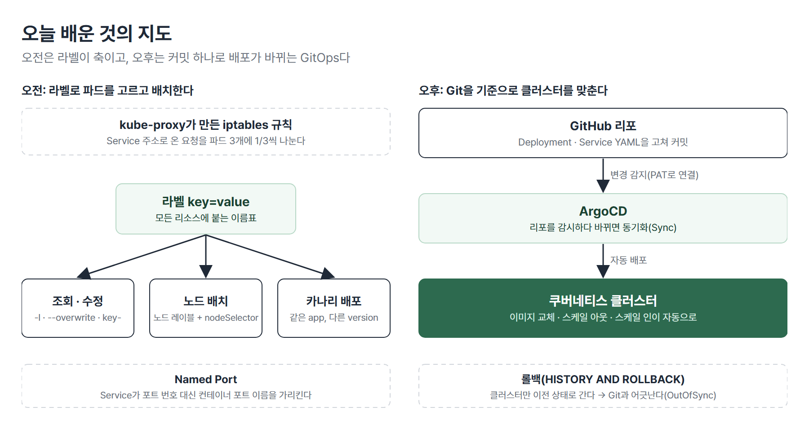
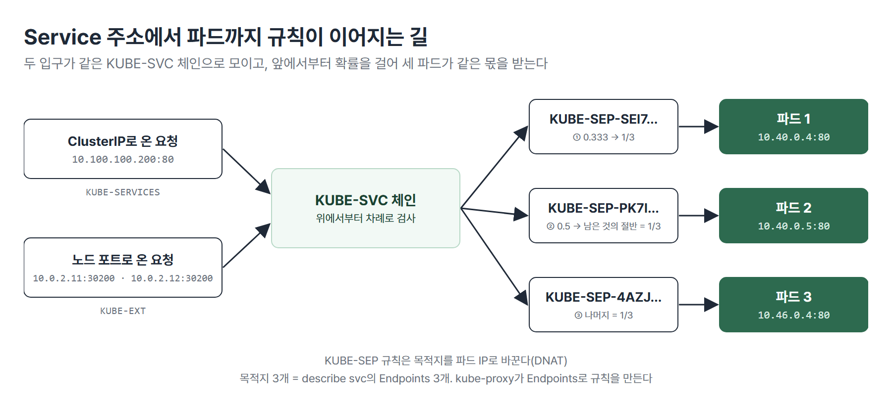
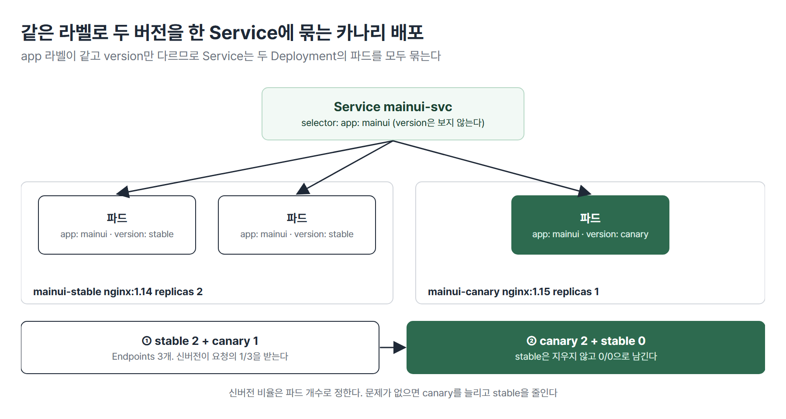
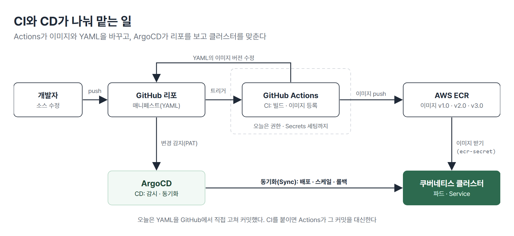

# <LG CNS 6기] MSA II 7일차 TIL · 라벨과 카나리 배포, ArgoCD GitOps

> TL;DR: 오전에는 kube-proxy가 만든 iptables 규칙을 직접 읽었다. 이어서 라벨과 노드 레이블(nodeSelector)로 파드를 고르고 배치하는 법과 라벨을 이용한 카나리 배포를 실습했다. 오후에는 ArgoCD를 설치해 GitHub의 YAML을 고쳐 커밋하면 클러스터가 그대로 따라 바뀌는 GitOps 방식으로 버전 교체, 스케일 아웃, 롤백을 했다.

## 🗺️ 한눈에 보기

### 오늘은 무엇을 배운 날이었나

오전은 라벨이 축이다. 파드에 라벨을 붙이고 바꾸는 명령, 노드에 라벨을 붙여 특정 노드에만 파드를 두는 nodeSelector, 같은 라벨로 구버전과 신버전을 한 Service에 묶는 카나리 배포가 모두 라벨로 이어진다. 오후는 배포 자동화다. 지금까지 `kubectl`로 직접 하던 이미지 교체와 개수 조정을 Git 커밋 하나로 하도록 ArgoCD를 붙였다.



> 💡 오전은 라벨로 파드를 고르고 배치하는 법, 오후는 Git을 기준으로 클러스터를 자동으로 맞추는 법이다.

### 상황별로 무엇을 쓰나

| 이런 상황이면 | 이것을 쓴다 | 절 |
|---|---|---|
| Service로 온 요청이 어느 파드로 가는지 본다 | `iptables -t nat -S` | 1 |
| 서비스 포트를 번호 대신 이름으로 잇는다 | Named Port | 2 |
| 특정 라벨의 파드만 조회하거나 지운다 | `-l`, `--selector` | 3 |
| 라벨 값을 바꾸거나 지운다 | `--overwrite`, `키-` | 3 |
| 특정 노드에만 파드를 띄운다 | 노드 레이블 + `nodeSelector` | 4 |
| 배포 이력 같은 정보를 리소스에 남긴다 | annotation | 5 |
| 신버전을 일부 파드에만 먼저 올린다 | 카나리 배포 | 6 |
| Git의 YAML대로 클러스터를 맞춘다 | ArgoCD(GitOps) | 7 ~ 10 |
| 배포를 이전 상태로 되돌린다 | ArgoCD HISTORY AND ROLLBACK | 10 |

## 🧭 오늘의 학습 키워드

| 키워드 | 한 줄 정리 | 오늘 어디에 쓰였나 |
|---|---|---|
| kube-proxy · iptables | Service 주소로 온 요청을 파드로 옮기는 노드 구성요소 · 그 규칙이 들어가는 곳 | 1번 절 |
| `KUBE-SVC` · `KUBE-SEP` | 서비스별로 요청을 나누는 체인 · 파드 하나로 목적지를 바꾸는 규칙 | 1번 절 |
| Named Port | 컨테이너 포트에 이름을 붙이고 Service가 그 이름으로 잇는 방식 | 2번 절 |
| `--dry-run=client -o yaml` | 리소스를 만들지 않고 YAML만 뽑는다 | 2번 절 |
| 라벨 · selector | 리소스에 붙인 key=value · 그 값으로 고르는 조건 | 3번 절 |
| `--overwrite` | 이미 있는 라벨의 값을 바꿀 때 붙인다 | 3번 절 |
| 노드 레이블 · nodeSelector | 노드에 붙인 라벨 · 그 라벨이 있는 노드에만 파드를 두는 설정 | 4번 절 |
| `-L` | 라벨 키를 열로 보여 준다 | 4번 절 |
| annotation | 쿠버네티스나 도구에 넘길 정보, 관리 정보를 적는 칸 | 5번 절 |
| 카나리 배포 | 신버전을 일부만 올려 검증한 뒤 늘리는 배포 | 6번 절 |
| CI · CD | 빌드와 이미지 등록 자동화 · 클러스터 반영 자동화 | 7번 절 |
| GitOps | Git에 있는 YAML을 기준으로 클러스터를 운영하는 방식 | 7번 절 |
| ArgoCD | Git을 감시하다가 바뀌면 클러스터를 맞추는 CD 도구 | 8 ~ 10번 절 |
| PAT | GitHub 비밀번호 대신 쓰는 접근 토큰 | 9번 절 |
| Synced · OutOfSync | Git과 클러스터가 같다 · 다르다 | 10번 절 |
| `imagePullSecrets` | 비공개 레지스트리에서 이미지를 받을 인증 정보 | 🔧 |

## ✍️ 공부한 내용

### 1. kube-proxy가 만든 iptables 규칙 읽기

Service는 파드 앞에 고정 주소를 하나 준다. 그 주소로 온 요청을 실제 파드로 옮기는 일은 노드마다 떠 있는 kube-proxy가 iptables 규칙으로 한다. 파드 3개짜리 NodePort 서비스(`nodeport-service`, ClusterIP `10.100.100.200`, 노드 포트 30200)를 띄우고 마스터 노드에서 이 서비스의 체인만 골라 봤다. `-S`는 규칙을 iptables-save와 같은 형식으로 출력하는 옵션이다.

```bash
iptables -t nat -S | grep KUBE-SVC-QATUYZLPU4I4HE4S
-A KUBE-EXT-QATUYZLPU4I4HE4S -j KUBE-SVC-QATUYZLPU4I4HE4S
-A KUBE-SERVICES -d 10.100.100.200/32 -p tcp ... --dport 80 -j KUBE-SVC-QATUYZLPU4I4HE4S
-A KUBE-SVC-QATUYZLPU4I4HE4S ... -> 10.40.0.4:80" -m statistic --mode random --probability 0.33333333349 -j KUBE-SEP-SEI7D64NYQDBVVC7
-A KUBE-SVC-QATUYZLPU4I4HE4S ... -> 10.40.0.5:80" -m statistic --mode random --probability 0.50000000000 -j KUBE-SEP-PK7IQT2SBSHZ27OC
-A KUBE-SVC-QATUYZLPU4I4HE4S ... -> 10.46.0.4:80" -j KUBE-SEP-4AZJYIZL67I2UMTE
```

- `KUBE-SERVICES`는 ClusterIP의 80번으로 온 요청을 `KUBE-SVC` 체인으로 보낸다. 노드 포트로 들어온 요청은 `KUBE-EXT`를 거쳐 같은 `KUBE-SVC`로 간다.
- `KUBE-SVC`의 세 줄은 위에서부터 차례로 검사한다. 첫 줄이 1/3 확률로 첫 파드를 고른다. 걸리지 않은 2/3 중 절반(0.5)이 둘째 파드로 가고 나머지는 셋째 파드로 간다. 셋 다 1/3씩이다.
- 각 `KUBE-SEP` 규칙이 목적지를 파드 IP:80으로 바꾼다(DNAT). 목적지 3개는 `k describe svc nodeport-service`의 Endpoints 3개(`10.40.0.5:80,10.40.0.4:80,10.46.0.4:80`)와 같다. kube-proxy가 Endpoints로 이 규칙을 만든다.



노드 포트는 모든 노드에 같은 규칙이 있어서 `curl 10.0.2.11:30200`(worker1)과 `curl 10.0.2.12:30200`(worker2)이 둘 다 nginx 페이지를 돌려줬다. 파드는 지워지거나 늘어날 때마다 IP가 바뀌므로 누군가 묶어 주고 이어 줘야 한다. 묶는 것이 Service(Endpoints)이고 잇는 것이 kube-proxy다. `k get pods -n kube-system`에서 kube-proxy 파드는 노드 수만큼 3개였다.

> 💡 kube-proxy는 Endpoints 목록으로 iptables 규칙을 만든다. 확률을 앞에서부터 1/3, 1/2로 두어 파드마다 같은 몫을 보낸다.

### 2. Named Port: 포트를 이름으로 잇기

Named Port는 컨테이너 포트에 `http` 같은 이름을 붙이고 Service의 `targetPort`에 번호 대신 그 이름을 쓰는 방식이다. 현장에서 자주 쓰지는 않지만 CKA에 배점 높게 나오는 문제라서 출제 의도대로 이름으로 풀어야 한다. 문제는 `front-end` Deployment(nginx:1.15, replicas 3, 포트 80에 이름 `http`)와 이를 NodePort로 여는 `front-end-svc`를 만드는 것이다.

먼저 리소스를 만들지 않고 YAML만 뽑았다.

```bash
k create deployment front-end --image=nginx:1.15 --replicas=3 --dry-run=client -o yaml > front-end.yaml
```

여기에 kubernetes.io의 Service 문서 「Port definitions」 예제에서 `ports` 부분을 가져와 붙였다. 완성한 파일은 다음과 같다(뽑은 YAML의 `creationTimestamp: null`과 `strategy: {}`는 지웠다. 남겨 둬도 된다).

```yaml
apiVersion: apps/v1
kind: Deployment
metadata:
  labels:
    app: front-end
  name: front-end
spec:
  replicas: 3
  selector:
    matchLabels:
      app: front-end
  template:
    metadata:
      labels:
        app: front-end
    spec:
      containers:
      - image: nginx:1.15
        name: nginx
        ports:
          - containerPort: 80
            name: http
---
apiVersion: v1
kind: Service
metadata:
  name: front-end-svc
spec:
  type: NodePort
  selector:
    app: front-end
  ports:
  - name: http
    protocol: TCP
    port: 80
    targetPort: http
```

- 컨테이너의 `name: http`와 Service의 `targetPort: http`가 짝이다. 번호가 바뀌어도 이름만 같으면 이어진다.
- `---`로 두 리소스를 한 파일에 두면 `k apply -f front-end.yaml` 한 번에 `deployment.apps/front-end created`, `service/front-end-svc created`가 같이 나온다.
- `type: NodePort`는 `selector`와 형제 줄이고 `containerPort`는 `image`, `name`과 형제 줄의 `ports` 아래다. 들여쓰기와 대소문자를 가장 많이 틀리는 곳이다.
- `nodePort`를 적지 않아 `80:31742/TCP`처럼 임의 번호가 붙었다. Service의 `selector`가 Deployment 라벨(`app: front-end`)과 한 글자라도 다르면 파드를 묶지 못한다.

> 💡 Named Port는 Service가 포트 번호 대신 컨테이너 포트의 이름을 가리키게 하는 것이다.

### 3. 라벨 붙이기 · 고르기 · 바꾸기 · 지우기

라벨은 노드를 포함한 모든 리소스에 붙일 수 있는 key=value 한 쌍이다. 현장에서는 조회, 삭제, 수정을 라벨로 한다. 명령으로 다루는 방법은 다음과 같다.

| 명령 | 하는 일 |
|---|---|
| `k label pod label-demo name=order rel=prd` | 라벨 붙이기. 여러 개는 공백으로 구분 |
| `k get pods -l name=mainui` | 그 라벨의 파드만 조회. `-l`은 `--selector`와 같다 |
| `k get pods --show-labels` | 파드마다 붙은 라벨을 함께 본다 |
| `k label pods cmdpod run-` | 키 뒤에 `-`를 붙이면 그 라벨을 지운다 |
| `k label pods cmdpod name=order --overwrite` | 이미 있는 키의 값을 바꾼다 |
| `k delete pods --selector name=mainui` | 그 라벨의 파드를 모두 지운다 |

값을 바꿀 때 `--overwrite`를 빼면 다음 오류가 난다.

```bash
k label pods cmdpod name=order
error: 'name' already has a value (mainui), and --overwrite is false
```

- `k run`으로 만든 파드에는 `run=cmdpod`처럼 `run=<파드 이름>` 라벨이 기본으로 붙는다. 지워도 된다.
- YAML 파일에 라벨만 더하고 `metadata.name`을 그대로 두면 새 파드가 생기지 않고 같은 이름의 파드가 `configured`로 바뀐다. 새 파드를 만들려면 이름도 바꾼다.
- YAML로 만든 리소스는 `k delete -f pod1.yaml`처럼 같은 파일로 지울 수 있다.

라벨은 배포 대상을 고를 때 쓰여서 잘못 붙이면 장애가 난다. 운영(PRD)에 나갈 것이 스테이징(STG)으로, 테스트할 것이 운영으로 가는 식이다. 그래서 서비스 이름(`name`: mainui, product, order, account, cart)과 단계(`rel`: prd, stg, dev)처럼 업무에 맞춰 설계한다. 이 설계는 분석 단계의 요구사항 정의에서 정한다고 했다. selector는 `matchExpressions`(In, NotIn)보다 `matchLabels`로 단순하게 쓴다.

> 💡 쿠버네티스는 라벨을 따라간다. 조회, 삭제, 배포 대상이 모두 라벨로 정해지므로 라벨 설계가 곧 배포 설계다.

### 4. 노드 레이블과 nodeSelector

노드에도 라벨을 붙인다. 노드마다 사양이 다를 때 특정 파드를 특정 노드에만 두기 위해서다. 예를 들어 GPU와 SSD가 있는 노드에만 게임 파드를 띄운다. 노드 3대에 웹(nginx)과 WAS(Tomcat)를 짝으로 고르게 넣어 노드 하나가 죽어도 서비스가 이어지게 할 때도 쓴다.

```bash
k label nodes k8s-worker1 gpu=true disk=ssd
k label nodes k8s-worker2 disk=ssd
k get nodes -L disk,gpu
NAME          STATUS   ROLES           AGE   VERSION    DISK   GPU
k8s-master    Ready    control-plane   58d   v1.32.13
k8s-worker1   Ready    <none>          58d   v1.32.13   ssd    true
k8s-worker2   Ready    <none>          58d   v1.32.13   ssd
```

- `nodes`를 빼고 `k label k8s-worker1 ...`로 치면 `error: the server doesn't have a resource type "k8s-worker1"`이 난다. `k label` 다음에는 리소스 종류가 온다.
- `--show-labels`는 기본 라벨까지 한 줄에 쉼표로 이어져 찾기 어렵다. `-L`은 보고 싶은 키만 열로 보여 준다.
- 노드 라벨을 지우는 것은 파드와 같이 `k label nodes <노드> key-`다.

이 라벨로 파드가 뜰 노드를 고른다.

```yaml
apiVersion: v1
kind: Pod
metadata:
  name: label-nodeselector
spec:
  nodeSelector:
    gpu: "true"
    disk: ssd
  containers:
  - name: nginx
    image: nginx:1.14.2
    ports:
    - containerPort: 80
```

- `nodeSelector`는 `containers`와 형제 줄이다. 순서는 상관없다.
- 두 조건을 모두 가진 노드는 worker1뿐이라 파드가 worker1(`10.46.0.7`)에 떴다. `gpu` 라벨이 없는 worker2에는 뜨지 않는다.
- 라벨 값은 문자열이다. YAML은 따옴표 없는 `true`, `false`, `yes`, `no`를 참·거짓 값으로 읽으므로 큰따옴표로 묶는다.

> 💡 노드 레이블은 노드의 특성을 적고 nodeSelector는 그 특성을 모두 가진 노드에만 파드를 보낸다.

### 5. Annotation

라벨이 리소스를 고르는 데 쓰인다면 annotation은 정보를 적는 칸이다. 쓰임은 두 가지다.

| 용도 | 예 |
|---|---|
| 쿠버네티스나 도구에 정보 전달 | Deployment의 `kubernetes.io/change-cause: version 1.16` → `rollout history`에 변경 사유로 남는다. Service에 AWS 로드밸런서 종류 · 인증서를 적으면 그대로 반영된다 |
| 관리 정보 기록 | `builder`, `buildDate`, `imageRegistry` 같은 값. `describe`에 나온다 |

```yaml
metadata:
  name: frontend-nginx-svc
  annotations:
    service.beta.kubernetes.io/aws-load-balancer-type: "nlb"
    service.beta.kubernetes.io/aws-load-balancer-ssl-ports: "443"
```

- 6일차에 `--record` 없이 이력에 버전을 남긴 방법이 이 annotation이다.
- 쓰임의 대부분은 첫째, 쿠버네티스에 정보를 넘기는 용도라고 했다.

> 💡 라벨은 고르는 데, annotation은 알려 주는 데 쓴다.

### 6. 카나리 배포

배포 방식은 세 가지다. 롤링 업데이트는 파드를 하나씩 바꾼다. 블루/그린은 신버전 파드를 같은 수만큼 따로 띄워 한꺼번에 바꾼다. 카나리는 기존 버전을 그대로 둔 채 일부만 신버전으로 올려 문제가 없는지 본다. 블루/그린은 신버전 전체를 올릴 자원이 필요해 비용이 커서 요즘은 카나리나 롤링 업데이트를 쓴다고 했다. 이름은 광부가 갱도에 들어가기 전 유독가스에 민감한 카나리아를 먼저 들여보낸 데서 왔다.

카나리는 라벨로 만든다. 구버전(`mainui-stable`, nginx:1.14, 2개)과 신버전(`mainui-canary`, nginx:1.15, 1개)이 `app: mainui`를 같이 갖고 `version`만 다르다. Service는 `app: mainui`만 고른다.



```yaml
# mainui-stable.yaml(발췌). mainui-canary.yaml은 version: canary, image: nginx:1.15, replicas: 1
spec:
  replicas: 2
  template:
    metadata:
      labels:
        app: mainui
        version: stable
    spec:
      containers:
      - name: mainui
        image: nginx:1.14
---
# mainui-service.yaml(발췌)
spec:
  selector:
    app: mainui
```

```bash
k apply -f mainui-stable.yaml
k apply -f mainui-service.yaml          # Endpoints 2개
k apply -f mainui-canary.yaml           # Endpoints 3개(구버전 2 + 신버전 1)
k scale deployment mainui-canary --replicas=2
k scale deployment mainui-stable --replicas=0
k get deployments.apps
NAME            READY   UP-TO-DATE   AVAILABLE   AGE
mainui-canary   2/2     2            2           117s
mainui-stable   0/0     0            0           3m49s
```

- Service selector에 `version`을 넣지 않아서 두 버전이 한 Service 뒤에 섞인다. 신버전이 받는 비율은 파드 개수로 정한다. 10개 중 2개쯤 넣어 실제 사용자 요청에서 문제가 없는지 본다.
- 문제가 없으면 카나리를 늘리고 구버전을 0으로 줄인다. 구버전 Deployment는 지우지 않고 `0/0`으로 남긴다. 문제가 생기면 다시 늘릴 수 있는 대비책이다.

> 💡 카나리 배포는 같은 라벨의 두 Deployment를 한 Service에 묶고 파드 수로 신버전 비율을 조절하는 것이다.

### 7. CI/CD와 GitOps

지금까지 이미지 교체는 `set image`나 YAML 수정 뒤 `apply`로 사람이 했다. GitOps는 쿠버네티스 매니페스트(YAML)를 Git에서 관리하고 배포도 Git에 있는 매니페스트로 하는 방식이다. Git의 YAML이 클러스터가 어떤 상태여야 하는지를 정하고 ArgoCD가 Git을 계속 지켜보다가 바뀌면 클러스터를 그대로 맞춘다(동기화, Sync).



| | CI | CD |
|---|---|---|
| 도구 | GitHub Actions | ArgoCD |
| 하는 일 | 소스가 push되면 빌드해 이미지를 ECR에 올리고 리포의 `deployment.yaml` 이미지 버전을 고친다 | 리포의 YAML이 바뀐 것을 보고 클러스터에 반영한다 |
| 오늘 한 것 | 권한과 Secrets 세팅까지(workflow 파일과 Dockerfile은 다루지 못했다) | 설치, 리포 연결, 자동 배포, 롤백 |

- 정의만 말하면 약하다. CI/CD를 붙여 클러스터에 컨테이너를 자동으로 배포해야 GitOps라고 할 수 있다고 했다.
- ArgoCD는 쿠버네티스 클러스터 안에 설치된다. 그래서 VM 클러스터를 먼저 만들었다.
- Jenkins는 별도 서버가 필요해서 요즘은 GitHub 안에 있는 GitHub Actions를 많이 쓴다고 했다.

> 💡 GitOps에서 클러스터 상태의 기준은 Git이다. ArgoCD가 클러스터를 그 기준에 맞춘다.

### 8. ArgoCD 설치와 접속

ArgoCD는 전용 네임스페이스에 설치한다. 설치 직후 Service는 ClusterIP라 클러스터 밖(브라우저, GitHub)에서 들어올 수 없어서 타입을 바꾼다.

```bash
kubectl create namespace argocd
kubectl apply -n argocd -f https://raw.githubusercontent.com/argoproj/argo-cd/stable/manifests/install.yaml
kubectl get pods -n argocd                      # argocd-server가 ArgoCD를 관장하는 핵심 파드

# 방법 1: NodePort (https://<노드 IP>:30070)
kubectl patch svc argocd-server -n argocd -p '{"spec": {"type": "NodePort", "ports": [{"port": 80, "targetPort": 8080, "nodePort": 30070, "name": "http"}, {"port": 443, "targetPort": 8080, "nodePort": 30071, "name": "https"}]}}'

# 방법 2: LoadBalancer (MetalLB가 준 외부 IP)
kubectl patch svc argocd-server -n argocd -p '{"spec": {"type": "LoadBalancer"}}'

# 초기 admin 비밀번호
kubectl -n argocd get secret argocd-initial-admin-secret -o jsonpath="{.data.password}" | base64 -d; echo
```

| 접속 방법 | 주소 | 쓰는 곳 |
|---|---|---|
| NodePort | `https://10.0.2.11:30070` | 교육. 노드 IP와 포트를 매번 쳐야 한다 |
| LoadBalancer | `https://192.168.118.100` | 현장. 이 IP에 도메인을 연결해 어디서나 배포 · 롤백한다 |

- 설치 뒤 `argocd-server`를 `kubectl patch`로 `nodeSelector`(`kubernetes.io/hostname: k8s-worker1`)를 넣어 worker1에 고정했다. 4번 절의 nodeSelector와 같은 설정이고 NodePort 주소에는 worker1 IP(`10.0.2.11`)를 썼다.
- 인증서 경고(`NET::ERR_CERT_AUTHORITY_INVALID`)가 나면 고급에서 진행한다. 계정은 `admin`이고 초기 비밀번호는 위 Secret에 base64로 들어 있다. 로그인 뒤 User Info에서 바꾼다. CLI(`argocd account update-password`)로도 바꿀 수 있다.
- 다시 설치할 때는 Service를 처음부터 LoadBalancer로 하면 된다고 했다.

> 💡 ArgoCD는 설치 기본이 ClusterIP라서 외부에서 쓰려면 NodePort나 LoadBalancer로 바꾼다.

### 9. GitHub 준비: 리포, PAT, Actions 권한, Secrets

ArgoCD가 볼 리포와 나중에 CI가 쓸 권한을 미리 준비했다.

| 준비 | 위치 | 왜 |
|---|---|---|
| 리포(Public, README) | New repository | 매니페스트 2개(`nginx-deploy.yaml`, `nginx-loadbalancer.yaml`)를 둔다 |
| PAT(classic, `repo` · `workflow`, 30일) | Settings → Developer settings → Personal access tokens | ArgoCD가 리포에 접속할 때 비밀번호 자리에 넣는다 |
| Workflow permissions = Read and write | 리포 Settings → Actions → General | Actions가 리포에 커밋하려면 쓰기 권한이 있어야 한다. 바꾸지 않으면 오류가 난다 |
| Secrets `AWS_ACCESS_KEY_ID` · `AWS_SECRET_ACCESS_KEY` · `PAT` | 리포 Settings → Secrets and variables → Actions | AWS 키 2개는 Actions가 이미지를 ECR에 올릴 때, PAT는 ArgoCD 연결에 쓴다 |

- PAT는 만들 때 한 번만 보인다. AWS 키와 마찬가지로 코드나 리포에 올리지 않는다.
- AWS 키의 Secret 이름은 정해진 이름이라 정확히 쓴다. 이름 끝에 공백이나 줄바꿈이 들어가면 만들어지지 않는다.

리포의 Deployment는 4일차에 ECR에 올린 이미지를 쓴다. Service는 `type: LoadBalancer`로 고쳐 커밋했다.

```yaml
# nginx-deploy.yaml(발췌)
  template:
    metadata:
      labels:
        app: nginx
    spec:
      imagePullSecrets:
      - name: ecr-secret
      containers:
      - name: eks-nginx
        image: <계정ID>.dkr.ecr.ap-northeast-2.amazonaws.com/ecr-nginx:v1.0
```

- 템플릿 라벨 `app: nginx`와 Service의 `selector`가 같아야 한다.
- `imagePullSecrets`는 비공개 레지스트리(ECR)에서 이미지를 받을 인증 정보다. 5일차에 만든 `ecr-secret`을 가리킨다.

> 💡 PAT는 ArgoCD와 리포를, AWS 키는 Actions와 ECR을 잇는다. 무엇을 어디에 쓰려는 세팅인지 알고 해야 한다.

### 10. 커밋으로 배포하고 롤백하기

먼저 ArgoCD에 리포를 연결한다. Settings → Repositories → CONNECT REPO에서 VIA HTTP/HTTPS를 고르고 Repository URL(GitHub Code 버튼의 HTTPS 주소), Username, Password(PAT)를 넣는다. Successful이 떠야 하고 실패하면 토큰이 잘못된 것이다. Private 리포는 SSH 키로 연결한다.

이어 NEW APP으로 앱을 만든다.

| 항목 | 값 | 뜻 |
|---|---|---|
| SYNC POLICY | Automatic, ENABLE AUTO-SYNC · PRUNE RESOURCES 체크 | Git이 바뀌면 자동 반영, Git에서 지운 리소스는 클러스터에서도 지운다 |
| SYNC OPTIONS | AUTO-CREATE NAMESPACE | 대상 네임스페이스가 없으면 만든다 |
| SOURCE | 연결한 리포 URL, Revision `HEAD`, Path `.` | YAML이 리포 맨 위에 있다. 하위 폴더면 그 경로 |
| DESTINATION | `https://kubernetes.default.svc`, Namespace `default` | 같은 클러스터의 default 네임스페이스에 배포 |

앱이 만들어진 뒤에는 GitHub에서 YAML을 고쳐 커밋만 했다.

| 커밋으로 바꾼 것 | 클러스터 결과 |
|---|---|
| Service type → `LoadBalancer` | EXTERNAL-IP `192.168.118.101`, 브라우저에 v1.0 화면 |
| image v1.0 → v2.0 | 새 ReplicaSet으로 롤링 업데이트, v2.0 화면 |
| image v2.0 → v3.0 | 롤링 업데이트, v3.0 화면 |
| replicas 3 → 5 | 파드 5개(스케일 아웃) |
| replicas 5 → 3 | 파드 3개(스케일 인) |

- 사람이 `kubectl set image`를 치던 일을 ArgoCD가 대신한다. 옛 ReplicaSet은 `DESIRED 0`으로 남는다. 롤백에 쓰인다.
- 클러스터 반영은 자동이지만 ArgoCD 화면은 REFRESH를 눌러야 갱신된다. 왼쪽 패널의 HEALTH STATUS와 SYNC STATUS(Synced, OutOfSync)로 상태를 본다.
- `k delete --all all`로 default 네임스페이스를 비워도 ArgoCD가 Git대로 다시 만든다. ArgoCD 자신은 argocd 네임스페이스에 있어서 지워지지 않는다. ArgoCD까지 지우려면 그 네임스페이스를 지우고 설치부터 다시 한다.

롤백은 앱의 HISTORY AND ROLLBACK에서 한다. 배포 이력 카드에 배포 시각, Revision(커밋 해시), 커밋 메시지, 누가 시작했는지(automated sync policy 또는 admin)가 나온다. replicas 5로 바꾼 커밋(`0759d2c`) 카드에서 Rollback을 누르자 파드가 다시 5개가 됐다. 이때 앱은 OutOfSync가 되고 Auto sync is not enabled로 바뀌었다.

ArgoCD에서 롤백하면 클러스터는 이전 상태로 가지만 GitHub의 YAML은 최신 커밋 그대로다. Git에서 클러스터로 가는 방향만 자동이라 둘의 버전이 어긋난다(형상관리 문제). CD만 쓰면 생기는 단점이다. CI까지 붙여 빌드 버전이 리포, ECR, ArgoCD에 한 번에 반영되게 하는 것이 해결이라고 했다. 그래도 CD는 롤백 때문에 프로젝트마다 쓴다고 했다.

> 💡 ArgoCD는 커밋 하나로 버전 교체와 스케일을 하고 화면에서 바로 롤백한다. 롤백은 Git과 클러스터를 어긋나게 하므로 Git도 같이 맞춰야 한다.

## 🔧 트러블슈팅: 앱을 만들자 파드가 ImagePullBackOff

### 문제

ArgoCD 앱을 만들자 파드 3개가 `ErrImagePull`에서 `ImagePullBackOff`로 바뀌고 Deployment가 `0/3`에 머물렀다.

```bash
k get deployments.apps,rs,pod,svc
NAME                               READY   UP-TO-DATE   AVAILABLE   AGE
deployment.apps/nginx-deployment   0/3     3            0           2m16s

NAME                                   READY   STATUS             RESTARTS   AGE
pod/nginx-deployment-b9c8bcc86-d5242   0/1     ImagePullBackOff   0          2m16s
pod/nginx-deployment-b9c8bcc86-hckfn   0/1     ImagePullBackOff   0          2m16s
pod/nginx-deployment-b9c8bcc86-k4cr5   0/1     ImagePullBackOff   0          2m16s
```

### 가설

이미지나 Service 설정 문제로 보고 Service 타입을 NodePort로 되돌려 커밋했다. `k delete --all all`로 다시 만들게 하고 수동 SYNCHRONIZE도 했다. 리소스는 다시 만들어졌지만 파드는 계속 `ImagePullBackOff`였다. 이미지 이름이나 Service는 원인이 아니었다.

### 원인

Deployment의 `imagePullSecrets: ecr-secret`이다. 온프레미스 클러스터가 비공개 레지스트리인 ECR에서 이미지를 받으려면 인증 정보가 든 Secret이 필요하다. 그 안에 넣은 ECR 인증 토큰이 만료돼 있었다. `kubectl get secret`에서 `ecr-secret`의 AGE는 46h였다.

### 해결

Secret을 지우고 새 토큰으로 다시 만들었다.

```bash
kubectl delete secret ecr-secret
kubectl create secret docker-registry ecr-secret \
  --docker-server=<계정ID>.dkr.ecr.ap-northeast-2.amazonaws.com \
  --docker-username=AWS \
  --docker-password="$(aws ecr get-login-password --region ap-northeast-2)" \
  --namespace=default
```

이미 떠 있던 파드는 곧바로 풀리지 않아 `k delete --all all`로 지웠다. ArgoCD가 Git대로 다시 만들었고 파드 3개가 `1/1 Running`, 앱이 Healthy · Synced가 됐다.

### 재발 방지

- Secret은 만들 때 받은 토큰을 그대로 들고 있다. 토큰이 만료되면 Secret을 다시 만들어야 한다. ECR 인증 토큰의 유효 시간은 12시간이다(AWS CLI `get-login-password` 문서).
- ECR 이미지를 쓰는 온프레미스 클러스터에서 `ImagePullBackOff`가 나면 `kubectl get secret`의 AGE부터 본다.
- AWS EKS에서 돌리면 이 Secret이 필요 없다고 했다.

## 🧩 이어지는 내용

- 6일차에 Service 타입과 kube-proxy를 이론으로 다뤘고 오늘 그 규칙을 iptables에서 직접 읽었다.
- 4일차에 ECR에 올린 v1.0 · v2.0 이미지와 5일차에 만든 `ecr-secret`을 오늘 ArgoCD 배포에 그대로 썼다. v3.0은 오늘 EC2에서 빌드해 올렸다.
- 오늘로 MSA II 수업이 끝났다. 다루지 못한 것은 CI(workflow 파일, Dockerfile), HPA, 파드 리소스 설정, Static Pod다.
- 미니 프로젝트 2가 10/30에 시작한다.

## ❓ 몰랐던 것

### 확률이 0.333과 0.5인데 세 파드가 1/3씩 받는 이유

규칙을 위에서부터 차례로 검사하기 때문이다. 첫 규칙이 전체의 1/3을 첫 파드로 보낸다. 남은 2/3에 둘째 규칙의 0.5가 걸려 다시 1/3이 둘째 파드로 간다. 나머지 1/3은 확률 없이 마지막 파드로 간다. 파드가 늘면 확률이 1/N, 1/(N-1)처럼 앞에서부터 다시 계산된다.

### `targetPort`에 숫자 대신 이름을 쓰면 연결되는 곳

같은 이름이 붙은 컨테이너 포트다. `containerPort: 80`에 `name: http`를 붙이고 Service의 `targetPort: http`로 가리키면 80번으로 이어진다. Service는 번호를 몰라도 되고 컨테이너 쪽 번호가 바뀌어도 이름만 같으면 된다.

### 이미 있는 라벨의 값을 바꾸는 방법

`--overwrite`를 붙인다. 붙이지 않으면 `'name' already has a value (mainui), and --overwrite is false` 오류가 나고 값이 바뀌지 않는다. 기존 값을 실수로 덮지 않도록 막아 둔 것이다. 지울 때는 값 없이 키 뒤에 `-`를 붙인다.

### `gpu: "true"`처럼 큰따옴표를 붙이는 이유

라벨 값은 문자열이어야 하기 때문이다. YAML은 따옴표 없는 `true`, `false`, `yes`, `no`를 문자열이 아니라 참·거짓 값으로 읽는다. 큰따옴표로 묶어야 문자열 `"true"`로 들어간다. 문자인 `ssd`는 묶지 않아도 된다.

### stable과 canary 파드가 한 Service로 묶이는 이유

Service의 selector가 `app: mainui` 하나만 보기 때문이다. 두 Deployment의 파드는 모두 `app: mainui`를 갖고 `version`만 다르다. selector에 없는 라벨은 비교하지 않으므로 두 버전이 같은 Endpoints에 들어간다. 그래서 신버전 비율은 파드 수로 조절한다.

### GitOps에서 클러스터 상태의 기준

Git이다. 리포에 있는 YAML이 클러스터가 어떤 상태여야 하는지를 정하고 ArgoCD가 클러스터를 그 상태로 맞춘다. 그래서 클러스터에서 리소스를 지워도 Git에 있으면 다시 만들어진다.

### ArgoCD에서 롤백했을 때 GitHub YAML의 상태

그대로다. 롤백은 클러스터만 이전 이력으로 되돌리고 GitHub에는 최신 커밋이 남는다. 그래서 앱이 OutOfSync가 되고 Git과 클러스터의 버전이 어긋난다. 맞추려면 Git도 같은 상태로 고치거나 CI까지 붙여 한 곳에서 바꾸면 모두 맞춰지게 해야 한다.

## 📌 다음에 해볼 것

- [ ] ArgoCD로 이미지 교체, replicas 변경, 롤백을 반복하고 HISTORY 카드와 GitHub 커밋 이력을 대조하기
- [ ] 노드 레이블을 지우고(`key-`) nodeSelector 파드를 다시 만들어 어떤 상태가 되는지 보기
- [ ] Named Port 문제를 kubernetes.io 문서만 보고 다시 풀기
- [ ] 카나리 Deployment 비율을 2:1에서 1:2로 바꾸며 Endpoints 변화를 `describe svc`로 확인하기

## 🔍 더 짚어둘 것

### 1. 미니 프로젝트: 자동 배포를 어디에 붙일까

미니 프로젝트 2 안내의 CI/CD 기준은 GitHub Actions로 빌드, 테스트, 이미지 푸시, 배포를 자동화하고 자동 배포를 1회 이상 시연하는 것이다. 오늘 구조를 대입하면 배포 대상을 고르는 기준이 생긴다.

| 배포 대상 | 배포를 누가 하나 | 따져 볼 것 |
|---|---|---|
| 서버 1대 + Docker Compose | Actions가 서버에 접속해 새 이미지로 다시 띄운다 | 서버 접속 키를 Actions Secrets에 둔다 |
| 쿠버네티스 + ArgoCD | Actions는 이미지와 YAML만 바꾸고 ArgoCD가 클러스터 안에서 Git을 보고 가져온다 | Actions가 클러스터에 접속하지 않아도 된다. ECR을 쓰면 `ecr-secret`을 12시간 안에 다시 만들어야 한다 |

- 롤백을 ArgoCD 화면에서 하면 Git과 어긋나므로 팀 규칙은 되돌리기도 커밋으로 하는 편이 안전하다.
- 서비스가 여러 개면 Deployment마다 `app` 라벨을 먼저 정한다. 라벨이 겹치면 한 Service가 다른 서비스의 파드를 묶는다.

### 2. AI: 바이브코딩할 때 사람이 확인할 것

- **라벨 값의 따옴표**: AI가 쓴 YAML에서 `true`, `yes` 같은 라벨 값이 따옴표 없이 들어갔는지 본다.
- **비밀값의 위치**: PAT, AWS 키, Secret 값이 YAML이나 커밋에 들어가지 않고 GitHub Secrets나 쿠버네티스 Secret에만 있는지 본다.
- **롤백 방법**: AI가 ArgoCD 화면의 롤백만 안내하면 Git 쪽을 어떻게 맞출지까지 묻는다.
- **삭제 범위**: `delete --all all`은 default 네임스페이스만 지운다. GitOps 환경에서는 지워도 다시 생긴다.

### 3. SAP ERP: 운송 요청과 GitOps

SAP는 개발(DEV), 품질(QAS), 운영(PRD) 시스템을 두고 변경을 운송 요청(Transport Request)에 담아 순서대로 옮긴다. 기록된 변경 단위로만 운영을 바꾼다는 점이 커밋으로만 클러스터를 바꾸는 GitOps와 같다. 다르게 보면 SAP 운송은 사람이 반입을 실행하고 ArgoCD는 Git의 변경을 감지해 자동으로 맞춘다. 3번 절의 `rel: dev / stg / prd` 라벨도 같은 단계 구분이다.

### 4. 운영(AM): 수업 설명과 공식 문서가 다른 곳

| 항목 | 강사님 설명 | 공식 문서 |
|---|---|---|
| ECR 인증 토큰 유효 시간 | 24시간 | 12시간(AWS CLI `get-login-password`) |
| ArgoCD 롤백과 auto-sync | 롤백 뒤 Auto sync is not enabled로 바뀌었다 | auto-sync가 켜진 앱은 롤백할 수 없다(Argo CD auto-sync 문서). 롤백하려면 auto-sync를 끈 상태여야 한다 |

- Secret을 12시간보다 자주 다시 만들거나, 만료 전에 갱신하는 작업을 따로 둔다.
- auto-sync를 끈 채 롤백했다면 다시 켜는 순간 Git의 HEAD로 돌아간다. 장애 때 롤백하면 Git을 고칠 사람과 auto-sync를 다시 켤 시점을 같이 정한다.

태그: LG CNS 6기, 개발자, LGCNSINSPIRECAMP
